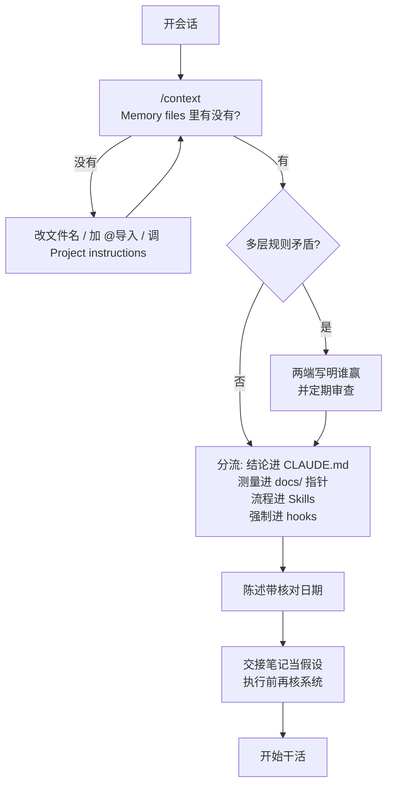

# 没加载进上下文的规则等于不存在

Claude Code

**一句话看懂**：Samuel Santana 在 2026-08-19 发现，写在父目录 `AGENTS.md` 里、自以为“全仓生效”的规则，从未进过任何 Claude Code 会话——当时工具读的是 `CLAUDE.md`。他把问题从「这工具读哪个文件名」换成「**本会话到底加载了哪些文件**」：用 `/context` 看 Memory files；多层 `CLAUDE.md` 是拼接不是覆盖；贵到不能不知的结论放进 always-load 并带理由与证据；必须成立的交给 hook；交接笔记当假设，系统状态才是事实。

## 读完你能带走的 7 条收获

1. **磁盘上有 ≠ 模型看见**：规则文件在仓里、写得很好，只要没进本会话上下文，就等于不存在（见 3.1）。
2. **先查加载，再猜文件名**：用 `/context` 的 Memory files；不在列表里，模型就看不见。文件名答案依赖版本、配置和碰巧读到的文档（见 3.1）。
3. **加载不是覆盖**：Claude Code 把沿路径找到的 `CLAUDE.md` 拼进上下文；矛盾时可能任意挑一边——两端都写明谁赢（见 3.2）。
4. **仓里有文档 ≠ 在上下文**：把贵到不能不知的结论搬进 always-load，附理由；测量与历史留在 `docs/`，指针写在 `CLAUDE.md`（见 3.3）。
5. **好规则带理由和可核对证据**：无理由易被仪式化或被似是而非论据冲掉；必须永远成立的放 hook / CI，不放上下文（见 3.4）。
6. **上下文文件是基础设施**：gitignore 后要有备份；陈述加核对日期；跨会话笔记是关于过去的假设，执行前先核对（见 3.5）。
7. **开局检查清单可交给代理本身**：`/context`、冲突三问、死指针 `git grep`、claim 带方法、强制项进 hook（见 3.6）。

::: tip 小白先懂这几个词
- [CLAUDE.md](/glossary#claude-md)：Claude Code 默认读入的项目规则 / 记忆文件；可从 cwd 向上多层加载。
- [AGENTS.md](/glossary#agents-md)：多工具通用的项目说明文件名；Claude Code 对它的读取有版本与条件（见 3.1）。
- [Context Engineering（上下文工程）](/glossary#context-engineering)：策展并维护推理时最优 token 集合，含提示词之外进窗的一切。
- [Skills](/glossary#skills)：按需加载的多步流程；未用时只占名称与描述。
- [Hooks](/glossary#hooks)：确定性钩子；用来强制“无论模型怎么想都不能做”的事。
- [Progressive Disclosure（渐进加载）](/glossary#progressive-disclosure)：先露索引 / 短描述，用到再读全文，省注意力预算。
- `/context`：Claude Code 命令，列出本会话已加载的 Memory files 等。
:::

## 1. 基本信息

<SourceCard type="文章" title="Context engineering in practice: what the agent doesn't load doesn't exist" author="Samuel Santana" date="2026-09-20" url="https://www.samuelsantana.dev/en/blog/context-engineering-in-practice-claude-md-memory-agents" />

| 项目 | 内容 |
|---|---|
| 链接 | https://www.samuelsantana.dev/en/blog/context-engineering-in-practice-claude-md-memory-agents |
| 类型 | 文章（个人工程博客） |
| 作者 | Samuel Santana |
| 发布日期 | 2026-09-20 |
| 使用工具 | Claude Code（`CLAUDE.md` / `AGENTS.md`、`/context`、auto memory、Skills、MCP；机制引用 2026-07～09 文档与 changelog） |
| 分析依据 | 原文全文（html→txt，2026-11-07）。引语、版本号 2.1.277、日期与配置名摘自正文；葡萄牙语规则句保留作者给出的原文。「我觉得」开头的段落是本站评论。与 [[20]] / [[116]] / [[125]] / [[107]] / [[28]] 对照：本文贡献是运维视角——先核实加载，再谈写什么。 |

## 2. 这篇在回答什么

2026-08-19，作者发现：自以为对所有仓库生效的规则，**从未**进过任何会话。它们写在放项目的父目录里的 `AGENTS.md`，标题还是 “Codex Custom Instructions for Developers”——他不用 Codex，用的是 Claude Code，而那时 Claude Code 读的是 `CLAUDE.md`。

::: tr 文件在磁盘上，写得很好，却在每一次会话的上下文之外。
> "The file was on disk, well written, and outside the context of every session."
:::

Anthropic 把 context engineering 说成策展并维护推理时最优 token 集合，<Trans zh="包括提示词之外可能落到那里的一切其他信息">"including all the other information that may land there outside of the prompts"</Trans>。作者这篇不讲零件说明书，而讲他怎么用这些零件、**以及什么地方坏了**。

主线回答五个问题：

1. 怎么确认规则真的进了本会话？
2. 多层指令是覆盖还是拼接，冲突怎么办？
3. always-load 放什么，文档 / Skills / hooks 各管什么？
4. 当上下文文件当基础设施时，gitignore、老化、交接笔记有哪些坑？
5. 今天开局该查哪几项？

## 3. 怎么做

### 3.1 换问题：用 `/context` 查加载，不要猜文件名

2026-08-18 归档的 Claude Code memory 页把话说死：

::: tr Claude Code 读 CLAUDE.md，不读 AGENTS.md。
> "Claude Code reads CLAUDE.md, not AGENTS.md."
:::

已有 `AGENTS.md` 时，建议另建一份导入它的 `CLAUDE.md`。诡异的是，作者在 Next.js 16.2.10 包内的 agents 指南里读到过相反概括：

::: tr 大多数 AI 编码代理——包括 Claude Code、Cursor、GitHub Copilot 等——在会话开始时会自动读取 AGENTS.md。
> "Most AI coding agents — including Claude Code, Cursor, GitHub Copilot, and others — automatically read AGENTS.md when they start a session"
:::

同页几行后又说 `create-next-app` 会生成含 `@AGENTS.md` 的 `CLAUDE.md`。若 Claude Code 自己就会读 `AGENTS.md`，导入就多余——**导入才是对的，那句概括不对**。他的 Next 项目没踩坑，是因为自 7 月 7 日起 `vertex-web` 的 `.claude/CLAUDE.md` 已经 `@../AGENTS.md`。父目录那份 `AGENTS.md` 却无人导入；8 月 19 日他改成 `D:\github\CLAUDE.md`——Claude Code 从工作目录向上加载 `CLAUDE.md`，父目录文件于是进入每个子仓会话。

两天后（文中“两天前”相对 9 月 20 日发布日，即 9 月 18 日）版本 **2.1.277** 开始读 `AGENTS.md`，条件才是关键：

::: tr 在没有 CLAUDE.md 的项目里，Claude Code 改为读取 AGENTS.md。
> "in a project with no CLAUDE.md, Claude Code reads AGENTS.md instead"
:::

同日文档：若工作目录或其上已有 `CLAUDE.md`、`.claude/CLAUDE.md` 或 `CLAUDE.local.md`，则 Claude Code 读那些并 <Trans zh="忽略每一个 AGENTS.md">"ignores every AGENTS.md"</Trans>。要两者都读，把 Project instructions 改成 `claude-md-and-agents-md`。于是：有自己 `CLAUDE.md` 的 `vertex-web` 会话，即使在新版本下也仍然吃不到那份父级 `AGENTS.md`；父目录本身再放一份 `CLAUDE.md` 后，默认设置下其下每个 `AGENTS.md` 都会被忽略。

教训不是「用对文件名」，而是把问题换掉：

::: tr 把「这个工具读哪个文件？」——答案依赖版本、配置和你碰巧读到的文档——换成「哪些文件进了本会话？」。
> swap the question "which file does this tool read?", whose answer depends on version, configuration and which documentation you happened to read, for "which files made it into this session?"
:::

文档在八月就给了命令：`/context`，看 Memory files。**不在列表里，模型就看不见。**

我觉得这句话该当成地基阶段的第一检查项：站内 [[125]] 讲多工具单源、[[116]] 讲怎么写有效 `AGENTS.md`，都默认「文件会被读到」；本文补上运维前提——先证明读到了。版本条件也提醒：写「Claude 读 X」必须带日期或版本，否则三个月后就是又一条老化陈述。

### 3.2 加载不是覆盖：拼接、冲突与两端写明

同一 memory 页的第二个细节，改变了「多层指令文件」的写法。Claude Code 找到的 `CLAUDE.md`：

::: tr 被拼接进上下文，而不是互相覆盖。
> "are concatenated into context rather than overriding each other"
:::

方向是从文件系统根到工作目录。`agents.md` 约定不同：monorepo 里 <Trans zh="最近的那一份优先">"the closest one takes precedence"</Trans>。文件名像，语义不像。

拼接之后两边都进模型；文档警告：若规则矛盾，<Trans zh="Claude 可能任意挑一边">"if two rules contradict each other, Claude may pick one arbitrarily"</Trans>。作者要的优先级，就**写在两端**：父文件用葡萄牙语声明每个仓自己的 `CLAUDE.md` 冲突时胜出；仓内文件顶部：

::: tr `D:\github\CLAUDE.md` 也适用。两者不一致时，以本文件为准。
> "`D:\github\CLAUDE.md` applies too. Where the two disagree, this file wins."
:::

粗暴：模型两份都读，正文自己说谁赢。更好是根本不要矛盾；文档建议定期复查——复查之前，写下的规则就是全部。

### 3.3 仓里有文档 ≠ 在上下文；always-load 放结论

8 月 21 日，做博客预渲染的会话用 “otherwise Google indexes the preview” 当论据。仓内 `docs/rendering-strategies.md` 已经测过并反驳：Vercel preview 在 SSO 后面，并带 `X-Robots-Tag: noindex`。文档在。它只是**不在上下文**——`docs/` 不会自己加载，`CLAUDE.md` 会。

答案不是「多读文档」，而是把结论搬进 always-load，并附上理由。今天 `vertex-web` 的 `CLAUDE.md` 写着：

::: tr 预览在 Vercel SSO 后面。……它们还带 `X-Robots-Tag: noindex`，所以「预览会被索引」在这里永远不是有效论据。
> - **Previews are behind Vercel SSO.** `curl` gets a 302 to `vercel.com/sso-api`. [...] They also carry
>   `X-Robots-Tag: noindex`, which is why "previews would get indexed" is never a valid argument here.
:::

这正是 Anthropic 文中 Claude Code 的混合模型：`CLAUDE.md`  upfront 朴素塞进上下文，glob / grep 则 just-in-time。前面放的是代理**不能不知**的；其余一指针之遥。作者分工：`CLAUDE.md` 承载贵到不能破的结论与规则，`docs/` 承载测量与历史，`CLAUDE.md` 写明动手前读哪份文档；一节标题是 “Rendering — read docs/rendering-strategies.md before touching a route”，下面再放结论短版，防没人打开长文。

为什么不把一切都塞进 always-load？因为上下文不免费。Anthropic 称之为 context rot：窗口里 token 越多，从中准确回忆的能力越差；模型有 attention budget，每个 token 都花一点。Claude Code 文档给出工作规则：每个 `CLAUDE.md` 目标 **200 行以下**，因为 <Trans zh="更长的文件消耗更多上下文并降低遵从度">"longer files consume more context and reduce adherence"</Trans>。拆成 `@import` 只整理结构、**不省** token——导入的文件启动时同样加载。作者坦白：公开研究测的是一般长输入，不是指令文件，他也没有自己的遵从度测量；带走的是方向——always-load 每一行都在和任务抢注意力。这与 [[20]]「只写每次都用得上的」、[[107]] 对上下文腐烂的讨论同向。

### 3.4 好规则带理由和证据；强制项放 hook

`vertex-web` 的 `CLAUDE.md` 有一节 “Rules that will bite”：违规已经付过代价的规则，每条带理由和证据。第一条：

::: tr 合并不等于发布。这里的 Vercel 未设自动 promote；合到 `main` 后由 Samuel 在控制台手推。……Vercel MCP 做不到——已核实：它能列出、检查、触发部署和改保护，但不能 promote。“Merged” 不是 “live”。
> - **Merging does not publish.** Vercel is not set to auto-promote here; after a merge to `main`,
>   Samuel promotes the deployment in the dashboard by hand. The Vercel MCP connector cannot do it —
>   verified: it lists, inspects, triggers deploys and changes protection, and does not promote.
>   "Merged" is not "live".
:::

另一条写 `useCurrentUser()` 是三态不是两态，并以代价收尾：header 里发生过两次，评论区差点再来一次。

理由不是装饰。文档说 `CLAUDE.md` 内容 <Trans zh="作为系统提示之后的用户消息投递">"is delivered as a user message after the system prompt"</Trans>，且没有 <Trans zh="严格遵从的保证">"guarantee of strict compliance"</Trans>（[[125]] 也钉过这句）。无理由的规则脆在两头：不该套的场合被当仪式执行，或一出现似是而非的论据就被丢掉。有了理由，模型和几周后的自己都能判断「这一案是否适用」。文档还要求指令 <Trans zh="具体到足以核对">"concrete enough to verify"</Trans>——“verified: it lists, inspects…” 正是做过的测试，免得后人重测。

必须无论模型怎么想都成立的，**不要依赖上下文**。Claude Code 把这些文件当作 <Trans zh="上下文，而不是强制配置">"as context, not enforced configuration"</Trans>；要挡住动作，文档指向 hook（见 [[28]]）。仓外同理：密钥进提交由 git hook + secretlint（经 husky / lint-staged）拦住——没有哪条指令能替代这件事。

### 3.5 基础设施：gitignore、老化陈述、交接假设

8 月 19 日作者决定：三个活跃仓里，`CLAUDE.md` 和 `docs/` 变为 gitignore 且不跟踪——代理指令与计划活在磁盘上，不在 GitHub。两个后果：

**立刻**：死指针。一仓二十处引用指向即将离开公开树的文件，三处出现在已发布 Storybook，包括一个指向 GitHub 上 `DESIGN.md`、会 404 的链接。逐条改成在用处自带推理；三条仓的 `CLAUDE.md` 都写入规则：评论里写 “see docs/x.md”，对 GitHub 读者就是死指针，**为什么**要写在使用点。

**延迟**（8 月 21 日）：三仓 `CLAUDE.md` 从磁盘消失。Git 不再备份，又没有替代。他从仓里可验证的内容重建 `vertex-web` 那份，并在文件开头声明：

::: tr 本文件于 21/08/2026 按仓库里可验证的内容重建。原件被 gitignore（PR #79）后从磁盘丢失——克隆不会恢复 git 不跟踪的东西，直到有会话去找它才有人发现。旧文件里凡无法从代码推导的都没了；下文对照源码、构建产物和 CI 配置核对过，不是凭记忆。
> **This file was rebuilt on 21/08/2026 from what is verifiable in the repository.** The original was
> gitignored (PR #79) and then lost from disk — a clone does not restore what git does not track, and
> nothing noticed until a session went looking for it. Anything the old file recorded that is *not*
> derivable from the code is gone; what follows was checked against the source, the build output and
> the CI config, not remembered.
:::

重建不了的，恰恰最值钱：无法从代码推导的坑、理由、非常规约定。文档从另一头说同一件事：`/doctor` 检查会 <Trans zh="砍掉 Claude 能从代码库推导的内容">"cuts content Claude can derive from the codebase"</Trans>，留下 pitfalls、rationale 和不同于工具默认的约定。上下文文件的价值部分**没有第二份拷贝**；离开 git，就要别处备份——作者把这记成未关闭的决策。

文件还会老化。父级 `CLAUDE.md` 曾写四个仓 “ainda têm AGENTS.md — não foram tocados”；git 显示其中三个在 8 月 19 日下午已删。句子到 9 月 7 日还在，会话原样加载；9 月 18 日才改正，并加上 <Trans zh="于 2026-09-18 核对">"Conferido em 18/09/2026"</Trans>。**日期值得抄**：告诉人或模型这条事实有多旧。Claude Code 的 auto memory 也在 frontmatter 的 `modified` 里记写入时间，因为 <Trans zh="时间戳表明事实有多新">"the timestamp shows how current the fact is"</Trans>。

跨会话只靠写下的东西。文档：<Trans zh="每个 Claude Code 会话都以全新上下文窗口开始">"Each Claude Code session begins with a fresh context window"</Trans>。作者除了 `CLAUDE.md`，还有 `GAPS.md`，用 “▶ RETOMAR AQUI” 分段、最新在上；父级 `CLAUDE.md` 第一节要求先读它。全文太大不必整进上下文，指令指向一节——自制版 structured note-taking。骨架含：本会话做了什么、已交付表、被代码推翻的假设、待办与责任人、以及 <Trans zh="于某日核实：用什么命令或响应头，而不是「以为如此」">Verified on &lt;date&gt;: &lt;how, with which command or header, not &quot;assumed&quot;&gt;</Trans>。

最有用的规则不在 `GAPS.md`，而在读它的指令正下方（原文葡萄牙语）：执行前先核对；8 月 19 日两项标成未完成的（Vercel 域名、Resend 域名验证）其实已经做好——**前会话写下的条目是关于过去的假设，不是当前状态**。两天后同一模式来自计划：预渲染计划的两条前提都被代码推翻；当天笔记总结为：夜里写下的计划是关于过去的假设，**以仓库为准**。笔记里写清核对方法（“verified in the Vercel build log and by HTTP header…”），几秒就能再核一次。

按需层简述：auto memory 的 `MEMORY.md` 前 200 行（或 25 KB）每会话进入，单条记忆按需读，作者在 correction / project 类记忆上加 Why 与 How to apply；多步流程进 Skills（未用只占名称与描述，即 progressive disclosure）；会话中途新加的 MCP 可能当次不可见、要下次才出现——写成开局查工具的一行；连接串与 API key **永不**进聊天或工具输出。

### 3.6 今天怎么查

不需要新工具，只需要查而不是以为：

| 检查 | 做法 |
|---|---|
| 开局加载 | `/context`：期望的文件是否都在 Memory files？依赖 `AGENTS.md` 时再看 `/config` 的 Project instructions |
| 指令被忽略 | 文件加载了吗？另一条是否矛盾？是否具体到可核对？ |
| 公开仓死指针 | PR 前：`git grep -nE "see docs/\|CLAUDE\.md\|AGENTS\.md" -- . ':!*.md' ':!.gitignore'` |
| 笔记与陈述 | 每条 claim 带日期与方法（“checked on” + 命令或响应头） |
| 必须成立 | 进 hook 或 CI，不进 `CLAUDE.md` |

为什么重要：模型只跟它看见的走，而且是以用户消息形式看见，**没有服从保证**。日常的 context engineering 少谈提示词文采，多谈运维——加载什么、顺序、冲突谁赢、什么按需、什么永不进、每条事实多旧。作者列的失败没有一条是模型能力问题：没加载的文件、没人读的文档、从磁盘消失的文件、老化的句子、其实已完成的待办——全是上下文，全都可以被「查而不是以为」抓住；那个「谁」也可以是代理本身，只要上下文告诉它去查。

## 4. 结果与局限

可核对的是作者自己的事故时间线与机制引用：未加载的父级 `AGENTS.md`、预览索引论据被仓内文档反驳、gitignore 后文件丢失并重建、老化句子带核对日期、以及文档中的拼接 / 200 行 / 原文 no "guarantee of strict compliance" 等表述。文中**没有**作者自己的遵从度 A/B，也没有大规模对照实验；Chroma 与 Lost in the Middle 被用作方向证据，并已自行加 caveat。

局限：

- 行为绑定 Claude Code 2026-07～09 的文档与 2.1.277；读 `AGENTS.md` 的条件可能再变，仍以 `/context` 为准。
- 「父目录一份 `CLAUDE.md` 喂所有子仓」在多工具、多作者仓要谨慎，易与 [[125]] 的单源策略打架，需团队约定。
- 把 `CLAUDE.md` / `docs/` 移出 git 是高风险取舍；没有备份仪式不要学表面动作。
- MCP「中途加入当次不可见」作者标为观察到的行为，不是产品规则。

## 5. 结论

没加载进上下文的规则等于不存在。先问本会话加载了什么，再问文件名该叫什么；拼接时把优先级写进正文；把贵结论放进 always-load 并附证据，把强制项放进 hook；把交接笔记当假设，把带日期的核对当习惯。上下文工程在日常里，是一门小运维。

**你可以这样试**

1. 下次开 Claude Code，第一件事跑 `/context`，对照你以为生效的 `CLAUDE.md` / `@导入` / 父目录文件，缺谁补谁。
2. 若同时有 `CLAUDE.md` 与 `AGENTS.md`，打开 `/config` 看 Project instructions；需要双读就显式打开 `claude-md-and-agents-md`。
3. 从最近一次代理「理直气壮说错」的论据里，抽出一条结论，写进 always-load，附理由与 “verified: …”；原文测量留在 `docs/` 并加指针。
4. 给每条易过期的事实加上「核对于 YYYY-MM-DD + 方法」；给交接文件加一句：前会话条目是假设，执行前再核系统。
5. 把「永不 / 必须」从规则文件挪到 hook 或 CI；PR 前跑一趟死指针 `git grep`。

**读完自测**

1. 你现在能指出：当前会话 Memory files 里有哪些指令文件吗？
2. 多层规则冲突时，是靠「谁近谁赢」的想象，还是正文写明了？
3. 仓里那份长文档，代理上次犯错时到底读过没有？
4. 若今天磁盘上的 `CLAUDE.md` 丢了，有没有第二份拷贝？
5. 交接里标成「待办」的项，是假设还是刚刚核对过的系统状态？
