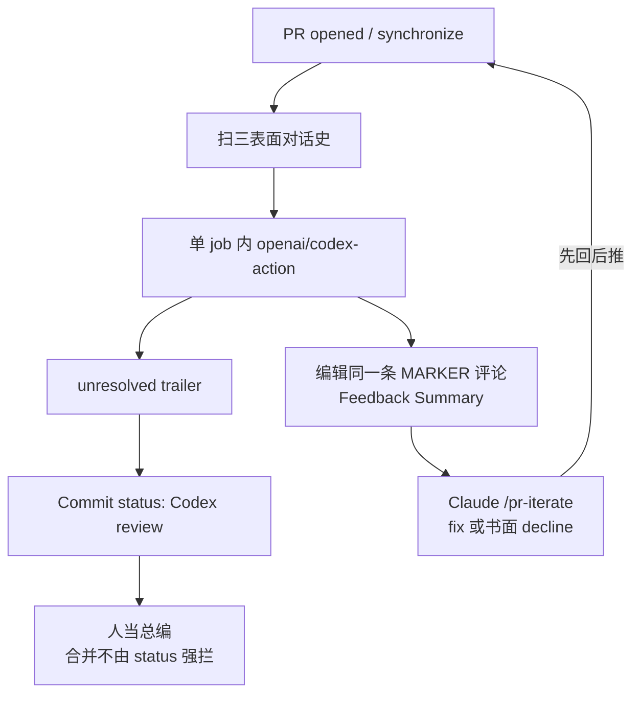

# 别让写代码的模型给自己打分

<div class="meta-tags"><span class="tool-tag tool-codex">Codex</span></div>

<div class="hook">

**一句话看懂**：Ruben Broekx 不让 Claude 给自己的 PR 打分——审查交给 **另一家厂的 Codex**，跑在 GitHub Actions 里。核心不是「再调一次模型」，而是审查合同：一张跨推送的 `Feedback Summary`、书面 decline 会被记下、机读行 `＜!-- codex-review: unresolved=N --＞` 驱动 commit status；单 job 躲开跨 job 输出被当密钥擦掉；作者侧 `/pr-open` · `/pr-iterate` · `/pr-babysit` 先回复再推送。人当总编，不读每一行 diff。

</div>

## 读完你能带走的 7 条收获

1. **自审最弱**：进了 diff 的幻觉对作者模型本就「说得通」；跨厂审查靠错误种类不相关，不靠「谁更强」（见 3.1）。
2. **模型调用只是一行**：可靠来自普通 CI——单 job、三表面对话、手动重试、concurrency 取消旧审、`/head` 检出（见 3.2）。
3. **一张 Feedback Summary 管生命周期**：编辑同一条评论，打开 PR 就能看到全历史（见 3.3）。
4. **书面拒绝算数**：作者写清 won't fix / 有意为之，审查标 resolved，不反复纠缠（见 3.3）。
5. **机读 trailer → commit status**：`unresolved=N` 解析成红/绿；作者故意非 blocking，合并仍人定（见 3.3）。
6. **两边都自动化**：作者三技能 +「先回后推」，队列里只剩 merge-ready（见 3.4）。
7. **钉死 model / effort，并当 PR 文本不可信**：默认会漂账单；fork 与同仓信任模型要先想清楚（见 3.2、3.4）。

::: tip 小白先懂这几个词
- [Code Review（代码审查）](/glossary#code-review)：读变更、找问题、决定能否合并；本文把第一轮自动化交给跨厂模型。
- GitHub Actions：PR 打开或推送时跑工作流；本文用它调 Codex 并写 commit status。
- Commit status：挂在具体 SHA 上的红/绿检查（如 `Codex review`）；可与「工作流跑没跑」分开。
- Feedback Summary：审查合同要求的生命周期表——Issue / Severity / Summary / Resolved，跨每次推送累积。
- Cross-provider review（跨厂审查）：写者与审查者来自不同模型厂，利用错误种类不相关。
- [Sandbox（沙箱）](/glossary#sandbox)：`codex-action` 侧另有旋钮；本文主线是审查合同与流水线，沙箱细节见 [[146]] / [[22]]。
:::

## 1. 基本信息

<SourceCard type="文章" title="Don't Let Claude Grade Its Own Homework" author="Ruben Broekx" date="2026-07-15" url="https://towardsdatascience.com/dont-let-claude-gaslight-you/" />

| 项目 | 内容 |
|---|---|
| 链接 | https://towardsdatascience.com/dont-let-claude-gaslight-you/ |
| 类型 | 文章（Towards Data Science，约 22 分钟） |
| 作者 | Ruben Broekx（Velta，Belgium） |
| 发布日期 | 2026-07-15（页面日期） |
| 使用工具 | OpenAI Codex via `openai/codex-action@v1`；作者侧 Claude Code skills；GitHub Actions |
| 分析依据 | 原文全文（html→txt，2026-11-07）。引语、yaml 片段与 30/95、NeurIPS 2024 等摘自正文；「我觉得」为本站评论。对照 [[142]]：本文增量是 **GHA 上的生命周期审查合同**（Feedback Summary、decline、unresolved trailer→status、单 job、作者 skills），不是本地 SHA 门闸。 |

## 2. 这篇在回答什么

作者用并行 Claude agents 写侧项目的 strategy 文件夹，开出的 PR「看起来很棒」：十份文档、交叉链接整齐。自动审查贴出发现后，Claude 当场认栽——文档链接指向**自己编造的文件名**。全量一查：95 个相对链接里 **30** 个落空。人扫一眼几乎都会过，因为每个名字都「像那么回事」；审查器解析链接，不靠 vibes。

主线四个问题：

1. 为什么不能靠自审，而要跨厂第二意见？
2. 怎样用普通 CI 工程包住这一次 Codex 调用？
3. 审查合同如何记住历史、尊重拒绝、并变成 status？
4. 作者代理怎样接招，让人队列只见 merge-ready？



## 3. 怎么做

### 3.1 跨厂审查：别跟作者共用盲点

幻觉一直存在；变了的是**吞吐**。一人多会话，千行 diff 趁倒咖啡就出来。人成了瓶颈，团队在两种失败模式间摇摆：不读就批，或每行必读。

自审是最弱的一招：

::: tr 进入 diff 的幻觉，对产生它的模型来说，按定义就是说得通的。让同一套权重去找代码里的错——尤其还在已经有偏的同一次编码会话里——通常只会复现当初放过错误的那些盲点。
> "A hallucination that made it into the diff is, by definition, plausible to the model that produced it. Asking the same weights to find mistakes in the code, especially within the same already-biased coding session, usually reproduces the exact blind spots that let the mistakes through."
:::

研究侧，作者引用 Panickssery 等 NeurIPS 2024：LLM 评估者会识别并偏爱自己的生成；后续工作把这种自偏好连到熟悉性——对模型来说，没有比它刚写过的文本更「可预期」的了。

不同厂训练数据、配方和反馈环不同，错误种类不相关——这才是审查要买的东西。作者写：用了这套一年，Codex 持续标出 Claude 自审眨眼放过的问题（编造文件名、与需求无关的代码块、直接的安全违规）。

两句不能推出的话他也钉死了：不能因此把键盘交给 Codex（它也常 misfire，只是方向不同）；也不能盲信审查（审查里也有幻觉，当 advisory，作者可书面反驳）。

我觉得这和 [[142]]「一人写、一人只读审」同方向，但论据从「角色硬拆」推进到「厂级 decorrelation」——写审分工不够时，至少别同厂同权重打分。

### 3.2 普通 CI 工程包住一次 Codex 调用

概念上审查可以是一行：「here is the code diff, please review it」。OpenAI 有托管 GitHub 审查集成，Anthropic 有 `claude-code-action`；作者要自管 prompt、审查生命周期、合并门控和模型钉死，所以仓库里放两份文件：

```text
.github/
├── workflows/pr.yml
└── actions/codex-pr-review/action.yml
```

中心一步仍是：

```yaml
- uses: openai/codex-action@v1
  with:
    openai-api-key: ${{ inputs.openai-api-key }}
    prompt: |
      # the review contract…
```

周围每一行几乎都是踩坑换来的：

**一切放在同一个 job。** Action README 的两 job 例（一跑 Codex、经 job output 传审查，二发帖）作者照做后，审查开始空到达。原因是：GitHub **拒绝传递任何包含已登记密钥子串的 job output**（日志里只有一行警告），且误报极多——多数长得像 hash 的字符串都会中招，包括 Codex 报告里的占位符。被擦掉的往往是审查正文；「密钥」仍在第一 job 日志里明文可见。单 job 绕开这场检查。这和 [[22]] / [[146]] 主张的「密钥与写权限拆两 job」解决的是**不同问题**——见 [[146§3.3]] 对照。

**对话扫三个表面。** Issue 评论、review 摘要、inline 评论是三套 API；按时间序原文交给 Codex。长命 PR 历史会胀，极端时要裁剪或摘要。

**缺密钥快失败、手动两尝试、最小权限。** Secrets 不随 yml 走；缺 `OPENAI_API_KEY` 给一行错，而不是沉进 action 深处。`uses:` 步骤包不了通用 retry，所以 `continue-on-error` 第一次 + 失败再等 20 秒跑第二次；选输出时看 outcome，避免吃到半截失败的残留。Token 只能读代码、发评论、设 status——不能 push、approve、merge。

**检出钉 `refs/pull/N/head`。** Merge ref 异步物化，快触发会 race；`/head` 随每次推送同步更新。随后 pre-fetch base 与 head，让 Codex 自己跑 git diff。

**Concurrency 取消过时审查。** `cancel-in-progress: true`，group 钉 PR 号——代理连推三次修复时，不买三份审查：

```yaml
concurrency:
  group: pr-reviewer-${{ github.event.pull_request.number }}
  cancel-in-progress: true
```

**钉 model 与 effort。** `model` 可选；留空等于「Codex 当前默认」。作者账单上吃过默默漂到更贵模型（`gpt-5.5`）的亏；成文时钉 `gpt-5.3-codex`（页面已标 deprecated，API 仍可用），effort 取 `medium`——issues-per-dollar 与 issues-per-minute 的甜点。更高 effort 多抓一点、贵且慢，而审查嵌在 iterate 环里，延迟会按轮次相乘。

::: tr 模型调用是容易的那部分。审查器的可靠性来自它周围的普通 CI 工程。
> "the model call is the easy part. Reviewer reliability comes from ordinary CI engineering around it."
:::

### 3.3 有记忆的审查：表、拒绝、机读行

多数 AI 审查是路过评论：对某一瞬间 diff 的瞬时意见，每次推送再堆一堵墙。作者把差别写进 prompt 合同：

- 一节 `## Feedback Summary`：表跟踪本 PR **一生**所有反馈（列：`Issue`、`Severity`、`Summary`、`Resolved`），✅ / ❌，按严重度排、未解决在前。
- 一节 `## Open Issues`：仅未解决项，各有 Issue / Proposed fix / Related files。
- 结尾**必须**有一行：`` ＜!-- codex-review: unresolved=N, high=M --＞ ``（N=0 也要），CI 解析进 status。

三项设计：

1. **有状态。** 加上工作流「带 MARKER 的评论原地编辑」，PR 上只有一份审查产物，反映全生命周期。
2. **拒绝生效。** Codex 读完整对话；维护者书面拒绝（won't fix、有意、超范围）则标 resolved，附一行理由，**不要再提**——除非后续改动推翻了理由。假阳性的成本变成一条书面回复，而不是唠叨循环。
3. **机读结论。** Trailer 变成 `Codex review` commit status：未解决 → failure；全解决或显式拒绝 → success；缺 trailer 当作「审查已贴出」，永不当成零 finding。作者**故意不 blocking**：status 只告知，合并不合仍是人的。

容量 grid 一例：第一轮 High「超 batch cap 静默丢格」+ Medium「cap 应进 app config」，status 红。Claude 用自适应 batch 修了 High，并在评论里拒绝 Medium——真 cap 在数据库托管 API 设置里，镜像进 app config 会多一个会漂的真相源。再审：两行 ✅，`unresolved=0`。第二行就是整套机制的缩影：**没有为了消音去改代码，理由进了 PR 史。**

::: tr 结构胜过审查器里的原始模型质量。一张生命周期表、一条拒绝规则，外加机读结论，把自由发挥的 LLM 意见变成带书面反驳机制的合并门闸，让假阳性变便宜。
> "Structure beats raw model quality in a reviewer. A lifecycle table, a decline rule, and a machine-readable verdict turn free-form LLM opinions into a merge gate with a mechanism for written pushback that makes false positives cheap."
:::

### 3.4 作者侧闭环：三技能与「先回后推」

审查只是一半。另一半是教作者代理怎么接招，否则往返又变成人肉瓶颈。作者在 `.claude/skills/` 下放三个 markdown 技能：

| 技能 | 做什么 |
|---|---|
| `/pr-open` | 分析分支提交、本地验证、写诚实 title/body、对准 base。Body 是审查对照的「意图声明」——写全需求并挂 Linear。 |
| `/pr-iterate` | 扫三表面；每条归为修复 / 附理由拒绝 / 延期；修复本地验证；拒绝变成 PR 评论。「够好可合」在范围满足时合法。 |
| `/pr-babysit` | 看 CI、修红、有新反馈就 iterate，直到全绿且每条已修或已拒；终点 merge-ready。同一根因红两次则停下来报告，不乒乓提交。 |

**排序铁律：先回复，再推送。** 审查在每次推送时启动，用的是那一瞬存在的上下文。还没写下的 decline / 修复摘要，对这一轮等于不存在，审查会高高兴兴把看不见回应的项再提一遍。

人变成总编：读审查、裁两模型偶发对峙、把标准写进 prompt。两模型同意，PR 大概行；不同意，分歧本身就是对准该看代码的指针。懒日可凭 trail 合绿 PR；仔细日读表并抽查 declines——「无论哪种，没有任何东西只凭一个模型的自信说法到达合并按钮。」

账本上还几条：对**将接收合并的 base** 审（他的 PR 对 `dev`）；feature 分支与 base 同步，否则审出「PR 没做过的变更」；直推 `dev`/`main` 绕过整套机制；PR body、对话、代码皆 prompt-injection 面——最小权限收 GitHub 侧爆破半径，`codex-action` 有 sandbox / safety-strategy；**fork 来的 PR 工作流拿不到 secrets**，这套默认假定同仓可信贡献者，开源前先审信任模型。

## 4. 结果与局限

可核对的主要是作者自报：30/95 断链一例、一年「Codex 常抓住 Claude 自审放过的问题」的经验叙述、以及容量 grid 前后 Feedback Summary。文中**没有**精确率 / 召回或对照实验数字；NeurIPS 自偏好是引用，不是作者复现。

局限：

- Status 非 blocking——纪律一半仍在人；胡写的 decline 也能把表刷绿。
- 单 job 换来「审查过得了边界」，但写权限与密钥仍在同一 job 生命周期里；若威胁模型更怕密钥泄露，要回到 [[22]] / [[146]] 的拆分，并小心 job output blanking。
- 对话史胀、模型钉死要维护、effort 权衡无银弹。
- 信任模型偏同仓；开源 fork 不能照搬。
- 与 [[140]]「开 PR 前自审 + 收据」可叠：跨厂 CI 审不替代工作树里的证明。

## 5. 结论

代理吞吐把「人读每一行」判了死刑；自审又买不回诚实。Broekx 的答案是跨厂第二意见，外加把意见收成**有记忆、可拒绝、可机读**的合同，两边代理一起把 PR 推到 merge-ready，人只做总编。

**你可以这样试**

1. 仓库加 composite action：钉 `model` / `effort: medium`，prompt 强制 Feedback Summary + Open Issues + unresolved trailer。
2. `pr.yml` 单 job：扫三表面 → Codex（可两尝试）→ 编辑 MARKER 评论 → 解析 trailer 写 `Codex review` status；加 concurrency 取消。
3. 作者侧加 `/pr-open` · `/pr-iterate` · `/pr-babysit`；纪律写进技能：**先评论 decline/修复说明，再 push**。
4. Status 先非 blocking 跑一周，抽查 decline 质量，再决定要不要升门禁。
5. 开源或接受 fork 前，重画信任模型；需要密钥与写权硬拆时对照 [[146]]。

**读完自测**

1. 你的 AI 审查是同厂自审，还是跨厂第二意见？
2. PR 上是一堵过时评论墙，还是一张生命周期表？
3. 作者拒绝一条 finding 之后，下一轮还会不会原样杀回？
4. `unresolved` 有没有变成看得到的 commit status？缺 trailer 时你当成什么？
5. 上一次 iterate，是先回了评论再推，还是推完才解释？
