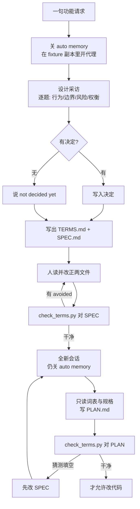

# 先让代理采访你，再写规格和计划

<div class="meta-tags"><span class="tool-tag tool-claude">Claude Code</span></div>

<div class="hook">

**一句话看懂**：Schuberg Philis 的培训课用一个听起来清楚的请求——「把 to-do 列表整理一下，做完的别挡眼，但我还想看上个月完成了什么」——演示：动手前先让编码代理采访你。你用决策或 “not decided yet” 作答；代理写出 `TERMS.md`（词 + 含义 + 避免用词）与 `SPEC.md`；`check_terms.py` 抓规格里的漂移词；再开**全新会话**（关掉 auto memory）只根据规格写 `PLAN.md`。词表共享之后，计划与代码才站得住。

</div>

## 读完你能带走的 7 条收获

1. **听起来清楚 ≠ 可建造**：一句请求里的词常有两义（tidy 是已有的 `clear`，还是挪到仍可读处？）；采访在改还便宜时挖出未做决定（见 3.1）。
2. **设计采访在计划与写码之前**：逐题问行为、边界、风险、权衡；跳过代码可读的；一词两义就问哪个意思；结束时写词表与规格（见 3.2）。
3. **不会就说 not decided yet**：为赶进度编出来的答案会变成需求；未决进 SPEC 的 Open questions（见 3.2）。
4. **共享词表先于规格**：每个术语一行含义 + Avoid；对话、规格、计划、代码用同一套词（见 3.3）。
5. **用脚本对照词表**：`check_terms.py` 抓 avoided words；漂移时读整行——有时是笔误，有时是决定写拧了（见 3.3）。
6. **计划在全新会话写**：上下文只有规格与词表，没有长采访；auto memory 要关，免得采访笔记漏进「无记忆」会话（见 3.4）。
7. **改词 = 改设计**：词表与规格一起改；计划里的猜测先回写规格（见 3.3、3.4）。

::: tip 小白先懂这几个词
- [AskUserQuestion](/glossary#ask-user-question)：Claude Code 用来向你逐题提问的工具；请求里点名它，采访更稳。
- [Spec（需求规格说明）](/glossary#spec)：写清行为与开放问题的规格；本文要求只用词表里的词。
- [Plan Mode（计划模式）](/glossary#plan-mode)：先出计划再改代码；本文强调计划会话与采访会话分开。
- TERMS.md（本课）：功能的共享词表——每个词的含义，以及要避免的近义词。
- Shared vocabulary / Ubiquitous Language：对话、文档、代码用同一套词；本课取自领域驱动设计里的这一条。
- Auto memory：Claude Code 默认把代理自写笔记带进同项目下一会话；本课要求关掉。
:::

## 1. 基本信息

<SourceCard type="指南" title="Let the agent interview you" author="Schuberg Philis AI Training" date="2026-10-07" url="https://schubergphilis.github.io/ai-training/coding-with-agents/agent-interviews-you/" />

| 项目 | 内容 |
|---|---|
| 链接 | https://schubergphilis.github.io/ai-training/coding-with-agents/agent-interviews-you/ |
| 类型 | 指南（AI Training 公开课「Coding with agents → Deciding and specifying」一课） |
| 作者 | Schuberg Philis AI Training（页脚注明 Content co-authored by AI） |
| 发布日期 | 2026-10-07（Sources checked on / Last updated） |
| 使用工具 | Claude Code（`AskUserQuestion`、auto memory 开关）；附 `check_terms.py` 与 to-do fixture |
| 分析依据 | 原文全文（html→txt，2026-11-07）。采访示例标注为 illustrative、非真实转录；命令与 `check_terms.py` 输出摘自正文（CI 核实）。「我觉得」开头为本站评论。与 [[03]] / [[64]] / [[96]] / [[135]] / [[84]] 对照：本文把词表 + 机器检查 + fresh session 写计划收成可跟练流程。 |

## 2. 这篇在回答什么

同事丢来一句改动：

::: tr 做完的项把列表弄乱了。你能整理一下吗？我还想看见上个月完成了什么。
> "Done items clutter the list. Can you tidy it? I still want to see what I finished last month."
:::

听起来清楚，动手才发现问题：<Trans zh="tidy">"tidy"</Trans> 是程序已有的 `clear`（删除所有 done 项），还是把它们挪到仍可读的地方？本课不急着写计划，而是让代理先采访你，一起把设计用词敲定；最后用同一套词检查规格，再让**没见过采访**的新会话写计划。

Claude Code 最佳实践也建议：较大功能上，代理先采访你并写规格，再由新会话按规格施工。代理的问题把你还没做的决定拽出来——此时改它们还便宜。上一课「到底要不要做」结束于陌生人可核对的成功标准；那些标准只有在你知道功能**是什么**之后才写得出来。

主线四个问题：

1. 为什么「听起来清楚」的请求仍要采访？
2. 设计采访怎么开、怎么答？
3. 词表与规格怎么写、怎么用脚本验？
4. 为什么计划必须在全新会话、且关掉 auto memory？



## 3. 怎么做

### 3.1 为什么「听起来清楚」不够

Fixture 是课程里 to-do 程序数周后的版本：已有 `clear`，拆成三个模块。整课目录复制到别处再干活——重置就是删掉再复制；也避免课程仓库上层的指令文件进会话（Claude Code 会加载启动目录之上每一层的指令文件）。

先看列表：四项里两项 done。`python3 todo.py clear` 会删掉它们，同事却要保留。**tidy 与 clear 之间的缝，就是采访该抓住的第一件事。**

我觉得这和 [[84]]「计划里未说清的假设」、[[135]]「先问再计划」是同一类风险：代理优化的是「交出一个 diff」，不是「交出我们同意含义的那个 diff」。差别在于本课把歧义收成**可机器检查的词表**，而不仅是门闸口头约定。

### 3.2 设计采访：怎么问、怎么答

设计采访 = 代理问、你答；发生在任何计划或改码之前。在 `fixture-repo` 里启动代理（见下节关 memory），给一段短描述，并规定停手条件与产物：

::: tr 我想要一种整理 to-do 列表的办法。做完的项把列表弄乱了，但我还需要看见上个月完成了什么。在你计划任何事或改任何代码之前，就这个功能采访我。一次只问一个问题。问它该怎么表现、边界情况、可能出什么错、以及权衡；不要问你能从代码里查到的事。当一个词可能指两件不同的事时，问我指的是哪一个。一直问到没有未决点。然后写 TERMS.md，每行一个术语，形式为 “- **term**: meaning. Avoid: word, word.”，再写 SPEC.md，并且只用那些术语。把我留下未决的放进 SPEC.md 的 “Open questions”。
> I want a way to tidy the to-do list. Done items clutter it, but I still need to see what I finished last month. Before you plan anything or change any code, interview me about this feature. Ask one question at a time. Ask about how it should behave, the edge cases, what could go wrong, and the trade-offs, and don't ask what you can find out from the code. When a word could mean two different things, ask me which one I mean. Keep going until nothing is open. Then write TERMS.md, one line per term in the form "- **term**: meaning. Avoid: word, word.", and SPEC.md, which uses only those terms. Put what I left undecided under "Open questions" in SPEC.md.
:::

在 Claude Code 里，最佳实践建议在请求中点名 `AskUserQuestion`（与 [[03]] 同技）；代理就通过该工具提问。别的代理则在聊天里问。

课里的来回是 **illustrative**（为课文编写，非模型实录）。第一问就钉住双关：

::: tr 程序已经有 `clear`，会删除每一个做完的项。你说的 “tidy”，是指 `clear`，还是应该把做完的项挪到你以后还能读到的地方？
> "The program already has `clear`, which deletes every done item. When you say “tidy”, do you mean `clear`, or should the done items move somewhere you can still read them later?"
:::

你答：挪走，放到自己的文件，叫 “archive”；`clear` 保持原样——删除，且不碰 archive。第二问才是你可能采访前没想过的：归档项保留原编号，还是列表把未完成项重新从 1 编号？

**答题规则**：每一问用一个决定回答；没有决定就说 <Trans zh="尚未决定">"not decided yet"</Trans>，代理把它列入开放问题。

反面教材：代理问归档项要不要记录归档日期，工程师想赶去写码，随口 <Trans zh="要，加上日期">"yes, add the date"</Trans>。规格里立刻多出日期字段、格式与时区；新会话照建；`archive list` 多出一列没人要过，diff 大了一倍。规则：

::: tr 你为了往下推进而编出来的答案，会变成代理去实现的需求。
> "an answer you make up to move on becomes a requirement the agent builds."
:::

说 “not decided yet”，规格就只列出开放点。课内自测也钉死：没想过「列表超过 20 个 done 是否自动 archive」时，正确回答是未决，而不是 “Yes” / “You decide” / “别问了写规格”。

### 3.3 TERMS.md、SPEC.md 与 `check_terms.py`

采访中词会漂：你说 “done”，代理说 “completed”，规格再说 “finished”。对说话的人每个词都清楚；对**没参加采访**的新会话，三个词像一个还是三个东西，只能猜——有些猜是错的。

办法是共享词表：功能里每个术语一个约定含义，写下来，并在对话、规格、计划、代码里同样使用。念头来自领域驱动设计里的 Ubiquitous Language（Evans）：言语、书写与代码用同一语言；语言一变，设计就算变。本课只取短列表：白话含义 + 要避免的词。

`sample/TERMS.md` 长这样：

::: tr （词表样例）item = 列表一行及其正文与完成标记，避免 task/tasks/entry/entries；done item = 标成 done 的项，避免 completed/finished；archive = 把每个 done item 从列表移到 archive.json 并由 archive list 展示，避免 hide/hides/hidden；clear = 永久删除列表上每个 done item，永不碰 archive.json，避免 purge/wipe。
> - ** item ** : one line of the to-do list, with its text and its done mark. Avoid: task, tasks, entry, entries.
> - ** done item ** : an item marked with `done` . Avoid: completed, finished.
> - ** archive ** : move every done item from the list to `archive.json` , where `archive list` shows it. Avoid: hide, hides, hidden.
> - ** clear ** : delete every done item from the list for good. It never touches `archive.json` . Avoid: purge, wipe.
:::

Avoid 里的词，是采访里冒出来的同义说法，或容易混淆的另一件事。“Hide” 在列：因为 hidden 项仍在 `todos.json`，archived 的不在。

`check_terms.py` 读词表，打印另一文件里用了 avoided word 的每一行；整词匹配、忽略大小写。采访会话留在原终端，另开终端从复制根目录跑：

```bash
python3 check_terms.py sample/TERMS.md sample/SPEC.md
```

样例输出（CI 核实）：

```text
sample/SPEC.md:15: "task" where sample/TERMS.md says "item"
sample/SPEC.md:16: "completed" where sample/TERMS.md says "done item"
2 words to check
```

第 15 行是笔误（“the text of each task” → item）。第 16 行不仅词错，整句还与词表矛盾——它写 `clear` 会清空 `archive.json`，词表却说 `clear` 永不碰 archive。**漂移词有时是笔误，有时是采访决定的一件事、规格写成了另一件**——每次读整行。课内选择：不是把 “completed” 并进定义糊弄过去，也不是只改一个词再跑到绿；而是对照词表与代理敲定 `clear` 做什么，再重写那一行。修好后应得到：

```text
no avoided words in sample/SPEC.md
```

自己的采访同样：先读改 `TERMS.md` 与 `SPEC.md`，再往下走。此后改名是改设计——词表与规格一起改。归位直觉：词的含义 → TERMS；已决行为 → SPEC 正文；未决 → SPEC Open questions。

### 3.4 全新会话写 PLAN.md，并关掉 auto memory

最佳实践建议由新会话执行规格，因为它的上下文里只有工作、**没有**长采访。计划也在新会话写。结束采访 → 在 `fixture-repo` 再开一局 → 只读两文件写计划、先别改码：

::: tr 阅读 TERMS.md 和 SPEC.md。按 SPEC.md 描述的内容写 PLAN.md，步骤里使用 TERMS.md 中的术语，不要用别的词指称它们。先不要改任何代码。
> "Read TERMS.md and SPEC.md. Write PLAN.md with the steps to build what SPEC.md describes, using the terms in TERMS.md and no other words for them. Don't change any code yet."
:::

再对计划跑检查：

```bash
python3 check_terms.py fixture-repo/TERMS.md fixture-repo/PLAN.md
```

计划里出现 avoided word，只有两类：笔误（改词），或规格留空、计划用猜测填上——第二种先改规格。

**为什么必须关 auto memory**：Claude Code 本地会话默认开；笔记按 git 仓（或非 git 时的项目根）存放，会进同项目下一会话。采访笔记若漏进「本该两手空空」的计划会话，fresh 就名存实亡；同路径重置副本也会再次加载旧笔记。本课每次启动：

```bash
CLAUDE_CODE_DISABLE_AUTO_MEMORY=1 claude
```

（先 `cd` 进 `fixture-repo`，因为该命令在你运行时所在目录启动代理。）别的代理：查清它是否在会话间留笔记，本课同样关掉。

从请求到计划的顺序（课内排序题）：

1. 先让代理就功能采访你，任何计划之前  
2. 每题用决定回答，或 “not decided yet”  
3. 让代理写词表与规格  
4. 人读并改正两文件  
5. 全新会话按规格写计划  
6. 对照词表检查计划  

规格里同时出现 archive 与 hide、词表却只定义了 archive 时：新会话**不得不猜**两词是不是一件事，有些猜会错——它问不了你（除非你另开采访），因为它从未见过采访。诚实作答的自测：已决定的（归档到 `archive.json`、未完成项保序）照实说；日期尚未有看法就 <Trans zh="尚未决定。把日期列进开放问题。">"Not decided yet. List the date under the open questions."</Trans>——不要 “Sure, … whatever is easiest” 或 “Use your own judgment”。

练习建议：就 `done` 的撤销（误敲 `done 3`）再跑一遍；约二十分钟。好结果：至少一问是你没想到的；`TERMS.md` 三到六个词；规格列出至少一条开放问题，或说明为何没有；规格与计划都打印 `no avoided words`。若打印 `no terms found` / `not in the term form`，让代理按请求里的行格式重写词表。Stretch：按计划改码后再对改过的模块跑 `check_terms.py`，看代码命名是否也跟词表走。

## 4. 结果与局限

本课是可跟练的培训材料，不是生产仓度量报告。可核对的产出是：fixture 与脚本路径、CI 核实过的 `list` / `check_terms` 样例输出、以及明确标注为 illustrative 的采访对话。页脚写 Sources checked on October 7, 2026；Content co-authored by AI。

局限：

- 示例对话非真实转录，不能当「模型一定会先问 tidy vs clear」的证据；它示范的是**请求应逼出的问题类型**。
- `check_terms.py` 只抓 avoided 整词，不理解语义矛盾的全部种类——第 16 行那种「词错 + 行为写反」仍要人读整行。
- 流程绑定「词表行格式」；格式一漂，脚本报 `no terms found`，要打回重写。
- 关 auto memory、工作在复制目录，是为了课的可重复性；团队日常是否关 memory，要另做取舍。

## 5. 结论

大于一句话的功能，先让代理采访你，再写规格和计划。答案只许是决定或 “not decided yet”；词写进短词表并在规格、计划、代码里复用；用脚本抓漂移；计划交给没见过采访的会话。设计在共享用词里定稿之后，代理再提议怎么建。

**你可以这样试**

1. 下一句以上的功能请求，粘贴本课采访 prompt（点名 `AskUserQuestion`），声明未决进 Open questions。
2. 约定 `TERMS.md` 行格式与 Avoid 列；SPEC / PLAN 只用词表词。
3. 把 `check_terms.py`（或同等整词检查）接进本地习惯：改 SPEC / PLAN 后必跑。
4. 计划会话单独开，并关掉会把采访笔记带过去的 memory。
5. 回顾：哪一问挖出了你没想过的决定？若从未问过，代理会建成什么样？

**读完自测**

1. 你最近一个「听起来清楚」的请求，争议词是什么？采访第一问该问什么？
2. 未想过的细节，你是说了 “not decided yet”，还是随口编了个答案？
3. 规格与计划是否用同一套词？有没有脚本在抓 Avoid？
4. 写计划的会话，上下文里是否还残留采访对话或 auto memory？
5. 改一个术语时，你改了词表也改了规格吗？
