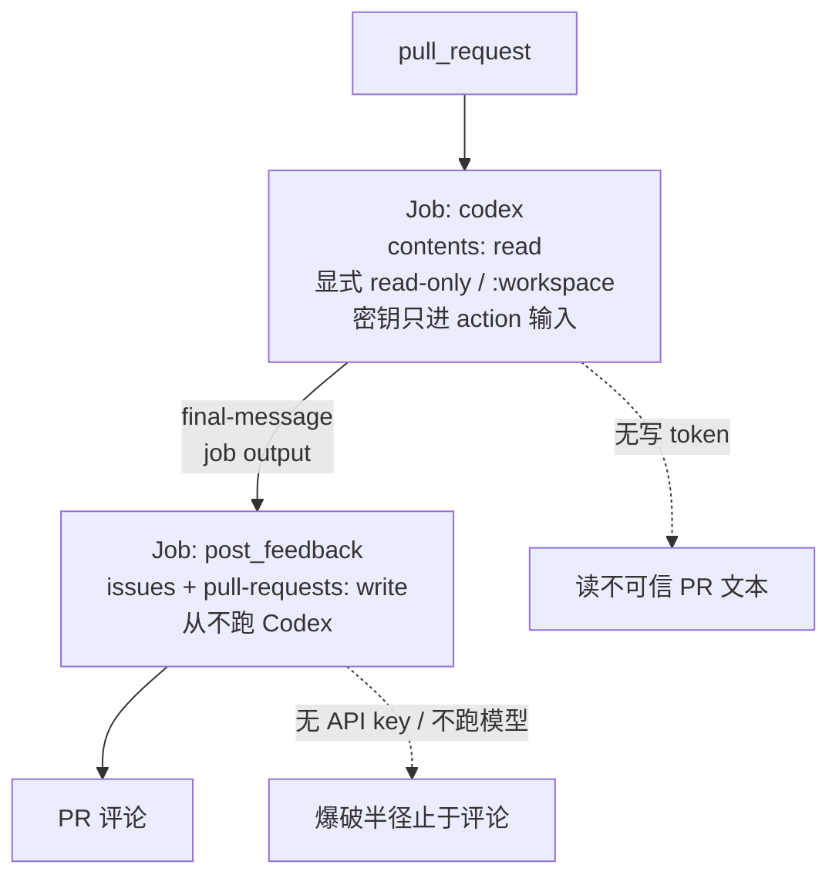

# Codex 进 CI：只读沙箱与双作业权限拆分

<div class="meta-tags"><span class="tool-tag tool-codex">Codex</span></div>

<div class="hook">

**一句话看懂**：Atlas 把官方文档收成一条 CI 安全清单——`codex exec` **默认只读**，但 `openai/codex-action` 若既不设 `sandbox` 也不设 `permission-profile`，会走 legacy **`workspace-write`**；API key 绝不能进「跑仓库代码」的 job 级 `env`；PR 审查拆成只读跑 Codex 的 job 与持写权限发评论的 job；`drop-sudo` 是默认护密钥手段，自托管复用 runner 上会持久。文末推销 Atlas 产品，本站只标一句事实。

</div>

## 读完你能带走的 7 条收获

1. **CLI 与 Action 默认不同**：`codex exec` 默认 read-only；Action 未显式设置时是 workspace-write——必须自己写上（见 3.1）。
2. **密钥只给需要的那一步**：永不把 `OPENAI_API_KEY` / `CODEX_API_KEY` 设成跑仓库控制代码的 job 级环境变量（见 3.2）。
3. **审查拆两 job**：读不可信 PR 文本的一侧只有 `contents: read`；有写 token 的一侧从不跑 Codex（见 3.3）。
4. **`drop-sudo` 默认护的是内存里的密钥**：撤 sudo、Linux 上挡 Docker 等 socket；自托管会持久 → disposable runner，Action 放末步（见 3.2）。
5. **`safety-strategy: read-only` 不护密钥**：文件改不了，进程内存仍可能读到经 proxy 的 key（见 3.2）。
6. **触发名单无 bot 通配符**：`allow-bots` / `allow-bot-users` 要逐个列；调 prompt 期间钉 `codex-version`（见 3.4）。
7. **PR title/body 当数据，不当指令**：prompt-file 进仓可审；先只读跑一周再给写权（见 3.3、3.4）。

::: tip 小白先懂这几个词
- [`codex exec`](/glossary#codex-exec)：无交互跑一轮 Codex；进度去 stderr，终消息去 stdout。
- [Sandbox（沙箱）](/glossary#sandbox)：`read-only` / `workspace-write` / `danger-full-access`；Action 还可用 `permission-profile`（与 sandbox 互斥）。
- `drop-sudo`：Action 默认 safety-strategy——跑前撤默认用户 sudo，降低提权读内存密钥的能力。
- Two-job review：一 job 只读跑审查，另一 job 持 `issues`/`pull-requests` 写权限发评论。
- [Prompt Injection（提示词注入）](/glossary#prompt-injection)：PR 标题、正文、对话皆不可信输入面。
:::

## 1. 基本信息

<SourceCard type="文章" title="Codex in CI: codex exec and the GitHub Action" author="Atlas" date="2026-10-31" url="https://bridge-terminal.com/atlas/blog/codex-exec-github-action-ci-review/" />

| 项目 | 内容 |
|---|---|
| 链接 | https://bridge-terminal.com/atlas/blog/codex-exec-github-action-ci-review/ |
| 类型 | 文章（Atlas 产品博客 · Technical How-to，约 6 分钟） |
| 作者 | Atlas（页面无个人署名；文末称独立产品，与 Anthropic / OpenAI 无隶属） |
| 发布日期 | 2026-10-31 |
| 使用工具 | Codex CLI（`codex exec`）、`openai/codex-action@v1`、GitHub Actions |
| 分析依据 | 原文全文（2026-11-07）。技术主张与命令摘自正文，并对照其列出的官方文档链接方向；文末产品 CTA 仅作事实标注。「我觉得」为本站评论。对照 [[22]]：本文更强调 **CLI vs Action 默认差**、**审查场景的读写拆分**、**allow-bots 无通配**；对照 [[144]]：单 job（躲 output blanking）与两 job（躲密钥/写权同域）解决不同威胁。页面写 Researched and drafted with Claude，再对源核对。 |

## 2. 这篇在回答什么

要把 Codex 接进 CI，文档路径已经清楚：非交互用 `codex exec`，GitHub 上优先用 `openai/codex-action`。真正翻车的地方往往是**默认值**和**权限叠层**——你以为只读，Action 却在写；你以为密钥只在一步，整 job 的 `npm test` 都能读到。

主线四个问题：

1. `codex exec` 与 Action 的沙箱默认差在哪，怎么显式收窄？
2. API key 与 safety-strategy 各管什么？
3. PR 审查为什么要拆成读 job 与写 job？
4. 上线前 checklist 还要钉住哪些触发与版本？



## 3. 怎么做

### 3.1 默认不一样：exec 只读，Action 可能可写

`codex exec` 跑一次、无交互屏，方便脚本和 CI。进度流到 stderr，终消息进 stdout，易于管道。默认在**只读沙箱**；要加宽必须显式：

```bash
codex exec --sandbox workspace-write "<task>"
codex exec --sandbox danger-full-access "<task>"  # only in a controlled environment
codex exec --approve-for-me "<task>"
```

旧脚本注意：`--full-auto` 已不支持，换成 `--sandbox workspace-write`。`--ignore-user-config` / `--ignore-rules` 让 CI 不依赖 runner 上谁配过 `$CODEX_HOME`。若某 MCP 标了 `required = true` 却启动失败，exec **报错退出**，不静默裸奔。

GitHub 上文档推荐 Action，而不是自己装 CLI 再登录。关键差异：

::: tr 在 GitHub Actions 里，文档推荐用 openai/codex-action，而不是自己安装并登录 CLI。显式设置它的 sandbox 或 permission profile：两者都不设时，Action 使用旧的 workspace-write 沙箱。
> "In GitHub Actions, the docs recommend the openai/codex-action over installing and signing in the CLI yourself. Set its sandbox or permission profile explicitly: with neither, the action uses the legacy workspace-write sandbox."
:::

最小只读例（摘自文中改编的文档输入）：

```yaml
- id: run_codex
  uses: openai/codex-action@v1
  with:
    openai-api-key: ${{ secrets.OPENAI_API_KEY }}
    prompt: "Summarize the open TODOs in this repository."
    sandbox: read-only
    safety-strategy: drop-sudo
    output-file: codex-output.md
```

`sandbox` 与 `permission-profile` 互斥；选能完成任务的最窄档。结构化输出可用 `--json`、`-o` / `--output-last-message`、或 `--output-schema`——按流水线下一步需要选。

我觉得这条默认差是本文最值钱的一行：很多人从 CLI 习惯推断 Action「也应该只读」，抄最小示例时漏掉 `sandbox:`，等于默默放开写工作区。

### 3.2 密钥与 safety-strategy：各管一截

自动化推荐 API key。内联单次可以：

```bash
CODEX_API_KEY=<api-key> codex exec --json "triage open bug reports"
```

规则最重的一句：

::: tr 最要紧的规则：在会跑仓库控制代码的工作流里，不要把 OPENAI_API_KEY 或 CODEX_API_KEY 设成 job 级环境变量。该 job 环境里的任何东西——例如来自 pull request 的测试脚本——都可能读到它。
> "The rule that matters most: do not set `OPENAI_API_KEY` or `CODEX_API_KEY` as a job-level environment variable in workflows that run repository-controlled code. Anything in that job's environment, such as a test script from a pull request, could read it."
:::

ChatGPT 托管登录的 `~/.codex/auth.json` 当密码看：别提交、别贴进工单；文档写明公仓 / 开源不要用这套。GitHub 上继续用 Action，让它装 Codex、起 Responses API 代理、按 safety-strategy 跑——密钥由代理持有（与 [[22]] 同构）。

`safety-strategy` 选项：

| 值 | 做什么 | 注意 |
|---|---|---|
| `drop-sudo`（默认） | Linux/macOS 撤默认用户 sudo；Linux 还挡 `/run` 下 root 属主服务 socket（含 Docker） | 自托管**复用** runner 上可能持久 → disposable，Action 放 **job 末步**；需 passwordless sudo / setpriv / setfacl |
| `unprivileged-user` | 以 `codex-user` 指定账户跑 | 该账户须能读写 checkout |
| `read-only` | 沙箱不能改文件、不能直连网络 | key 仍经 proxy，内存可能读到——**勿单靠它护密钥** |
| `unsafe` | 无降权；Windows 唯一选项 | runner 常有 sudo |

::: tr 不要只依赖 read-only 来保护密钥。
> "Do not rely on it alone to protect secrets."
:::

（原文在 safety-strategy 的 `read-only` 条：API key 仍经 proxy，Codex 可能从进程内存读到。）

这和 [[115]]「凭据生命周期要可轮换」同属 CI 接代理的成本：模型调用之前，先画清密钥能被谁看见。

### 3.3 两 job 审查：读文本的人不能握写权

Action README 的审查工作流被作者标成「值得抄」：

- **`codex` job**：仅 `contents: read`；checkout PR 的 merge ref（`refs/pull/<number>/merge`），`persist-credentials: false`；fetch base 与 head；以 `permission-profile: ":workspace"` 跑（README 写该 profile **不授网络**）。Prompt 带上 PR 号、仓、title、body，要求只审本 PR 引入的变更。`final-message` 暴露为 job output。
- **`post_feedback` job**：依赖前序且输出非空才跑；持 `issues: write` 与 `pull-requests: write`；`actions/github-script` 发评论。**从不跑 Codex。**

拆分的点：读不可信 PR 文本的 job 没有写 token；握写 token 的 job 不跑模型。

与 [[144]] 的对照要写清：Broekx 用**单 job**，是因为跨 job 传审查正文时，GitHub 会把「像密钥」的子串从 job output 里擦掉，审查变空。Atlas / [[22]] 用**两 job**，是怕密钥与写权限、以及「跑不可信代码」叠在同一环境。威胁模型不同，答案不同——审查正文若必须跨 job，要想 blanking；密钥若必须进跑 `npm ci` 的环境，想拆分。

其他规则：permission profiles 仍 beta，需 Codex CLI ≥ 0.138.0，勿与过旧的 `codex-version` 钉死混用；同时设 profile 与 sandbox 会在启动前失败；`safety-strategy: read-only` 不能和 profile 组合；`codex-home/config.toml` 与具名 profile 定义是**可信工作流配置**，不能来自不可信 checkout。

收紧的审查提示可放进仓内 `prompt-file`：

```text
Review only the changes in this pull request.
List correctness bugs, missing tests and security issues, most severe first.
For each, name the file and line. If you find nothing, say so briefly.
Do not suggest style changes.
```

PR 标题与正文来自仓外可信代码之外——当数据，不当指令。

### 3.4 触发、钉版本与上线清单

默认：只有对仓库有**写权限**的用户能触发 Action。`allow-users` 追加用户名；`allow-bots: true` 让可信 bot（如 `github-actions[bot]`）跳过写权限检查；`allow-bot-users` 点名。**不支持 `*` 通配符**，每个信任的 bot 都要写出来。

调 prompt 期间钉 `codex-version`（空白=最新），换可重复跑法。`model` / `effort` 留空则跟 Codex 默认——若账单敏感，对照 [[144§3.2]] 的钉死策略。

上线前清单（原文 short version + checklist 合并）：

1. 显式 `sandbox: read-only`（或只读 profile），不够再加宽。
2. Key 在 GitHub secrets，经 `openai-api-key` 输入；不进 job 级 `env`。
3. Disposable runners；Action 放 job 最后一步。
4. 钉 `codex-version` 直到 prompt 稳定。
5. 触发收紧：`allow-users` 默认空；bots 点名。
6. 读 job 与任何能写仓库的 job 分开。

结论句也收得很窄：先只读审查跑一周，看评论质量，**然后再**给某个 job 写权限。

### 3.5 问答补丁

原文 FAQ 与正文重叠，边界条件留三句：

- 无终端跑 CI → `codex exec`；GHA 上用 Action，别自己装 CLI 登录。
- exec 默认不能改文件；**Action 未设 sandbox/profile 时是 workspace-write**。
- 结构化输出：`--json` 事件流、`-o` 终消息文件、`--output-schema` 固定形状。

**产品 pitch（标注）**：文末写若想换种方式检查 AI 写的代码，Atlas 是建在 Claude Code 上的「AI 工程师团队」，**不用 Codex，也不是 Codex CI 方案**，并链到定价 / Download for Mac。本站主线到官方 Codex CI 安全做法为止，不展开该产品。

## 4. 结果与局限

本文是 how-to + checklist，**没有**缺陷率、精确率或线上对照数据。价值在把官方分散的默认值、互斥项和警告收成可执行顺序。

局限：

- 来源是产品博客，文末有软广；技术段需与 openai/codex-action 文档交叉核对（作者自称对源核对过）。
- 两 job 传 `final-message` 时，若正文含密钥形子串，仍可能撞上 [[144]] 写的 blanking——本文未提该坑。
- permission-profile beta 与最低 CLI 版本会变；钉版本要跟官方 release。
- Windows 只能 `unsafe`，清单里的 drop-sudo 路径不适用。
- 「先只读一周」是流程建议，不是测量方案。

## 5. 结论

Codex 进 CI 的安全，靠的是每层都收窄：显式只读（别吃 Action 的 legacy 默认）、密钥只进一步、审查读与仓库写拆开、触发名单短且无通配。提示词可以后调；默认值和权限叠层要先画对。

**你可以这样试**

1. 现有 `codex-action` 步骤补上 `sandbox: read-only`（或只读 profile），去掉 job 级 API key `env`。
2. 审查工作流拆成 read job + post job；写权限 job 不装模型。
3. 确认 runner 可丢弃，Action 放末步；自托管不要假设 drop-sudo「跑完就没了」。
4. `allow-bot-users` 逐个写名；pin `codex-version`。
5. 需要生命周期表 / decline / status 时接 [[144]]；需要自动修 CI 出补丁时接 [[22]]。

**读完自测**

1. 你的 Action 步骤里，`sandbox` / `permission-profile` 有没有显式写出？
2. API key 出现在 job `env:` 里，还是只在 action `with:` 里？
3. 跑 Codex 的那个 job，有没有 `pull-requests: write`？
4. 自托管 runner 上，上一次 drop-sudo 之后 sudo 还能用吗？
5. 信任的 bot 列表里，有没有图省事写 `*`？
