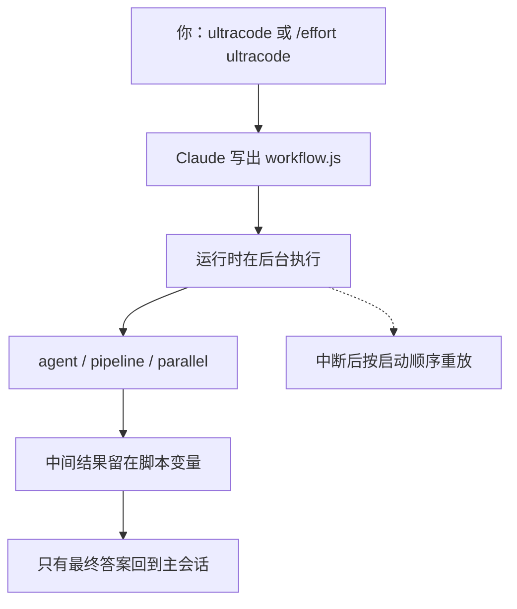

# 把编排写成脚本，计划就不必挤进上下文

Claude Code

**一句话看懂**：Claude Code 的动态工作流让模型不再回合制调度子代理，而是写出一段 JavaScript，由运行时在后台执行；循环、分支、重试和中间结果住在脚本变量里，主会话只收回最终答案。计划于是变成可以读、可以重跑、可以恢复的程序。

## 读完你能带走的 7 条收获

1. **编排从对话里搬进脚本**：谁下一步、中间结果放哪，不再靠主会话记住，而由 `pipeline()` / `parallel()` / `agent()` 写死（见 3.1）。
2. **五种入口**：单次 prompt 里写 `ultracode`、整段会话 `/effort ultracode`、自带的 `/deep-research`、把跑通的流程存成 `/命令`、以及插件的 `workflows/` 目录（见 3.2）。
3. **从 v2.1.210 起，`ultracode` 只认你亲手输入的词**：`-p`、定时任务、webhook、被转发的 PR 评论不再能触发扇出（见 3.2）。
4. **脚本不能碰文件系统和 shell，也不能用 `Date.now()` / `Math.random()`**：恢复靠“按启动顺序重放”，不确定因素会破坏重放（见 3.2）。
5. **失败的恢复语义要设计进脚本**：直接 `await` 失败会终止整次运行；放进 `pipeline()` 会变成 `null` 并继续（见 3.2）。
6. **工作流比对话费 token**：作者一次 `CLAUDE.md` 审计把 Pro 会话用量从约 11% 打到 48%；`ultracode` 会关掉“大型工作流”警告和并发上限（见 3.3）。
7. **Bun 案例证明的是规模，不是正确性**：约 75 万行 Rust、既有测试 99.8% 通过、11 天；同时有约 16.5 万美元的 API 计价、19 处细微回归，以及“测试套件本身会漏”的批评（见 3.3）。

::: tip 小白先懂这几个词
- [Dynamic Workflow（动态工作流）](/glossary#dynamic-workflow)：模型为当前任务现写的 JavaScript 编排脚本，用 `agent` / `pipeline` / `parallel` 拉起后台子代理。
- `ultracode`：触发工作流的关键字或会话开关；它是开关，不是一个 effort 档位。
- [子代理](/glossary#subagent)：脚本里每次 `agent()` 拉起的隔离工人。
- Resume is replay（恢复即重放）：重跑时按启动顺序回放；已完成的返回缓存结果，从第一个提示词变了的代理起全部重跑。
- [Fan-out（扇出）](/glossary#fan-out)：对一批文件或条目同时派出多个代理。
:::

## 1. 基本信息

<SourceCard type="文章" title="Dynamic workflows in Claude Code move the plan out of the context window" author="Max Zimmer" date="2026-10-10" url="https://emzimmer.com/dynamic-workflows-in-claude-code/" />

| 项目 | 内容 |
|---|---|
| 链接 | https://emzimmer.com/dynamic-workflows-in-claude-code/ |
| 类型 | 文章（个人工程博客，约 2,900 词） |
| 作者 | Max Zimmer |
| 发布日期 | 2026-10-10 |
| 使用工具 | Claude Code 动态工作流（作者写需 v2.1.154+；若干行为标注了 v2.1.210 / v2.1.271） |
| 分析依据 | 原文全文（2026-11-08 抓取）。命令、上限、版本号和成本数字摘自正文；Bun 案例的 16.5 万美元与 19 处回归是作者转述 The Register 与 InfoQ，本站未复核原始报道。「我觉得」为本站评论。对照 [[85]]：#85 是 2026-06-02 官方预览，讲六种模式和三种失败；本文是 GA 之后的操作手册，补上触发方式、恢复语义、缓存错峰、权限和成本。 |

## 2. 这篇在回答什么

主会话自己当调度员时，每个子代理的结果都要写回这段对话，每一次“下一步做什么”都要再花一轮。作者管很多项目，有一次让 Claude 按同一套标准去审计各仓的 `CLAUDE.md`，后台突然弹出几十个代理，每个项目自己走审计、改写、核对。他回过头去搞清楚刚才发生了什么，写成这篇。

主线三个问题：

1. 为什么要把计划从上下文里搬进脚本？
2. 怎么启动、怎么写、中断之后怎么恢复？
3. 它有多贵、权限怎么批、什么时候不该用？

## 3. 怎么做

### 3.1 计划变成代码，调度就不再靠“记住”

作者把动态工作流称作今年 Claude Code 最有意思的变化：

::: tr Claude 不再自己当编排者，而是去写一个编排者。
> "Claude stops being the orchestrator and starts writing one."
:::

它不再一轮一轮地调度子代理，而是写出一小段 JavaScript，运行时在后台执行，只有最终答案回到对话里。作者的判断是：

::: tr 这让大型代理任务变得可以阅读、可以重跑、可以恢复，就像普通代码一样。
> "That makes big agent jobs something you can read, rerun, and resume, like ordinary code."
:::

他用一张表对比四种并行方式。子代理、Skills、代理团队都是模型（或领队模型）按回合决定下一步，中间结果住在上下文或共享任务列表里；工作流则由**脚本**决定下一步，中间结果住在脚本变量里，可重复的是编排本身，典型规模是几十到上百个代理，中断之后可以在会话内恢复。作者认为后两行才是关键：

::: tr 因为计划就是代码，所以它是确定的、可以做 diff、可以重跑、可以设检查点。
> "Because the plan is code, it's deterministic, diffable, rerunnable, and checkpointable."
:::

于是扇出再核对、对抗式审查、评委团这类质量模式可以写进脚本，而不必指望模型在第 40 轮还记得。工作流作为研究预览发布于 2026-05-28，作者写稿时已经正式可用。

我觉得：这和官方预览文 [[85§3.1]]、[[85§3.2]] 是同一件事的两面。#85 解释为什么要现写外壳；本文回答“GA 之后你怎么操作它”。Grok Build Workflows（[[65]]）也是把扇出写成后台脚本，但那是产品里预置的工作流，不是模型当场写出来的 JavaScript。

### 3.2 怎么启动、脚本能写什么、中断后怎么重放

启动有五条路：

1. **按任务写关键字**。在 prompt 任意位置写 `ultracode`，或用白话说 “use a workflow”。Claude Code 会高亮这个词，然后改写脚本而不是按回合干活。示例：`ultracode: audit every API endpoint under src/routes/ for missing auth checks`。改主意可用 `Option+W`（macOS）或 `Alt+W`（Windows/Linux）取消本次高亮，也可以在 `/config` 里彻底关掉关键字。
2. **按会话打开 Ultracode**。`/effort ultracode` 让每个实质性任务都先规划成工作流，一次请求可能拆成理解、修改、核对三条链。启动时可写 `claude --effort ultracode`（同时把 effort 设成 `xhigh`），用 `ultracode` 设置持久化，用 `/effort ultracode off` 关掉。作者强调：Ultracode 是开关，不是一个 effort 档；它需要支持 `xhigh` 的模型，若工作流被禁用它也会消失。
3. **自带的 `/deep-research`**。从多个角度扇出网络搜索，交叉核对来源，对每条主张投票，去掉被驳倒的主张，核对失败（限流、API 错误）标成未验证而不是假。作者只短暂用过，觉得有的题目会偏重。
4. **存成命令**。一次运行满意后打开 `/workflows`，选中按 `s`，它会变成 `/命令`，存到仓库里的 `.claude/workflows/` 或个人目录 `~/.claude/workflows/`。保存后的工作流通过 `args` 全局变量接收输入，例如 `Run /triage-issues on 1024, 1025, and 1030` 会传入真正的数组，不用自己解析字符串。
5. **插件**。把脚本放进插件的 `workflows/` 目录，会带命名空间；`acme-tools` 插件里的 `release-audit` 以 `/acme-tools:release-audit` 运行。

安全相关的版本线要单独记：

::: tr 从 v2.1.210 起，ultracode 关键字只在你亲手输入时生效。
> "As of v2.1.210, the ultracode keyword only counts when you typed it"
:::

作者写明：交互提示符、IDE 面板、Remote Control，以及把输入标成人类输入的 SDK 应用都算；它不再从 `-p` 提示、定时任务、webhook 负载，或被转发进会话的 PR 评论里触发。更早的版本里，一条包含这个词的 PR 评论就能拉起扇出。如果你让 Claude Code 去读别人写的文本，先升级。

脚本你很少手写，但应该能读懂。作者给了一个“修到类型检查通过或连续两轮没有进展就停”的草稿，核心原语是：

- `agent(prompt, opts)` 拉起一个子代理。传入 JSON `schema` 会得到校验过的 JSON 而不是散文；不合格输出默认重试五次（`MAX_STRUCTURED_OUTPUT_RETRIES` 可调），自相矛盾的 schema 会在启动前被拒绝。
- `pipeline(items, fn)` 对每个条目跑一个代理；`parallel(...)` 跑一组并等待全部完成。
- `phase(title)` 在进度视图里分组，`log()` 打印在阶段上方。
- 停止或失败的代理会解析成 `null`，所以脚本末尾常见 `.filter(Boolean)`。

约束是故意的：脚本里没有文件系统和 shell——代理干活，脚本只协调；不能 `import()`；`Date.now()`、`Math.random()` 和裸的 `new Date()` 会抛错，时间戳必须从 `args` 传入，这样才能在恢复时重放同一批 `agent()` 调用；中途也不能向用户提问，需要阶段性签字就拆成多个工作流。

运行时还有几条上限。默认最多 16 个代理同时跑（CPU 吃紧时更少），可用 `CLAUDE_CODE_WORKFLOW_MAX_CONCURRENT_AGENTS` 调到 1–256。单次 `parallel()` / `pipeline()` 最多 4,096 项，超了会报错而不是悄悄截断。整次运行封顶 1,000 个代理，用来挡住失控循环。

共享 prompt 缓存：模型、effort、代理类型、工具、schema 和工作目录相同的代理会拼出同一段前缀。扇出时，运行时会按住除第一个以外的匹配代理，等它的响应开始（最多 5 秒，`CLAUDE_CODE_WORKFLOW_PREFIX_STAGGER_MS`），再放行其余代理去读热缓存。工作流代理默认 5 分钟缓存 TTL；长跑可把 `subagentPromptCacheTtl` 设成 `1h`，代价是更高的写入速率。

恢复的规则是：

::: tr 恢复即重放。
> "Resume is replay."
:::

重新启动一次中断的运行，会按代理当初的启动顺序重放。已完成的代理返回保存的结果，直到第一个提示词与上次不同的代理；之后全部重跑。一个失败的代理会和所有在它之后启动的代理一起重跑，包括已经完成的。作者举的例子：A、B、C、D 按序启动，B 失败，重跑会复用 A，重跑 B、C、D。所以长扇出应当把失败吸收在 `pipeline()` 里（失败变成 `null`，运行继续），而不是直接 `await`——直接等待失败会结束整次运行。

另外：安静太久的代理会用同一提示词重启，最多五次，它已经改过的文件保持改过的状态；超时可用每代理的 `stallMs` 或全局 `CLAUDE_ASYNC_AGENT_STALL_TIMEOUT_MS` 加长。订阅制的交互会话在 v2.1.271+ 碰到用量上限时会暂停等待重置，而不是失败；重置超过 24 小时，或第三次撞上限，代理仍会失败。

文档说每次运行会把脚本写到 `~/.claude/projects/`，可以读、对比、编辑后再让 Claude 从你的改动重跑。作者去找过，没找到，所以这一条他不能担保。他把跑通的流程从 `/workflows` 存成命令，是他真正在用的部分。`/workflows` 里可用 `p` 暂停/继续、`x` 停下某个代理或整次运行、`r` 重启正在跑的代理、`f` 按状态过滤、`s` 存成命令。

### 3.3 权限、成本，以及什么时候不该用

审批取决于权限模式：

- auto 模式下，第一次启动会问你一次；打开 ultracode 则连这次也不问。作者写 Anthropic 推荐工作流用 auto mode。
- 手动或 accept-edits 模式下，每次运行都问，并展示计划中的阶段，可用 `Ctrl+G` 在编辑器里看原始脚本。捆绑的、已保存的和插件工作流可以按项目设成“不再询问”。
- `claude -p` 和 Agent SDK 从不弹窗，因为 `Workflow` 工具走普通权限评估。需要允许 `Workflow`（全部）或 `Workflow(某个已保存工作流)`，或通过 auto mode、`PreToolUse` hook、`canUseTool` 批准。

子代理没有特权，仍遵守同一套权限和沙箱。长跑开始前，把会用到的工具提前写进 allow 规则，避免中途卡在确认框。一个细点：auto 模式下，脚本传给 `agent()` 的提示词被标成“脚本计算出来的”，分类器不会把它们当成你本人的指令。

成本是作者认为必须认真对待的部分。工作流比在对话里做同一件事烧更多 token，订阅制会计入额度。护栏包括：计划超过 25 个代理或预计超过 150 万 token 时出现 “Large workflow” 警告（只是建议，不会拦住）；`workflowSizeGuideline` 或 `/config` 会暗示 Claude 规划多少代理：`small`（不到 5）、`medium`（不到 10，默认）、`large`（不到 50）、`unrestricted`。Pro 在 v2.1.271+ 默认 `small`。这是给 Claude 的建议，不是硬顶。你可以按阶段选模型，机械阶段用更小的模型，或设 `CLAUDE_CODE_SUBAGENT_MODEL`。作者建议先在一个目录上试跑，看着 `/workflows` 里的 token 列再放大。

特别警告：

::: tr Ultracode 会故意去掉大型运行警告和并发子代理上限，因为打开它就等于同意跑大规模任务。
> "Ultracode deliberately removes the large-run warning and the concurrent-subagent limit"
:::

作者自己日常工作会把它关掉。他那次 `CLAUDE.md` 审计把 Pro 套餐上的会话用量从约 11% 打到 48%。他知道会花钱，量还是让他有点意外；没有逼近每周上限，而且他觉得完全值得。

官方发布时的展示案例是 Jarred Sumner 把 Bun 从 Zig 迁到 Rust：大约 75 万行 Rust，既有测试套件 99.8% 通过，从第一次提交到合并用了 11 天。它是一串各管一件事的工作流：一份给每个结构体字段映射正确的 Rust 生命周期；下一份把每个 `.zig` 文件迁成行为一致的 `.rs`，用上数百个代理、每个文件两个审查者；然后用修复循环把构建和测试跑绿；再在夜间工作流里抓不必要的拷贝，每个修复开一个 PR。作者转述：大约 11 天里跑了约 50 个工作流，关键输入是一份 `PORTING.md`（Zig 习惯到 Rust 的对照）加上生命周期表；峰值是 4 个并发工作流、各 16 个代理，也就是跨隔离 worktree 并行 64 个代理。Sumner 的做法是盯着运行、读输出，出问题再让 Claude 改循环。Claude Code 自己从 v2.1.181 起跑在这个 Rust 版 Bun 上。

作者没有把它写成无可争议的成功。他转述 The Register 称这次运行按 API 计价约 16.5 万美元；InfoQ 指出机械翻译引入了 19 处细微回归——Zig 和 Rust 代码看起来像，行为却不同；Zig 作者 Andrew Kelley 公开批评，并反问：一套在 Zig 里就漏掉 bug 的测试，怎么能抓住机器写出来的 Rust 里的同类问题。作者自己的读法是：

::: tr 我把这个案例读成规模的演示，以及你将需要多少验证，而不是输出正确的证据。
> "I read the case study as a demonstration of scale, and of how much verification you'll need, not as proof the output is correct."
:::

适合用工作流的，是又宽、又重复、又需要独立核对的活：跨很多文件的同一种审计（且每个发现都要对抗式核实）、大迁移（每个文件在隔离副本里变换）、对着类型检查/lint/测试套件的修到变绿、搜到饱和（比如不稳定测试，连续两轮没有新发现就停）、需要交叉核对来源的研究、以及想从几个角度起草再对比的高风险计划。不适合的是：单上下文就装得下的小任务（白白付扇出开销）、中途需要你判断的活（拆成多个工作流）、以及你无法验证输出的活——更多代理只会更快地生产未经核实的代码。

可用性：需要 Claude Code v2.1.154+，Pro / Max / Team / Enterprise 以及 Anthropic API、Bedrock、Google Cloud、Microsoft Foundry 都可用；默认开启，但 Pro 要在 `/config` 里打开 Dynamic workflows。要关掉：`/config` 开关、`"disableWorkflows": true`，或 `CLAUDE_CODE_DISABLE_WORKFLOWS=1`。关掉工作流会同时去掉 ultracode 和 `/deep-research`。

## 4. 结果与局限

作者亲自量到的，主要是那次 `CLAUDE.md` 审计：会话用量约 11% → 48%，他认为值得，但没有给出审计质量或漏改数字。运行时上限、缓存错峰、恢复语义和版本线来自他阅读的官方文档；脚本会写到 `~/.claude/projects/` 这一条，他找过却没找到，文中如实写了。

Bun 案例的 75 万行、99.8%、11 天、约 50 个工作流、峰值 64 个并行代理，是转述 Sumner 的写法以及后续报道；16.5 万美元和 19 处回归同样是转述，作者本人把它定位成“规模演示 + 验证需求”，不是正确性证明。Klarna 用工作流找静态分析没看到的死代码、CyberAgent 把它放在“单个子代理”和“完整代理团队”之间，都只是早期用户的简短描述，没有数据。

整篇是一个人的操作笔记加文档对照，不是受控实验。具体命令和默认值以你安装的 Claude Code 版本为准。

## 5. 结论

动态工作流把“下一步做什么”从模型的回合制判断里搬进一段可以读、可以改、可以重跑的程序。主会话不再被几十份子代理记录撑爆，代价是更多 token、更需要你把验证写进脚本，以及一套必须理解的恢复语义。

我觉得：如果你已经在用 Claude Code 做跨很多文件的审计或迁移，这比继续让主会话当调度员更接近普通工程——有脚本、有进度、有成本表。但 Bun 那种规模把问题从“能不能扇出”换成了“扇出之后谁来证明行为没变”。没有验证，工作流只是一台更快的半成品机器。

### 你可以这样试

1. 用 `/deep-research` 看一次进度视图，熟悉阶段和 token 列。
2. 在**一个目录**上写 `ultracode:` 做一次有核对步骤的审计，先不要开会话级 ultracode。
3. 打开 `/workflows`，读生成的脚本：有没有把失败吸收进 `pipeline()`？有没有把机械阶段指定到更小的模型？
4. 跑通后按 `s` 存成命令。确认 Claude Code ≥ v2.1.210，再让它去读别人写的文本。

### 读完自测

1. 子代理、代理团队和工作流，中间结果分别住在哪里？
2. 为什么脚本里禁止 `Date.now()` 和 `Math.random()`？
3. A、B、C、D 按序启动且 B 失败，恢复时哪些会重跑？
4. 打开 ultracode 会拿掉哪两道护栏？
5. 作者为什么拒绝把 Bun 重写读成“输出正确”的证据？
