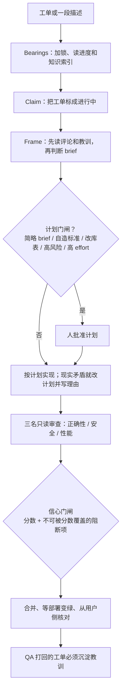

# 用证据重建工作流，别让仪式拖住新模型

Claude Code

**一句话看懂**：X2 Labs 有一套用了几个月、超过六千行的 Claude Code 工作流，模型变强之后，维护这套仪式比它省下的时间还多。Laszlo Csiki 按三份证据重写：effort 不让模型更聪明、写下来的规则在动作当下仍会被打破、人的注意力应该留在更高一层。新循环大约 1,400 行，带两道门闸、不能改代码的审查者和一份循环自己改不了的配置。

## 读完你能带走的 7 条收获

1. **为旧模型堆的仪式，新模型会绕过去**：复杂度量表、频繁的保存/清空/加载，加上一只错了两个月的上下文监视器，并不能证明工作流本身好用（见 3.1）。
2. **Effort 改变的是自检量和不问人就做的决定，不是智力**：安全工作 64% → 87%，一般软件 43% → 56%，运维 12% → 22%；高档大约多花三倍 token，有的任务 33 分钟对上 2 分钟（见 3.1）。
3. **规格不清楚时，高档会把错的东西验得很彻底**：一个故意写得含糊的应用，低档一分半、最高档 67 分钟（见 3.1）。
4. **知道规则 ≠ 会在动作当下执行**：作者已经写下的五条规则，被写出它们的同一个代理再次打破，其中一条八次（见 3.1）。
5. **计划门闸消不确定性，信心门闸消风险**：批准计划清掉的是不确定性阻断项，不是风险阻断项；计划批准不等于合并批准（见 3.2）。
6. **最自主的审查者权限反而最小**：安全审查在碰到认证、密钥或支付时可开到 max，但工具集改不了任何一个文件（见 3.2）。
7. **先测量再信文档**：文档说“按代理设 effort”不存在，两分钟对照实验证明三档都生效；同一会话监视器报 246% 满，校正后是 52%（见 3.2）。

::: tip 小白先懂这几个词
- [Reasoning Effort](/glossary#reasoning-effort)：给代理的算力预算，影响它自检多少、问你多少次。
- [Plan gate / Confidence gate](/glossary#plan-confidence-gate)：计划门闸在开工前去掉不确定性；信心门闸在合并前去掉风险。
- [做与查分离](/glossary#builder-validator)：写代码的代理和审查的代理分开，审查者只读。
- Carrier（载体）：把反复被打破的规则做成测试、hook 或默认值，而不再改措辞。
- Advisor：循环在特定条件（大计划、错误重复、长任务宣称完成）下咨询的第二个、不同的模型。
:::

## 1. 基本信息

<SourceCard type="文章" title="I rebuilt our Claude Code workflow on evidence, not habit" author="Laszlo Csiki" date="2026-10-15" url="https://x2labs.ai/notes/rebuilding-the-workflow" />

| 项目 | 内容 |
|---|---|
| 链接 | https://x2labs.ai/notes/rebuilding-the-workflow |
| 类型 | 文章（X2 Labs 笔记，约 9 分钟 / 约 2,200 词；页内有演示视频） |
| 作者 | Laszlo Csiki（@l4szlocs） |
| 发布日期 | 2026-10-15 |
| 使用工具 | Claude Code（多代理、按代理设置 effort）；顾问代理使用第二个不同模型 |
| 分析依据 | 原文全文（2026-11-08 抓取）。Effort 对照表作者标明来自 Claude Code 团队的 reasoning effort 深潜（对照 [[72]]）；三十轮对辩和监视器事故是作者自述。页内视频注明是“sample tasks 上的模拟运行配旁白，不是真实工单录像”。“我觉得”为本站评论。 |

## 2. 这篇在回答什么

一套大家一起建、在真实客户项目上用了几个月、也确实交付过东西的工作流，会在模型升级后变成负担：你花更多力气伺候工作流，而工作流省下来的时间不够补这笔开销。作者没有继续打补丁，而是推倒重来。

主线三个问题：

1. 旧工作流怎样从“周全”变成模型会绕开的仪式？
2. 三份证据分别改了设计的哪一块？
3. 新循环如何用两道门闸、只读审查和配置锁把人的注意力留在计划和合并上？

## 3. 怎么做

### 3.1 旧仪式为何失效，三份证据改了什么

纸面上旧工作流很周全。六条命令外加自动驾驶：一条生成 prompt 文件，一条运行，一条保存会话，一条加载，一条建议下一步，一条管理功能列表；自动驾驶会自己把 prompt 文件嚼完。还有一张复杂度量表：五个维度各打 1 到 5 分，加总 25 分，再分成四档，用来决定一个任务该用一条 prompt 还是几条——作者后来把它看成“为小上下文窗口做的算术”。保存、清空、加载这套仪式写进了六个不同文件，由一只上下文监视器触发。

监视器错了两个月。它假定窗口是 20 万 token，实际模型已经是 100 万，于是把用量大约报成五倍，大约在真实占用 15% 时就叫他们停下来保存。他们信了。作者审计整套系统时还发现：有的命令把可执行步骤嵌在输出区里；有的命令权限禁止它实际在做的写入；一个生成器产出的代理根本没有配置头，所以没有被注册。

它大多时候还能跑，是因为模型足够好，能绕开它。作者说，这不等于工作流本身好。把一套需要人搀扶的工作流补丁成“自主”的，通常两套毛病都会留下，所以他选择重写。

第一份证据来自 Claude Code 团队关于 reasoning effort 的深潜。它的主论改变了作者的想法：

::: tr Effort 并不会让模型更聪明。它改变的是模型检查自己工作的程度，以及它不问你就做决定的数量。
> "effort doesn’t make the model smarter. It changes how much the model checks its own work, and how many decisions it makes without asking you."
:::

文中表格（作者标明来自该深潜）：

| 工作 | 低 effort | 最高 effort |
|---|---|---|
| 安全工作 | 64% | 87% |
| 一般软件 | 43% | 56% |
| 运维 | 12% | 22% |

最高档大约多花三倍 token；有一个任务用了 33 分钟而不是 2 分钟。所以 effort 只该花在“多检查会回报”的地方。更戳他的是另一个数字：一个故意写得含糊的应用，低档一分半，最高档 67 分钟。

::: tr 对一份含糊的 brief 开高档，不会给你更好的答案……它给你的是一份被彻底验证过的错误东西，只是晚了一个小时。
> "High effort on a vague brief doesn’t give you a better answer… it gives you a thoroughly verified version of the wrong thing, an hour later."
:::

于是新工作流的第一条规则变成：规格清不清楚，先于其他因素决定 effort。这和 [[72§3.2]]、[[72§3.3]] 的方向一致：高档帮的是补边界，不是在 brief 很差时把方法想明白。

第二份证据是一次实验：两个模型共用一个文件辩三十轮，规则是每条主张都要有真实事故或可运行实验，每一轮必须挑战上一轮。两个发现改了设计。一是复发表：作者已经写下的五条规则，被写出它们的同一个代理再次打破，其中一条八次。

::: tr 知道规则从来不是问题，在动作发生的那一刻去执行才是。
> "Knowing the rule was never the problem, applying it at the moment of action was."
:::

所以单靠写下来的规则救不了他（同类观察见 [[28]]：能写成 hook 的就不要停在散文里）。二是速度差距是习惯不是性格：同一张工单，一个模型 15 分钟到终点，另一个 33 分钟，阅读量和单步耗时相近；快的那个先读事故自己的证据，慢的那个先读代码。另外，因为一个模型逼另一个去真跑测试而不是引用测试，他们在已经合并的代码里找到一个真正的 bug。

第三份证据是同事画的一张“一小时注意力回报最高的地方”地图，从整套代理系统到单行代码分五层：越高层回报越大、也越模糊。如果你发现自己在手改某一行，说明上面某层已经失败了。作者加上自己的担心：他已经不再通读代理产出，也跟丢了数据库里实际有什么，并且希望在任何表结构变化之前由人而不是代理做决定。

### 3.2 新循环：两道门闸、只读审查，以及先测量再信文档

新流程是一个循环、两扇前门：一张工单，或一段你想要什么的描述。第一步之后两条路径合并。步骤是：

1. **Bearings（定向）**：加一把锁，避免两个会话同时跑；读上次停在哪，读知识索引。
2. **Claim（认领）**：把工单标成进行中。这次状态迁移本身就是锁，别人不会再捡走。
3. **Frame（取景）**：先读工单评论再读描述，因为更正往往写在描述之后；然后读相关教训、数据库地图、搜索已有实现；这之后才判断 brief 是否够用来开工。
4. **计划门闸**（有条件）：brief 很薄、标准是代理自己编的、有数据库改动、碰到风险面、架构上是新的、effort 高，或项目还没赢得信任时触发。它挡住的是这张工单，不是整个循环，队列继续往前走。
5. **Build**：计划就是合同。现实和计划冲突时，代理修改计划并写上理由，而不是即兴发挥。
6. **Review**：三名没有写过这些代码的审查者，分别看正确性、安全和性能。严重程度决定修复循环，而不是一个计数器。严重发现要复检；风格挑剔绝不在同一轮修复。
7. **信心门闸**（每次都走）：一个分数，外加一份任何分数都不能覆盖的阻断项清单。
8. **Ship and verify**：合并，等部署真正变绿，再从用户侧检查运行中的系统。测试通过不是验证。失败就回滚。
9. **Hand over**：评论分两层，先给产品和 QA 的白话，再写技术细节。
10. **Learn**：一张被 QA 打回的工单是系统里信号最强的事件，因为两道门都过了仍然错了。这种情况必须沉淀一条教训。

两道门问的是不同问题。计划门闸去掉不确定性，信心门闸去掉风险。一份被批准的计划清掉不确定性阻断项，绝不清掉风险阻断项。作者的原话是：<Trans zh="计划批准不是合并批准。">“a plan approval is not a merge approval.”</Trans>

Effort 按代理设置，循环通过“派谁上场”来选档：探索者低档且只能读；规划者高档，专门找边界情况，并被明确告知不要自己回答关于意图的问题；实现者中档；三名审查者分别是中、高、最高档，全部只读。安全审查在改动碰到认证、密钥或支付时升到最高档，因为测量说多检查在这些地方有回报。

::: tr 每一位审查者都是只读的。
> "Every reviewer is read-only."
:::

作者写得很重：系统里最自主的东西——一个最高档审查者——拥有的工具集改不了一个文件。上面还坐着顾问：第二个、不同的模型，在大计划之前、错误重复时、以及长任务被宣布完成之前咨询。循环按这些条件触发，而不是代理“觉得该问的时候”再问，因为“我的计划够不够大、需不需要第二意见”正好是代理对自己工作最容易判错的那一类问题。

配套脚本包括：一份安装器，只投放项目之间不变的部分，并拒绝覆盖有人改过的文件；一份数据库地图生成器，从活的 schema 而不是代理记忆里生成，猜测之处会打标，地图过期时漂移检查会大声失败；一个 prompt hook，看见工单引用就提醒代理走循环——它只能提醒，不能拒绝，作者宁可把这一点说清楚也不愿吹过头；一条 setup 命令，先给项目指令文件的每一段打标签，从不删除，裁掉项目用不到的框架建议，每一条修正单独成行，等人批准。

指令文件本身也改过写法。第一版只写循环在哪、计划放哪；代理读完知道工具存在，然后继续手工干。作者说参考卡什么也改变不了，于是改成“触发条件 + 后果”：拿到工单就跑循环，因为手工干是同一份工作，只是检查被拿掉了。留下来的几条规则包括：完成是被核实的，不是被汇报的；先读事故自己的日志再读代码；一条写下来的规则第二次被打破，就停止改措辞，把它做成测试、hook 或默认值；

::: tr 循环永远不能编辑自己的配置。
> "The loop can never edit its own configuration."
:::

校准失误变成给人类的提案。你不能批准自己的计划，另一个代理转达的批准也不算批准。

最出乎他意料的教训不在提示词上。构建后期他让代理去查文档：按代理设置 effort 到底存不存在？代理很有把握地回报：不是受支持的字段，整套 effort 梯子大概只是装饰。他差点从每个代理里拆掉它。取而代之，他做了一个两分钟实验：三个代理除了那一行完全相同，然后看它们实际跑在哪一档。低就是低，中就是中，最高就是最高。功能可用，文档只是不完整。同一周，旧的上下文监视器报一个会话 246% 满；校正后的读数是 52%。

::: tr 两次都是：对系统的描述是错的，测量是对的。
> "Both times the description of the system was wrong and the measurement was right."
:::

作者承认新工作流还没有证明速度：到发文时显示的加速是零分钟。它在试运行，他在测两件事——到达同一终点的时间，以及交接之后的返工。数字无论好坏他都会回来更新。他最喜欢的变化是注意力放哪：他读计划、批准合并，不再盯着工作发生。

我觉得：即使你不采用他们的安装器，两道门闸、只读的最高档审查、以及“循环不能改自己的配置”这三条也可以直接搬到自己的项目里。但发文时没有前后对照的耗时，视频又是模拟运行，所以不要把它读成“已经证明更快”。

## 4. 结果与局限

作者给出的硬结果，主要是旧系统的故障：监视器把 100 万窗口当成 20 万，错报约五倍，真实约 15% 时就喊停；生成的代理缺配置头而未注册；文档与实测在 per-agent effort 上相反。新循环从“六千多行”收到“大约 1,400 行，循环本身两三百行”，但到发文为止<Trans zh="到目前为止显示的加速是零分钟">“zero minutes of speed shown so far”</Trans>。Effort 对照表来自 Claude Code 团队已发表的测量，不是作者在客户项目上复现的。三十轮对辩是设计实验，不是生产指标。页内视频是样例任务上的模拟，不是真实工单录像。没有公开完整配置仓库，文中的命令和脚本以描述为主。

## 5. 结论

为弱模型设计的周全仪式，在强模型上会变成你要喂养的第二套产品。作者用三份证据把它收成一个更短的循环：先判断规格再决定 effort，用门闸把不确定性和风险分开，让最强的审查者改不了文件，并规定循环不能改自己的配置。更硬的一条是方法论：文档和仪表都可能错，两分钟的测量比自信的转述值钱。

### 你可以这样试

1. 审计自己的工作流：有没有在过时的窗口大小或过时文档上做决定？用一次实测核对。
2. 把“计划批准”和“合并批准”拆开，列出信心门闸上不能被分数覆盖的阻断项。
3. 给审查者单独的只读工具集；认证、密钥、支付相关改动才把安全审查升到最高档。
4. 找一条已经被代理打破两次的书面规则，把它做成测试、hook 或默认值，而不是再改一版措辞。

### 读完自测

1. 旧监视器错在哪个假设上？它大约在真实占用多少时喊停？
2. 对一份含糊 brief 开最高档 effort，作者说你会得到什么？
3. 计划门闸和信心门闸各去掉什么？哪一道每次都走？
4. 为什么最高档审查者反而是只读的？
5. 文档说 per-agent effort 不存在时，作者做了什么两分钟实验？
