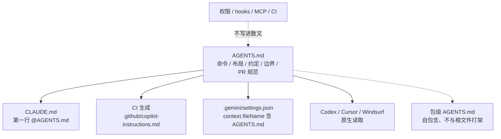

# 多工具只维护一份 AGENTS.md，其余做成薄适配器

<div class="meta-tags"><span class="tool-tag tool-general">通用（不限工具）</span></div>

<div class="hook">

**一句话看懂**：团队同时跑 Claude Code、Cursor、Codex、Copilot、Gemini CLI 时，最容易出现的不是“没写规则”，而是五份规则各自漂移。Kevin Kaminski 的策略是：共享约定只写进 `AGENTS.md`，各工具的文件变成薄适配器（导入、生成或一行配置）；权限、hooks、MCP 仍然留在各工具自己的设置里。

</div>

## 读完你能带走的 7 条收获

1. **过期的指令文件比过期的 README 贵**：README 浪费新同事一个下午；指令文件会让之后每一个会话走同一条错路，而且各工具漂得还不一样（见 3.1）。
2. **Claude Code 默认并不会和 `CLAUDE.md` 一起读 `AGENTS.md`**：工作目录及以上已有 `CLAUDE.md` / `.claude/CLAUDE.md` / `CLAUDE.local.md` 时，要在 `CLAUDE.md` 第一行写 `@AGENTS.md`（见 3.2）。
3. **Copilot 不是处处读 `AGENTS.md`**：云端代理、GitHub.com 上的 code review、VS Code Chat 和 Copilot CLI 会读；GitHub.com / Visual Studio / JetBrains 里的 Copilot Chat 只认 `.github/copilot-instructions.md`，要用 CI 从 `AGENTS.md` 生成并检查是否过期（见 3.2）。
4. **Codex 默认把整条指令链封顶在 32 KiB**：根文件太肥会把包一级的文件挤出上下文（见 3.1、3.3）。
5. **权限、hooks、MCP 不能靠散文共享**：指令文件是给模型看的说明，要挡住某个动作得写进各工具的设置和 CI（见 3.3）。
6. **嵌套文件必须能单独成立**：Copilot 文档没承诺与根文件合并，Codex 可能截断，Claude Code 只在碰到该目录时才加载嵌套文件（见 3.3）。
7. **这些文件里永远不要放密钥**：它们会被注入每个开发者机器上的模型上下文，并进到各厂商的请求日志；`CLAUDE.local.md` 被 gitignore 也一样（见 3.3）。

::: tip 小白先懂这几个词
- [AGENTS.md](/glossary#agents-md)：跨工具的厂商中立指令文件，作为单源真源。
- [薄适配器](/glossary#thin-adapter)：只负责接线的工具专用文件，例如第一行 `@AGENTS.md` 的 `CLAUDE.md`，或由 CI 生成的 Copilot 副本。
- [嵌套 AGENTS.md](/glossary#nested-agents-md)：包或子目录里的指令文件，和根文件如何合并因工具而异。
- [`/context`](/glossary#slash-context)：在 Claude Code 里核对本会话实际加载了哪些 Memory files。
- [`/doctor prompt-audit`](/glossary#prompt-audit)：Claude Code 命令，检查指令文件里的失效路径、过时写法和互相矛盾，提议修改但不擅自改。
:::

## 1. 基本信息

<SourceCard type="文章" title="CLAUDE.md, AGENTS.md and .cursorrules: One Config Strategy" author="Kevin Kaminski" date="2026-11-05" url="https://www.bighatgroup.com/blog/claude-md-agents-md-cursorrules-configuration-strategy/" />

| 项目 | 内容 |
|---|---|
| 链接 | https://www.bighatgroup.com/blog/claude-md-agents-md-cursorrules-configuration-strategy/ |
| 类型 | 文章（咨询公司工程博客，约 5,400 词） |
| 作者 | Kevin Kaminski（Big Hat Group） |
| 发布日期 | 2026-11-05 |
| 使用工具 | Claude Code、OpenAI Codex、GitHub Copilot、Cursor、Gemini CLI、Windsurf / Devin Desktop |
| 分析依据 | 原文全文（2026-11-08 抓取）。文中“每个工具读什么”声称对照当时各厂商文档并在文末列出链接，本站未逐条打开复核。文末有咨询转化（预约 discovery call）。「我觉得」为本站评论。对照 [[125]]：#125 提出“一份 AGENTS.md + 薄指针”；本文补上六种工具的对照表、Copilot 的生成而非指向、monorepo 嵌套、治理和可复制模板。 |

## 2. 这篇在回答什么

平台组标准化了 Claude Code，前端付钱买 Cursor，全员经由 GitHub Enterprise 拥有 Copilot，有人在排队跑 Codex，数据组一半笔记本装着 Gemini CLI。每个人写自己那一款的指令文件。半年后 `CLAUDE.md` 里的构建命令已经错了，`.cursorrules` 还在禁止团队已经依赖的库，没人说得清哪一份算数。

主线三个问题：

1. 这六种工具各自读哪些文件，嵌套时谁说了算？
2. 怎样只维护一份 `AGENTS.md`，其余做成导入、生成或一行配置？
3. 哪些东西不能写进散文？monorepo 和治理怎么落地？



## 3. 怎么做

### 3.1 先看清每种工具读什么

作者把指令文件比成你交给新同事的入职文档，差别是代理在**每一个会话开头**都读一遍，而且文件错了它也不会反驳。过期的 `README.md` 浪费新同事一个下午；

::: tr 一份过期的指令文件会让仓库里之后每一个代理会话都走同一条错路
> "A stale instruction file sends every agent session in the repository down the same wrong path"
:::

而且因为每个工具有自己的文件，漂移还是不均匀的：Claude Code 可能已经知道新的测试运行器，Copilot 还在跑旧的。

他给出一张对照表（声称根据当时各厂商文档整理）：

| 工具 | 主要指令文件 | 嵌套与优先级 | 文档中的限制 | 读 AGENTS.md？ |
|---|---|---|---|---|
| Claude Code | `CLAUDE.md` 或 `.claude/CLAUDE.md`、`CLAUDE.local.md`、`.claude/rules/*.md`、由 IT 下发的托管文件 | 工作目录及所有父目录在启动时加载；子目录文件按需加载；拼接后离得近的后读 | `@path` 导入最多四跳；单文件目标不超过 200 行 | 是，但仅当工作目录及以上没有 `CLAUDE.md`（v2.1.277+），或通过 `@AGENTS.md` 导入 |
| OpenAI Codex | `AGENTS.md`（`AGENTS.override.md` 优先） | 先 `~/.codex/`，再从项目根走到工作目录，每层最多一份，近的更靠后也更强 | 整条链默认 `project_doc_max_bytes` = 32 KiB | 原生 |
| GitHub Copilot | `.github/copilot-instructions.md`，以及带 `applyTo` 的路径级文件 | 仓级和匹配的路径级文件都会用；个人 > 仓库 > 组织，但相关集合都会提供给模型 | 未文档化平台级大小上限 | 云端代理、GitHub.com 上的 code review、VS Code Chat、Copilot CLI 会读；GitHub.com / Visual Studio / JetBrains 里的 Chat 不读 |
| Cursor | `.cursor/rules/*.mdc`（要有 frontmatter；纯 `.md` 会被忽略） | Team Rules，然后 Project Rules，然后 User Rules，冲突时更靠前的赢 | 规则建议不超过 500 行；规则里引用的文件不会被内联 | 是，根目录和子目录，更具体的赢 |
| Gemini CLI | `GEMINI.md` | 全局 `~/.gemini/GEMINI.md`、工作区及父目录，子目录按需 | `@file.md` 导入；`context.fileName` 可列多个文件名 | 当 `context.fileName` 包含 `AGENTS.md` 时 |
| Windsurf | `.windsurf/rules/*.md`（现在更推荐 `.devin/rules/`），以及旧的 `.windsurfrules` | 工作区向上找到 Git 根；`trigger` 可为 `always_on` / `glob` / `model_decision` / `manual` | 工作区规则每个文件 12,000 字符，全局文件 6,000 | 是，根文件始终开，子目录文件按 glob 自动限定范围 |

几个容易踩的细节：Claude Code 的 `@path` 导入相对写它的那个文件解析，代码 span 和围栏里的导入会被忽略，导入不会减少成本，因为被导入的文件会和主文件一起加载。Codex 的上限作者认为团队最容易漏掉：

::: tr `project_doc_max_bytes` 默认把合并后的大小封顶在 32 KiB，链到达上限后 Codex 就停止追加文件。
> "project_doc_max_bytes caps the combined size at 32 KiB by default"
:::

一份臃肿的根文件会把包一级的文件悄悄挤出上下文。Cursor 现行文档里的项目规则是 `.mdc`；老指南里的单个 `.cursorrules` 文件已经不再出现在当前规则页，作者建议当作遗留并迁移。Copilot 改指令文件时还要注意：code review 读的是 PR **head** 分支上的文件，不是 base。

### 3.2 单源加薄适配器：导入、生成，或改一行配置

为什么真源是 `AGENTS.md`？作者的理由是：AGENTS.md 规范是没有必填字段的纯 Markdown，由 Linux 基金会旗下的 Agentic AI Foundation 托管，支持者包括 Codex、Cursor、Gemini CLI、Windsurf、GitHub Copilot 的 coding agent、VS Code、Zed、JetBrains Junie、Devin、Aider、Factory 等，开源项目使用量超过 6 万。对照表里，它是唯一一种每个工具要么原生读取、要么可以配置去读的文件。

::: tr AGENTS.md 是唯一一份每个主流编码代理都会原生读取、或可以被指向去读的指令文件
> "AGENTS.md is the only instruction file every major coding agent reads natively or can be pointed at"
:::

共享约定进 `AGENTS.md`，其他文件变成适配器：一份又短又只放工具专用说明、并拉进共享文件的存根，或一份由 CI 保持同步的生成副本。

**Claude Code：导入，不要复制。** 陷阱在默认行为。文档写明：工作目录或上方任意目录已有 `CLAUDE.md`、`.claude/CLAUDE.md` 或 `CLAUDE.local.md` 时，Claude 默认只读这些，不再读 `AGENTS.md`。仓库里两份都有——因为有人给 Claude 专用说明加了 `CLAUDE.md`——就会在 Claude Code 里悄悄停掉共享文件。

::: tr 文档里的修法，是让 `@AGENTS.md` 成为 CLAUDE.md 的第一行
> "The documented fix is to make @AGENTS.md the first line of CLAUDE.md"
:::

Claude 先读导入的文件，再读下面的 Claude 专用内容，文档确认导入不会导致读两遍。符号链接 `ln -s AGENTS.md CLAUDE.md` 也能用，但作者转述 Anthropic 的警告：Windows 上创建符号链接需要管理员或开发者模式，Git 在没开 `core.symlinks` 时会把提交的符号链接检出成一行文本。他的客户里至少有一名 Windows 开发者，所以他用导入。还有一个 Project instructions 取值 `claude-md-and-agents-md`，但只从用户设置、`--settings` 或托管设置生效，项目级和本地设置会被忽略，不能提交进仓库。可移植的答案仍是导入。这和 [[125§3.2]]、[[143§3.2]] 看到的加载陷阱是同一件事。

**GitHub Copilot：生成，不要指向。** 会读 `AGENTS.md` 的那些表面，到这里就结束了。GitHub.com、Visual Studio 和 JetBrains 里的 Copilot Chat，仓库里唯一会被加载的文件是 `.github/copilot-instructions.md`。在那个文件里写“去读 AGENTS.md”，要靠模型自己决定打开它——作者认为这和 Anthropic 批评的“在 `CLAUDE.md` 里用文字叫 Claude 去读 `AGENTS.md`”是同一种弱法。可靠做法是在 CI 里从 `AGENTS.md` 生成 `.github/copilot-instructions.md`，文件头写明它是生成的，并在两份不一致时让流水线失败。只作用于 `**/*.sql` 这类路径的规则，放进 `.github/instructions/*.instructions.md`，共享文件没有对等物。

作者给的同步脚本是：

```bash
#!/usr/bin/env bash
set -euo pipefail
{
  echo "<!-- GENERATED from AGENTS.md. Edit AGENTS.md and run scripts/sync-agent-instructions.sh. -->"
  cat AGENTS.md
} > .github/copilot-instructions.md
# In CI, fail when the committed copy is out of date:
git diff --exit-code -- .github/copilot-instructions.md
```

**其余工具。** Cursor 原生读根目录和嵌套的 `AGENTS.md`，`.cursor/rules` 收缩到 Cursor 专用、按 glob 生效的行为，以及管理员通过 Team Rules 强制的内容。Gemini CLI 需要提交一行配置：在 `.gemini/settings.json` 里把 `context.fileName` 设成 `["AGENTS.md", "GEMINI.md"]`，之后 `GEMINI.md` 只放 Gemini 专用说明。Codex 和 Windsurf 不用配置就能读共享文件；Codex 要把整条链控制在 32 KiB 以内，`AGENTS.override.md` 只用于临时的本地覆盖。若用 Codex 做 GitHub 代码审查，把 `## Code Review Rules` 一节写进离它要审的代码最近的那份 `AGENTS.md`（OpenAI 文档中的机制，对照 [[75]]）。

### 3.3 不能共享的、嵌套写法，以及怎么治理

::: tr 指令文件是给模型看的散文。
> "Instruction files are prose for the model."
:::

由工具强制、而不是向模型建议的东西，留在各工具自己的配置里：

| 事项 | 能写进 AGENTS.md？ | 它实际住在哪 |
|---|---|---|
| 构建、测试、lint 命令和约定、边界 | 能 | 根目录和嵌套的 `AGENTS.md` |
| 工具权限（allow / ask / deny） | 不能 | Claude Code 的 `settings.json`；各工具自己的设置；Cursor Team Rules 用于强制行为 |
| 工具调用前后的 hooks | 不能 | Claude Code 的 hooks；没有跨工具等价物 |
| MCP 服务器注册 | 不能 | 各工具自己的配置 |
| 按路径生效的规则 | 部分能 | 共享范围用嵌套 `AGENTS.md`；工具专用范围用 Claude 的 `paths`、Cursor 的 `globs`、Copilot 的 `applyTo`、Windsurf 的 `glob` |
| 组织级策略 | 不能 | 托管 `CLAUDE.md`、Cursor Team Rules、Copilot 组织指令、Windsurf 系统规则 |
| 个人的、不提交的笔记 | 不能 | `CLAUDE.local.md`、`~/.codex/AGENTS.override.md`、Cursor User Rules、`~/.gemini/GEMINI.md` |

作者引用 Anthropic 的说法：Claude 把 `CLAUDE.md` 当上下文，不当强制配置；要挡住某个动作，得用 `PreToolUse` hook 或 `permissions.deny`。他对这里每一种文件都持同样判断：规则写进 `AGENTS.md` 让每个代理都知道，真正要紧的再用设置和 CI 强制。这与 [[125§3.4]]、[[116§3.5]] 的“指导不是强制”一致。

嵌套是共享策略站得住或垮掉的地方。Claude Code 在启动时加载根文件和祖先，碰到该目录的文件时才加载嵌套文件，近的后读，也可用 `claudeMdExcludes` 跳过。Codex 从根往下拼接，近的更强，到 32 KiB 停止，`AGENTS.override.md` 替换该层文件。GitHub Copilot 采用离文件最近的 `AGENTS.md`，文档没有说明嵌套是否与根文件合并。Cursor 把嵌套文件和父级合并，更具体的赢。Gemini CLI 拼接。Windsurf 根文件始终开，子目录文件按 glob 自动限定。

作者抽出两条规则。第一，把每个嵌套 `AGENTS.md` 写成：就算根文件不在上下文里，它也是对的。Copilot 没承诺合并，Codex 可能截断，Claude Code 只在代理真正碰到该目录时才加载嵌套文件。会酿成灾难的那一两条边界要重复写，但永远不要和根文件打架；Anthropic 说指令冲突时模型“可能任意挑一条”，作者认为这对每个代理都成立。第二，根文件要短。Anthropic 的 200 行目标和 Codex 的 32 KiB 是设计的两条边界；根文件大概控制在 10 KB 以内，才能给两三份包级文件留出空间，避免 Codex 开始丢文件。

内容怎么分，他用一个测试：

::: tr 如果开发者明天换了工具，这条指令仍然为真吗？
> "if a developer switched tools tomorrow, would this instruction still be true?"
:::

为真就进 `AGENTS.md`（安装/构建/测试/lint 的原文命令、仓库布局、语言与风格约定各举一个例子、边界、安全规则、PR 和提交约定、以及 Codex 的 `## Code Review Rules`）。只在一个产品里说得通的，进那个产品的文件：plan mode、模型选择、effort、auto memory 进 `CLAUDE.md`；权限、hooks、MCP、`claudeMdExcludes` 进 `.claude/settings.json`；按框架 glob 挂上的规则进 Cursor / Copilot / Windsurf 各自的路径级文件。

治理方面：把 `AGENTS.md`、适配器文件和同步脚本写入 `CODEOWNERS`，根文件归平台或开发者体验组，嵌套文件归各包的负责人。指令文件的每次改动都走 pull request。Claude Code 提供 `/doctor prompt-audit`（v2.1.283 或以后）：检查 `CLAUDE.md`、`CLAUDE.local.md` 和 `AGENTS.md` 以及 rules 和 skills，找不存在的文件或命令、为旧模型写的指令、互相矛盾的文件，并提出修改，在你接受之前不改任何东西。即使改动不是 Claude Code 引起的，合并前也可以跑一次。生成副本当成故意纳入版本的文件：提交 `.github/copilot-instructions.md`，让 CI 在它过期时失败，而不是在构建时静默再生、没人看到 diff。

密钥是“永远不要”。这些文件会被每个工具注入每个开发者机器上的模型上下文，发送到该工具调用的厂商，并被生成器复制。`AGENTS.md` 里的连接字符串就是五家厂商请求日志里的连接字符串。`CLAUDE.local.md` 和 `~/.codex/AGENTS.override.md` 被 gitignore，但仍然进上下文，同样不是放密钥的地方。让代理去读环境或密钥管理器，并用强制手段垫底：例如 Claude Code 的 `permissions.deny` 写成 `Read(./.env)`，模型再想读也被挡住。

改完之后按工具做一次冒烟：Claude Code 用 `/context` 看 Memory files（[[143§3.1]]），Gemini CLI 用 `/memory show` 打印合并上下文，GitHub.com 上的 Copilot Chat 若用了文件会在 References 里列出 `.github/copilot-instructions.md`，OpenAI 建议 `codex -c log_dir=./.codex-log` 写出可审计的日志。然后再用一组固定问题（“测试命令是什么？”“数据库查询该写在哪？”）对比各工具的回答，分歧就是你在开发者撞上之前抓到的漂移。

作者还附了一套虚构支付平台的模板（`AGENTS.md`、薄 `CLAUDE.md`、一条 Cursor `.mdc`、Gemini 的 `settings.json`、上面的同步脚本），以及四周试点：第一周盘点，第二周合并成一份 `AGENTS.md` 并写适配器，第三周找覆盖所有工具的三到五名开发者试点，第四周加上 `CODEOWNERS`、CI 检查和仓库模板，再一个 PR 推广到下一个仓库。文末有咨询转化，本站只把它当作来源背景。

我觉得：#125 已经把“一份真源 + 薄指针”讲清楚了；这篇的价值是把它扩成可以在六种工具上执行的操作手册，尤其是 Copilot 那张支持矩阵，以及“生成、不要指向”。表里的细节会随厂商文档漂移，落地前应用 `/context`、`/memory show` 或各工具自己的加载检查核对一遍。

## 4. 结果与局限

这不是一次迁移的前后对照，没有“漂移下降了多少”或“各工具遵从度”的数字。6 万个开源项目使用 AGENTS.md、各工具的限制和矩阵，都是作者当时对照厂商文档的整理，本站未逐条复核原始文档页。模板是虚构的支付平台，不是某个生产仓库的脱敏副本。文末明确提供“两周 AI 编码代理配置审查”到“完整多代理落地”的咨询，并给出电话和预约入口——综合评分里需要把这一点算进去。Windows 符号链接、Copilot 支持矩阵、Claude Code 读 `AGENTS.md` 的版本线（v2.1.277+）都会随时间变化。

## 5. 结论

多工具团队的问题通常不是缺规则，而是规则复制了五份、又各漂各的。把对所有工具都成立的内容写进一份 `AGENTS.md`，让 `CLAUDE.md` 导入它、让 Copilot 的仓库文件由 CI 生成、让 Gemini CLI 用一行配置指向它，其余原生支持的工具直接读。权限和副作用不要指望模型“记住”；嵌套文件要能在根文件缺席时仍然正确。

### 你可以这样试

1. 用 `git ls-files | grep -Ei 'claude\\.md|agents\\.md|cursorrules|cursor/rules|copilot-instructions|gemini\\.md|windsurf'` 盘点仓库里的指令文件。
2. 把对任何工具都成立的命令、边界和 PR 约定合并进根目录 `AGENTS.md`，尽量短于 200 行、给 Codex 留出 32 KiB 余量。
3. 若已有 `CLAUDE.md`，把 `@AGENTS.md` 放在第一行，把非 Claude 专用内容移走。
4. 添加从 `AGENTS.md` 生成 `.github/copilot-instructions.md` 的脚本和 CI 检查；删除 `.cursorrules`。
5. 在 Claude Code 里跑 `/context`，确认共享文件真的进了 Memory files。

### 读完自测

1. 工作目录里同时有 `CLAUDE.md` 和 `AGENTS.md` 时，Claude Code 默认读哪一份？
2. 哪些 Copilot 表面不读 `AGENTS.md`？作者建议怎么同步？
3. Codex 默认的指令链大小上限是多少？根文件太长会怎样？
4. 为什么不能在 `CLAUDE.md` 或 Copilot 文件里用文字“请去读 AGENTS.md”了事？
5. 嵌套 `AGENTS.md` 为什么必须写得能单独成立？
