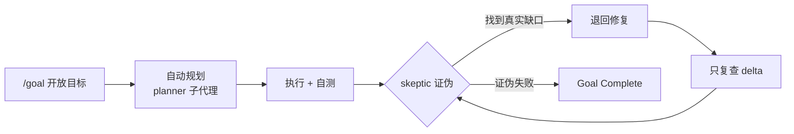
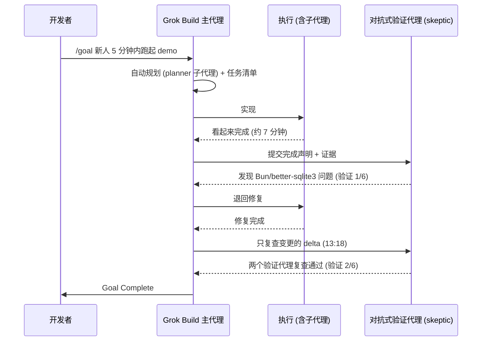

# 57 个子代理之后，谁来确认“真的做完了”：Grok Build 三项实测

Grok Build

**一句话看懂**：Arcade 的工程师给 Grok Build 出了三道题：用计划模式加一个 dry-run 参数；派 57 个子代理并行审查 57 个文件；用 `/goal` 完成一个开放目标。前两题展示的是“能干多快”，第三题才是重点：代理说“完成了”之后，一个专门唱反调的验证代理找出了真实问题，修完后只复查改动部分，第二轮才放行。

## 读完你能带走的 6 条收获

1. **“完成”要由另一个代理来证伪，而不是由干活的代理自己宣布。** 验证代理的提示词开头就是“你不是做这项工作的代理，你的任务是证伪它”（见 3.3）。
2. **验证者的默认立场是“没做完”。** 不确定时判为已证伪，这样宽松的错误才会少（见 3.3）。
3. **修复后只复查 delta。** 把上一轮标出的缺口和证据交给同一个验证者，只核对这些地方有没有修好（见 3.3）。
4. **大规模只读审查，用“一文件一子代理”扇出，分批启动。** 57 个文件约 3 分钟审完，每个子代理只看一个文件（见 3.2）。
5. **计划是一个可以批准、要求修改、评论的对象。** 计划模式下代理只能写计划文件，改别的文件会被直接拒绝（见 3.1）。
6. **Git 让代码代理的错误看得见、能回滚；代理一离开仓库，这层保护就没了。** 这是讲者（Arcade 员工）的产品立场，但道理成立（见 3.4）。

::: tip 小白先懂这几个词
- [Plan Mode](/glossary#plan-mode)：只读、先出计划再动手的模式。
- [子代理](/glossary#subagent)：主代理派出去、有独立上下文的“分身”。
- [/goal](/glossary#goal)：给代理一个可验证的目标，直到达成才停。
- [对抗式验证（skeptic）](/glossary#adversarial-review)：专门去证明“没做完”的验证代理。
- [Dry Run](/glossary#dry-run)：只显示将要做什么、不真正执行。
- [Persona](/glossary#persona)：给子代理配的角色和关注点。
:::

## 1. 基本信息

<YouTube id="1NwO2dPzwRM" title="Grok Build Spawned 57 Agents in 3 Minutes" />

| 项目 | 内容 |
|---|---|
| 讲者 / 频道 | Thierry Damiba（Arcade.dev Member of Technical Staff）／ **Arcade**（企业 AI 代理 actions runtime 厂商的官方频道） |
| 发布日期 | 2026-09-09 |
| 时长 | 18:57 |
| 使用工具 | Grok Build + Grok 4.5（简介：“This walkthrough was recorded with Grok 4.5.”，本演示用 Grok 4.5 录制）；plan mode、并行 subagents、`/goal`、对抗式验证代理 |
| 利益相关 | 视频结尾部分为 Arcade 的产品观点（代理离开代码仓库后的权限与审计） |
| 分析依据 | ① **YouTube 英文字幕**（2026-10-14 重新获取 en-US 轨道，文字通顺，本文英文引语均已与它逐字核对；早先版本拿到的是质量很差的自动字幕，现已替换）；② 视频简介与官方章节（YouTube 元数据）；③ **视频画面截图**，终端里清晰可读的 prompt 和输出按画面原文引用；④ xAI 官方页面 *Introducing /goal* 与 *Introducing Grok Build*；⑤ Grok Build 开源仓库用户手册（`docs/user-guide/16-subagents.md`、`19-plan-mode.md`）。凡来自官方文档的机制说明均已标注，**不代表视频中逐字出现**。“我觉得”开头的段落是本站评论。 |

官方章节：00:00 用 plan mode 加 dry-run 功能 → 02:39 并行派生子代理 → 04:47 57 个子代理完成 → 05:11 测试自主 goal 模式 → 08:20 目标完成、开始验证 → 09:27 skeptic 发现真实问题 → 13:18 只复查变更的 delta → 14:42 第二轮验证通过 → 14:50 评价 → 16:06 为什么 Git 让编码代理的自主性显得安全 → 17:20 代理离开仓库后需要什么。

## 2. 这篇在回答什么

想象你让代理“把仓库整理到新人 5 分钟能跑起来”，然后去开会。半小时后它说：“目标完成。”

你信吗？

代理写代码越来越快，还能一次派出几十个分身。但“快”不是问题，问题是谁来确认它真的做完了。做事的代理天然倾向于认为自己做完了，测试绿了就收工。

这期视频是一次 19 分钟的上手实测。讲者 Thierry Damiba 一边操作一边点评，三道题难度递增：

1. **计划模式能不能让人先看懂再放行？**（3.1）
2. **几十个子代理并行，怎么分工、怎么不打架？**（3.2）
3. **代理宣布完成后，谁来证伪？**（3.3，视频最有价值的部分）

最后 3 分钟，讲者转向 Arcade 的产品观点：为什么大家敢让几十个代理同时改代码，却不敢让一个代理发邮件（3.4）。

## 3. 怎么做

### 3.1 计划模式：先把“dry run 是什么意思”想清楚（测试 1）

第一题故意给得模糊：在一个 Next.js demo 项目里加一个 dry-run 标志。讲者的评论点出了难点：

> "obviously this is a prompt that it's going to need to work a little bit on because what does that mean?"

dry run 通常是命令行参数，而这个项目是网站。切到计划模式后，Grok 先推理“这里的 dry run 指什么”，再写计划。计划出来后有四个操作：**批准、要求修改、评论、复制**。讲者批准后进入实现，按 Ctrl+E 可以展开推理过程，最后 Grok 给出一条试运行命令（00:00–02:39）。

讲者有三个槽点，都很具体：

- 太快了，跟不上：<Trans zh="它跑得太快，我甚至没法注意到发生了什么">“it's going so fast that I can't even like pay attention to what's happening”</Trans>。
- 界面重点在“模型在想什么、调了什么工具”，代码 diff 反而不显眼：<Trans zh="它更想给你看它在做什么，而不是实际的代码">“this is much more interested in showing you what it's doing rather than the actual code”</Trans>。
- 能看到“有命令失败了”，却点不进去看详情：<Trans zh="我能深挖吗？不能。">“Can I dig into it? I cannot.”</Trans>

官方手册对 plan mode 的说明：除计划文件外只读，<Trans zh="对其他任何文件的修改都会被直接拒绝……在所有权限模式下都如此，包括 always-approve">“edits to any other file are rejected outright … This holds in every permission mode, including always-approve”</Trans>。计划包含变更理由（Context）、推荐方案、关键文件路径、可复用的现有函数等，经批准后才进入实现。

我觉得第一题的价值在“模糊需求”这一点。需求本身有歧义时，先让代理写出“我理解的 dry run 是什么”，人看一眼再放行，比直接动手省事得多。

### 3.2 并行子代理审查 57 个文件（测试 2）

**为什么要拆**：一个代理审 57 个文件，上下文会被撑爆。每个文件一个子代理，各自在干净的上下文里工作，也不会互相改到同一个文件。

简介：<Trans zh="xAI 刚刚允许一个 AI 编码代理在同一个代码库上启动 57 个自己的副本">“xAI just gave an AI coding agent permission to spin up 57 copies of itself on the same codebase”</Trans>。

画面上讲者输入的 prompt 原文：

::: tr 并行审查这个仓库里的每一个文件。为每个文件写一份配套的 NOTES-<文件名>.md，概述这个文件做什么、有哪些依赖，并给出一条改进建议。每个文件用单独的子代理，避免互相冲突。
> Review every file in this repo in parallel. For each one, write a companion NOTES-&lt;filename&gt;.md summarizing what the file does, its dependencies, and one improvement suggestion. Use separate subagents per file so they don't conflict.
:::

<figure class="shot"><figcaption>📷 视频截图 · <a href="https://www.youtube.com/watch?v=1NwO2dPzwRM&t=200s" target="_blank" rel="noopener">3:20</a> · 3:20 讲者输入上面的 prompt 后，Grok 先列出要处理的文件，再<Trans zh="每个文件一个子代理，分批启动">“launching the first batch of subagents, one per file”</Trans>。</figcaption></figure>

Grok 没有一次启动 57 个，而是分批：<Trans zh="它不会一次启动 57 个，而是一批一批来">“it's not going to launch 57 though. It's just going to do it a batch at a time.”</Trans> 第一批就有 15 个，讲者也没想到。子代理列表显示在界面顶部，带每个代理的运行时长；可以点进去看单个子代理在做什么，按 Q 返回。全部完成约 3 分钟，主代理最后逐个核对每个文件是否都有了配套说明（02:39–04:47）。

<figure class="shot"><figcaption>📷 视频截图 · <a href="https://www.youtube.com/watch?v=1NwO2dPzwRM&t=290s" target="_blank" rel="noopener">4:50</a> · 4:50 画面显示“Ran 57 subagents”，随后“All 57 subagents launched”，主代理等待全部完成后，逐个核对 NOTES 文件是否都已写出。</figcaption></figure>

官方手册对子代理机制的说明（不是视频原文）：子代理是<Trans zh="独立的子会话">“independent child sessions”</Trans>，各有独立的上下文窗口，结束后向父会话汇报摘要；内置类型包括 `general-purpose`、`explore`（不改文件）、`plan`（不改文件）；还可以叠加 persona 控制输出格式和关注点。

我觉得这道题证明的是“扇出”能跑通，而不是审查质量。视频没有打开任何一份 NOTES 看内容，57 份说明写得好不好，不知道。

### 3.3 `/goal` + 对抗式验证（测试 3，视频最有价值的部分）

**为什么重要**：做事的代理天然倾向于认为自己做完了。让另一个代理专门“证伪”，才能抓住它自己看不到的问题。

简介描述的过程：

::: tr 当目标看起来已经完成时，一个对抗式验证代理发现了真实的问题，把工作退回去修复，然后再次检查改动的那部分（delta）。
> "When the goal looks complete, an adversarial verification agent finds a real issue, sends the work back for a fix, and checks the changed delta again."
:::

画面上讲者输入的 `/goal` 原文：

::: tr 让这个仓库达到这样的状态：第一次来的贡献者 clone 下来后，5 分钟内就能跑起 demo。修好安装流程里任何坏掉的地方，确认 README 里的安装步骤真的能用，并把你一路上遇到的问题写成一个故障排查章节。
> /goal Get this repo to a state where a first-time contributor can clone it and run the demo in under five minutes: fix anything broken in setup, verify the install steps in the README actually work, and add a troubleshooting section for whatever you hit along the way.
:::

整个过程分四步（05:11–14:50）。

**第一步，自动规划。** 讲者没开计划模式，但 `/goal` 自己先规划了：<Trans zh="看起来 goal 会自动开启计划模式">“it looks like goal automatically activates the plan mode”</Trans>。规划交给了一个 planner 子代理，它去读安装文档和脚本，让计划贴合新人真正会遇到的步骤。讲者注意到，哪怕只需要一个子代理，Grok 也选择派出去，而不是自己做，他猜测好处是：

> "it gets to hand off that context to the sub-agent so that your main agent can stay focused on the task at hand"

但执行阶段又不一样：<Trans zh="子代理只在你要求、或它觉得需要时才出现">“The sub-agents only pop up when you either request them or it feels like it needs it.”</Trans> 主代理自己依次处理了 `.gitignore`、模拟干净环境安装、数据库迁移和环境变量，并反复重跑测试。

**第二步，第一次宣布完成。** <Trans zh="目标完成。用了七分钟，大约 15 万 token。">“goal's complete. Took seven minutes. Looks like about 150,000 tokens.”</Trans> 随后自动启动 goal skeptic（目标达成怀疑者）。画面上能看到子代理标签“General goal achievement skeptic · grok-4.5”，提示词开头是：

::: tr 你是 xAI Grok Build harness 的“对抗式验证者”。下面的工作不是你做的。你的任务是证伪“目标已经达成”。如果不确定，默认判定为“已证伪”（refuted: true）……（画面中后文被截断）
> You are an **adversarial verifier** for the xAI Grok Build harness. You are NOT the agent that produced the work below. Your job is to **refute** that the objective has been met. **Default to `refuted: true` if uncertain** – a …
:::

讲者双击看了完整提示词，评价是 <Trans zh="审计，不要创作">“Audit don't author”</Trans>，并提到里面还有一份“输出契约”（output contract）。

<figure class="shot"><figcaption>📷 视频截图 · <a href="https://www.youtube.com/watch?v=1NwO2dPzwRM&t=575s" target="_blank" rel="noopener">9:35</a> · 9:35 验证子代理“General goal achievement skeptic”启动，提示词要求它证伪目标已达成、不确定时默认判为已证伪。</figcaption></figure>

**第三步，验证者找到真实问题。** 验证者发现 README 的路径只适用于 Bun，而 better-sqlite3 在 Bun 下跑不起来，有 Node 才行。讲者看着它实时犹豫：先决定不证伪，又重新考虑，最后判为证伪，要求修复。界面上的验证计数是“1/6”，讲者推测有最多 6 次验证的上限，避免无限循环：

> "which is actually a really nice way to make sure that it doesn't just spin forever doing nothing"

这是讲者的推测，视频没有核实上限到了会怎样。

**第四步，只复查 delta。** 修复后进入第二轮。验证者的提示词说明它是同一个验证者，手上有上一轮的记录、标出的缺口和引用的证据，任务是 <Trans zh="复查 delta">“Recheck the Delta”</Trans>。讲者的评论：<Trans zh="它不需要把所有东西再查一遍">“it doesn't need to check everything once again”</Trans>。这一轮派了两个验证代理同时复查，在“2/6”时通过。

<figure class="shot"><figcaption>📷 视频截图 · <a href="https://www.youtube.com/watch?v=1NwO2dPzwRM&t=884s" target="_blank" rel="noopener">14:44</a> · 14:44 “Skeptic gaps fixed”汇总：复现的根因是只有 Bun、PATH 上没有 node 时，Quick Start 第 4 步报错“&#x27;better-sqlite3&#x27; is not yet supported in Bun”；改动包括 README 写明需要 Node.js 18+、新增故障排查章节、调整 db:setup 脚本等；复验表显示 bun run test:setup 34/34 通过。</figcaption></figure>

下图是测试 3 的完整交互：

有一处数字对不上：第一次宣布完成时讲者说“用了七分钟”，结尾总结时又说 <Trans zh="用了 23 分钟">“It took 23 minutes”</Trans>。合理的理解是 7 分钟是第一轮实现，23 分钟包括两轮验证和修复，但视频没有明说。

我觉得这一题最值得抄的有三点：验证者的身份声明（你不是做这项工作的代理）、默认立场（不确定就判为没做完）、复查范围（只看上一轮的缺口）。三点都和工具无关，任何能派子代理的环境都能照做。

### 3.4 讲者的观点：Git 是编码代理的安全带

最后 3 分钟（约 15:55 起）是 Arcade 的产品观点。讲者的问题是：为什么 12 个代理并行改你的代码，你耸耸肩就接受了？

他的回答：三家实验室在别的事上意见都不一致，却收敛到了同一套流程。简介原文：

::: tr Anthropic、OpenAI 和 xAI 都收敛到了同一套流程：计划、批准、看 diff、隔离、回滚。Git 让编码代理的错误看得见、也能恢复。
> "Anthropic, OpenAI, and xAI have all converged on plan, approve, diff, isolate, and revert. Git makes coding-agent mistakes visible and recoverable"
:::

这套流程不是谁发明的，就是 Git。讲者原话：

> "12 parallel agents and you shrug because the blast radius is just deleting a branch."

然后他换了一个场景：同一个代理去发邮件、转账、改 Salesforce。<Trans zh="电汇的回滚命令是什么？">“What's the revert command for a wire transfer?”</Trans>

::: tr 代理一旦离开代码仓库，Git 就不再是它的安全带了。
> "The moment an agent leaves the repo, Git stops being its seatbelt."
:::

他给的答案是一个“运行时”：所有代理动作都经过它，它检查“这个代理代表这个用户，现在被允许做什么”，并记录每次输入和输出。讲者随即说明 <Trans zh="我在 Arcade 工作，这正是我们做的东西">“I work at Arcade and that's exactly what we build.”</Trans>

我觉得这个类比本身站得住：代码代理的“自主”很大程度上是 Git 给的底气。但“答案是一个运行时”是厂商结论，视频没有给出数据或案例来支撑。

## 4. 结果与局限

- **三项测试都完成了**：dry-run 标志加上了，并给出试运行命令；57 个子代理约 3 分钟写完配套说明；goal 模式第一次宣布完成（约 7 分钟、约 15 万 token）后，被验证代理发现 Bun / Node 兼容问题，修复后对 delta 二次验证通过，讲者说全程约 23 分钟。
- **讲者评价**：两个大拇指。最看重工具调用的透明展示、子代理界面，以及完成后自动派验证代理的严谨。槽点是太快难以跟随、代码 diff 不突出、失败命令看不到详情、两处 token 计数对不上。

::: warning 局限与注意
- 频道属于 Arcade 公司，结尾转为产品立场；全片评价非常正面（多次“shout out”），属于上手体验，不是对比评测。
- 测试项目是一个 demo 仓库，不能代表大型存量代码库的表现。
- 57 份 NOTES 的质量没有展示；“6 次验证上限”是讲者推测；7 分钟和 23 分钟两个耗时没有解释清楚。
- 机制说明（plan 模式只读、子代理类型）来自官方手册，不是视频实测。
:::

## 5. 结论

这期视频真正回答的问题是：**代理宣布完成，凭什么信它？**

Grok Build 给的答案是把“做”和“查”交给两个代理：做的那个宣布完成后，另一个带着“默认没做完”的立场去证伪；找到问题就退回，修完只复查缺口。57 个子代理的扇出很好看，但让人敢把开放目标交出去的，是这个证伪环节。

而讲者最后的提醒也值得记住：代码代理敢放手，是因为有 Git 兜底；代理一旦要动仓库外的东西，就得另找一条“回滚命令”。

### 你可以这样试

- [ ] 写一个只读的 skeptic 子代理，提示词借用画面上的开头：“You are NOT the agent that produced the work below. Your job is to refute that the objective has been met. Default to refuted: true if uncertain.”
- [ ] 给一个长任务写 `/goal`，目标要能被别人复现验证（例如“新人 5 分钟内跑起 demo”），并让验证者在干净环境里真的跑一遍。
- [ ] 修复后让验证者只拿上一轮的缺口清单和 git diff 复查，而不是重审整个仓库。
- [ ] 复制 3.2 那条“每个文件一个子代理写 NOTES”的 prompt，在一个小仓库上试一次，抽查几份 NOTES 的质量。

::: details 读完自测（点开看答案）
1. **验证代理发现了什么问题？** README 的步骤只在有 Node 时可行；只装 Bun 时 better-sqlite3 无法工作。
2. **验证者“不确定”时怎么判？** 默认判为已证伪（refuted: true）。
3. **第二轮验证为什么只看 delta？** 验证者手上有上一轮的缺口和证据，只需核对它们是否修好；降低成本，也避免对已确认的部分重新挑刺。
4. **57 个子代理是一次启动的吗？** 不是，分批启动，第一批 15 个，约 3 分钟全部完成。
5. **讲者为什么说 Git 是“安全带”？** 代理在仓库里的错误能被看见、能回滚；离开仓库后就没有这层保护了。
:::
