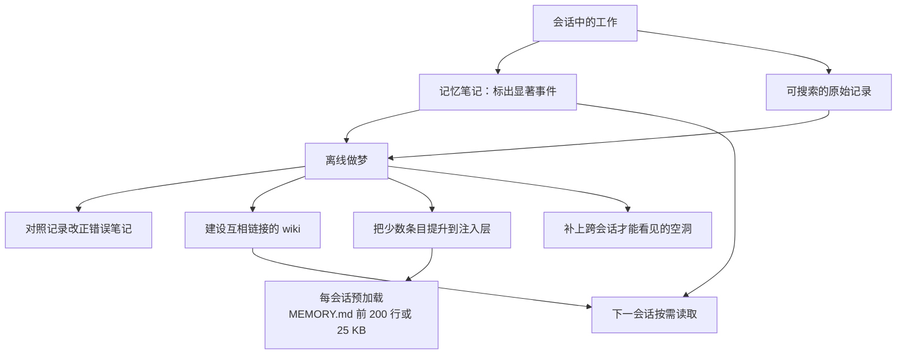

# 代理该记什么：当场记笔记，离线再做梦整理

Claude Code

**一句话看懂**：Anthropic 把代理记忆拆成当场写下的笔记，以及会话之间用“做梦”做的离线整理。笔记是对未来会需要什么的预测；做梦拿原始记录来核对、建 wiki、把少数条目提升到每会话注入的那一层，并补上单次会话看不到的空洞。

## 读完你能带走的 7 条收获

1. **代理记忆不包括权重更新、单次对话内学习和压缩摘要**：它是跨会话保留、稍后能读回来的经验（见 3.1）。
2. **记下来就是一次预测**：写下一条经过核实的事实，等于预测未来会话会依赖它、不必再查一遍（见 3.1）。
3. **显著性判断比“尽量多记”重要**：宝可梦评测里，Sonnet 3.7 写了 413 个文件、225 个文件夹、拿到 1 枚徽章；Fable 5 写了 9 个文件、2 个文件夹，外加一份 `global.md`，拿到 4 枚（见 3.1）。
4. **对更强的模型，告诉它记忆用来做什么，不要规定怎么记**：“只记录失败”让 Opus 5 和 Opus 4.7 失去了记忆带来的大部分增益（见 3.1）。
5. **做梦能拿原始记录改正错误笔记**：写错了月见山宝可梦中心的位置后，未校正的一轮反复掉下悬崖；校正后的笔记让 Claude 回到洞里并到达下一座城（见 3.2）。
6. **wiki 对需要跨文档综合的问题更有用**：内部语料上 128 轮做梦把 25 道题的得分从 13% 拉到 48%；搜索加 wiki 从 54% 到 61%，每题大约少用 2 万 token；Harvey 并购题上 wiki 87%、单用搜索 73%（见 3.2）。
7. **注入层必须很瘦**：Claude Code 的自动记忆只把 `MEMORY.md` 的前 200 行或 25 KB 载入每个会话，当作索引而不是全书（见 3.2）。

::: tip 小白先懂这几个词
- [Agent Memory（代理记忆）](/glossary#agent-memory)：从经验里得到、跨会话保存、稍后能读回的知识。
- [Dreaming（做梦）](/glossary#dreaming)：会话之间的离线整理：对照记录改正笔记、建表示、提升到注入层、补空洞。
- [Auto memory（自动记忆）](/glossary#auto-memory)：Claude Code 把代理自写笔记带进同项目下一会话；`MEMORY.md` 开头是每会话注入的索引。
- Salience（显著性）：此刻什么值得写下。模型变强以后，它自己判断往往比你规定“只记失败”更有效。
- Memory wiki：做梦建出来的一组互相链接的页面，用来在越来越大的记忆库里找路。
:::

## 1. 基本信息

<SourceCard type="文章" title="The components of agent memory" author="Lance Martin" date="2026-11-06" url="https://www.anthropic.com/research/components-of-agent-memory" />

| 项目 | 内容 |
|---|---|
| 链接 | https://www.anthropic.com/research/components-of-agent-memory |
| 类型 | 文章（Anthropic 研究博客） |
| 作者 | Lance Martin（致谢写明 Written by Lance Martin；页面署名 Team: Engineering） |
| 发布日期 | 2026-11-06 |
| 使用工具 | Claude Managed Agents、Claude Code 自动记忆（`MEMORY.md`）；评测用 CL-Bench、宝可梦、Stainless 内部语料、Harvey LAB |
| 分析依据 | 原文全文（2026-11-08 抓取）。数字和结论来自文中评测描述；宝可梦对照是“各一次运行、约 10,000 步时”的记忆文件夹快照，不是多次平均。Stainless 语料约 35 万个文件 / 4.2 亿 token，问的是 25 道内部题。「我觉得」为本站评论。对照 [[46]]：Grok Build 讲回合后记什么；对照 [[143]]：`MEMORY.md` 前 200 行 / 25 KB 的加载预算在此得到官方机制说明；对照 [[45]]：Managed Agents 把事件日志放在 harness 之外。 |

## 2. 这篇在回答什么

人一边生活一边编码记忆，但只有一部分会在睡眠和安静休息时被重放、蒸馏，写进长期知识。代理也有类似的分工：干活时写下日志和笔记，空闲时再回头整理。Letta 和 UC Berkeley 的研究者把这种空闲计算叫 sleep-time compute；用它来对照日志改正错误、写出新笔记和表示，文中称为做梦。

主线三个问题：

1. 代理应该把什么写成记忆？显著性该由谁判断？
2. 离线做梦能做哪些当场记笔记做不到的事？
3. 什么时候该规定“怎么记”，什么问题仍然开放？

## 3. 怎么做

### 3.1 记忆是对未来需求的预测，显著性比“多记”更重要

文中的“代理记忆”指 Claude 从经验里得到的知识——包括与用户的互动和被指派的任务——并在会话之间保留下来，存成稍后能读的上下文。它不包括改权重、单次对话里的学习，以及用摘要替换旧回合的压缩（compaction）。

当场，Claude 可以在会话日志里给显著事件打标，方便以后找，或把它们写进记忆库，例如一个记忆笔记文件夹。困难在于：它怎么在还不知道接下来会发生什么的时候，判断此刻什么显著？

作者的回答是：记忆有时就是预测。

::: tr 记忆偶尔是一种预测。
> "Memory is, occasionally, a prediction."
:::

写下一条规则，等于预测它所描述的模式还会再出现。例如写下一条经过核实的事实，就是预测未来会话会想依赖它、不必再查一遍。模型在这类预测上已经进步很多。

他们用 Continual Learning Bench（CL-Bench）1.0 里的一道题来看学习闭环：Claude 要查数据库回答一系列问题，给出答案后会被告知正确答案，并可以写一条记忆帮以后答题。每次提问都开一个全新会话，唯一例外是可从上一会话留存的记忆目录里取文件。不同模型把这个闭环做到不同深度。Sonnet 4.6 能生成“为什么错了”的理论，记忆目录里是一堆各自列出若干未检验猜测的文件。Opus 4.7 把笔记收成一份参考文档，并开始标明哪些事实已核对、哪些尚未确认。Sonnet 5 在评分器检查后把每个答案标成已确认，答错就写更正。Opus 5 是其中第一个走完闭环的：大多数条目包含一条规则（以及它何以知道这条规则为真）、先前问题的答案，以及对沿途陷阱的明确警告。Opus 5.5 和 Sonnet 5.5 也都走完了闭环；有记忆时两者得分与 Opus 5 大致相当，不过它们在无记忆基线上略高。

宝可梦红是另一项显著性测试。每次运行开始时，模型拿到一个可以读写的记忆文件夹。他们比较了 Sonnet 3.7 和 Fable 5 各一次运行、大约走到 10,000 步时的文件夹。Sonnet 3.7 假定什么都可能有用，不加选择地写：常常每场战斗、每件物品、每个 NPC 单独一个文件。最终它写了 413 个记忆文件、分在 225 个文件夹里，拿到 1 枚徽章。Fable 5 写了 9 个文件、2 个文件夹，外加一份顶层 `global.md`，拿到 4 枚徽章。

问题主要不在“记多少字”，而在游戏状态一直在变。Sonnet 3.7 那份详尽档案不断过期，Claude 花越来越多时间和资源翻自己的记忆，而不是玩游戏。大约第 10,000 步，它开始建第四个“主”记忆文件夹；接下来 17 步里，它新建 6 个文件、删除 9 个，对游戏本身零动作。钱包余额、地图位置这类信息每回合都能从屏幕读到，存下来是多余的。真正只存在于 Claude 推断里、不写就消失的，是策略、计划和经过检验的规则。Fable 5 的 `global.md` 像一块仪表盘：当前目标、一份预先写好的道馆计划，以及它自己的记忆使用规则。`locations` 文件夹放路线计划，`gameplay` 放关于游戏机制的策略。例如连续 7 个精灵球没抓到一条最容易抓的鲤鱼王之后，它写下：如果连续 3 个球失败，就改变按键时机（在菜单步骤之间插入额外的等待）——改了之后立刻抓到了。记忆文件夹小得多的 Fable 5 在游戏里走得更远。Opus 5.5 采取类似做法：保持一小撮追踪当前目标和下一步的笔记，边玩边重写，并打通了游戏。

怎么引导 Claude 写记忆？他们的发现是：

::: tr 我们发现，告诉 Claude 记忆是用来做什么的会有帮助，但不要告诉它该怎么用。
> "We’ve found that it helps to tell Claude what memory is for, but not how to use it."
:::

在 CL-Bench 上，他们只告诉 Claude 有一个记忆文件夹可用。对 Opus 4.7 和 Opus 5 来说，这条笼统指导就足够让它们有效使用记忆，并带来明显提升。他们也试过一次一条地规定“应该写什么”，并比较有无该规则时记忆带来的增益。当规则设成“只记录失败”时，Opus 5 和 Opus 4.7 都失去了记忆带来的大部分性能提升。对更强的模型，让它们自己判断显著性，比事先定死规则更有效，那些规则甚至可能削弱表现。

旧模型则更需要具体指令。Sonnet 4.6 常常不读记忆目录里的文件，也不去检验自己关于“为何答错”的理论。提示它先读记忆再回答、并明确检验这些理论，几乎让它的基准分翻倍。Sonnet 5 不用提示，10 次里有 9 次会在回答前读记忆；Sonnet 4.6 不到一半。对前沿 Claude 模型，他们通常只给简单指导：在有人要求时，或某件事明显值得记住时，创建记忆笔记，判断留给 Claude。

我觉得：这和“规则文件少即是多”（[[20]]、[[116]]）是同一类教训，只是对象从你写给模型的 `AGENTS.md` 换成了模型写给未来自己的笔记。规定“只记失败”听起来很克制，评测里却帮了倒忙。

### 3.2 做梦：核对、建 wiki、提升到注入层、补空洞

当场写下的笔记可能一开始就错，或随着环境改变而漂。后来的会话会读到它，并信任它。做梦让 Claude 拿原始记录检验这些笔记。

宝可梦里有一个正面例子。玩家必须穿过月见山：入口在西、出口在东，入口附近有一块只能单向跳下的岩石，会把玩家送回原路。Claude 把入口旁的宝可梦中心当路标，它是否走下悬崖，取决于它以为中心在山的哪一侧。它一度（错误地）写下中心在东侧。从中心走出来时它宣布“月见山已经在我身后”，并更新笔记：“月见山 DONE。” 月见山并不在它身后。几步之后它走下悬崖，回到来时的路上。导航工具没有显示这段落差，于是它断定“我往西走过头了”，并且自己一直站在正确的一侧。它没有。

他们随后在包含错误位置的记忆文件夹上跑做梦：Claude 对照会话记录抓住错误并重写笔记。记录给了它校验记忆的地面真值。带着改正后的笔记，Claude 直接回到月见山，并最终到达华蓝市。未校正的那一轮里，它三次掉回先前的路上；第三次失败后它写下“我打算停下来，而不是继续打转”。实验设置的自动回复让它继续，于是它一路退回山前的尼比市，希望在那里恢复和补给。那一轮结束时它从未到达华蓝市。没有记忆的对照，以及未校正记忆的对照，都没能过山。

做梦也能建设用来导航记忆的表示。其中一种是 wiki：由 Claude 撰写和维护的一组页面，汇集它关于某一主题知道的事，并链接到其他笔记。这些链接相当于一张地图，让它在越来越大的知识库里高效定位。

他们用 Stainless 的内部文档做评测——约 35 万个文件，大约 4.2 亿 token，评测集是 25 道关于这份语料的问题——并给 Claude 一个搜索工具。同时让它用做梦基于这些文件建 wiki。128 个会话里，他们提示 Opus 5 代理去探索文件、撰写或改正链接页面、合并重复、对照来源检查主张。每个会话接续先前代理的进度，用一份共享日志协调。做梦从 2 个会话扩到 128 个时，25 道题的得分从评分标准的 13% 升到 48%。只使用 wiki 时 Claude 最好的分数是 48%；只使用搜索工具是 53%。搜索加上 wiki，随着 wiki 变大，总分从 54% 升到 61%，并且每题大约节省 2 万 token。早期的 wiki 像新员工的知识，单靠它答题能力有限；做的梦越多，知识地图越像老员工。

不是所有任务都受益。Harvey LAB 基准加上一套并购文件时：24 道并购题里半数以上需要跨多份文件找信息，许多还需要判断或算术，wiki 上 Claude 得到 87%，只用搜索是 73%。另一项 LAB 任务里，多数评分标准能用文本搜索从单一文件取到，wiki 没有明显增益。还有一项任务里，wiki 长得比源文件还大——作者借用博尔赫斯《论科学的精确性》里那张和帝国一样大的地图：Claude 做了一份极细的 wiki，实际上什么也没有抽象。

做梦还可以把笔记“浮”到记忆层级的顶层，由代理 harness 在每个会话开始时预加载进上下文。这样 Claude 不必去搜索，甚至不必知道有东西可搜。注入必须小心：注入的记忆消耗宝贵 token，一条错误笔记会被带进每一个会话；加载也不保证 Claude 会照做——Claude Code 文档警告，更长的指令文件会降低遵从。所以顶层必须相对较小，做梦在这里的大量工作是保持它小：把细节往下层挪，留下链接。Claude Code 的自动记忆用同样方式保持注入层很小，并在会话中由 Claude 维护。它不会把全部自动记忆载入每个会话的上下文，只加载 `MEMORY.md` 的前 200 行或 25 KB。这段开头充当索引，告诉 Claude 它知道什么、去哪找。这与 [[143§3.3]] 观察到的加载预算一致。

做梦也能按特定目标塑形记忆。LAB 的收购任务里，brief 是否正确描述合同条款会被评分。最初的 wiki 指令没有告诉 Claude 怎么使用 wiki，几个代理同时写一张共享的合同条款表，57 条事实里只留下 41 条（72%），因为他们互相覆盖，摘要也差。他们跑了一个循环：Claude 反思失败、提议改指令、重建 wiki。最终每个合同由单个代理写自己的页面，并逐字引用条款而不是摘要进共享表。用改进后的 wiki 生成 brief 时，100% 的评分标准都能满足。第二次做梦还能补上单次会话留下的空洞：在一个任务里，它找到 9 条指向缺失页面的链接，把它们改指到同一文档的已有页面，并新增 3 个页面（包括一份索引）。

仍然开放的问题包括：记忆该在何时创建——当场写会分走对主任务的注意力，推到做梦则不一定能立刻用上；如何让记忆可靠地保持更新——连续检查全部记忆可能不现实，也许该把做梦集中在容易变的信息上，或按访问频率调节节奏；以及是否把记录搜索本身当作记忆的地基——表示加上搜索有时有效，但维护表示、防止错误和幻觉累积，本身就要消耗计算。即使 Claude 的显著性判断已经变好，也没有模型能真正知道未来回合会发生什么。做梦提供一次回头看的机会。

## 4. 结果与局限

数字都来自受控评测，不是某个产品代码库里的前后对照。CL-Bench 展示的是不同模型把“记下来、检验、写成规则”这条闭环做到哪一步；文中没有给出每道题的绝对分，只描述相对行为和“有记忆 vs 无记忆”的增益方向。宝可梦对照是各一次运行、约 10,000 步时的快照：413 个文件 / 1 枚徽章对上 9 个文件 / 4 枚徽章，不是多次平均，版本是 Sonnet 3.7 对 Fable 5。月见山是一次机制演示，带自动“继续”回复。Stainless wiki 用的是约 35 万内部文件和 25 道题，128 会话从 13% 到 48%；搜索加 wiki 的 54% → 61% 和每题约 2 万 token 的节省，也限于这套内部题。Harvey LAB 上 87% 对 73% 出现在需要跨文档综合的那一组；单文档可检索的任务没有明显增益，也有 wiki 长过源文件的反例。合同条款从 41/57（72%）到 57/57，靠的是改做梦指令（一合同一页、逐字引用），不是换模型。这些评测用的是 Claude Managed Agents 和内部基准，读者不能直接复现 Stainless 语料。

## 5. 结论

代理记忆不是“把会话里出现过的事都存下来”。当场笔记是对未来需求的预测；离线做梦用原始记录做校验、结构化和稀疏的预加载。更强的模型更适合你告诉它记忆用来做什么，而不是规定只许记失败；注入层则必须瘦，因为它会进入每一个后续会话。

我觉得：对日常写代码的人，最可搬走的不是宝可梦里的文件夹结构，而是三件事——记策略和经过检验的规则，不记屏幕上随时能读到的状态；给记忆一个“用来做什么”的目的，少写死格式；以及把 `MEMORY.md` 开头当成索引来维护，而不是一本越写越长的日记。wiki 长过源文件的反例也值得记住：表示一旦停止抽象，就变成第二份要维护的语料。

### 你可以这样试

1. 打开项目的 `MEMORY.md`（或等价记忆目录），问：有多少条是“打开文件或跑一条命令就能重新得到的状态”？考虑删掉它们。
2. 给记忆写一句目的（“供未来会话复用经过核实的项目约定和已知陷阱”），不要写“只许记录失败”。
3. 确认 `MEMORY.md` 开头是索引：200 行或 25 KB 以内，细节放在被链接的主题文件里。
4. 抽一条你怀疑已过时的笔记，对照 git 日志或原始会话核对；这就是一次手动的“做梦”。

### 读完自测

1. 文中的代理记忆不包括哪三种东西？
2. 宝可梦对照里，两个模型各写了多少文件、各拿到几枚徽章？差别的关键是什么？
3. “只记录失败”对 Opus 5 和 Opus 4.7 做了什么？
4. Stainless 语料上，做梦从 2 个会话到 128 个会话，25 道题的得分怎么变？搜索加 wiki 呢？
5. Claude Code 每个会话会注入 `MEMORY.md` 的多少内容？为什么顶层必须保持很小？
