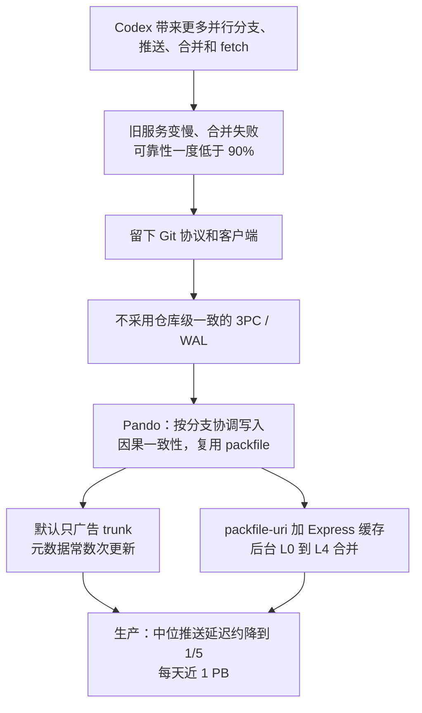

# 并发推送把 Git 服务压垮以后：OpenAI 为什么重建后端却留下协议

通用（不限工具）

**一句话看懂**：OpenAI 没有换掉 Git，而是做了新后端 Pando：按分支独立协调写入，用因果一致性换掉仓库级时间点快照，并把客户端推上来的 packfile 拿来给后来的 fetch 复用。生产里中位推送延迟降了将近 5 倍（后文又写成降低近 80%），每天能送出近 1 PB 的 Git 数据。

## 读完你能带走的 7 条收获

1. **压垮服务的是 Codex 带来的并发分支、合并，以及开发环境、研究作业和 CI 同时涌来的 fetch。** 可靠性一度低于 90%。他们问的是：到极限的是 Git 本身，还是服务 monorepo 的方式（见 3.1）。
2. **留下 Git 协议和客户端，是为了工作流不被打断，并且对客户端的改进可以送回上游。** Pando 不改团队怎么用 Git，从一开始就按这个约束来设计（见 3.1）。
3. **他们建模的 3PC 把副本磁盘和多轮协调放进了推送路径；WAL 虽然能并行上传 pack，共享 manifest 仍是全库瓶颈。** Pando 放弃「所有引用处于同一时刻」来换写入并行（见 3.2）。
4. **因果一致性保证单条引用的更新可串行化，但不提供仓库级时间点快照。** clone 协商期间，一个客户端可能看到 `foo` 第 1 版加 `bar` 第 2 版，另一个看到反过来的组合（见 3.2）。
5. **默认只广告指定的 trunk，是为了让推上来的 pack 可以原样发给后来的 fetch。** 他们 monorepo 里这样产生的 pack 中位不到 20 KiB、99 分位不到 3 MiB；代价是多次推同一功能分支，或把分支叠在另一分支上时，要重发 trunk 以外的全部对象（见 3.3）。
6. **读路径不给每个客户端现场打包：响应里只传空 pack，真正的数据走 `packfile-uri`，由 Express 区域缓存分发。** 缓存命中率超过 99%，标准云虚机上的 clone / fetch 能打满 10 Gbps；后台按 LSM 树的思路把 L0 合并到最多 L4，而且各层 pack 都保留（见 3.3）。
7. **从启动到生产用了 10 周，先以读写穿透代理上线，再把流量切过去。** 他们为代理准备了 Git 行为一致性测试和确定性模拟，并用 Lean / TLA+ 和红队补边；对上游贡献了 `packfile-uri` 相关改进，以及配合 `--force-with-lease` 的 explicit haves（见 3.3）。

::: tip 小白先懂这几个词
- [Monorepo（单体仓库）](/glossary#monorepo)：公司或团队的大量代码放在同一个 Git 仓库里。
- Packfile：Git 把多个对象打在一起压缩存储、也用同一格式在网上传输的文件。
- Ref（引用）：分支或标签这类指向某个 commit 的指针。
- [因果一致性（causal consistency）](/glossary#causal-consistency)：你读到一次写入时，也能读到它所依赖的历史；但不保证仓库里所有分支处于同一时间点。
- [`packfile-uri`](/glossary#packfile-uri)：Git 协议里让服务器另外返回 pack 下载链接、HTTP 响应体只传空 pack 的机制。
- 三阶段提交（3PC）和预写日志（WAL）：两种常见的分布式协调方法。前者靠多数副本多轮确认，后者靠一份共享日志给更新排序。
:::

## 1. 基本信息

<SourceCard type="文章" title="Scaling Git at OpenAI" author="Aaron Friel, Taylor Blau, and Ted Nyman" date="2026-11-02" url="https://openai.com/index/scaling-git-at-openai" />

| 项目 | 内容 |
|---|---|
| 链接 | https://openai.com/index/scaling-git-at-openai |
| 类型 | 文章（OpenAI 工程博客，约 5,200 词） |
| 作者 | Aaron Friel、Taylor Blau、Ted Nyman（Members of Technical Staff, OpenAI） |
| 发布日期 | 2026-11-02 |
| 使用工具 | Git 协议与客户端；自研后端 Pando；建造和迁移过程使用了 Codex。公开发布的 Git 构建在 https://github.com/openai/git |
| 分析依据 | 原文全文（2026-11-10 抓取）。页面上有交互式模拟控件，说明写的是教学用合成模型，不是生产基准；下文不引用控件上的数字，只采用正文里写明的结果。生产数字均为 OpenAI 自报，文中未给出测量方法。开头「中位推送延迟降了将近 5 倍」和部署一节「中位推送延迟降低近 80%」说的是同一方向（大约降到原来的 1/5）。「我觉得」开头的段落是本站评论。对照 [[49]]：Anthropic 的 Scion 面对同类压力，选择离开 Git。 |

## 2. 这篇在回答什么

一个工程师现在可以同时准备好几份改动去送 CI。每一次推送，又可能带起好几份作业去拉同一个提交。分支更多，合并更多，开发环境、研究作业和 CI 的 fetch 也更多。需求会叠在一起。

大约 2025 年底，支撑 OpenAI monorepo 的系统开始跟不上：fetch 和 push 变慢，合并失败，可靠性一度低于 90%。他们没有据此宣布 Git 过时，而是问了另一句：这是 Git 本身的极限，还是我们服务这个仓库的方式到了极限？

全文沿着三条线回答：

1. 为什么并发工作会把旧服务压垮，却还要留下 Git 协议？（3.1）
2. 常见的 3PC 和 WAL 方案卡在哪，Pando 接受了怎样的一致性代价？（3.2）
3. 怎样让 pack 可复用、把读取打满带宽，又怎样上线并回馈上游？（3.3）

这和 [[49]] 是同一类问题的另一份答案。Anthropic 选择离开 Git，自研 Scion；OpenAI 选择留下协议和客户端，把后端换成 Pando。不要把两套系统读成同一个东西换了名字。

## 3. 怎么做

### 3.1 并发分支压垮的是服务方式，他们选择留下 Git

Codex 改变的不只是「写得更快」，而是一个人能并行推进的工作量。那意味着更多分支和推送，更多合并，以及从开发环境、研究作业和 CI 涌来的更多 fetch 和 clone。文中把叠加写得很具体：一个工程师可以同时让好几份改动进入 CI，而一次 push 又能让好几份作业去取同一个提交。

大约去年年底（按文章日期，即 2025 年底），旧系统开始掉队。慢只是一面，另一面是失败的合并，以及可靠性有时掉到 90% 以下。

::: tr 我们遭遇了缓慢的 fetch 和 push，以及失败的合并，可靠性有时会掉到 90% 以下。
> "We suffered slow fetches and pushes along with failed merges, with reliability at times falling below 90%."
:::

他们没有把这当成更换版本控制系统的理由。Git 起源于用邮件交换内核补丁的社区，二十多年来工具和工作方式一直围着它改。作者的判断是：可以留下已经熟悉的工作流，同时重建后端，让指向不同分支的推送并行进行，并把同一段历史并发提供给许多读者。

::: tr 我们做了 Git 仓库的新后端 Pando，没有中断任何工程工作，也没有改变团队使用 Git 的方式。
> "We built Pando, a new backend for Git repositories, without interrupting any engineering work or changing how our team uses Git."
:::

留下协议还有一层用意：对客户端的改进可以在 OpenAI 之外有用。他们把自己这份 Git 的改动往上游送，公开仓库在 `github.com/openai/git`。换句话说，他们赌的是：到极限的是服务 monorepo 的方式，不是 Git 这套对象模型和协议。

Pando 现在支撑 OpenAI monorepo 的全部开发，瞄准两件事。一是水平扩展的写入，针对「同时向许多分支推送」做优化；二是尽量提高读吞吐，让客户端下数据的速度能够打满自己的网卡。开篇给出的生产结果是：<Trans zh="在生产中，Pando 把中位推送延迟降了将近 5 倍。">“In production, Pando cut median push latency by nearly 5x.”</Trans> 每天送出近 1 PB Git 数据。部署一节把同一件事写成 <Trans zh="切换到 Pando 提高了合并可靠性，并把中位推送延迟降低了近 80%。">“Switching to Pando improved merge reliability and reduced the latency of the median push by nearly 80%.”</Trans> 5 倍快，相当于大约剩下原来的 1/5，两条表述是对齐的。测量方法文中没有写。

我觉得：普通团队很难直接复现这种流量，但值得先借他们的提问方式看自己的 Git 服务——变慢的时候，是协议不够用，还是无关分支在同一个协调点上排队，同一段历史被反复现场打包。

### 3.2 放弃仓库级快照，用因果一致性换无关分支并行写

扩展源码管理有两个方向：许多写者推向不同分支，许多读者拉取同一段历史。Pando 对两者都做了优化，也为此改掉了多数 Git 系统当作前提的两件事。

第一件是仓库级一致性。若要提供所有引用在某一时刻的一致快照，就得在整个仓库上做协调；一旦所有 ref 更新被排进同一条顺序，无关分支的推送就会争同一个点。第二件是为每个客户端生成独特的 packfile。两个本地历史不同的客户端来取同一分支时，服务器往往要为各自缺的对象现场打一份不同的包，CPU 和磁盘很快会成为读路径的上限。

3PC 和 WAL 是他们评估过的两条常规路，卡点正好落在这两件事上。

在他们建模的三阶段提交里，若干副本各自保存完整仓库。任一服务器收到推送，都要把到来的 pack 并行拷到所有副本；多数副本接受这次 ref 更新，才能发布。协调者要和各副本多轮通信：先锁住该 ref、检查它仍指向客户端期望的 commit，再发预提交，多数确认后才真正更新。好处是读可以在本地做，无论打到哪一台副本，看到的全部引用都一致。代价也很硬：引用一次只能更新一个，每次推送都要多轮往返；等待法定人数，等于把副本的磁盘性能和通信延迟放进了推送路径。写量上去以后，这些副本既要消化进包，又要服务读。

WAL 方案把「全库排序」换成一份放在 blob 存储里的共享 manifest。服务器可以并行上传 pack，准备好 ref 更新后，用 compare-and-swap 去原子替换这份 manifest；若别人抢先改过，就读出中间条目、检查自己的更新还是否有效，再用已经传上去的 pack 重试。无关分支仍然要改同一份 manifest。成功一次 CAS 的往返时间，限制了仓库发布新快照的频率；批处理可以一次改多个 refs，但会让更新排队，延迟上升。只把 blob 存储加更大，解决不了这个瓶颈。副本还得把 pack 读回来建索引，才能本地服务；写入超过这个进度，读者就要更久才能取到刚推上的提交。

Pando 把这两条都绕开。它提供更松的一致性模型——因果一致性——来扩展写入，再用复用 packfile 来扩展读取。

一次向某分支的推送，会把到来的 packfile 当作不可变 blob 存进 blob 存储；分支每移动一次，就在元数据存储里记下一条 ref version：新的 tip、提供这个 tip 的 pack，以及这份 pack 所依赖的更早 ref version。两套存储都可以水平扩展。之后有人来 fetch 这个引用，服务器并不是按它的本地仓库现场打包，而是回放一组 ref version，把产生该版本的写者状态重建给读者。

由此得到的性质很具体。对单个 ref 的更新是可串行化的，客户端只有同时推同一条引用才会冲突。对整个仓库，一致性更弱：一个客户端同时读几个分支时，不能假定这些读描述的是仓库的同一个时间点。<Trans zh="代价是，一个同时查看多个分支的读者，可能在不同时间点上看见它们。">“The tradeoff is that a reader looking at several branches can see them at different points of time.”</Trans> 文中举了 clone 协商的例子：假如协商期间 `foo` 和 `bar` 都被更新，一个客户端可能看到 `foo` 第 1 版加 `bar` 第 2 版，另一个看到 `foo` 第 2 版加 `bar` 第 1 版。

::: tr 实践中，用户和代理并不在意引用更新的全局顺序，而是依赖对单条引用的更新顺序。
> "In practice, users and agents are agnostic to the global ordering of ref updates, and instead depend on the order of updates to a single reference."
:::

推送到 trunk 时，Pando 追加一份增量 pack；推送到侧分支时，会再次带上该主题更早的提交。这样，已经拥有被广告的 trunk 版本的客户端，可以用一个 pack 取走这个主题。推送过程中，Pando 还控制双方认可的共享历史，好让客户端打出更容易被别人复用的 pack。整次写入对元数据是常数次读写，并用多键事务原子更新 ref 指针，从而提供「读到自己刚写下的内容」的一致性。服务器在流式把 pack 送进 blob 存储时做单遍解码校验，并不把它解压进一份本地仓库。

页面上有一个交互式模拟：1,000 个客户端各选不同分支、反复推独特的提交，比较三种一致性模型的墙钟时间和 push-to-fetch 延迟，并可以切换从普通到高端的虚机和 blob 存储。正文说明，这个模拟里他们也放宽了 3PC 的仓库级一致性。控件本身标明：这些是教学用的合成模型，不是生产基准。正文只给了定性比较——负载下，建模的 3PC 写延迟明显更大，因为磁盘饱和；WAL 的读延迟明显更大，因为服务器赶不上从日志里读——并写了一句同时覆盖真实测试和模拟的话：在他们 monorepo 的真实测试和这个模拟里，Pando 能支持数千个客户端并发推送，并且在负载下不影响性能。成稿把这句当作作者自报的定性结论，不把控件上的过程数字当成生产结果。

我觉得：这个取舍能不能接受，取决于你的工具是不是真的只关心单条分支的顺序。代理并行开很多主题分支、各自推、各自取，通常符合这个假设。若发布、审计或某种内部工具需要「一次 fetch 看到全部引用的同一时刻」，Pando 这种模型从一开始就不适用。3PC 和 WAL 在文中是他们建模的设计，不是对某个具名托管产品的测评。

### 3.3 只广告 trunk 换 pack 复用，再用 URI 和分层合并打满读取

要让后来的 fetch 直接使用某次推送产生的 pack，服务器必须说得清这份 pack 依赖什么。传统 Git 服务器在推送时像摊开全部手牌：把仓库里的分支都广告给客户端，客户端据此排除服务器已经有的对象，打出一份更小的 pack。广告得越多，pack 往往越小，也越难复用——另一个客户端可能恰恰缺了被排除的那些对象。

两个极端都不好用。一个引用都不广告，客户端会打出包含完整历史的 pack，谁都能用，但取任何分支都等于一次全量克隆。把百万级分支全部广告出去，仅广告本身就可能超过 100 MiB，而且还要为「当前所有 ref 的一致视图」付协调成本。文中的观察是：广告更多 refs 确实会让 pack 变小，而大部分体积下降来自只广告一个。

于是默认策略很干脆：

::: tr 默认情况下，当客户端推送一条新的功能分支时，Pando 只广告一个指定的 trunk 分支作为基础。
> "By default, when a client pushes a new feature branch, Pando advertises only a designated trunk branch as a base."
:::

广告大小不随仓库里分支变多而变。代价写在同一段里：工程师若多次推同一条分支，或把一个功能分支叠在另一个上面，客户端就必须重发 trunk 以外的全部对象。连续推送会变大，带上潜在重复的对象，也多占客户端带宽。

对他们自己的 monorepo，这个交换是划算的。<Trans zh="在我们的 monorepo 里，这种方式产生的 packfile 中位数不到 20 KiB，99 分位不到 3 MiB。">“In our monorepo, the median packfile produced this way was under 20 KiB, and the 99th percentile was under 3 MiB.”</Trans> 而一个已经拥有被广告 trunk 历史的读者，用这一个 pack 就能取走该分支。元数据更新还拆成同步和异步两部分，写在同一事务里：同步部分保证别人能立刻 fetch 到新提交；异步部分再去调度后台合并。非常大的推送只有一部分 commit 同步写入，从而无论 pack 多大，元数据读写次数都保持为常数。无关 ref 的推送由不同 Pando 服务器独立接受，唯一争用的键是该 ref 的指针，用类似原子 compare-and-swap 的操作保护。

读路径接着把「可复用」变成「可缓存」。客户端在 fetch 时带上协议里的 `have` 和 `want`。传统服务器要计算可达对象的差集并现场压缩；这类 pack 计算贵，通常也难以缓存。Pando 用推送时记下的映射，把这些 commit 解析成一组 ref version，再选出能覆盖所需对象的已存 pack。想要一个侧分支，也就意味着要带上它在 trunk 上的依赖。选 pack 对元数据是 O(log Δ) 次读取，Δ 是客户端已有版本和想要版本之间最短的 ref version 距离。

Git 的 HTTP 响应本来只允许内嵌一个 pack。协议里有一个作者称为较少被重视的能力 `packfile-uri`：服务器可以另外返回下载链接。Pando 只用这条路径，响应体里传一份空 pack。真正的字节由名为 Express 的分发服务送出。OpenAI 的系统跨很多地理区域，每个区域的 Pando 集群都有本地缓存：Express 缓存 blob 存储，另有服务缓存元数据存储。对某个 commit ID 的请求，或对某个 ref 的特殊读取，可以从该集群已缓存的状态直接回答。他们用一致性哈希把 pack 请求路由到 Express 服务器，缓存命中率超过 99%。用这些 URI 和本地缓存，他们验证过：只用标准云厂商虚机，clone 和 fetch 能把 10 Gbps 的网络链路打满。

还有一个必须处理的问题。在他们这种推送很频繁的 monorepo 里，如果上次 fetch 以来的每一次推送都单独发一个 pack URI，客户端每天光是赶上 trunk 就可能要下载几万个 pack。Pando 在后台合并 pack，做法类似日志结构合并树（LSM tree）里的分层合并。每次推送先形成一个 L0，这是它能传输的最小单位；后台 worker 再把它们收成覆盖一段 ref version 的集合，并从 L0 起按几何级数扩大。今天他们的 monorepo 用到 L4。集合足够满以后，worker 会认领它、打成单个 pack：既提高压缩比，也在 ref version 上形成类似跳表的索引，从而在对数时间里为一次 fetch 选出该发哪些 pack。

和许多 Git 服务器不同，每一层的 pack 都留着，不丢弃，也不做垃圾回收。各层都会按客户端的 `have` 和 `want` 继续提供服务。如果把 Pando 当作 API、从 pack 里读某个对象，从 L0 读往往比从 L4 读更少数据，因为它更不容易被压成对其他对象的差量。分层合并的效果是：发给客户端的总传输量下降，而且 pack 规划相对于客户端落后了多远，可以亚线性扩展。

系统不是只写在纸上。<Trans zh="我们用 Codex 构建 Pando，从启动到生产只用了 10 周。">“We built Pando with Codex, moving from kick-off to production, in just 10 weeks.”</Trans> 核心由一名工程师设计，由成组的代理实现，由少数工程师部署；2026 年 4 月开始承接生产流量。为了让代理改得可检验，他们写了一套对照标准 Git 行为的一致性测试，并做了确定性模拟测试环境，用来检查不变量，发现协商和 pack 规划里的竞态与回退。代理还用 Lean 和 TLA+ 形式化了一套「Pando 的理论」，用来找实现里的缺陷并证明性质；多个连续会话跑了数百小时。他们也全天候用具备 Daybreak 能力的模型，对 Git 和 Pando 做红队测试。实现语言是 Rust，并且没有引入遗留依赖。

上线方式同样保守。Pando 最初是旧源码管理系统的读写穿透代理，两边保持同步，以便在不停机的情况下把流量切过去。缓存层还能在转发前合并和去重请求，于是旧工具可以一个系统一个系统地迁；迁过去的工作负载又用推送把 Pando 的缓存填热，连旧后端的可靠性也一起改善。为了让客户端吃到这些协议能力，他们开始把公开发行的 Git 发到开发者机器和 ChatGPT 桌面应用，并用内部的 Git CLI 包装器分阶段迁移客户端。同时迁走的，还有数百个依赖旧 API、webhook 和仓库下载的集成。他们也为准备已有 checkout、引导代理使用新系统写了 skills，开发者可以直接让 Codex 迁移开发环境和业务。

回馈上游的工作，和「把同一份 pack 发给许多客户端」直接相关。并发下载、中断后的清理、已经下完的传输如何恢复，这些路径被补上后送回了上游；他们也为 `packfile-uri` 下载加了追踪，并为 pack 生成加了字节计数，以便分清一次缓慢的 fetch 是耗在打包上还是耗在传输上。公开的 Git 构建里，客户端可以并行下载并索引互相独立的 pack。他们还增加了 explicit haves：服务器可以把一条分支当前的 tip，和推送客户端可能从 pack 里省略的历史分开广告。在 Pando 上，这让客户端能够用 `--force-with-lease` 确认功能分支没有被别人移动，同时只相对 trunk 打 pack；任何已有这份 trunk 历史的人，都可以用同一份 pack 取走该分支。文中说，若干改进已经进入上游 Git，更多还在他们的公开仓库和补丁跟踪器里。

## 4. 结果与局限

正文里写明的生产数字都是 OpenAI 自报，没有测量方法和时间窗口说明：

| 项目 | 原文表述 |
|---|---|
| 切换前可靠性 | 有时低于 90% |
| 中位推送延迟 | 降了将近 5 倍；后文作降低近 80%（同一方向） |
| 每日传输 | 开篇为每天近 1 PB；后文为「只需一把 CPU 核就能每天送出 1 PB」 |
| 峰值 | 单小时送出超过 57 TB Git pack，其中超过 99% 的字节来自本地磁盘缓存 |
| 只广告 trunk 时的 pack | 中位不到 20 KiB，99 分位不到 3 MiB |
| Express 缓存 | 命中率超过 99% |
| 读带宽 | 标准云虚机上的 clone / fetch 打满 10 Gbps |
| 分层 | monorepo 用到 L4 |
| 工期 | 10 周到生产，2026 年 4 月开始承接生产流量 |

::: tr Pando 曾在单小时内送出超过 57 TB 的 Git pack，其中超过 99% 的字节来自本地磁盘缓存。
> "Pando has served more than 57 terabytes of Git packs in a single hour, with more than 99% of those bytes from local disk cache."
:::

交互式模拟里 1,000 个客户端、三种架构的对比，是教学用的合成模型，不是生产基准。正文把「monorepo 上的真实测试」和「这个模拟」写在同一句里，用来支持「数千客户端并发推送」的定性说法，但没有单独给出真实测试的方法或曲线。控件上出现的过程数字，本文不用。

Pando 目前只在 OpenAI 内部使用，是更大一套源码管理工具里的一部分。文末说他们在探索向用户分享使 Pando 成为可能的技术，也在探索大量代理共同使用一个 Git 仓库这类内部负载。这不是产品发布，外面的团队今天并不能把仓库迁到 Pando 上。

和 [[49]] 对照，两边面对的都是代理把 monorepo 的源码管理推到极限，结论却分道了。Scion 不再把 Git 当作工作流基础，数据单位改成 changeset，派生数据按需计算，客户端不必持有完整仓库。Pando 反过来把 Git 协议和客户端当成约束，换后端、换一致性模型。两边都报出超过 99% 的缓存命中，都用自己的编码代理加速建造；但 Scion 是约 7 个人、5 个月完成系统和迁移，Pando 是「一人设计、代理实现、少数人部署、10 周到生产」，口径不能直接比较。Scion 的作者明说它不适合作为通用场景下的 Git 替代；Pando 则还不能给外人用。OpenAI 这条路的一个可见结果，是 `packfile-uri` 和 explicit haves 这类改动有机会回到上游 Git。

::: warning 局限与注意
- 所有生产数字均为作者自报，没有测量方法、对照基线和仓库规模（历史体积、分支数、并发客户端数）的完整披露。
- 「将近 5 倍」和「近 80%」应对齐理解，不要当成两次独立实验。
- 交互模拟不是生产基准；「数千客户端并发推送不影响性能」是把真实测试和模拟写在一起的定性判断。
- 3PC 与 WAL 是他们建模的设计，不是对某一托管 Git 服务的点名评测。
- Pando 未开放。可借鉴的是取舍，不是一套可以 tonight 部署的服务。
:::

## 5. 结论

Pando 的核心不是「我们重写了 Git」，而是：在必须留下 Git 工作流的前提下，放弃仓库级时间点快照，按分支做可串行化的写入，并把 packfile 从「为每个客户端现场计算的响应」改成「可以缓存、可以共享的字节」。对 OpenAI 自己的 monorepo，这个交换换来了更短的中位推送延迟、更高的合并可靠性和可以打满网卡的读取。它也要求你接受：同时看多个分支时，它们未必处于同一时刻；叠在别人分支上推送时，可能反复重发 trunk 以外的对象。

我觉得：对大多数团队，这篇的用处不在于去仿造一套 Pando，而在于先分清自己的痛是协议问题还是服务方式问题。若无关分支已经在同一个协调点上排队，或同一段历史被反复现场打包，文中的两条思路——缩小广告面以换 pack 复用，以及认真看待「要不要仓库级快照」——比 10 周建成的故事更可搬走。用代理写基础设施时，更值得看的也不是工期长短，而是他们先为代理准备了一致性测试、确定性模拟和形式化规格。

### 你可以这样试

1. 看自己的 Git 服务在高峰时，无关分支的推送是否互相等待；如果是，瓶颈更可能在全库协调，而不在单条分支的冲突检测。
2. 量一次推送时服务器广告了多少 refs、广告体积有多大。分支非常多时，先确认这是不是已经超过 100 MiB 量级，再谈要不要全部广告。
3. 如果你在评估「放宽仓库级一致」，先列出哪些内部工具默认假定一次 fetch 里看到的全部分支处于同一时刻。
4. 若你也在给许多客户端发同一段历史，关注上游 Git 里与 `packfile-uri`、并行索引 pack、explicit haves 相关的改进，而不是等待 Pando 开放。

### 读完自测

1. OpenAI 认为把自己 monorepo 压到可靠性低于 90% 的，主要是什么负载？他们为什么仍留下 Git？
2. 在 Pando 里，一个客户端同时读取 `foo` 和 `bar` 时，为什么不能把这两次读取当成仓库的同一个时间点？
3. 默认只广告 trunk，换来了什么？在哪种推送模式下客户端反而会多传数据？他们自己的 pack 体积是多少？
4. `packfile-uri` 和 Express 在读路径里各做了什么？L0 到 L4 的分层合并为什么不删除旧层？
5. 开篇的「将近 5 倍」和后文的「近 80%」是什么关系？为什么不能把页面上的交互模拟当成生产基准？
