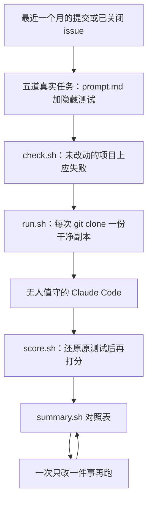

# 换模型别只凭感觉：用自家任务给编码代理搭一套评测

<div class="meta-tags"><span class="tool-tag tool-claude">Claude Code</span></div>

<div class="hook">

**一句话看懂**：从自己项目的 git 历史里抽出几道真实任务，把评测和隐藏测试放在项目旁边，用脚本在干净副本里反复跑代理、打分，一次只改一件事（比如模型），看表格上的数字有没有动。

</div>

## 读完你能带走的 7 条收获

1. **评测要放在项目旁边，不要放进去**：项目里的东西代理都能读，不能让它读到打分用的隐藏测试（见 3.1）。
2. **任务从最近的提交和已关闭 issue 里挑，prompt 按平时的写法**：不要打磨成完美规格，你要看的是代理怎么应对日常提示（见 3.1）。
3. **成功 = 隐藏测试通过，并且还原后的原测试套件仍通过**：改受保护路径、以及没过 linter / formatter，算失误，和成功分开计数（见 3.2）。
4. **隐藏测试只测 prompt 真正要求的事**：先用 `check.sh` 确认未改动的项目上全失败，再用你自己的正确解确认能通过——作者有一道测试在自己的正解上失败了（见 3.2）。
5. **打分前先把原来的测试文件 checkout 回去**：否则代理可能靠改测试让套件通过（见 3.2）。
6. **无人值守要隔离个人配置、关掉自动记忆、打开沙箱**：通过率看不出权限拒绝，第一次跑完即使全过，也要查 `permission_denials`（见 3.3）。
7. **一次只改一件事**：默认每题至少跑 3 次；15 次里 14 对 13 说明不了问题；两套配置都全过，只说明这些题太容易（见 3.4）。

::: tip 小白先懂这几个词
- [Evals（评测）](/glossary#evals)：用一套固定任务、同样的跑法、由脚本打分，用来比较代理或配置有没有变好。
- [隐藏测试（Hidden tests）](/glossary#hidden-tests)：代理做题时看不到、结束后才拷进项目里打分的测试，避免它按测试特判。
- [Sandbox（沙箱）](/glossary#sandbox)：限制代理只能在划定范围内写文件、访问网络的隔离环境。
- [Headless（无界面模式）](/glossary#headless)：不打开交互界面，用一条命令把任务交给代理并拿回结果，适合脚本。
- [Task / Trial（题目 / 一次作答）](/glossary#eval-task-trial)：一道评测题要跑多次；同一 prompt 下代理不会每次做同样的事。
- [Reward hacking（奖励黑客）](/glossary#reward-hacking)：想办法让评分信号变绿，却没按出题意图解题，比如改测试或只特判测试里的值。
- [Hill-climbing（爬山式迭代）](/glossary#hill-climbing)：一次只改一处，用同一套指标看数字有没有动，变好就保留。
:::

## 1. 基本信息

<SourceCard type="文章" title="Build an Eval for Your Coding Agent" author="Alex Garrett-Smith" date="2026-11-03" url="https://unlearn.dev/blog/build-an-eval-for-your-coding-agent" />

| 项目 | 内容 |
|---|---|
| 链接 | https://unlearn.dev/blog/build-an-eval-for-your-coding-agent |
| 类型 | 文章（Unlearn 博客，页面标注 16 min read） |
| 作者 | Alex Garrett-Smith |
| 发布日期 | 2026-11-03 |
| 使用工具 | 主演示是 Claude Code（`claude -p`、沙箱和项目级设置）；作者写明代理命令可换成 `codex exec` 或其他无需人盯着的代理 |
| 分析依据 | 原文全文（2026-11-10 抓取；页面 H1 为 Build an Eval for Your Coding Agent，txt 从正文第一段起）。脚本、命令和数字以原文为准；对照表来自作者的小商店应用，不是生产仓库的多次平均。文末有 Unlearn 付费课程和 Toolkit 导流，第 4 节如实写出，不当作步骤。「我觉得」开头的段落是本站评论。对照 [[19]] 的评测入门、[[57]] 课程里构造的 CI 示例，以及 [[62]]、[[138]] 关于评测可信度和隔离 harness 的讨论。 |

## 2. 这篇在回答什么

换了模型，或在规则文件里加了一句指令，接下来几道任务好像顺了一点——这算改进吗？多数时候我们只是凭感觉决定。作者要的是一个可以重复的答案：

::: tr 它是从你项目里取出的一小把真实任务，每次用同样的方式跑，由脚本打分，这样你就可以改一件事，看数字会不会动。
> "It's a handful of real tasks from your project, run the same way every time and scored by a script, so you can change one thing and see whether the numbers move."
:::

这和公开基准不是同一件事。任务来自你的 git 历史，隐藏测试按你平时会写的 prompt 出题，评测目录放在项目旁边，免得代理读到自己的考卷。主演示用 Claude Code，但项目相关的安装、测试和 linter 都进 `config.sh`，其余脚本只用 bash、git 和 jq。

主线四个问题：

1. 任务从哪来，评测为什么必须放在项目外面？
2. “成功”怎么变成脚本能回答的事，又怎么防止代理作弊？
3. 怎样在干净副本里无人值守地跑，并且先检查测试和权限拒绝？
4. 怎样一次只改一件事，读对照表时又不被总分骗到？



## 3. 怎么做

### 3.1 任务从自家 git 历史来，评测放在项目旁边

作者说，五道任务就够起步。最好的来源是自己的 git 历史：回看最近一个月的提交或已关闭 issue，挑你会交给代理的活。修 bug 特别合适——修复前提交是起点，随修复带上的测试能告诉你有没有修好。搭配上尽量混合：修 bug、小功能，以及会动到数据库的改动。

他在一个带商品、优惠券和购物篮合计的小商店应用里选了五道，后文的数字都来自这个应用：

- `fix-percent-coupons`：百分比优惠券被当成固定金额扣，一张 10% 的券只扣 10p。
- `product-search`：给商品接口加上 `search` 参数。
- `product-validation`：修好校验，避免重复 SKU 导致 500 错误。
- `low-stock-command`：一条新的控制台命令，列出库存偏低的商品。
- `discontinue-products`：需要新增一个数据库列。这道题专门给代理一个常犯的机会：去改已经存在的 migration，而不是再加一条新的。

每道任务一份 `prompt.md`，按你平时会打的写法写。作者特意说，不要把它们打磨成完美规格：

::: tr 不要把这些打磨成一份完美规格，因为你想知道代理如何应对你平时的提示。
> "Don't polish these into a perfect spec, because you want to know how the agent copes with your normal prompts."
:::

优惠券那道是这样的：

```text
Customers are reporting that percentage coupons take off the wrong amount. A 10% coupon on a £50 basket only takes 10p off. Fix it so percentage coupons work properly.
```

评测目录不放进项目里，而放在旁边：

```text
my-app/                    # your project
evals/
├── tasks/
│   ├── fix-percent-coupons/
│   │   ├── prompt.md
│   │   └── tests/
│   ├── product-search/
│   └── ...
├── config.sh
├── check.sh
├── run.sh
├── score.sh
├── summary.sh
└── results/
```

原因很直接：

::: tr 评测放在项目旁边，而不是里面。项目里的任何东西代理都能读，而我们不想让它读到用来打分的测试。
> "The evals live next to the project rather than inside it. Anything inside the project is something the agent can read, and we don't want it reading the tests we're going to mark it with."
:::

项目相关的差异——怎么安装、怎么跑测试、用哪种 linter——全部进 `config.sh`：`PROJECT_DIR`、`SETUP_CMD`、`TEST_CMD`、`TESTS_DIR`，以及隐藏测试的目录和命令；可选的还有 `LINT_CMD` / `LINT_FILES`，和标记“已存在就不该再改”的 `PROTECTED_PATHS`（例如 `^migrations/` 或 lockfile）。

`SETUP_CMD` 最需要想清楚。`git clone` 只拷已经提交的内容，依赖、`.env`、本地数据库这些不在 git 里的东西，要在这里准备好。可以用 `&&` 把命令串起来，并用 `$PROJECT` 指向原来的项目拷文件。值里如果提到 `$PROJECT`，要用单引号包起来，让变量在命令真正执行时再展开，而不是加载配置时就展开。

这和 [[57§3.2]] 里那条写在仓库内部、用 JSON 描述的 eval 是互补的：那里是课程里构造的例子，用来演示配置改了会不会变差；这里要测的是代理在你自己的项目上能不能把活做完，所以考卷不能留在它伸手就够得到的地方。隔离 harness 本身，[[138§3.4]] 从另一个方向讲过：先把要比较的配置变成一份可版本化的输入，再谈分数。

### 3.2 成功由脚本判定，并先防止代理作弊

“有没有做好”必须是脚本能回答的问题。作者每次运行检查三件事。

第一件，隐藏测试通过。每道任务在自己的 `tests/` 里，用项目已有的测试框架写测试。代理看不到它们，因为只在它做完之后才拷进项目。优惠券任务有三道：把一件 £12.50 的商品放进篮子、加一张 20% 的券，期望合计是 £10.00；一张 100% 的券应让篮子免费；固定金额的券则仍应可用。

为什么要藏起来？

::: tr 如果代理能看见自己正在被打分的测试，它可以用你绝不会接受的方式让测试通过，比如针对测试里的值做特判。
> "If the agent can see the tests it's being marked on, it can get them passing in ways you'd never accept, like special-casing the values in the test."
:::

写的时候也只测 prompt 真正要求的事。作者故意用 20% × £12.50，因为结果是整便士，而 prompt 从未说明怎么四舍五入。如果改成测 15% × £9.99，就是在用一个从未告诉代理的取整规则给它打分。

第二件，项目原来的测试套件仍然通过。修好优惠券、却把购物篮合计弄坏，不算成功。跑这套测试之前，要先把原来的测试文件放回去：

::: tr 把原来的测试放回去，这样代理就不能靠改测试过关。
> "Put the original tests back, so the agent can't pass by editing them"
:::

`score.sh` 里对应的是对起始 commit 做 `git checkout --quiet "$start" -- "$TESTS_DIR"`。代理自己新写的测试文件会留下，这没问题。一套运行只有隐藏测试和原套件都通过，才记为 success。这和 [[57§3.4]] 里“别让代理靠改规则过关”是同一类防护，只是对象从评测规则换成了测试文件。

第三件，没有明显失误。有些改动即便测试全绿，在 pull request 里也会被打回。作者计两类：改了或删了已经存在、且落在受保护路径上的文件（新建文件算 `A`，这正是你想要的，比如一条新的 migration）；以及它新增或改过的文件没过 linter / formatter。linter 只跑代理动过的文件，避免把项目里原来就有的问题算到它头上。作者建议先对整个项目跑一遍 linter，把修复提交后再开始。

这些失误和成功分开计数。一次运行可以测试全过，却仍然有失误，两种都要看见。

代理还没上场之前，先检查测试本身。`check.sh` 会 clone 一份未改动的项目、执行 `SETUP_CMD`，再把每道任务的隐藏测试逐个拷进去跑。每一道都应该显示 `fails`。如果某道显示 `passes`，说明测试并没有在检查这道任务要求的事。作者还建议你自己读一次失败输出，确认败因是对的，而不是测试写错了。

然后用脚本留下的那份副本，自己把每道题解一遍，再跑隐藏测试。作者说这二十分钟值得花，因为他有一道测试在自己的正确解上失败了。那是 `low-stock-command`：测试先在输出里找商品名，再找 SKU，但测试框架在一行上匹配到一次之后，就不再看这行；名称和 SKU 正好在同一行，第二次检查永远过不了。若不先自检，他会把每一轮代理都判失败，然后怪代理。

我觉得：这一步比对照表更值钱。评测一旦写错，后面所有“模型 A 比模型 B 好”都站不住，[[62§3.1]] 讲的也是同一件事——先问这套评测值不值得相信，再拿它去爬分。

### 3.3 在干净副本里无人值守地跑，并检查权限拒绝

Claude Code 的 `-p` 会跑完一条 prompt 就退出，正适合脚本。作者实际使用的命令是：

```bash
CLAUDE_CODE_DISABLE_AUTO_MEMORY=1 claude -p "$(cat prompt.md)" \
  --output-format json \
  --setting-sources project \
  --strict-mcp-config \
  --no-session-persistence \
  --permission-mode acceptEdits \
  --permission-prompts none \
  --allowedTools "Bash" \
  --settings '{"sandbox": {"enabled": true, "allowUnsandboxedCommands": false, "failIfUnavailable": true}}' \
  --model sonnet < /dev/null
```

这些旗帜要解决的是三件不同的事。

一是把数字拿回来。`--output-format json` 会返回最终消息，以及费用、时长、轮数和 token。token 后来从 `modelUsage` 里读，这样会包括它拉起的子代理，而不是只统计主对话的 `usage`。输入 token 含缓存读取，通常占总量的大头，因为提示词和对话在每一轮都会被再读一次。若你用的是 Claude 订阅而不是 API key，`total_cost_usd` 是按 API 价格估算的费用，不是你实际在付的钱，但用来比较两套配置足够好。

二是把你个人的配置挡在外面。评测要测的是项目的设置，所以 `~/.claude` 里的东西不能漏进来。`--setting-sources project` 只加载项目的设置和指令文件（`CLAUDE.md` 或 `AGENTS.md`），跳过用户级的。`CLAUDE_CODE_DISABLE_AUTO_MEMORY=1` 关掉自动记忆，避免一轮写下的笔记漏到下一轮。`--strict-mcp-config` 表示除非你显式传入，否则不加载 MCP，包括你已登录的 claude.ai connectors。`--no-session-persistence` 则是为了整洁，免得每次 eval 都出现在 `/resume` 列表里。

三是让它在没人批准的情况下仍能工作，同时又出不了项目副本。`--permission-mode acceptEdits` 允许它改文件，`--permission-prompts none` 拒绝那些本会向人请示的操作。沙箱打开后，操作系统只允许代理在这份项目副本里写文件，并拦住网络；`allowUnsandboxedCommands: false` 禁止它在沙箱外重试被拦截的命令，`failIfUnavailable: true` 则在沙箱不可用时直接拒绝启动，而不是关掉沙箱继续跑。有了这些，`--allowedTools "Bash"` 才允许它不问就跑命令——因为每条命令仍在沙箱里。末尾的 `< /dev/null` 是为了不让 Claude Code 空等 3 秒 stdin、再打印一条警告。

作者第一次没把这件事做对。他起初只允许项目的测试命令，其余一概不准，听起来很稳妥。结果五道任务里有四道，试图在同一条 Bash 里既写文件又跑测试，被拒绝后干脆没跑测试。它们的最终消息甚至写了自己没跑测试，可他当时还没去读这些消息。打开沙箱之后，仍有三分之二的运行带着一次拒绝：沙箱对又长又复杂的命令不会自动批准，没人回答就否决了。加上 Bash 的 allow 规则之后才解决。他后来让代理去 `touch` 家目录里的一个文件，得到 `Operation not permitted`，确认沙箱仍然有效。

::: tr 这两类问题都没有反映在通过率上，所以即使一切都通过了，第一次跑完也要检查拒绝次数。
> "Neither problem showed up in the pass rate, so check the denials after your first run, even if everything passes."
:::

`run.sh` 把这条命令包起来。用法是 `./run.sh <label> [extra claude flags...]`，默认每题跑 3 次（`ATTEMPTS=${ATTEMPTS:-3}`）。每一次尝试都 `git clone` 到临时目录，在里面执行 `SETUP_CMD`，记下起始 commit，再把 label 之后的参数（例如 `--model sonnet`）原样传给 `claude`。因为 clone 只拷已提交的内容，开跑之前要先 commit 或 stash。跑完调用 `score.sh`，把一行 JSON 追加进 `results/<label>/results.jsonl`，然后删掉这份副本。

如果要比较的不是一面旗帜，而是一个文件（比如一份 `CLAUDE.md` 或项目设置），就把它放进 `evals/variants/<label>/`。脚本会在代理开工前拷进去并提交，这样这些文件不算代理的改动。

我觉得：第一次跑完先看拒绝次数、再看通过率，应当写成这套脚本的使用说明，而不是排障附录。通过率是滞后指标，权限问题在它之前就已经把代理的手绑住了。

### 3.4 一次只改一件事，并学会读这张表

脚本可执行之后，先拿一条基线：

```bash
./run.sh baseline --model sonnet
./summary.sh baseline
```

作者强调，即使是你平时就在用的模型，也要显式传进去。`sonnet` 这样的别名指向最新版本，如果比较做到一半时发布了新版，两轮就不再是同一个模型。若打算长期对照这份基线，改用完整模型名——撰文时是 `claude-sonnet-5-5`，可以在任一 JSON 的 `modelUsage` 里看到。

默认每题 3 次，五道题就是 15 轮。代理对同一条 prompt 不会每次做同样的事，每题只跑一次信息很少。3 是作者认为的最低值，负担得起就更多。这 15 轮大约花了五分钟、约 90 美分，汇总表是：

```text
label     success  mistakes  avg time (s)  avg turns  avg tokens in  avg tokens out  avg cost ($)
baseline  15/15    3         17            6          105238         1534            0.06
```

15 轮全过。3 次失误都是代码没过项目的 formatter——说得通，因为没有人告诉代理这个项目在用 formatter。

接着只改一件事。作者试了 Haiku：它比 Sonnet 便宜得多，问题是这类工作对它够不够用。

```bash
./run.sh haiku --model haiku
./summary.sh baseline haiku
```

```text
label     success  mistakes  avg time (s)  avg turns  avg tokens in  avg tokens out  avg cost ($)
baseline  15/15    3         17            6          105238         1534            0.06
haiku     15/15    0         22            10         168526         3469            0.006
```

Haiku 也是 15/15，一次失误都没有，费用大约是十分之一。它用了更多轮数和更多 token，平均慢几秒，但每个 token 便宜得多，所以这点差别无所谓。零失误出乎作者意料，他去读了最终消息（例如 `jq -r .result results/haiku/product-validation-1.json`）：Haiku 在 15 条最终消息里有 10 条提到跑了 formatter，Sonnet 只有 3 条。这种差别，日常用下来很难注意到。

也可以改 `--effort high`，或把 `--mcp-config` 指向一个 MCP 服务器；要测文件就用上面的 variant 目录。作者写得很干脆：

::: tr 一次只改一件事，否则你不会知道是哪处改动起了作用。
> "Just change one thing at a time, otherwise you won't know which change made the difference."
:::

这和 [[62§3.3]] 说的“不要自欺”是同一条纪律，只不过这里的指标是你家仓库上的隐藏测试，而不是内部基准。

汇总会把单道翻车的任务平均掉。作者给了一段按任务拆开的 `jq`。在这五道题上，两个 label 都是每题 3/3；Haiku 的轮数一律更高，单次平均费用大约在 0.005 到 0.008 美元之间。若某次运行真的失败了，先查原因再怪代理：最终消息在 JSON 的 `result` 字段里；若把 `run.sh` 里的 `rm -rf "$dir"` 注释掉，还能留下它写出的代码。作者早期的许多失败，其实是 harness 或隐藏测试的问题。

读表时还有两条提醒。十五轮并不多：

::: tr 十五次运行并不多。如果一套通过 14 次、另一套通过 13 次，这完全落在你把同一套配置跑两遍也会看到的波动里，所以不要据此改任何东西。
> "Fifteen runs isn't a lot. If one setup passes 14 and another passes 13, that's well within what you'd get from running the same setup twice, so don't change anything because of it."
:::

要找的是跨任务站得住的差异，或者加次数直到有把握。另外，如果像这次一样全部全过，说明这些任务太容易，单靠成功率已经分不出两套配置。这本身也是一个有用的答案。

就这五道任务，作者学到的是：Haiku 能做，价格大约是十分之一；Sonnet 需要被告知项目在用 formatter。若想知道 Haiku 能不能应付更难的活，就需要更难的任务。最好的来源是自家代理在真实工作里的失败——每次出错，就把它做成一道题，并配上本来能抓住这次出错的隐藏测试。

建好之后，再跑只需一条命令。作者会在新模型发布时重跑，也会在加入任何改变代理工作方式的东西（例如新的 MCP 服务器或 hook）之前重跑。不同 label 还可以在不同终端同时跑，因为每一轮都有自己的项目副本。

## 4. 结果与局限

文中真正跑出来的，是这个小商店应用上的 15 轮对照：Sonnet 与 Haiku 都是 15/15；Sonnet 有 3 次 formatter 失误，Haiku 为 0；平均时长 17 秒对 22 秒，轮数 6 对 10，平均费用 0.06 美元对 0.006 美元。基线大约五分钟、约 90 美分。按任务拆开后，五道题在两边都是 3/3。Haiku 在 15 条最终消息里有 10 条提到 formatter，Sonnet 是 3 条。这些是一次教学演示的结果，不是生产仓库上的多次平均，也不能推广成“Haiku 做任何编码工作都够用”——作者自己写了，若要回答更难的工作，需要更难的任务。

订阅方案下的 `total_cost_usd` 是按 API 价格做的估算，不是实际扣费。`sonnet` / `haiku` 是会跟随最新版的别名，长期对照要用完整模型名。已发表的 `check.sh` 在打印副本路径时写成了 `The untouched copy is at$dir`，少了一个空格；`score.sh` 里是 `eval "$LINT_CMD$lint_files"`，命令和文件名之间没有空格，填写 `LINT_CMD` 时需要自己留意。

Unlearn 是一个带课程和 Toolkit 的产品站。正文本身是一套可核对的做法，但文末“Where this fits / Keep going”会导向标了 Plus 的付费课程，以及若干审查类 skill。那是导流，不是这套评测的步骤。

## 5. 结论

给编码代理搭评测，不必先拥有一份公开基准。从自家 git 历史里取出几道真实任务，把考卷放在项目够不着的地方，用脚本在干净副本里反复跑、打分，一次只改一件事，看表上的数字动不动。隐藏测试、还原原测试、把失误和成功分开计，是为了不让代理用你不能接受的方式把分数做绿；查 denials、先验证测试本身，是为了不把 harness 的故障算到模型头上。

我觉得：最该搬走的不是“Haiku 全过而且便宜十分之一”这张表，而是三件更硬的事——测试放在项目外、打分前还原原测试、一次只改一件事。表上的 15/15 恰恰说明，题目不够难时，成功率会失去分辨力；这时更有用的信号，可能是失误次数、是否主动跑 formatter，以及真实失败里长出来的下一道题。

### 你可以这样试

1. 从最近一个月的提交或已关闭 issue 里挑 5 道你会交给代理的任务，按平时的口气各写一份 `prompt.md`，不要先打磨成规格。
2. 在项目旁边建 `evals/`，把隐藏测试放在每道任务自己的 `tests/` 里；确认这些测试不在代理能读到的项目目录中。
3. 填好 `config.sh`，先跑 `./check.sh`：未改动的项目上每一道都应失败。再自己解一道，确认隐藏测试能通过。
4. 跑 `./run.sh baseline --model <你的完整模型名>`，然后只改一件事（换模型、加一份 `CLAUDE.md`，或打开一个 MCP），用新的 label 再跑，对照 `summary.sh`。第一次跑完先看 `permission_denials`，再看通过率。

### 读完自测

1. 为什么评测目录要放在项目旁边，而不是放进项目里？
2. `score.sh` 在跑项目原有测试套件之前，会先做什么？为什么？
3. 作者那道在自己的正确解上失败的隐藏测试，错在哪里？
4. 为什么第一次跑完即使全部通过，也要检查 `permission_denials`？
5. 在这五道任务上，Sonnet 和 Haiku 的成功次数、失误次数和大约费用分别是什么？作者为什么说这还不能回答“Haiku 能不能做更难的活”？
