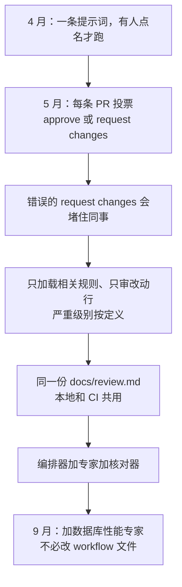

# 错误的 request changes 会堵住同事：五个月演化的审查剧本

Claude Code

**一句话看懂**：一套 PR 审查从一条提示词长成剧本、六位专家代理和核对器；几乎每一步都是在修假阳性、误伤旧代码、情绪化的严重级别，以及一次塞太多规则时会编造问题，好让机器人敢于在每条 PR 上投票。

## 读完你能带走的 7 条收获

1. **官方 Code Review 默认找正确性 bug，既不批准也不阻塞 PR**：若要按书面架构强制执行、并且给出裁决，需要自己准备一份剧本（见 3.1）。
2. **规则还在定型时，只在有人点名时跑**：一旦机器人会提交 `request changes`，一次误报就会堵住同事，噪声从打扰变成成本（见 3.2）。
3. **按路径加载规则，只审查改动或新增的行，严重级别按定义而不是临场判断**：一次加载全部规则会让审查者报告并不存在的违规（见 3.3）。
4. **本地 `/review` 和 CI 共用一份 `docs/review.md`**：BLOCKING 必须引用架构规则的文件和章节，风格最高只到 WARNING，不因风格阻塞遗留代码（见 3.3）。
5. **编排器自己不审查，按文件把活分给专家**：核对器检查引用的文件、摘录、是否落在这次 diff 里、规则是否真那样写，通不过就默默丢掉（见 3.4）。
6. **假阳性远比假阴性糟**：核对器不得重评严重级别，也不得自己追加发现（见 3.4）。
7. **后来加上的数据库性能审查可以阻塞遗留代码**——这是“不阻塞遗留代码”的唯一有意例外；加一位专家不必改 workflow 文件（见 3.4）。

::: tip 小白先懂这几个词
- [PR Review Bot（PR 审查机器人）](/glossary#pr-review-bot)：在 Pull Request 上自动留言、甚至提交 approve / request changes 的审查代理。
- [Playbook（剧本）](/glossary#playbook)：为一项重复任务写好的固定说明；这里是本地和 CI 共用的审查规则。
- [Review Rules（审查规则）](/glossary#review-rules)：写给 AI 审查器的、按目录或文件类型生效的仓库检查项。
- [Precision / Recall（精确率 / 召回率）](/glossary#precision-recall)：精确率是报出的问题里有多少是真的；召回率是真实问题里有多少被报出来。这套设计明确优先前者。
- [核对器（Verifier）](/glossary#finding-verifier)：不负责找新问题，只检查别人的发现能不能被证明；证明不了就丢掉。
- [Subagent（子代理）](/glossary#subagent)：主代理派出去只做一件事的分身，这里是各自只持有一套规则的专家审查者。
:::

## 1. 基本信息

<SourceCard type="文章" title="Claude Code Review in Production: How Our Review Rules Evolved Over Five Months" author="Rohan Sen Sharma" date="2026-09-28" url="https://nulltensor.com/posts/claude-code-review/" />

| 项目 | 内容 |
|---|---|
| 链接 | https://nulltensor.com/posts/claude-code-review/ |
| 类型 | 文章（nulltensor.com，页面标注 8 min read） |
| 作者 | Rohan Sen Sharma（页面署名 CTO & Backend Engineer） |
| 发布日期 | 2026-09-28 |
| 使用工具 | Claude Code（GitHub Actions 中的官方 action、本地 `/review`；文中对照了 Anthropic 托管的 Code Review） |
| 分析依据 | 原文全文（2026-11-10 抓取）。页面 H1 与 og:title 为 Claude Code Review in Production: How Our Review Rules Evolved Over Five Months；HTML `<title>` 是另一句 What Five Months in Production Taught Us，SourceCard 采用 H1。文中没有假阳性率或拦截数；可复制模板在单独一页，本页未给出其正文，文中只注明有这份链接。「我觉得」开头的段落是本站评论。对照 [[31]]、[[60]]、[[75]]、[[90]]、[[144]]。 |

## 2. 这篇在回答什么

一个会在每条 pull request 上投票的审查机器人，错一次的代价不是多一条嘈杂评论，而是把同事的分支堵住。作者所在的团队把 Claude Code 审查从 GitHub workflow 里的一条提示词，做成一份剧本、六位专家代理，以及一个无法证明就扔掉发现的核对器。中间几乎每一步，都是在反应某个已经出过的错：规则还没定稳时的假阳性，对 PR 从未改动过的代码的发现，随模型情绪起伏的严重级别，以及一次塞太多规则时审查者会编造问题。

主线四个问题，外加文末问答：

1. 官方已经有托管的 Code Review，为什么还要自己写规则，并且让机器人投票？
2. 从“有人点名才跑”到“每条 PR 给出裁决”，为什么精确率突然变成成本？
3. 规则怎么加载、审哪些行、严重级别如何定义，才把假阳性压下去？
4. 专家代理和核对器解决了什么？后来怎样在不动 workflow 的前提下加上第六位？

## 3. 怎么做

### 3.1 要的是书面规则和裁决，所以自己留了一份剧本

Claude Code 现在有自己的审查。Anthropic 托管的 Code Review 当时处于 Team 和 Enterprise 方案的 research preview，经 Claude GitHub App 运行：多个代理并行查找不同类别的问题，再用一步验证过滤假阳性，发现以行内评论送达，标签是 Important、Nit 或 Pre-existing。它从不批准或阻塞 pull request，用一份 `REVIEW.md` 来调节。本地的 `/code-review` 对当前分支做同样的事。

他们没有改用这套托管审查来替换自己的流程，是因为已经有一套定制过的流程。内置审查默认寻找正确性 bug；他们的则强制执行书面架构，要求每条发现引用一条规则，并且对 pull request 投票。作者把分界画得很清楚：若你只想多一双眼睛找 bug，从官方产品起步；若你想按已经写下来的规则强制执行，并给出裁决，就需要自己的剧本。这不是一篇产品对比，后文也不再展开官方功能。

这和 Claude Code 团队自己那套七层把关（[[60§3.3]]）也不完全是同一件事。那里的 AI 审查是多层里的一层，并且同样强调不要把人的时间浪费在噪点上；这里从一开始就要一份可投票的裁决，所以规则和核对必须先站得住。

### 3.2 审查者一旦投票，噪声就变成成本

第一版在 4 月 20 日接入。当时的 workflow 监听 pull request 评论里同时包含 `@claude` 和 `review`，再用一条提示词让 Claude Code 做三件事。对分层模块里的文件（routers、services、repositories 和 DTOs），它阅读各层的架构规则文档，任何违反都视为 `blocking`；其余文件做一般审查，并且明确不用这些分层规则。发现按文件分组，每条带严重级别（BLOCKING、WARNING 或 SUGGESTION）、位置、问题和一个具体修法。

这个输出结构在后来每个版本里都留了下来，触发方式却没有。规则还在定型的时候，假阳性太多，所以当时只在有人请求时才跑。

到了 5 月 12 日至 15 日，workflow 连改四次。它改为在每条 pull request 上运行：打开、每次新的 push、以及重新打开。它提交真正的 GitHub review：只要有一条 blocking 发现，就 `request changes`，否则 `approve`。草稿 PR 会跳过，直到被标成 ready for review。长期存在的项目分支也跳过，免得每一次中间 push 都招来一次审查。

那一周留下的教训是：

::: tr 审查者一旦投票，噪声就不再只是打扰，而变成成本。一次错误的 request changes 会堵住同事。
> "once a reviewer votes, noise stops being a nuisance and becomes a cost. A wrong "request changes" blocks a colleague."
:::

此后所有改动，都围绕精确率展开。这和 OpenAI 在大规模代码验证里强调的“精确率比召回率更重要”（[[31§3.1]]）是同一方向，只不过这里的代价非常具体：同事的 PR 被卡住。

### 3.3 只加载相关规则，只审改动行，严重级别按定义写死

下一轮重写留下了三条至今仍是骨架的做法。

第一，按路径加载规则，不要一次全部加载。审查者先列出变更文件，再只读取这些路径需要的规则文档：改了 router，才读 router 规则，以此类推。一次加载全部规则会造成幻觉：审查者会报告实际上并不存在的违规。

第二，只审查改动过的行。提示词里加了一句他们从未删掉的话：

::: tr 只审查改动或新增的行，永远不要标记既有代码。
> "review only changed or added lines, never flag pre-existing code"
:::

没有这句，旧文件里改一行，可能带回二十条针对多年前代码的发现。作者后来给其他团队的建议里，把这一点写得更重：没有什么比标记既有代码更快摧毁对自动审查者的信任。

第三，严重级别按定义执行，不靠临场判断。这一节的标题是 <Trans zh="严格按定义执行，不要做判断调用">“apply exactly, no judgment calls”</Trans>。BLOCKING 指分层规则违反、正确性 bug、安全问题或数据丢失风险；WARNING 指架构正确、但仍有风险；SUGGESTION 指风格或命名，并不打破规则。

5 月 18 日，规则从 workflow 和 `CLAUDE.md` 里搬出来，收进单一的 `docs/review.md`。GitHub Action 和本地的 `/review` 命令遵循同一份文件，这样 push 之前的本地审查，和 pull request 将会面对的规则是同一套。本地审查会询问工作将要合入的基线分支，而不是假定一定是 `main`。SQL、CSV 和 JSON 被排除在外——把 migrations 和 fixtures 当作代码来审，会产生没人能动手处理的发现。

每条发现还必须引用一条规则：BLOCKING 必须引用架构规则的文件和章节，WARNING 必须引用 `CLAUDE.md` 里的风格规则，SUGGESTION 留给没有任何规则覆盖的事项。风格在各处最高只到 WARNING，从不因风格阻塞遗留代码。把严重级别绑到引用之后，审查的性质变了：一条发现要么指向团队已经同意过的规则，要么只是作者可以忽略的建议。这和 Codex 把审查者反复会说的话写成仓库规则（[[75§3.2]]）是同一类约束，只不过这里还把规则的引用变成了投票的前提。

### 3.4 专家只持有自己的规则，核对器扔掉无法证明的发现

5 月 19 日，单一审查者变成了一个自己什么也不审的编排器。它把每个变更文件路由给拥有该文件的专家，让他们并行工作，再汇总结果。每位专家只读自己的规则文档，因此一个 service 文件即便被四位专家看过，也不会把同一条发现报四次。他们用同一种固定格式返回发现，并且逐字引用出问题的代码。

当时的分工是五位专家加一个核对器：

| 专家 | 审查范围 | 拥有的规则 |
|---|---|---|
| Router reviewer | 分层模块中的 API 和 router 文件 | Router 层规则 |
| Service reviewer | 分层模块中的 service 文件 | Service 层规则 |
| Repository reviewer | 分层模块中的 repository 文件 | Repository 层规则 |
| Architecture reviewer | 分层模块中的任意文件 | 横切架构规则 |
| Python style reviewer | 每个 Python 文件 | `CLAUDE.md` 里的风格规则，最高 WARNING |
| Verifier | 每一条发现 | 什么也不拥有，只检查别人的工作 |

作者说，核对器是他会最先复制的 Claude Code 审查代理：

::: tr 核对器是我会最先复制的 Claude Code 审查代理。
> "The verifier is the Claude Code review agent I would copy first."
:::

它对每条发现检查四件事，任何一条失败就拒绝这条发现：

1. 引用的文件存在。
2. 引用的代码出现在所引行附近五行以内。
3. 那一行是这次 diff 里新增或改动的。
4. 引用的规则章节存在，并且写的就是这条发现所声称的内容。

核对器的指令以整个设计背后的原则开头：

::: tr 假阳性远比假阴性糟。
> "false positives are far worse than false negatives"
:::

它不得重新评定严重级别，也不得自己追加发现；被拒绝的发现会默默丢掉。这和“别让写代码的模型给自己打分”（[[144§3.1]]）不是同一层意思，但方向相近：找问题的和使用标准去核对的，不该是同一个角色。[[90]] 里六轮机器人审查则提醒过另一面——审查太密、修丁变成新代码时，流程本身会制造下一轮问题；这里用核对器先把站不住的发现扔掉，是在投票之前做的收敛。

9 月他们加了第六位审查者，专门看数据库性能，因为最昂贵的生产问题是开发时很快、到规模时变慢的查询。它会阻塞循环里的查询、对关联字段的 N+1 访问，以及已经有批量写入却仍逐行写的做法；对无界拉取、以及本该在数据库里做却在 Python 里做的聚合，给出警告。若某种模式是有意的，可以用带理由的 `# db-perf: allow` 注释把发现压下去。

这里有两个特别的决定。数据库性能的发现也可以阻塞遗留代码——这是“从不阻塞遗留代码”的唯一有意例外，因为循环里的查询不论写在哪里，代价都一样。另外，workflow 文件完全不必改：加一位专家，只需要一份规则文档、一个代理定义，以及路由表里的一行。

作者给其他团队的建议，恰好也是这几个版本里留下来的部分：先定输出格式和严重级别定义，它们在每个版本里都活了下来，触发方式和架构反而变过；让每条发现引用一条规则，把品味之争变成“这条规则对不对”的讨论；永远不要标记既有代码；发布之前先核对，因为再做一遍摘录、行号、diff 和规则的检查，比一次错误的 `request changes` 便宜。

### 3.5 问答

来源文末有三道常见问题。

**Claude Code 的 PR 审查能否在每条 pull request 上自动跑？** 可以。它通过 Anthropic 的官方 action 跑在 GitHub Actions 里，由 pull request 事件或一条含 `@claude` 的评论触发。这是官方 action 的一般能力；他们自己后来选择的是每条 PR 自动跑，并且提交 approve 或 request changes，那是定制流程，不是托管 Code Review 的默认行为。

**该用 skill、slash command 还是 agent？** 作者认为它们是配套的：斜杠命令做本地入口，子代理让每位审查者只持有一套规则，skill 放可复用的步骤。若要把这套流程打成 skill，就把步骤放进 `SKILL.md`，规则文档和发现格式放在旁边，专家和核对器作为子代理。

**它能替代人工审查吗？** 不能。当规则已经被写下来并且必须被引用时，它能可靠地抓住违规，而这正是人工审查者大量时间花掉的地方；但在判断“这次改动是不是该这样改”上，它更弱。每条 pull request 仍然需要一次人工批准。作者还提醒，审查所花费的功夫，是那些头条数字常常藏起来的成本。

## 4. 结果与局限

这是一篇大约八分钟的生产复盘，讲的是规则因何而改，不是一份效果报告。文中没有假阳性率、被挡住的 PR 数量、前后对照，也没有工作流的 YAML。公司未具名。可复制的剧本在另一页（作者称已去掉公司特定规则），本页只提供链接，没有引用其正文，因此这里能搬走的是原则和核对清单，不是一份开箱即用的配置。

对 Anthropic 托管 Code Review 的描述以 2026-09-28 撰文时为准，当时是 Team 和 Enterprise 方案的 research preview。FAQ 里关于官方 action 的说明，和他们自己“每条 PR 投票”的定制流程不是同一套默认行为，需要分开读。文末另有指向作者其他文章的链接，以及 Substack 订阅，都不构成本文的步骤。

## 5. 结论

这套系统今天看起来并不聪明：一份剧本、一张路由表、各自只懂一套规则的几位审查者，再加上一个拒绝任何无法证明之事的核对器。

::: tr 每一块都存在，是因为更简单的版本曾以某种具体的方式失败过。
> "Every piece exists because a simpler version failed in a specific way."
:::

输出格式和严重级别定义从第一版留到了现在；变掉的是触发方式、规则的加载范围，以及投票之前那一道核对。

我觉得：即使你不打算上六位专家，也可以先搬走三件事——每条发现必须引用规则、只审改动行、再用一道核对把引用、摘录、diff 和规则核对一遍。一旦审查机器人会提交 `request changes`，精确率就不再是评论区体验问题，而是会不会堵住同事的问题。官方托管审查适合先找 bug；若你要的是书面架构上的裁决，这份复盘给出的是演化顺序，而不是一份可以不经改写就挂上的配置。

### 你可以这样试

1. 先写下发现的输出格式，以及 BLOCKING / WARNING / SUGGESTION 的定义，明确哪些情况允许“临场判断”，哪些不允许。
2. 在审查提示词里加上“只审查改动或新增的行，不要标记既有代码”，并规定每条 BLOCKING 或 WARNING 必须引用一条规则的文件和章节。
3. 若已经按路径拆了规则，加一个只做核对、不找新问题的第二步：文件是否存在、摘录是否在所引行附近、该行是否在这次 diff 里、规则是否真那么写。通不过就丢掉，不要改严重级别，也不要自己补发现。
4. 在让机器人对 PR 投票之前，先只在有人请求时跑一段时间，观察假阳性；确认噪声可接受之后，再打开 approve / request changes。

### 读完自测

1. 作者为什么保留自己的审查流程，而不是改用 Anthropic 托管的 Code Review？
2. 5 月那一周，workflow 改成对每条 PR 投票之后，作者认为噪声的性质发生了什么变化？
3. “只审查改动或新增的行”是为了修什么问题？一次加载全部规则又会怎样？
4. 核对器对每条发现检查哪四件事？它被明确禁止做哪两件事？
5. 数据库性能审查对遗留代码的处理，和其他规则有什么不同？加这位专家需要改 workflow 文件吗？
