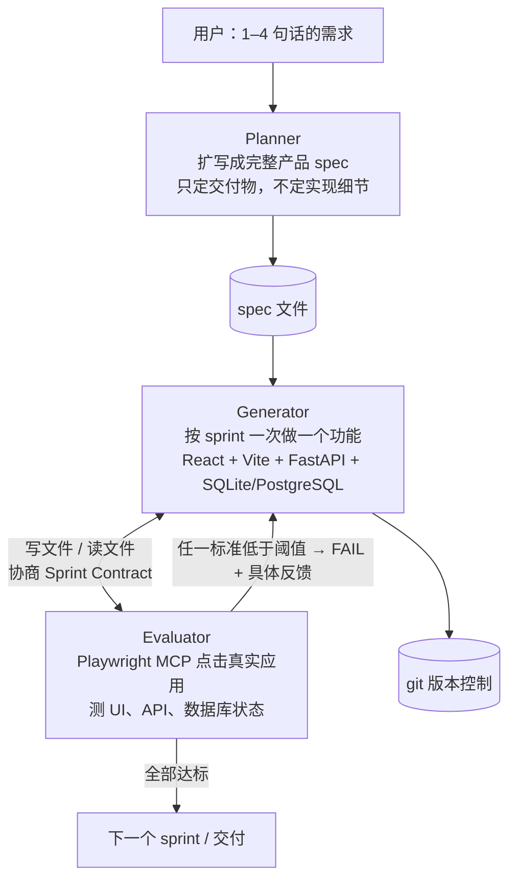
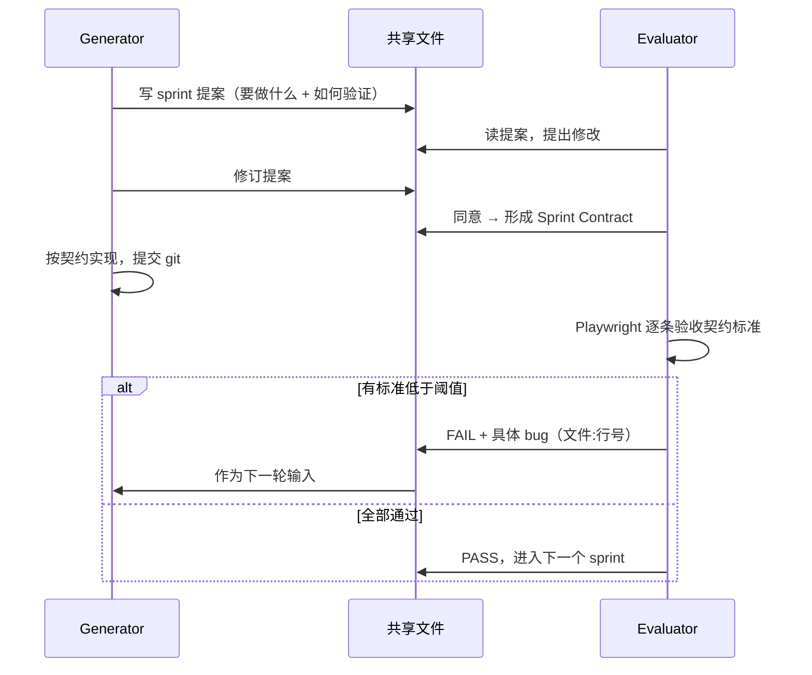

# Planner / Generator / Evaluator：Anthropic 怎样让 Claude 连续几小时自己做出一个全栈应用

Claude Code

**一句话看懂**：让 AI 给自己打分，它几乎总说“很好”。Anthropic Labs 的做法是把“干活的”和“打分的”拆成两个代理，再加一个把一句话需求扩写成产品规格的 Planner。结果是：完整 harness 跑 6 小时做出的游戏编辑器真能玩，单代理 20 分钟做出的版本，核心功能是坏的。

## 读完你能带走的 7 条收获

1. **长任务有两个老毛病：上下文越长越跑偏，自评越评越宽。** 前者靠重置或压缩，后者靠把“做”和“查”分开（见第 2 节）。
2. **主观质量也能打分。** 把“好看吗”拆成 4 条标准，同一份标准同时写给生成者和评估者（见 3.1）。
3. **Planner 只定“交付什么”，不定“怎么实现”。** 规格里写错的技术细节会一路传到实现里（见 3.2）。
4. **动手前先签“冲刺契约”。** 写代码的提出“做什么、怎么验证”，验收的审核，两边同意了再写（见 3.3）。
5. **开箱即用的 Claude 是很差的 QA。** 调法只有一个循环：读评估者日志，找它和你判断不一致的地方，改提示词（见 3.4）。
6. **每个 harness 组件都是一个“模型做不到”的假设。** 模型升级后一次只拆一个组件，看结果变不变（见 3.5）。
7. **评估者值不值，看任务有没有超出模型的能力边界。** 完整 harness 比单代理贵 20 倍以上（见 3.5、第 4 节）。

::: tip 小白先懂这几个词
- [Harness（代理外壳）](/glossary#harness)：包在模型外面、负责循环调用、给工具、管上下文的那层程序。
- [Generator / Evaluator（生成者 / 评估者）](/glossary#generator-evaluator)：一个负责写，一个负责挑毛病，灵感来自 GAN（生成对抗网络）。
- [Sprint Contract（冲刺契约）](/glossary#sprint-contract)：动手前，写代码的代理和验收的代理先约定“做到什么算完成”。
- [Context Reset（上下文重置）](/glossary#context-reset)：清空上下文、开一个全新代理，再靠交接文档接着干；和“压缩（compaction）”不同。
- [Context Anxiety（上下文焦虑）](/glossary#context-anxiety)：模型觉得上下文快满了，就提前草草收工。
- [Playwright MCP](/glossary#playwright)：让代理能真的打开浏览器、点按钮、截图的工具。
:::

## 1. 基本信息

<SourceCard type="文章" title="Harness design for long-running application development" author="Prithvi Rajasekaran（Anthropic Labs）" date="2026-03-24" url="https://www.anthropic.com/engineering/harness-design-long-running-apps" />

| 项目 | 内容 |
|---|---|
| 链接 | https://www.anthropic.com/engineering/harness-design-long-running-apps |
| 类型 | 官方工程博客（文章，约 5200 词） |
| 作者 | Prithvi Rajasekaran（Anthropic Labs 团队） |
| 发布日期 | 2026-03-24 |
| 使用工具 | Claude Agent SDK、Claude Opus 4.5 / 4.6、Playwright MCP、git |
| 前作 | [Effective harnesses for long-running agents](https://www.anthropic.com/engineering/effective-harnesses-for-long-running-agents)（2025-11，Initializer + Coding Agent 两段式） |
| 分析依据 | Anthropic Engineering 博客原文全文（2026-10-14 重新抓取并逐字核对）。英文引号内容是原文摘录；原文中的截图与视频版权归 Anthropic，本站未转载。“我觉得”开头的段落是本站评论，不是作者观点。 |

## 2. 这篇在回答什么

设想你给代理一句话：“做一个 2D 复古游戏编辑器。”然后去睡觉。

醒来后会看到什么？作者真做了这个实验。单代理跑了 20 分钟，交出一个看起来像样的应用；可点进去，角色出现在屏幕上，按什么键都不动。游戏是坏的，界面上也看不出哪里坏了。

作者在前作里已经有一套“初始化代理 + 一次做一个功能的编码代理”的 harness，能跨多个会话干活。但更复杂的任务里，代理还是会跑偏。他总结了两个失败模式。

**第一，上下文越长，越不连贯。** 有些模型还有“上下文焦虑”：

<Trans zh="在它们以为快到上下文上限时，就开始提前收尾">“they begin wrapping up work prematurely as they approach what they believe is their context limit”</Trans>

解决办法是上下文重置（context reset）：清空上下文、开一个新代理，用结构化的交接文档把状态和下一步传过去。它和压缩（compaction）不同：压缩是把前面的对话就地总结，同一个代理继续干，保持了连续性，但

<Trans zh="它没有给代理一张白纸，所以上下文焦虑仍可能存在">“it doesn't give the agent a clean slate, which means context anxiety can still persist”</Trans>

作者说 Sonnet 4.5 的上下文焦虑很重，光靠压缩不够，所以重置成了必需品。代价是编排更复杂、token 更多、延迟更高。

**第二，自评过于宽容。**

::: tr 让代理评价自己产出的东西时，它们往往会自信地夸奖——哪怕在人看来质量明显平庸。
> "When asked to evaluate work they've produced, agents tend to respond by confidently praising the work—even when, to a human observer, the quality is obviously mediocre."
:::

设计这类主观任务尤其明显，因为没有“测试通过 / 不通过”这样的二元检查。

作者的判断是：把干活的代理和评判的代理分开。分开并不会自动消除宽容，评估者也是 LLM，也倾向于对 LLM 的产出手下留情。但是

<Trans zh="把一个独立的评估者调得多疑，比让生成者批评自己的工作要容易得多">“tuning a standalone evaluator to be skeptical turns out to be far more tractable than making a generator critical of its own work”</Trans>

于是文章回答了五个问题，也是本文第 3 节的顺序：

## 3. 怎么做

### 3.1 先在前端设计上验证“做与查分离”

作者先拿前端设计开刀，因为自评偏宽在这里最明显。不加干预时，Claude 倾向于做出安全、可预测的布局：能用，但平淡。

他的出发点有两个。第一，审美没法完全变成一个分数，但可以用评分标准来改进：“这个设计美吗？”很难稳定回答，“这个设计符合我们的好设计原则吗？”就有东西可对照了。第二，生成和评分分开，就能形成一个把生成者往更好方向推的反馈回路。

**四条标准，同时写进生成者和评估者的提示词：**

| 标准 | 原文要点 | 白话 |
|---|---|---|
| Design quality | <Trans zh="设计是否像一个整体，而不是零件的堆砌？">“Does the design feel like a coherent whole rather than a collection of parts?”</Trans> | 有没有统一的气质 |
| Originality | <Trans zh="未修改的现成组件——或者像白色卡片上叠紫色渐变这种明显的 AI 生成痕迹——在这一项不及格">“Unmodified stock components—or telltale signs of AI generation like purple gradients over white cards—fail here.”</Trans> | 拒绝“AI 味”模板 |
| Craft | 字体层级、间距一致、配色和谐、对比度 | 基本功 |
| Functionality | 用户能否不靠猜就看懂界面、找到主要操作、完成任务 | 好不好用 |

**加权。** 设计感和原创性权重更高。Claude 在基本功和可用性上默认就做得不错，弱的是前两项，产出往往平淡。

**校准。** 用带详细分数拆解的 few-shot 示例校准评估者，让它的判断贴近作者的偏好，减少各轮之间的分数漂移。

**让评估者真的去用。** 评估者配了 Playwright MCP，会自己打开页面、截图、仔细研究实现，再逐条打分、写评语。评语交给生成者作为下一轮输入。

**每轮做一个战略决定。** 生成者看完评语后，要么沿当前方向继续打磨，要么整体换一种审美。每次生成跑 5 到 15 轮；因为评估者要真的去点页面，完整一次最长跑了 4 小时。

**结果不是一条直线。** 分数随轮次上升，然后进入平台期，仍有提升空间。后面的版本整体更好，但作者常常更喜欢中间某一轮。实现也越来越复杂，因为生成者为回应评语会尝试更大胆的方案。

最戏剧化的例子是一个荷兰美术馆网站。前九轮做出的是一个干净的深色主题落地页，精致但在意料之中。第十轮，生成者推翻重来，把网站做成了一个空间体验：CSS 透视渲染的 3D 房间、棋盘格地板、自由挂在墙上的画作，用“走过门”代替滚动和点击来切换展厅。作者说，这种创造性的跳跃，他在单次生成里从没见过。

::: tip 一个意外发现
评分标准的措辞本身就会影响产出：<Trans zh="加入“最好的设计具有博物馆级品质”这类措辞，会把设计推向某种特定的视觉趋同">“Including phrases like "the best designs are museum quality" pushed designs toward a particular visual convergence”</Trans>。而且第一轮的产出就已经明显好于不加提示的基线。也就是说，评估反馈还没开始，标准本身就已经在起作用了。
:::

我觉得这一节最该记住的是“同一份标准给两边”。很多人只给评审写标准，生成者不知道自己会被怎么打分，自然做不到点子上。

### 3.2 扩展到全栈：三个代理

作者认为，生成者—评估者回路天然对应软件开发流程：代码审查和 QA 扮演的，就是设计评估者的角色。

这一版用 Opus 4.5。Opus 4.5 基本没有上下文焦虑，所以他**去掉了上下文重置**，整个构建跑成一个连续会话，用 Claude Agent SDK 自带的自动压缩处理上下文增长。

每个代理都是为了补上前一版暴露的一个缺口。

**Planner：把一句话变成产品规格。** 前作要求用户先写好详细规格。现在 Planner 拿到 1 到 4 句话，扩写成完整的产品 spec。作者要它

<Trans zh="对范围保持雄心，专注产品语境和高层技术设计，而不是具体的技术实现">“be ambitious about scope and to stay focused on product context and high level technical design rather than detailed technical implementation”</Trans>

为什么不让它写细？因为 Planner 如果一开始就把细节写错，错误会一路传到实现里。更好的办法是约束交付物，让后面的代理边做边找路。作者还让 Planner 主动找机会把 AI 功能编进产品里。

**Generator：一次做一个功能。** 沿用前作的思路，按 sprint 推进，每个 sprint 从 spec 里拿一个功能，用 React、Vite、FastAPI 和 SQLite（后来换成 PostgreSQL）实现。每个 sprint 结束先自检，再交给 QA。它有 git 做版本控制。

**Evaluator：像用户一样点一遍。** 前几版做出的应用常常看着不错，一用就有 bug。所以评估者用 Playwright MCP 点击运行中的应用，测 UI 功能、API 端点和数据库状态，再按产品深度、功能、视觉设计、代码质量打分。**每条标准都有硬阈值，任何一条不达标，这个 sprint 就判失败**，生成者收到具体的反馈。

### 3.3 冲刺契约：动手前先对齐“完成的定义”

spec 故意写得很高层。从“用户故事”到“可以测试的实现”，中间有一道缝。冲刺契约就是用来填这道缝的。

每个 sprint 开始前：

1. 生成者提出：这个 sprint 要做什么、怎么验证做成了；
2. 评估者审核，确认它要做的是对的东西；
3. 两边来回修改，直到同意。

**代理之间通过文件沟通**：一方写文件，另一方读了，在同一个文件里回复，或者写一个新文件让对方读。契约定下后，生成者按契约实现，再交给 QA。作者说这样既忠于 spec，又不会过早把实现定死。

契约写得很细。在游戏编辑器那次运行里，光 Sprint 3 就有 27 条标准，覆盖关卡编辑器。评估者的发现也具体到可以直接动手修（见第 4 节的表格）。

我觉得契约最有价值的地方，是它把验收标准**提前**了。评估者不是事后挑刺，而是事前就参与定义“什么算完成”。这和人类团队里“先写验收条件再开工”是同一个道理。

### 3.4 调教评估者：读日志、找分歧、改提示词

评估者能做到上面那样，是花了功夫的。原文很坦白：

<Trans zh="开箱即用的 Claude 是个很差的 QA 代理">“Out of the box, Claude is a poor QA agent.”</Trans>

早期它有两个毛病。一是会发现真问题，然后

<Trans zh="说服自己这些问题没什么大不了，照样批准">“talk itself into deciding they weren't a big deal and approve the work anyway”</Trans>

二是测得浅，不去碰边界情况，细一点的 bug 就漏了。

调法只有一个循环：

1. 读评估者的日志；
2. 找到它的判断和你不一致的例子；
3. 改 QA 的提示词，专门解决这些问题。

作者重复了好几轮，评估者的打分才变得合理。即使这样，产出里仍有小的布局问题、有些交互不直观、深层功能里的 bug 没被测到。作者说，验证还有提升空间；但和单代理那次“核心功能根本不工作”相比，提升是明显的。

我觉得这一节说明了一件常被忽略的事：**评估者也是一个需要调试的程序。** 加一个评审代理不是终点，你得读它的日志，确认它真的在按你的标准判。

### 3.5 模型升级后，逐个拆掉脚手架

第一版 harness 效果不错，但又重、又慢、又贵。下一步自然是：能不能简化，又不掉性能？作者给出的原则是：

::: tr harness 里的每个组件，都编码了一个“模型自己做不到什么”的假设；这些假设值得压力测试，因为它们可能本来就错，也可能随着模型进步很快过时。
> "every component in a harness encodes an assumption about what the model can't do on its own, and those assumptions are worth stress testing, both because they may be incorrect, and because they can quickly go stale as models improve."
:::

**第一次简化失败了。** 他大刀阔斧地砍，还试了几个新点子，结果复现不了原来的效果，也分不清哪些组件真正在承重。于是改成**一次只删一个组件，看对结果有什么影响**。

这时 Opus 4.6 发布了。官方说它规划更仔细、能更久地持续执行代理任务、在大代码库里更可靠、更会审查和调试自己的错误，长上下文检索也明显提升。这些正是 harness 原本要补的能力。

他的拆法和结论：

- **删掉 sprint 结构。** sprint 原本是为了把工作切成模型能连贯处理的块。Opus 4.6 下，生成者不靠这种拆分也能连续两个多小时保持连贯。
- **保留 Planner。** 没有它，生成者会“范围不足”：拿到原始需求就直接开干，不先写规格，做出的功能比 Planner 版少。
- **评估者改成最后跑一遍**，不再每个 sprint 都打分。

为什么评估者的位置变了？作者的解释是：它值不值，取决于任务离模型的能力边界有多远。在 4.5 上，这些构建正处在生成者单独能做好的边缘，评估者在整个过程中都能抓到重要问题。到 4.6，边界往外移了，以前要靠评估者才能做对的部分，现在生成者自己就能做好，评估者在这些地方成了多余的开销；但在仍处于边缘的部分，评估者依然有实打实的帮助。所以：

<Trans zh="评估者不是一个固定的“要或不要”的决定">“the evaluator is not a fixed yes-or-no decision”</Trans>

当任务超出当前模型单独能稳定完成的范围时，它才值这个成本。

同时，他还加了提示词，让生成者在应用里正确地做出一个能用工具驱动应用自身功能的代理。这花了不少迭代，因为这方面的知识比较新，Claude 的训练数据覆盖得不多。

**往后看。** 作者说，模型越强，有些脚手架就越不重要，你可以等下一个模型，看问题自己消失；但模型越强，harness 能做到的超出基线的事也越多。他的结论是：

<Trans zh="有意思的 harness 组合空间不会随着模型进步而缩小，而是会移动">“the space of interesting harness combinations doesn't shrink as models improve. Instead, it moves”</Trans>

## 4. 结果与局限

**实验 1：复古游戏编辑器**（Opus 4.5，提示词只有一句话）

::: tr 做一个 2D 复古游戏制作器，功能包括关卡编辑器、精灵编辑器、实体行为，以及可试玩的测试模式。
> Create a 2D retro game maker with features including a level editor, sprite editor, entity behaviors, and a playable test mode.
:::

| Harness | 时长 | 成本 | 结果 |
|---|---|---|---|
| 单代理（Solo） | 20 分钟 | $9 | 布局浪费空间，流程僵硬；**实体不响应输入，游戏是坏的** |
| 完整 harness | 6 小时 | $200 | Planner 扩成 16 个功能、10 个 sprint；**能真正移动角色玩游戏**，还内置了用 AI 生成关卡和精灵的功能 |

完整 harness 版也不完美：角色跳上平台会和平台重叠；AI 生成的关卡里有一堵跳不过去的墙；界面仍然没告诉用户“要先建精灵和实体，再填关卡”。作者认为最后这一条是基础模型的产品直觉不足，不是 harness 要解决的问题。

评估者发现的 bug 很具体（原文节选）：

| 契约标准 | 评估者发现 |
|---|---|
| 矩形填充工具可以拖拽填充区域 | <Trans zh="失败——工具只在拖拽起点/终点放置图块，没有填充区域。fillRectangle 函数存在，但在 mouseUp 时没有被正确触发。">“FAIL — Tool only places tiles at drag start/end points instead of filling the region. fillRectangle function exists but isn't triggered properly on mouseUp.”</Trans> |
| 可以通过 API 重排动画帧 | <Trans zh="失败——PUT /frames/reorder 路由定义在 /{frame_id} 路由之后，FastAPI 把 reorder 当作 frame_id 整数解析，返回 422。">“FAIL — PUT /frames/reorder route defined after /{frame_id} routes. FastAPI matches 'reorder' as a frame_id integer and returns 422”</Trans> |

**实验 2：浏览器里的 DAW 音乐工作站**（Opus 4.6，简化后的 harness）

::: tr 用 Web Audio API 在浏览器里做一个功能完整的 DAW。
> Build a fully featured DAW in the browser using the Web Audio API.
:::

| 阶段 | 时长 | 成本 |
|---|---|---|
| Planner | 4.7 分钟 | $0.46 |
| Build 第 1 轮 | 2 小时 7 分 | $71.08 |
| QA 第 1 轮 | 8.8 分钟 | $3.24 |
| Build 第 2 轮 | 1 小时 2 分 | $36.89 |
| QA 第 2 轮 | 6.8 分钟 | $3.09 |
| Build 第 3 轮 | 10.9 分钟 | $5.88 |
| QA 第 3 轮 | 9.6 分钟 | $4.06 |
| **合计** | **3 小时 50 分** | **$124.70** |

QA 仍然抓到了“只做了展示、没做交互”的问题。第一轮指出片段不能在时间线上拖动、没有乐器面板、没有效果器的可视化编辑；第二轮还发现

<Trans zh="录音仍然只是个桩：按钮能切换，但没有麦克风采集">“Audio recording is still stub-only (button toggles but no mic capture)”</Trans>

最终的应用离专业音乐软件很远，但有了编曲视图、混音器和走带控制。作者只靠提示词就做出了一小段曲子：代理设了速度和调性、写了旋律、做了鼓轨、调了混音、加了混响。

::: warning 局限与注意
- **成本高**：完整 harness 比单代理贵 20 倍以上。
- **QA 仍有盲区**：小的布局问题、深层功能里的 bug 没被测到；Claude 听不见声音，音乐品味类反馈基本无效。
- **产品直觉问题 harness 没解决**，比如缺少“先建精灵再建关卡”的引导。
- **只有两个演示项目，都是全新项目**，没有存量代码库的数据，也没有多次重复运行的统计。
- 作者在 Anthropic 工作，实验用的是自家模型和 SDK。
:::

## 5. 结论

这篇文章的主线是一句话：**harness 的每个组件，都是对模型某个短板的假设。**

所以做法分两步：

1. **加组件补短板。** 自评偏宽，就分出一个评估者；需求太粗，就加一个 Planner；写的和查的对不齐，就先签契约；评估者太宽松，就读日志调它。
2. **模型变强后，逐个验证、拆掉。** 一次只删一个，看结果变不变。删掉的预算，投到模型新够得着的能力上。

我觉得最值得马上抄的有三条：评分标准**同时给生成者和评估者**；动手前写一份 `contract.md`；模型升级后**一次只拆一个组件**。

### 你可以这样试

- [ ] 给下一个前端任务写 4 条评分标准（参考 Design quality / Originality / Craft / Functionality），同时贴给写代码的会话和一个新开的“评审”会话。
- [ ] 给评审会话接上 Playwright MCP，要求它“先点击每个主要按钮再打分”，按“标准 / FAIL 原因 / 文件:行号”输出。
- [ ] 开始实现前，让代理先写一份 `contract.md`：列出本轮要做的功能和每条的验证步骤，你或评审代理审过再动手。
- [ ] 读一次评审代理的日志，找出一处它放过、而你不会放过的问题，把它写进评审提示词。
- [ ] 记录单代理和“生成 + 评审”两种方式的时长和花费，自己算算值不值。

::: details 读完自测（点开看答案）
1. **上下文重置和压缩有什么区别？** 重置是清空上下文、开新代理、靠交接文档接着干；压缩是就地总结旧对话、同一个代理继续。压缩不给代理一张白纸，上下文焦虑可能还在。
2. **为什么不直接让写代码的代理自己评审？** 代理评价自己的产出时会系统性地偏宽；单独调一个多疑的评估者更容易。
3. **Sprint Contract 解决什么问题？** spec 故意写得高层，契约在动手前把用户故事翻译成可测试的完成标准。
4. **换到 Opus 4.6 后作者删掉了什么、保留了什么？** 删掉 sprint 结构，评估者改为最后跑一遍；保留 Planner，因为没有它生成者会把范围做小。
5. **评估者什么时候值得用？** 任务超出当前模型单独能稳定完成的范围时。
:::
