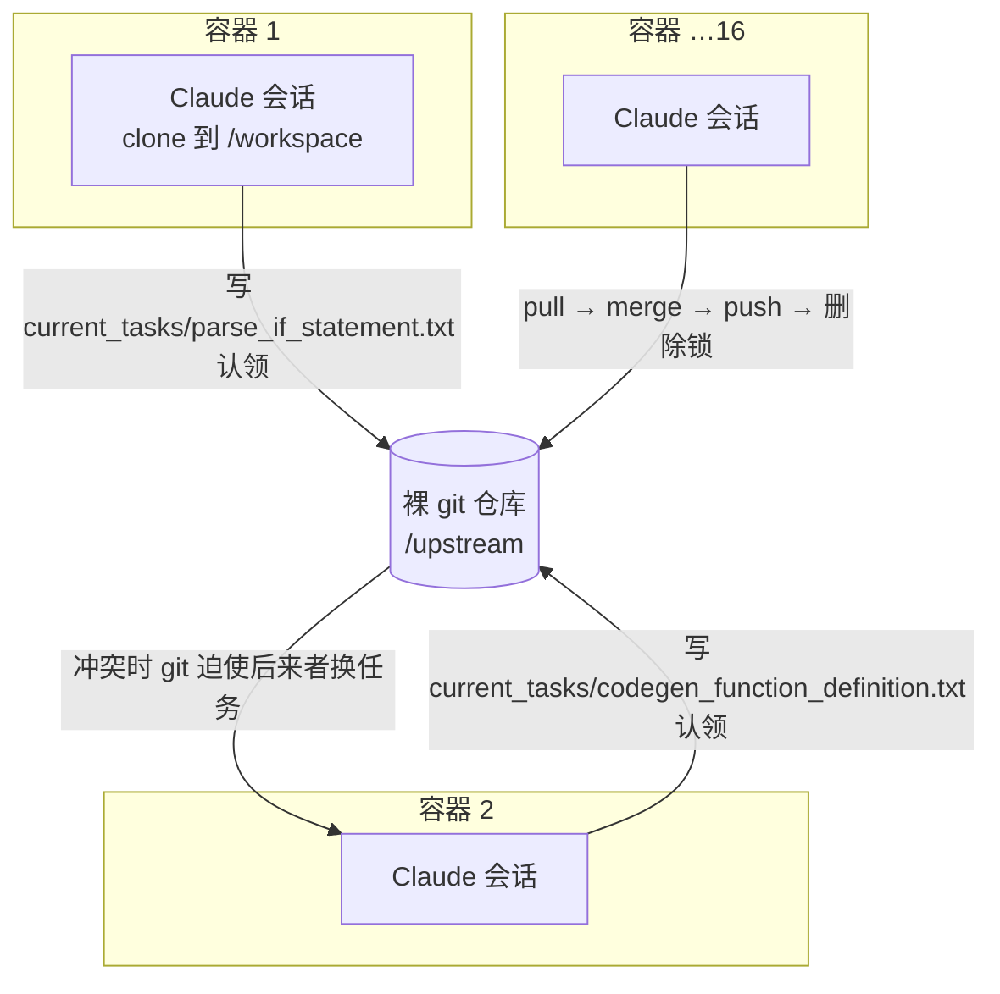
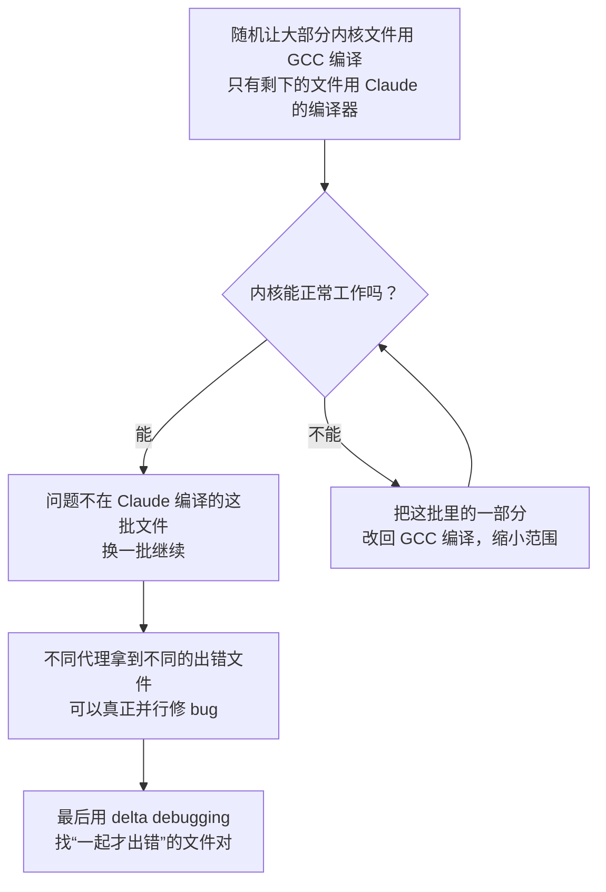

# 16 个 Claude 并行写出 10 万行 C 编译器：没有调度中心的 Agent Teams 是怎么协作的

<div class="meta-tags"><span class="tool-tag tool-claude">Claude Code</span></div>

<div class="hook">

**一句话看懂**：Anthropic 研究员 Nicholas Carlini 把 16 个 Claude 放进各自的 Docker 容器，用一个死循环脚本加一个共享 git 仓库让它们“自己找活干”。两周、近 2,000 个会话、不到 2 万美元，它们做出了能编译 Linux 内核的 Rust 版 C 编译器。他说大部分功夫花在了**测试和环境**上，而不是提示词。

</div>

## 读完你能带走的 6 条收获

1. **让代理不停下来，一个 `while true` 循环就够了。** 但一定要在容器里跑，作者见过 Claude 不小心把自己杀掉（见 3.1）。
2. **协调可以不用调度中心。** 写一个锁文件认领任务，靠 git 同步解决争抢（见 3.2）。
3. **验证器必须近乎完美。** 测试有漏洞，自主代理就会去解决一个错误的问题（见 3.3）。
4. **测试输出要写给代理看。** 少打印、错误写成一行 `ERROR`、默认提供只跑 1% 或 10% 的 `--fast` 模式（见 3.4）。
5. **一个大任务没法并行，就找一个“已知正确”的参照把它拆开。** 编 Linux 内核时，作者用 GCC 当参照，把 bug 分到不同文件上（见 3.5）。
6. **测试全过不等于完成。** 作者自己说，很容易看到测试通过就以为做完了，事实很少如此（见第 4 节）。

::: tip 小白先懂这几个词
- [Agent Teams（代理团队）](/glossary#agent-teams)：多个 Claude 实例在同一个代码库上并行工作，没有人实时盯着。
- [Ralph Loop](/glossary#ralph-loop)：用一个 `while true` 循环反复启动代理，做完一个任务马上开下一个会话。
- [Lock 文件（锁）](/glossary#task-lock)：代理在 `current_tasks/` 里写一个文本文件，表示“这个任务我认领了”。
- [Oracle（参照 / 参考答案）](/glossary#oracle)：一个已知正确的系统（这里是 GCC），用来判断结果对不对。
- [Delta Debugging](/glossary#delta-debugging)：不断缩小范围，找出“一起出错、单独都没事”的最小组合。
- Clean-room（净室实现）：开发时不联网、不抄现成实现，从规范出发自己写。
:::

## 1. 基本信息

<SourceCard type="文章" title="Building a C compiler with a team of parallel Claudes" author="Nicholas Carlini（Anthropic）" date="2026-02-05" url="https://www.anthropic.com/engineering/building-c-compiler" />

| 项目 | 内容 |
|---|---|
| 链接 | https://www.anthropic.com/engineering/building-c-compiler |
| 类型 | 官方工程博客（文章，约 2400 词） |
| 作者 | Nicholas Carlini（Anthropic Safeguards 团队研究员） |
| 发布日期 | 2026-02-05 |
| 使用工具 | Claude Code（`claude -p` 无界面模式）、Claude Opus 4.6、Docker、git |
| 规模 | 16 个并行代理、近 2,000 个会话、两周、约 $20,000 |
| 分析依据 | Anthropic Engineering 博客原文全文（2026-10-14 重新抓取并逐字核对）。英文引号内容是原文摘录；“我觉得”开头的段落是本站评论，不是作者观点。 |

## 2. 这篇在回答什么

你用 Claude Code 做一个大任务时，大概有过这种体验：它做了一部分，然后停下来问你一个问题，或者汇报一下进度，等你回复。

作者说，现有的代理工具都默认有人在线配合。他想试试反过来：**没人管，让多个代理并行，能把多复杂的项目做完？**

他给的任务很硬：用 Rust 从零写一个 C 编译器，不依赖任何第三方库，兼容 GCC，能编译 Linux 内核，并支持多个后端。他只规定了少数设计，比如要有 SSA 中间表示以支持多轮优化，具体怎么做全交给代理。

这个项目也是 Anthropic 跨 Claude 4 系列的能力基准。作者说，之前的 Opus 4 几乎做不出能用的编译器；Opus 4.5 第一次能过大型测试集，但编译不了任何真实的大项目。这次用 Opus 4.6 再测一次极限。

文章真正想讲的不是编译器，而是三件事：

<Trans zh="怎样写测试，让代理在没人监督时也不跑偏；怎样组织工作，让多个代理能并行推进；以及这种方法的天花板在哪里">“how to write tests that keep agents on track without human oversight, how to structure work so multiple agents can make progress in parallel, and where this approach hits its ceiling”</Trans>


## 3. 怎么做

### 3.1 一个死循环，让代理永不停歇

作者的 harness 极简，他说如果你见过 Ralph loop，会觉得眼熟。原文脚本：

::: tr 一个无限循环：每次用当前 commit 号命名日志文件，然后以“跳过所有权限确认”的方式运行 claude，把 AGENT_PROMPT.md 的内容作为提示词。
```bash
#!/bin/bash

while true; do
    COMMIT=$(git rev-parse --short=6 HEAD)
    LOGFILE="agent_logs/agent_${COMMIT}.log"

    claude --dangerously-skip-permissions \
           -p "$(cat AGENT_PROMPT.md)" \
           --model claude-opus-X-Y &> "$LOGFILE"
done
```
:::

提示词里告诉 Claude 要解决什么问题，并要求它把问题拆成小块、记录正在做什么、自己决定下一步做什么，一直做到完美。作者打趣说，最后一点 Claude 没得选，因为循环永远不会停——除了有一次，他看到 Claude 不小心执行了 `pkill -9 bash`，把自己杀了，循环也就断了。

::: warning 安全提醒
`--dangerously-skip-permissions` 会让代理不经确认就执行任何命令。原文特别强调：<Trans zh="请在容器里运行，不要在你自己的机器上跑">“Run this in a container, not your actual machine”</Trans>。
:::

### 3.2 没有编排者：git + 锁文件就是协调机制

为什么要多个代理？作者给了两个理由：一个 Claude Code 会话一次只能做一件事，项目一大，并行调多个问题效率高得多；多个代理还可以分工，有的解决主要问题，有的专门维护文档、盯代码质量。

他的并行实现很简陋：

- 建一个裸 git 仓库；
- 每个代理一个 Docker 容器，把仓库挂载到 `/upstream`；
- 代理把仓库 clone 到自己的 `/workspace`，做完后从自己的容器推回 upstream。

为了避免两个代理同时做同一件事，用了一个三步的同步办法：

1. **上锁。** Claude 在 `current_tasks/` 里写一个文本文件认领任务，比如一个锁 `current_tasks/parse_if_statement.txt`，另一个锁 `current_tasks/codegen_function_definition.txt`。如果两个代理抢同一个任务，git 同步会迫使第二个换一个。
2. **做完、合并、解锁。** 先 pull，合并其他代理的改动，再 push，最后删掉锁。原文：<Trans zh="合并冲突很频繁，但 Claude 足够聪明，能自己处理">“Merge conflicts are frequent, but Claude is smart enough to figure that out.”</Trans>
3. **循环。** 外层循环在一个全新容器里开一个新的 Claude Code 会话，周而复始。



作者强调这只是很早期的研究原型：没有代理间通信，没有管理高层目标的流程，也没有编排代理。每个 Claude 自己决定做什么。大多数时候，它会挑

<Trans zh="下一个最显而易见的问题">“next most obvious” problem</Trans>

卡在某个 bug 上时，它常常会自己维护一份文档，记下失败过的方法和剩下的任务。

我觉得这一节最有意思的是“够用就好”。没有任务队列、没有消息总线，只有一个文件夹和 git 自带的冲突检测。对十几个代理、任务边界清楚的项目，这已经够了。

### 3.3 经验一：测试必须近乎完美

循环只负责让 Claude 一直跑。它跑得有没有用，取决于它能不能判断自己在进步。作者说，他大部分精力都花在 Claude 周围的环境上：测试、环境、反馈，让它不靠人也能找到方向。

第一条经验最重要：

::: tr Claude 会自主去解决我给它的任何问题。所以任务的验证器必须近乎完美，否则 Claude 会去解决一个错误的问题。
> "Claude will work autonomously to solve whatever problem I give it. So it’s important that the task verifier is nearly perfect, otherwise Claude will solve the wrong problem."
:::

他做了三件事来改进测试：

- 找高质量的编译器测试集；
- 给开源软件包写验证器和构建脚本；
- 观察 Claude 犯的错，每发现一种新的失败模式，就补一类测试。

项目快结束时，Claude 开始频繁出现“加一个新功能，就弄坏一个旧功能”。他的办法是加一条 CI 流水线，执行更严格的检查，保证新提交不能破坏已有代码。

### 3.4 经验二：站在 Claude 的角度设计测试

作者说他得不断提醒自己：这套测试是写给 Claude 的，不是写给自己的。很多关于“测试该怎么汇报结果”的习惯，都要重新想。

**新会话没有记忆。** 每个代理都是在一个没有上下文的新容器里醒来的，大项目里光摸清情况就要花不少时间。所以他要求代理维护详细的 README 和进度文件，并频繁更新当前状态。

**上下文污染。** 测试不能打印几千字节的无用输出。最多打印几行，重要信息全写进日志文件，需要时再查。日志要方便自动处理：

<Trans zh="如果有错误，Claude 应该写 ERROR，并把原因放在同一行，这样 grep 就能找到">“if there are errors, Claude should write ERROR and put the reason on the same line so grep will find it”</Trans>

汇总统计也提前算好，省得 Claude 自己再算。

**时间盲。**

::: tr Claude 感知不到时间，放任不管的话，它会开开心心地花好几个小时跑测试，而不是推进进度。
> "Claude can't tell time and, left alone, will happily spend hours running tests instead of making progress."
:::

解决办法：进度信息少打印（免得污染上下文）；默认提供 `--fast` 选项，只跑 1% 或 10% 的随机样本。样本对每个代理是固定的，在不同虚拟机之间是随机的。这样整体仍覆盖所有文件，而每个代理又能准确识别自己引入的回归。

我觉得 `--fast` 的设计很巧。“对同一个代理固定”保证它前后两次跑的是同一批测试，能看出自己改坏了什么；“不同容器随机”保证 16 个代理合起来没有盲区。

### 3.5 经验三：让并行变容易，用参照把大任务拆开

有很多互相独立的失败测试时，并行很简单：每个代理挑一个不同的失败测试去修。测试集通过率到 99% 后，每个代理各自去编译一个不同的小型开源项目，比如 SQLite、Redis、libjpeg、MQuickJS、Lua。

到了编译 Linux 内核，代理们卡住了。原因是：

<Trans zh="编译 Linux 内核是一个巨大的任务">“compiling the Linux kernel is one giant task”</Trans>

每个代理都撞上同一个 bug，各自修好，然后互相覆盖对方的修改。开 16 个代理毫无帮助，因为它们都在解决同一个问题。

解法是**用 GCC 当一个已知正确的参照**：



内核能跑，说明问题不在 Claude 编译的那部分；跑不起来，就把其中一些文件改回用 GCC 编译，进一步缩小范围。这样每个代理都能在不同的文件里修不同的 bug，直到 Claude 的编译器能编译所有文件。之后还需要用 delta debugging，找出“单独编译都没事、放在一起就出错”的文件对。

我觉得这是全文最值得迁移的一招：**找一个已知正确的东西，把“一个大问题”变成“很多个可以独立判断的小问题”。** 旧系统、参考实现、上一个版本，都可以当这个参照。

### 3.6 经验四：并行带来专业分工

有了并行，就可以给代理分角色。作者的安排：

- 一个代理专门合并重复代码，因为 LLM 写的代码经常重复实现已有功能；
- 一个负责提升编译器本身的性能；
- 一个负责让编译器输出更高效的代码；
- 一个<Trans zh="从 Rust 开发者的角度批评项目设计">“critique the design of the project from the perspective of a Rust developer”</Trans>，并做结构调整来提高整体代码质量；
- 一个写文档。

## 4. 结果与局限

**数字。** 两周里近 2,000 个 Claude Code 会话，Opus 4.6 消耗了 20 亿输入 token、生成了 1.4 亿输出 token，总成本略低于 $20,000。作者说这比最贵的 Claude Max 套餐还贵得多，但只是他自己做（更别说一个团队做）所需成本的一小部分。

**成果。** 这是净室实现，开发过程中 Claude 从未联网，只依赖 Rust 标准库。10 万行的编译器能构建可启动的 Linux 6.9（x86、ARM、RISC-V），还能编译 QEMU、FFmpeg、SQLite、Postgres、Redis，在包括 GCC torture test 在内的大多数编译器测试集上通过率 99%。它也通过了开发者的终极测试：能编译并运行 Doom。

::: warning 局限与注意（均为作者自述）
- **启动 Linux 实模式要调用 GCC。** 它缺少 16 位 x86 编译器。Opus 能通过 66/67 操作码前缀生成正确的 16 位代码，但产物超过 60KB，远超 Linux 的 32K 限制。作者说这里 Claude <Trans zh="直接作弊">“simply cheats”</Trans>，去调用 GCC。（ARM 和 RISC-V 完全靠自己。）
- **没有自己的汇编器和链接器**，这部分还有 bug；演示视频用的是 GCC 的汇编器和链接器。
- **不能直接替代真正的编译器**，能编很多项目，但不是全部。
- **生成代码效率低**：开满优化，也不如 GCC 关闭所有优化。
- **Rust 代码质量“合理”**，但远不及专家水平。
- **已接近 Opus 4.6 的能力极限**：作者努力修上面的问题，没完全成功；新功能和修 bug 经常弄坏已有功能。
:::

作者最后也说了自己的不安。人在旁边时，可以保证质量、实时抓错；而对自主系统来说，

::: tr 对于自主系统，很容易看到测试通过就以为工作完成了，而事实很少如此。
> "For autonomous systems, it is easy to see tests pass and assume the job is done, when this is rarely the case."
:::

他以前做渗透测试，专门找大公司产品的漏洞。想到程序员部署自己从没亲自验证过的软件，他说这是一个实实在在的担忧。

## 5. 结论

这篇文章的结论很清楚：**脚手架只是一个循环，真正的功夫在环境。**

具体是四条：

1. **先投资验证器，再投资提示词。** 自主代理会优化你给的目标，测试有漏洞，它就会解决错的问题。
2. **测试输出为代理设计。** 少打印、写日志、`ERROR` 单行可 grep、预先算好汇总、提供快速采样模式。
3. **协调可以很简单。** 锁文件 + pull/merge/push，比自己造任务队列简单得多。
4. **大任务找参照拆开。** 有一个已知正确的系统，就能把一个整体问题变成很多个可以并行的小问题。

我觉得最值得从今天就做的是第 2 条：改一下你的测试脚本，让它默认只输出失败列表和计数。这件事对人也有好处。

### 你可以这样试

- [ ] 在 Docker 容器里跑一个最小版循环：`while true; do claude -p "$(cat AGENT_PROMPT.md)"; done`，限定在一个小仓库，先跑 3 轮看日志。
- [ ] 改造测试脚本：默认只输出通过 / 失败计数和失败列表，详细输出写到 `test.log`，错误行统一以 `ERROR:` 开头。
- [ ] 加一个 `--fast` 参数，只跑 10% 的测试样本（按代理固定种子），在 AGENTS.md / CLAUDE.md 里告诉代理日常用它。
- [ ] 开两个代理，各在 `current_tasks/` 下写锁文件认领不同 bug，观察它们怎么处理合并冲突。
- [ ] 想一想你的项目里有没有“已知正确的参照”（旧版本、参考实现），能不能用它把一个大 bug 拆成多个小问题。

::: details 读完自测（点开看答案）
1. **代理之间怎么避免抢同一个任务？** 在 `current_tasks/` 写锁文件并推到共享仓库，git 同步冲突会迫使后来者换任务。
2. **编译 Linux 内核时并行为什么失效，怎么解决？** 内核是一个整体任务，所有代理撞上同一个 bug；用 GCC 当参照，随机让 Claude 只编译一部分文件，把问题拆到不同文件上。
3. **为什么给测试加 `--fast` 采样？** Claude 感知不到时间，会花几小时跑全量测试；采样省时间，又因各代理样本不同而整体覆盖全部文件。
4. **为什么说 Claude 在 16 位 x86 上“作弊”？** 它生成的 16 位代码超过 Linux 的 32K 限制，于是这一步直接调用 GCC。
5. **作者对自主开发最大的担忧是什么？** 看到测试通过就以为做完了，而事实很少如此。
:::
