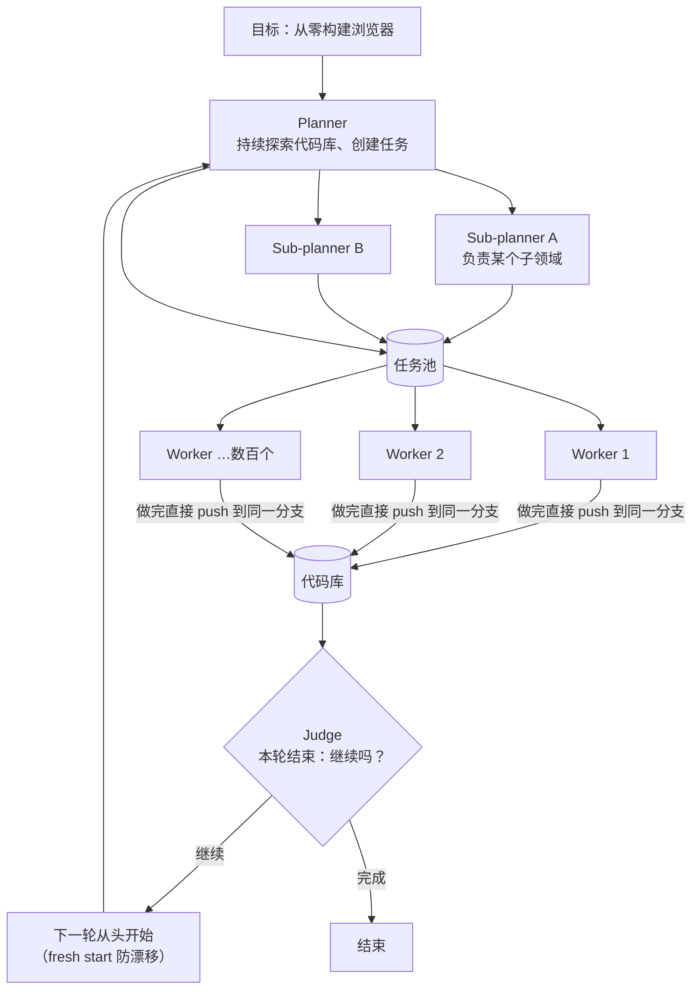

# 几百个代理同时写一个浏览器：Cursor 的 Planner / Worker 多代理实验踩过的坑

Cursor

**一句话看懂**：Cursor 让数百个编码代理在同一个项目上连续跑了将近一周，写出 100 多万行代码的浏览器。他们先试了“人人平等、靠锁协调”，失败了；改成“规划者拆任务、执行者埋头干、裁判决定要不要继续”的分层结构，才跑了起来。

## 读完你能带走的 5 条收获

1. **代理一多，锁就成了瓶颈。** 二十个代理靠锁协调，有效吞吐只剩两三个（见 3.1）。
2. **没有层级，代理会变得保守。** 它们躲开难题，只做小而安全的改动，没人对端到端结果负责（见 3.1）。
3. **分出“拆任务的”和“做任务的”。** Planner 持续拆任务，Worker 只管做完自己那份；每轮结束由 Judge 决定是否继续（见 3.2）。
4. **按角色挑模型。** 当时他们发现 GPT-5.2 当 Planner 比专门写代码的 GPT-5.1-Codex 更好（见 3.3）。
5. **结构要适中，先试着删。** 专门负责合并的 integrator 角色，制造的瓶颈比解决的还多（见 3.4）。

::: tip 小白先懂这几个词
- [Long-running Agent（长时代理）](/glossary#long-running-agent)：连续自主工作数小时到数周的代理。
- [Planner / Worker / Judge](/glossary#planner-worker-judge)：规划者（拆任务）、执行者（做任务）、裁判（判断是否继续）。
- Optimistic Concurrency Control（乐观并发控制）：读随便读，写的时候如果数据已被别人改过，这次写入就失败、重来。
- Drift（漂移）/ Tunnel Vision（隧道视野）：代理跑久了偏离目标，或者死盯一个局部问题。
- LoC（Lines of Code）：代码行数。
:::

## 1. 基本信息

<SourceCard type="文章" title="Scaling long-running autonomous coding" author="Wilson Lin（Cursor）" date="2026-01-14" url="https://cursor.com/blog/scaling-agents" />

| 项目 | 内容 |
|---|---|
| 链接 | https://cursor.com/blog/scaling-agents |
| 类型 | 公司研究博客（文章，约 1100 词，7 分钟阅读） |
| 作者 | Wilson Lin（Cursor） |
| 发布日期 | 2026-01-14 |
| 使用工具 | Cursor 自研多代理 harness；GPT-5.2、GPT-5.1-Codex、Opus 4.5（对比） |
| 代码 | 浏览器项目源码：https://github.com/wilsonzlin/fastrender |
| 分析依据 | Cursor 官方博客原文全文（2026-10-14 重新抓取并逐字核对）；补充参考 Simon Willison 的评论文章（2026-01-19，他实际编译运行了该浏览器）和 Cursor 后续文章《Towards self-driving codebases》（站内 [[38]]）。英文引号内容是原文摘录；“我觉得”开头的段落是本站评论，不是作者观点。 |

## 2. 这篇在回答什么

单个代理做聚焦的小任务很好用，做复杂项目就太慢了。很自然的下一步是：开很多个代理一起做。

但人多了，就要协调。Cursor 想回答的核心问题是：

<Trans zh="把更多代理扔到一个问题上，能不能扩展自主编码？">“can we scale autonomous coding by throwing more agents at a problem”</Trans>

他们的测试目标很大：从零写一个网页浏览器。这通常是人类团队要做好几个月的项目。

站内另一篇 [[17]] 里，Anthropic 用 16 个代理、锁文件和 git 就跑通了一个 C 编译器。Cursor 的规模大一个数量级：几百个代理同时跑。规模一大，答案就变了。文章按时间讲了四个问题：

## 3. 怎么做

### 3.1 第一版：人人平等 + 共享文件 + 锁（失败）

他们一开始觉得提前规划太死板：大项目的路径不清楚，一开始也看不出该怎么分工。所以先试“动态协调”：每个代理看别人在做什么，再决定自己做什么。

具体做法是：所有代理地位平等，通过一个共享文件自我协调。每个代理查看别人在做什么、认领一个任务、更新状态。为了不让两个代理抢同一个任务，用了锁。

结果失败得“很有意思”。

**锁成了瓶颈。** 代理会持锁太久，或者干脆忘了释放。就算锁工作正常，也会变成瓶颈：

<Trans zh="二十个代理会慢到只剩两三个代理的有效吞吐，大部分时间都在等待">“Twenty agents would slow down to the effective throughput of two or three, with most time spent waiting.”</Trans>

**系统很脆弱。** 代理可能持锁时崩溃、去拿自己已经拿着的锁，甚至不拿锁就直接改协调文件。

**换成乐观并发，又出现更深的问题。** 他们改用乐观并发控制：读随便读，写的时候如果状态已经被别人改过，写入就失败。这样更简单、更稳健。但这时暴露出一个和锁无关的问题：

::: tr 没有层级时，代理变得规避风险。它们回避困难任务，只做小而安全的改动。没有哪个代理为难题或端到端实现负责。
> "With no hierarchy, agents became risk-averse. They avoided difficult tasks and made small, safe changes instead. No agent took responsibility for hard problems or end-to-end implementation."
:::

结果是工作长时间空转，没有进展。

我觉得这个发现比锁的问题更重要。锁的问题可以靠换技术解决，“没人认领难题”是组织问题，只能靠改结构解决。

### 3.2 第二版：Planner / Worker / Judge 分层

第二版把角色分开。不再是每个代理什么都做的扁平结构，而是一条分工明确的流水线。

- **Planner（规划者）**：持续探索代码库、创建任务。它可以为特定区域派生子规划者，<Trans zh="让规划本身也变成并行和递归的">“making planning itself parallel and recursive”</Trans>。
- **Worker（执行者）**：领到任务就专心做完。不和其他 Worker 协调，也不操心全局，做完就 push。
- **Judge（裁判）**：每轮结束时判断要不要继续，然后下一轮从头开始。

原文的结论是，这个结构

<Trans zh="解决了我们大部分协调问题，让我们能扩展到非常大的项目，而没有任何一个代理陷入隧道视野">“solved most of our coordination problems and let us scale to very large projects without any single agent getting tunnel vision.”</Trans>

我觉得这三个角色恰好对应 3.1 的三个问题：Planner 让难题有人拆、有人认领；Worker 不用互相协调，也就不需要锁；Judge 加“从头开始”，对抗长时间运行后的漂移。

### 3.3 按角色选模型

跑了几万亿 token 后，他们对模型有了明确的观察：

::: tr 对于超长时任务，模型选择很重要。我们发现 GPT-5.2 系列在长时间自主工作上好得多：遵循指令、保持专注、避免漂移、精确完整地实现。
> "Model choice matters for extremely long-running tasks. We found that GPT-5.2 models are much better at extended autonomous work: following instructions, keeping focus, avoiding drift, and implementing things precisely and completely."
:::

他们还观察到 Opus 4.5

<Trans zh="倾向于更早停下，在方便时走捷径，很快把控制权交回">“tends to stop earlier and take shortcuts when convenient, yielding back control quickly”</Trans>

另一个发现是：不同模型擅长不同角色。GPT-5.2 当 Planner，比专门为编码训练的 GPT-5.1-Codex 更好。所以他们现在**每个角色用最适合的模型**，而不是一个模型包打天下。

::: tip 注意时效
这些对比是 2026 年 1 月的观察。Anthropic 后来的文章提到 Opus 4.6 能连续工作更久（见 [[16]]）。模型排名变得很快，可借鉴的是“按角色挑模型、定期重新评估”这个做法，而不是具体结论。
:::

### 3.4 删掉复杂度，比加更有效

原文说，很多改进来自**删掉**复杂度，而不是增加。

- **integrator 角色被删掉了。** 他们一开始设计了一个“集成者”负责质量控制和解决冲突，结果它<Trans zh="制造的瓶颈比解决的还多">“created more bottlenecks than it solved”</Trans>。Worker 自己就能处理冲突。
- **照搬现成模型不一定行。** 他们一开始想参考分布式计算和组织设计里的系统，但不是都适用于代理。
- **结构要适中：**<Trans zh="结构太少，代理会冲突、重复劳动、漂移；结构太多，系统会变脆弱">“Too little structure and agents conflict, duplicate work, and drift. Too much structure creates fragility.”</Trans>
- **提示词比想象中重要。** 让代理协调好、避免病态行为、长时间保持专注，靠的是大量实验。原文说：<Trans zh="harness 和模型都重要，但提示词更重要">“The harness and models matter, but the prompts matter more.”</Trans>

我觉得“结构适中”和 [[17]] 放在一起看最清楚：16 个代理时，锁文件 + 扁平结构够用；几百个代理时，就需要分层。结构的多少，应该随规模调整。

## 4. 结果与局限

| 项目 | 规模（原文数据） |
|---|---|
| 浏览器（FastRender） | 近一周，100 万+ 行代码，1,000 个文件 |
| Cursor 代码库 Solid → React 原地迁移 | 3 周以上，+266K / -193K 行改动；通过 CI 和初步检查，仍需仔细审查 |
| 视频渲染改写为 Rust | 快 25 倍，并加了跟随光标的平滑缩放；已合并、即将上线 |
| Java LSP（仍在跑） | 7.4K commits，550K 行 |
| Windows 7 模拟器（仍在跑） | 14.6K commits，120 万行 |
| Excel（仍在跑） | 12K commits，160 万行 |

原文还说，尽管浏览器代码库很大，新代理仍能理解它并做出有意义的推进；数百个 Worker 同时推到同一个分支，冲突很少。总体评价是：系统不算完全高效，但

<Trans zh="比我们预想的有效得多">“far more effective than we expected”</Trans>

::: warning 局限与注意
- **浏览器是研究产物，不是可用产品。** Hacker News 讨论中有人指出发布初期无法编译、使用了大量开源组件；作者在讨论中回应正在把部分依赖改为仓库内自研。Simon Willison 后来按更新后的 README 编译出了能打开网页的窗口。
- **原文承认的问题**：Planner 应该在任务完成时被唤醒，以规划下一步；代理偶尔跑得太久；仍需要定期从头开始，来对抗漂移和隧道视野。
- **没有成本数字**，只说用了“数万亿 token”。
- **作者在 Cursor 工作**，文章同时是招聘文；三个“仍在跑”的项目只有提交数和行数，没有质量数据。
:::

## 5. 结论

Cursor 这次实验的答案是：**能扩展，但要靠适度的层级，而不是更多的协调机制。**

1. **扁平结构在大规模下失败**：锁会卡住吞吐，没有层级时代理不碰难题。
2. **分层能跑起来**：Planner 拆任务，Worker 只管做，Judge 决定是否继续并定期重来。
3. **模型按角色选**，并定期重新评估。
4. **结构宁少勿多**：新加的协调角色往往变成新的瓶颈，先看 Worker 能不能自己处理。

我觉得对普通开发者最有用的是第 2 条的“小号版本”：哪怕只开三个会话，也可以让一个只拆任务、一个只写代码、一个只看结果。

### 你可以这样试

- [ ] 拿一个中等功能，开一个“Planner”会话只负责把它拆成 5–10 个互不依赖的任务写进 `tasks/` 目录，不写代码。
- [ ] 开 2–3 个“Worker”会话（各自用 git worktree），每个只领一个任务文件，做完提交。
- [ ] 最后开一个“Judge”会话，只读 diff 和测试结果，回答“还差什么、要不要再来一轮”。
- [ ] 对比一下：同样的任务，规划者用推理强的模型、执行者用快模型，效果和成本有什么变化。

::: details 读完自测（点开看答案）
1. **扁平协调失败的两个原因是什么？** 锁导致等待和脆弱；没有层级时代理规避风险，只做小改动，没人负责难题。
2. **Judge 代理的作用是什么？** 每轮结束判断是否继续，并让下一轮从头开始，防止漂移和隧道视野。
3. **Cursor 为什么删掉了 integrator 角色？** 它制造的瓶颈比解决的问题多，Worker 自己就能处理冲突。
4. **为什么 Anthropic 的 C 编译器实验用锁文件能跑通，Cursor 却不行？** 规模不同：16 个代理时锁够用，几百个代理时锁成了瓶颈。
:::
