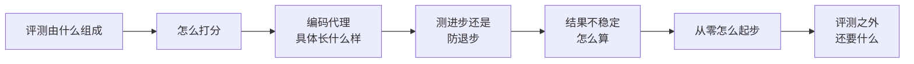

# 怎样把“代理感觉变笨了”变成可以修的问题：Anthropic 的 Agent Evals 入门

<div class="meta-tags"><span class="tool-tag tool-general">通用（不限工具）</span></div>

<div class="hook">

**一句话看懂**：用户说代理“改完感觉变差了”，你只能猜。Anthropic 这篇文章讲怎么给代理出考卷：评测由哪几个零件组成、三种评分器怎么搭、为什么同一道题要考很多次，以及从零开始的 8 个步骤。起步不用几百道题，20 到 50 道从真实失败里挑出来的就够了。

</div>

## 读完你能带走的 8 条收获

1. **评测的对象是“harness + 模型”的组合，打分要看环境里的最终状态，而不是代理嘴上说了什么**（见 3.1）。
2. **能用代码判分就用代码，必要时才用 LLM，人工判分留给校准**（见 3.2）。
3. **评代理做出了什么，不要评它走了哪条路。** 代理常常找到出题人没想到的合法解法（见 3.2）。
4. **能力评测从低通过率开始，回归评测要接近 100%。** 能力题练到高分就“毕业”进回归集（见 3.4）。
5. **同一道题要考多次。** 单次成功率 75%，连考 3 次全对只有约 42%（见 3.5）。
6. **从 20 到 50 道真实失败题起步，每道题配一个参考解。** 前沿模型考 100 次都是 0 分，多半是题坏了（见 3.6）。
7. **不读运行记录，就别信分数。** 评分 bug 能让同一个模型从 42% 变成 95%（见 3.6）。
8. **评测只是一层防护。** 还要有生产监控、A/B 测试、用户反馈和人工抽查（见 3.7）。

::: tip 小白先懂这几个词
- [Eval（评测）](/glossary#evals)：给 AI 一个输入，再用打分逻辑判断输出成不成功，相当于给代理出的考题。
- [Task / Trial（题目 / 一次作答）](/glossary#eval-task-trial)：同一道题要作答多次，因为每次结果可能不一样。
- [Grader（评分器）](/glossary#grader)：打分的逻辑，分代码评分、模型评分、人工评分三类。
- [Transcript（运行记录）](/glossary#transcript-outcome)：一次作答的完整过程，包括每次工具调用和中间结果。
- [Outcome（最终状态）](/glossary#transcript-outcome)：环境里真实发生了什么，比如数据库里有没有那条订票记录。
- [pass@k / pass^k](/glossary#pass-at-k)：k 次里至少成功一次的概率 / k 次全部成功的概率。
- [Saturation（饱和）](/glossary#eval-saturation)：分数接近 100%，再也看不出进步。
:::

## 1. 基本信息

<SourceCard type="文章" title="Demystifying evals for AI agents" author="Mikaela Grace、Jeremy Hadfield、Rodrigo Olivares、Jiri De Jonghe（Anthropic）" date="2026-01-09" url="https://www.anthropic.com/engineering/demystifying-evals-for-ai-agents" />

| 项目 | 内容 |
|---|---|
| 链接 | https://www.anthropic.com/engineering/demystifying-evals-for-ai-agents |
| 类型 | 官方工程博客（文章） |
| 作者 | Mikaela Grace、Jeremy Hadfield、Rodrigo Olivares、Jiri De Jonghe（Anthropic） |
| 发布日期 | 2026-01-09 |
| 涉及工具 | Claude Code、Agent SDK；评测框架 Harbor、Braintrust、LangSmith、Langfuse、Arize Phoenix；基准 SWE-bench Verified、Terminal-Bench、τ2-Bench 等 |
| 分析依据 | Anthropic Engineering 博客原文全文（2026-10-14 重新抓取并逐字核对）。英文引用和 YAML 示例均为原文摘录；“我觉得”开头的段落是本站评论，不是作者观点。 |


## 2. 这篇在回答什么

团队刚开始做代理时，靠手动测试、内部试用和直觉，能走得出奇地远。但上线、规模变大以后，问题就来了。文章描述了那个转折点：

::: tr 转折点往往出现在用户反映改动后代理感觉变差了，而团队在“盲飞”，除了猜和试，没有任何办法验证。
> The breaking point often comes when users report the agent feels worse after changes, and the team is “flying blind” with no way to verify except to guess and check.
:::

没有评测，调试就是被动的：等投诉、手动复现、修 bug、祈祷别的地方没退步。你分不清真退步和噪声，也没法在发布前把改动放到几百个场景里自动跑一遍。

评测为什么对代理特别难？因为代理会多轮调用工具、修改环境状态、根据中间结果调整，错误会一路传播放大。前沿模型还会找到超出静态评测的“创造性”解法。文章举了个例子：Opus 4.5 在 τ2-bench 的订机票题里发现了政策漏洞，按评测写法算“失败”，但对用户其实是更好的方案。

文章还给了几个“为什么要做”的理由：

- **评测逼你说清楚什么叫成功。** 两个工程师读同一份 spec，对边界情况的理解可能不同，评测集能消除这种歧义。
- **新模型出来时，能几天内升级。** 没有评测的团队要花几周测试。
- **免费拿到基线**：延迟、token 用量、每任务成本、错误率。
- **成本在前，收益在后，所以容易被低估。**

Claude Code 自己就是这么走过来的：先靠员工和用户反馈快速迭代，后来才加评测，先是简洁度、文件编辑这类窄领域，再到“过度工程”这种复杂行为。

于是文章回答了七个问题，就是第 3 节的顺序：



## 3. 怎么做

### 3.1 先认识评测的零件

评测（eval）就是给 AI 的考试：给一个输入，用打分逻辑判断输出成不成功。对代理来说，零件多一些：

| 零件 | 意思 |
|---|---|
| Task（题目） | 一道有明确输入和成功标准的题 |
| Trial（一次作答） | 每次作答。模型输出每次不同，所以要多考几次 |
| Grader（评分器） | 给代理表现某个方面打分的逻辑；一道题可以有多个评分器，每个包含多个断言 |
| Transcript（运行记录） | 一次作答的完整记录：输出、工具调用、推理、中间结果。对 Anthropic API 来说，就是评测结束时完整的 messages 数组 |
| Outcome（最终状态） | 作答结束时环境的最终状态 |
| Evaluation harness | 端到端跑评测的基础设施：给指令和工具、并发跑题、记录、打分、汇总 |
| Agent harness | 让模型能当代理用的系统，也叫 scaffold |
| Suite（评测集） | 一组衡量某种能力的题 |

两点最容易搞错。

第一，transcript 和 outcome 不是一回事：

::: tr 一个订票代理可能在记录最后说“您的机票已订好”，但最终状态要看环境的 SQL 数据库里有没有这条预订。
> A flight-booking agent might say “Your flight has been booked” at the end of the transcript, but the outcome is whether a reservation exists in the environment’s SQL database.
:::

第二，你评的从来不只是模型：

::: tr 我们评测“一个代理”时，评的是 harness 和模型合在一起的表现。
> When we evaluate “an agent,” we’re evaluating the harness and the model working together.
:::

所以换了 harness（比如从 Claude Code 换到别的工具），分数就不能直接比。

### 3.2 三种评分器怎么搭配

有了零件，下一个问题是怎么打分。文章把评分器分三类：

| 类型 | 常见方法 | 优点 | 缺点 |
|---|---|---|---|
| 代码评分 | 字符串匹配、二元测试（fail-to-pass、pass-to-pass）、静态分析、结果核验、工具调用核验、运行记录分析（轮数、token） | 快、便宜、客观、可复现、好调试 | 对“合理但不完全一样”的答案很脆；缺乏细微判断 |
| 模型评分 | 评分细则（rubric）、自然语言断言、成对比较、参考答案对照、多评委共识 | 灵活、能扩展、能处理开放式输出 | 不确定、比代码贵、要和人工校准 |
| 人工评分 | 领域专家审阅、众包、抽检、A/B 测试、标注者一致性 | 金标准，用来校准模型评分 | 贵、慢、难规模化 |

一道题的总分可以加权（合计过阈值）、二元（全部评分器都通过）或混合。文章在路线图第 5 步给了明确的选法：

::: tr 我们建议：能用确定性评分器就用确定性评分器，必要时或需要更多灵活性时用 LLM 评分器，人工评分器审慎使用，作为额外验证。
> We recommend choosing deterministic graders where possible, LLM graders where necessary or for additional flexibility, and using human graders judiciously for additional validation.
:::

还有三条很实用的细则：

- **评结果，不评路径。** 很多人本能地想检查代理是不是按顺序调用了某几个工具。文章说这太死板，因为代理经常找到出题人没预料到的合法做法：<Trans zh="通常更好的做法是评代理做出了什么，而不是它走了哪条路">“it’s often better to grade what the agent produced, not the path it took.”</Trans>
- **多步骤任务给部分分。** 一个客服代理认对了问题、核实了身份、但没完成退款，明显比一开始就失败的强，结果里要体现这种差别。
- **LLM 评委要校准、要有退路。** 和人工专家的判断对齐；给它一个出口，比如信息不够时返回“Unknown”，避免它瞎编；每个维度用一个独立的 LLM 评委，而不是一个评委评所有维度。

我觉得“评结果不评路径”最常被违反。很多团队写评测时，最先想到的就是“它有没有先读文件再改”。这种检查很容易写，但会惩罚合理的捷径，让分数和真实质量脱钩。

### 3.3 编码代理的评测示例（原文 YAML）

编码代理天然适合确定性评分：代码能不能跑、测试过不过。文章提到两个常用基准：SWE-bench Verified 用热门 Python 仓库的真实 issue，跑测试判分，必须修好失败的测试、又不弄坏原有的；Terminal-Bench 测端到端的技术任务，比如从源码编译 Linux 内核、训练一个机器学习模型。

测试通过以后，还可以给运行记录打分：用启发式规则看代码质量，用有清楚 rubric 的模型评分器看代理怎么调用工具、怎么和用户交互。

文章给了一个修复认证绕过漏洞的“理论示例”（原文）：

::: tr 题目：修复密码字段为空时的认证绕过。评分器：必须通过的确定性测试、代码质量 rubric、静态分析（ruff、mypy、bandit）、状态检查（安全日志里出现 auth_blocked 事件）、工具调用（读 src/auth、编辑文件、运行测试）。另外跟踪运行记录指标（轮数、工具调用数、总 token）和延迟指标。
```yaml
task:
  id: "fix-auth-bypass_1"
  desc: "Fix authentication bypass when password field is empty and ..."
  graders:
    - type: deterministic_tests
      required: [test_empty_pw_rejected.py, test_null_pw_rejected.py]
    - type: llm_rubric
      rubric: prompts/code_quality.md
    - type: static_analysis
      commands: [ruff, mypy, bandit]
    - type: state_check
      expect:
        security_logs: {event_type: "auth_blocked"}
    - type: tool_calls
      required:
        - {tool: read_file, params: {path: "src/auth/*"}}
        - {tool: edit_file}
        - {tool: run_tests}
  tracked_metrics:
    - type: transcript
      metrics:
        - n_turns
        - n_toolcalls
        - n_total_tokens
    - type: latency
      metrics:
        - time_to_first_token
        - output_tokens_per_sec
        - time_to_last_token
```
:::

文章特别说明，这个例子是为了展示全部评分器类型：

::: tr 实际中，编码评测通常靠单元测试验证正确性，再加一个 LLM rubric 评估整体代码质量，其他评分器和指标只在需要时才加。
> In practice, coding evaluations typically rely on unit tests for correctness verification and an LLM rubric for assessing overall code quality, with additional graders and metrics added only as needed.
:::

注意示例里有一个 `tool_calls` 评分器，这和 3.2 的“评结果不评路径”有些张力。按文章自己的建议，真用时它应该是可选项。

文章还简要讲了另外三类代理，思路可以借鉴：

| 代理类型 | 评测要点 |
|---|---|
| 对话代理 | 常要第二个 LLM 扮演用户；成功是多维的：工单解决了吗（状态检查）、10 轮内完成了吗（记录约束）、语气合适吗（LLM rubric）。原文也给了一个处理退款的 YAML |
| 研究代理 | 质量要看任务；组合“有据可查”（结论被来源支持）、“覆盖”（必须包含的关键事实）、“来源质量”三种检查；LLM rubric 要经常和专家校准 |
| Computer use 代理 | 在真实或沙箱环境里跑，检查后端状态（订单真的下了，而不只是出现了确认页）；读 DOM 快但费 token，截图慢但省 token，Claude for Chrome 专门评测代理有没有选对方式 |

### 3.4 能力评测 vs 回归评测

下一个问题：评测是用来测进步，还是防退步？文章说两种都要，而且目标完全不同：

- **能力评测**问“这个代理能把什么做好”。它应该从低通过率开始，挑代理还做不好的任务，给团队一座要爬的山。
- **回归评测**问“它以前会的还会吗”，通过率应该接近 100%。分数一掉，说明有东西坏了。

两者是流动的：

::: tr 能力评测里通过率已经很高的题，可以“毕业”成为回归集，持续运行以发现漂移。
> capability evals with high pass rates can “graduate” to become a regression suite that is run continuously to catch any drift.
:::

原来衡量“我们能不能做到”的题，变成衡量“我们还能不能稳定做到”。Descript 就是这样分了两套：质量基准和回归测试。

### 3.5 随机性：pass@k 和 pass^k

第五个问题：同一道题这次过、下次不过，怎么算？代理每次运行结果不同，每道题有自己的成功率，可能一道 90%、另一道 50%。文章用两个指标描述：

- **pass@k**：k 次作答里至少一次成功的概率。k 越大越高。编程里常最关心 pass@1，即第一次就做对。
- **pass^k**：k 次全部成功的概率。k 越大越低。

::: tr 如果你的代理单次成功率是 75%，跑 3 次，全部通过的概率是 (0.75)³ ≈ 42%。这个指标对面向客户的代理尤其重要，因为用户期望每次都可靠。
> If your agent has a 75% per-trial success rate and you run 3 trials, the probability of passing all three is (0.75)³ ≈ 42%. This metric especially matters for customer-facing agents where users expect reliable behavior every time.
:::

k=1 时两者相同；到 k=10，pass@k 接近 100%，pass^k 掉到接近 0。用哪个看产品：只要成功一次就行的工具看 pass@k，必须每次都稳定的代理看 pass^k。

### 3.6 从 0 到 1 的路线图

最后，也是最实用的部分：一个评测都没有，怎么开始？文章给了 9 步（第 0 到第 8 步），分成三组。

**收集题目**

- **第 0 步：早点开始。** 很多团队拖着不做，以为要几百道题。

::: tr 实际上，从真实失败里挑 20 到 50 道简单任务，就是很好的开始。
> In reality, 20-50 simple tasks drawn from real failures is a great start.
:::

  早期每次改动效果都很明显，小样本就够。拖得越久越难做，到时候得从线上系统反推成功标准。
- **第 1 步：从你已经在手动测的东西开始**：每次发布前手动检查的行为、用户常做的任务；已上线的话，翻 bug 跟踪和客服工单。
- **第 2 步：题目要没有歧义，并配参考解。** 好题的标准是两位领域专家各自判断会得出同样的通过 / 不通过结论。文章举了 Terminal-Bench 审计里的例子：题目让代理写个脚本却没说放哪，测试却假定了某个路径，代理不是自己的错也会失败。

::: tr 对前沿模型来说，多次作答都是 0%（即 0% pass@100），最常见的原因是题坏了，而不是代理不行。
> With frontier models, a 0% pass rate across many trials (i.e. 0% pass@100) is most often a signal of a broken task, not an incapable agent
:::

  每道题配一个能通过全部评分器的参考解，证明题能做、评分器配对了。
- **第 3 步：正反例要平衡。** 只测“该搜索时搜不搜”，最后会得到一个什么都搜的代理。Claude.ai 的网页搜索评测就同时覆盖了该搜（查天气）和不该搜（“谁创立了 Apple”）两类，花了很多轮才平衡好。

**设计评测环境和评分器**

- **第 4 步：环境稳定、每次隔离。** 评测里的代理要和生产里的大致一样，每次作答从干净环境开始。共享状态会造成相关失败，也会虚高分数：文章说内部评测里见过 Claude 翻看前几次作答留下的 git 历史，占了不公平的便宜。
- **第 5 步：认真设计评分器**（细则见 3.2）。文章举了一个评分 bug 的极端例子：Opus 4.5 在 CORE-Bench 一开始只得 42%，研究员发现评分太死板（期望 “96.124991…” 却扣了答 “96.12” 的分）、题目有歧义、有些随机任务无法精确复现。修完 bug、换了约束更少的 scaffold 后，分数跳到 95%。评分器还要防作弊，通过必须靠真正解决问题。

**长期维护和使用**

- **第 6 步：读运行记录。** 失败应该“公平”：清楚代理错在哪、为什么错。读记录才知道是代理真错了，还是评分器拒了合理的解。
- **第 7 步：盯住饱和。** 分数到 100% 只能防退步，不再显示进步。接近饱和时，大的能力提升只表现为很小的分数增长。代码审查公司 Qodo 一开始对 Opus 4.5 不以为然，因为他们的单次编码评测抓不到它在长任务上的进步，后来另做了代理式评测框架。文章的规矩是：

::: tr 原则上，在有人深入看过评测细节、读过一些运行记录之前，我们不会只看表面分数。
> As a rule, we do not take eval scores at face value until someone digs into the details of the eval and reads some transcripts.
:::

- **第 8 步：长期维护、开放贡献。** Anthropic 试下来最有效的是：专门的评测团队管基础设施，领域专家和产品团队贡献大部分题目、自己跑评测。文章推荐“评测驱动开发”：先写评测定义计划中的能力，再迭代到代理做好；新模型出来时一跑就知道哪些押注成功了。还有一句很具体的建议：PM、客户成功、销售都可以用 Claude Code 把一道评测题作为 PR 提上来，应该放手让他们做。

我觉得这 9 步里最值得马上做的是第 0、2、6 步：今天就从 bug 跟踪里挑 20 道题，每道配一个参考解，跑完先读记录再看分数。

### 3.7 评测只是“瑞士奶酪”的一层

自动评测之外，还要什么？文章对比了六种理解代理表现的方法：

| 方法 | 擅长 | 短板 |
|---|---|---|
| 自动评测 | 快、可复现、不影响用户、每次提交都能跑 | 前期投入大；和真实使用不符时会带来虚假信心 |
| 生产监控 | 看到真实用户行为和合成评测漏掉的问题 | 被动，问题先到用户那里；信号嘈杂 |
| A/B 测试 | 衡量真实用户结果（留存、完成率） | 慢，要足够流量；不读记录很难知道“为什么” |
| 用户反馈 | 暴露没想到的问题，带真实例子 | 稀疏、偏向严重问题；用户很少解释原因 |
| 人工读记录 | 培养对失败模式的直觉，抓细微问题 | 耗时、不能规模化、评审者会疲劳 |
| 系统性人工研究 | 多人金标准判断，适合主观任务 | 贵、慢、难频繁做 |

它们对应不同阶段：上线前和 CI 里靠自动评测，作为第一道防线；上线后靠生产监控发现分布漂移；流量够了用 A/B 验证大改动；用户反馈和读记录持续补漏（文章建议每周抽样读记录）；系统性人工研究留给校准 LLM 评分器。

::: tr 就像安全工程里的瑞士奶酪模型，没有哪一层评测能抓住所有问题。多种方法结合，从一层漏过去的失败会被另一层抓住。
> Like the Swiss Cheese Model from safety engineering, no single evaluation layer catches every issue. With multiple methods combined, failures that slip through one layer are caught by another.
:::

附录还列了几个评测框架：Harbor（容器里大规模跑试验，Terminal-Bench 2.0 通过它发布）、Braintrust（离线评测 + 生产观测，`autoevals` 库）、LangSmith、Langfuse（可自托管）、Arize Phoenix / AX。文章的态度是：框架只和你放进去的题一样好，快速挑一个合手的，把精力放在题和评分器上。

## 4. 结果与局限

文章给出的数字都来自案例，不是一次统一的实验：

| 案例 | 数字 |
|---|---|
| SWE-bench Verified | 文中一处说 LLM 一年内从 40% 涨到 80% 以上，另一处说“今年”起点是 30%，前沿模型已接近饱和（>80%） |
| CORE-Bench | Opus 4.5 修评分 bug 前 42%，修后 95% |
| pass^k 示例 | 单次 75%，3 次全过约 42% |
| Bolt | 3 个月建起评测系统 |
| 起步规模 | 20–50 道题 |

::: warning 局限与注意
- 两个 YAML 是作者自己说的“理论示例”，不是 Anthropic 真实在用的配置，字段名也不是某个框架的标准格式。
- SWE-bench Verified 的起点在文中前后不一致（40% 和 30%），引用时要注意。
- 案例多来自 Anthropic 和它的客户（Descript、Bolt、Qodo），有一定立场；没有给出 Claude Code 自己评测集的规模或分数。
- 文章没讲评测本身要花多少钱、跑一次多久，这对小团队很关键。
- 主要面向做代理产品的团队；个人开发者比较两版 prompt 或配置时，可以只取第 0、2、6 步。
:::

## 5. 结论

这篇文章的主线是：**把“感觉变差了”变成一组能反复跑、能读懂的题。**

做法可以压成几句：从真实失败里挑 20 到 50 道题；每道题写清楚、配参考解；能用代码判分就用代码，评结果不评路径；同一道题多考几次，用 pass@k 或 pass^k 描述；能力题练熟了就进回归集；分数之外一定要读运行记录；评测之外还有生产监控、A/B 和人工抽查。

我觉得这篇最大的价值是降低了起步门槛。很多团队觉得评测是“以后规模大了再说”的事，文章用 Claude Code 自己的经历说明：越晚做越难，因为到时候成功标准已经埋在线上系统里了。

### 你可以这样试

- [ ] 从 bug 跟踪或聊天记录里挑 20 个代理真实翻过车的任务，每个写成一道“输入 + 怎样算通过”的题。
- [ ] 给每道题自己做一遍参考解，确认题能做、判分逻辑对。
- [ ] 能用测试或状态检查判分的，先别上 LLM 评委。
- [ ] 每道题跑 3 次，分别算 pass@1 和 pass^3，看看差多少。
- [ ] 跑完先读 5 份失败的运行记录，判断是代理错了还是题错了。
- [ ] 下次改 prompt 或换模型，先跑一遍再上线。

::: details 读完自测（点开看答案）
1. **transcript 和 outcome 有什么区别？** transcript 是一次作答的完整过程记录；outcome 是环境里的最终状态。代理说订好了，要看数据库里真有没有预订。
2. **三种评分器的优先顺序？** 能用确定性（代码）评分就用；必要时用 LLM 评分；人工评分审慎使用，主要用来校准。
3. **能力评测和回归评测的通过率应该分别是什么样？** 能力评测从低通过率开始；回归评测接近 100%。
4. **单次成功率 75%，pass^3 是多少？** (0.75)³ ≈ 42%。
5. **前沿模型 0% pass@100，最可能是什么原因？** 题目或评分器坏了，而不是代理不行。
6. **为什么 Opus 4.5 在 CORE-Bench 上从 42% 变成 95%？** 修了评分太死板、题目有歧义、随机任务无法复现等问题，并换了约束更少的 scaffold。
:::
