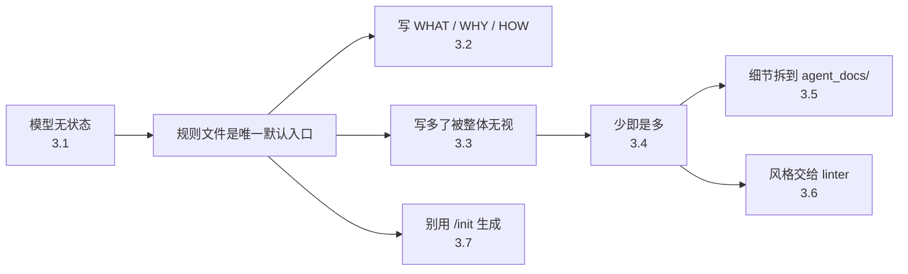

# CLAUDE.md 为什么常被无视：HumanLayer 讲怎么写一份好的规则文件

<div class="meta-tags"><span class="tool-tag tool-claude">Claude Code</span></div>

<div class="hook">

**一句话看懂**：模型是无状态的，每次会话都对你的项目一无所知，`CLAUDE.md`（或 `AGENTS.md`）是唯一默认每次都会进入上下文的文件，所以它是整个 harness 杠杆最大的地方。但 HumanLayer 抓包发现，Claude Code 注入它时附了一句“这段上下文可能与你的任务无关”，**写得越杂，越容易被整体无视**。他们的建议是：只写 WHAT / WHY / HOW 和每次都用得上的东西；控制在几十行（他们自己的根文件不到 60 行）；细节拆到 `agent_docs/`，根文件只放指针；代码风格交给 linter 和 hook；别用 `/init` 自动生成。

</div>

## 读完你能带走的 7 条收获

1. **规则文件是模型每次会话了解你项目的唯一默认入口**，所以它要像入职介绍一样，讲清技术栈、项目地图和怎么验证改动（见 3.1、3.2）。
2. **Claude Code 会提醒模型“这段内容可能不相关”**，不普遍适用的内容越多，整份文件越容易被忽略（见 3.3）。
3. **指令是有预算的**：作者引用的研究说前沿思考模型大约能稳定遵守 150–200 条，而 Claude Code 系统提示词自己就占了约 50 条（见 3.4）。
4. **指令多了，模型不是只忽略后面的，而是对所有指令都均匀变差**（见 3.4）。
5. **根文件只放目录和一句话简介，细节拆到按任务命名的文档里，让代理自己决定读哪份**；用 `file:line` 指针，不要复制代码片段（见 3.5）。
6. **别让模型当昂贵的 linter**：代码风格交给格式化工具，用 Stop hook 把报错交给代理修（见 3.6）。
7. **别用 `/init` 自动生成规则文件**：它的每一行都会影响研究、计划和代码，错误会层层放大（见 3.7）。

::: tip 小白先懂这几个词
- [Stateless（无状态）](/glossary#stateless)：模型权重在使用时已冻结，不会从你的对话里“学会”你的项目；它只知道你喂给它的 token。
- [CLAUDE.md / AGENTS.md](/glossary#agents-md)：给编码代理看的项目规则文件，每次会话默认加载。
- [Progressive Disclosure（渐进披露）](/glossary#progressive-disclosure)：先只给目录和简介，需要时再读详细文档。
- [Stop Hook](/glossary#stop-hook)：代理准备结束本轮时自动触发的脚本。
- Linter / Formatter：自动检查或修正代码风格的工具，结果是确定的。
:::

## 1. 基本信息

<SourceCard type="文章" title="Writing a good CLAUDE.md" author="Kyle（HumanLayer）" date="2025-11-25" url="https://www.humanlayer.dev/blog/writing-a-good-claude-md" />

| 项目 | 内容 |
|---|---|
| 链接 | https://www.humanlayer.dev/blog/writing-a-good-claude-md |
| 类型 | 公司技术博客（文章，标注 < 10 min read） |
| 作者 | Kyle（HumanLayer；博客署名仅为 Kyle，第三方转载标注为 Kyle Mistele） |
| 发布日期 | 2025-11-25 |
| 适用工具 | Claude Code（CLAUDE.md）；同样适用于 OpenCode、Zed、Cursor、Codex（AGENTS.md） |
| 分析依据 | HumanLayer 官方博客原文全文，2026-10-14 用 curl 重新抓取并逐字核对引语。英文引用和代码块均为原文摘录。“~150–200 条指令”等数字是作者引用的研究结论，原文没有给出研究名称，作者自己也说该话题<Trans zh="还没有被非常严格地研究过">“hasn't been investigated in an incredibly rigorous manner”</Trans>。“我觉得”开头的段落是本站评论。 |

## 2. 这篇在回答什么

很多人的 `CLAUDE.md` 是这样长大的：第一天写了技术栈和几条命令；第二周代理把 npm 和 bun 搞混了，加一条；第三周它又不按团队格式写导入语句，再加一条。半年后文件三四百行，代理却好像越来越不听话。

HumanLayer 这篇文章解释了为什么会这样，以及该怎么写。它回答了五个问题：

1. 规则文件为什么这么重要？（3.1）
2. 里面该写什么？（3.2）
3. 为什么模型经常无视它？（3.3）
4. 该写多少、多长？细节放哪里？（3.4、3.5）
5. 哪些东西不该写，哪些做法不该用？（3.6、3.7）



## 3. 怎么做

### 3.1 原理：模型每次会话都对你的项目一无所知

作者从一个基本事实讲起：

<Trans zh="LLM 是无状态的函数。">“LLMs are stateless functions.”</Trans>

模型的权重在推理时已经冻结，它不会随着使用学习。它对你代码库的全部了解，就是你放进上下文的那些 token。Claude Code 这类 harness 通常也要你自己管理代理的记忆，而：

<Trans zh="CLAUDE.md（或 AGENTS.md）是默认会进入你和代理每一次对话的唯一文件。">“CLAUDE.md (or AGENTS.md) is the only file that by default goes into every single conversation you have with the agent.”</Trans>

由此推出三点：每次会话开始时，代理对你的代码库一无所知；重要的事每次都得重新告诉它；规则文件是做这件事的首选方式。

### 3.2 写什么：WHAT / WHY / HOW

既然每次会话都是“第一天上班”，规则文件就该像一份入职介绍。作者把它分成三块：

| 块 | 写什么 | 例子 |
|---|---|---|
| WHAT | 技术栈、项目结构、代码库地图 | monorepo 里有哪些应用、哪些共享包、各自干什么，让它知道去哪里找 |
| WHY | 项目的目的，各部分在做什么 | 不同部分的用途和功能 |
| HOW | 在这个项目上该怎么干活 | 用 bun 而不是 node；怎么验证改动：怎么跑测试、类型检查、编译 |

但作者马上提醒，写法很重要：

<Trans zh="别想把 Claude 可能要跑的每一条命令都塞进 CLAUDE.md，那样结果会很差。">“Don't try to stuff every command Claude could possibly need to run in your CLAUDE.md file - you will get sub-optimal results.”</Trans>

### 3.3 为什么 Claude 经常无视 CLAUDE.md

不管用哪个模型，你可能都注意到 Claude 经常不按规则文件做。作者给了一个自己验证的方法：用 `ANTHROPIC_BASE_URL` 在 Claude Code 和 Anthropic API 之间架一个记录日志的代理，看实际发出去的内容。你会发现 Claude Code 把规则文件放进用户消息时，附带了这样一段提醒（原文摘录）：

::: tr 重要：这段上下文可能与你的任务相关，也可能无关。除非它和你的任务高度相关，否则不要回应它。
```
<system-reminder>
  IMPORTANT: this context may or may not be relevant to your tasks.
  You should not respond to this context unless it is highly relevant to your task.
</system-reminder>
```
:::

所以，模型判断不相关时就会忽略规则文件的内容。更关键的是：

<Trans zh="文件里不普遍适用于当前任务的信息越多，Claude 就越可能无视文件里的指令。">“The more information you have in the file that's not universally applicable to the tasks you have it working on, the more likely it is that Claude will ignore your instructions in the file.”</Trans>

Anthropic 为什么加这段？作者说只能推测：他们见过的大多数规则文件都塞了很多不普遍适用的指令，很多人把它当成给不满意的行为打<Trans zh="补丁">“hotfixes”</Trans>的地方。他们猜 Claude Code 团队发现让模型忽略这些坏指令，整体效果反而更好。

### 3.4 少即是多：指令是有“预算”的

作者先声明这些建议不一定适合所有情况，懂得何时、为何可以打破，并且有好理由时，就可以打破。然后他引用了一些研究结论（原文没有给出研究名称）：

- 前沿的思考模型大约能比较稳定地遵守 150–200 条指令；小模型、非思考模型能顾及的更少。
- 小模型随指令增多呈指数衰减，大的前沿思考模型呈线性衰减，所以作者不建议用小模型做多步骤任务。
- 模型偏向提示词两头的指令：最开头（系统提示词和规则文件）和最末尾（最近的用户消息）。
- 指令多了以后，遵守质量是**均匀下降**的：

<Trans zh="它并不是简单地忽略较新的（文件里更靠后的）指令，而是开始均匀地忽略所有指令。">“it doesn't simply ignore the newer ("further down in the file") instructions - it begins to ignore all of them uniformly”</Trans>

再加上作者对 Claude Code 的分析：它的系统提示词里已经有大约 50 条独立指令。按上面的数字，这几乎占了代理能可靠遵守的三分之一，还没算规则、插件、skills 和用户消息。

结论是：规则文件里的指令越少越好，最好只放普遍适用的。长度上，Anthropic 没有官方建议，一般共识是少于 300 行，越短越好。HumanLayer 自己的根规则文件不到 60 行。

什么算“不普遍适用”？作者的例子是：不要写怎么设计新的数据库表结构。你在做别的事时，这条只会分散模型的注意力。

我觉得判断一条规则该不该进根文件，可以问一句：下一个和它毫不相关的任务，也需要知道这件事吗？不需要，就该放到别处。

### 3.5 渐进披露：把细节拆到 agent_docs/

项目大了，几十行装不下所有要交代的东西。作者的办法是渐进披露：把特定任务的说明写成单独的 markdown 文件，文件名自己说明内容。原文的例子：

::: tr 按任务命名的说明文件：构建项目、跑测试、代码约定、服务架构、数据库表结构、服务间通信模式。
```
agent_docs/
  |- building_the_project.md
  |- running_tests.md
  |- code_conventions.md
  |- service_architecture.md
  |- database_schema.md
  |- service_communication_patterns.md
```
:::

然后在根规则文件里列出这些文件，每个配一句简介，让 Claude 自己判断哪些相关、开始工作前先读；或者让它先把想读的文件列给你批准。

还有一条细则：

<Trans zh="优先用指针，而不是副本。">“Prefer pointers to copies.”</Trans>

这些文件里尽量不放代码片段，因为代码片段很快就会过时。改用 `file:line` 引用，把 Claude 指向权威的上下文。作者说这在概念上和 Claude Skills 很像，只是 skills 更侧重工具使用。

### 3.6 别让 Claude 当昂贵的 linter

作者说规则文件里最常见的内容之一就是代码风格指南。他的态度很明确：

<Trans zh="永远不要让 LLM 去干 linter 的活。">“Never send an LLM to do a linter's job.”</Trans>

理由有三：LLM 比传统的 linter 和格式化工具贵得多、慢得多；风格指南会往上下文里塞一堆指令和不相关的代码片段，挤占上下文、降低指令遵守；而且 LLM 是“上下文学习者”，只要搜几次代码库，它自然会跟着已有的模式写。

替代做法：

- 设一个 Claude Code 的 **Stop hook**，跑格式化工具和 linter，把报错交给 Claude 修。不要让它自己找格式问题。
- 用能自动修复的 linter（作者喜欢 Biome），仔细调好哪些规则可以安全地自动修。
- 写一个斜杠命令，里面放代码规范，指向版本控制里的改动或 `git status`。实现和格式分开处理，两边效果都更好。

Hook 的具体写法可以参考 [[28]]。

### 3.7 不要用 `/init` 自动生成

Claude Code 和 OpenCode 都能自动生成规则文件。作者不建议用，理由是一条放大链：

::: tr 一行坏代码就是一行坏代码。一行坏的实现计划可能产生很多行坏代码。一行误解了系统工作方式的坏研究，可能导致计划里很多坏行，进而产生更多坏代码。
> "A bad line of code is a bad line of code. A bad line of an implementation plan has the potential to create a lot of bad lines of code. A bad line of a research that misunderstands how the system works has the potential to result in a lot of bad lines in the plan, and therefore a lot more bad lines of code as a result."
:::

而规则文件影响的是工作流的**每一个阶段**和每一份产物。所以它的每一行都值得仔细想。

## 4. 结果与局限

原文的结论可以归成五条：规则文件用来给 Claude 做入职介绍，讲清 WHY、WHAT、HOW；指令越少越好，但不要省掉必要的；内容简洁、普遍适用；用渐进披露，告诉它去哪找信息而不是把信息全塞进来；Claude 不是 linter，用 linter、格式化工具、hooks 和斜杠命令；规则文件是 harness 杠杆最大的地方，别自动生成。

注意第二条：作者反对的是不普遍适用的指令堆积，不是反对“代理犯错就补一条规则”。补的那条如果每次都用得上，就该加；只对某类任务有用，就放进 `agent_docs/` 或 skill。

::: warning 局限与注意
- “150–200 条”“指数 / 线性衰减”等结论来自作者引用但没有点名的研究，作者自己也承认不够严谨。
- `system-reminder` 的原文是作者抓包看到的，Claude Code 版本更新后可能变化，可以自己用 `ANTHROPIC_BASE_URL` 复查。
- “Claude Code 系统提示词约 50 条指令”是作者自己的分析，没有给出计数方法。
- 没有对照实验：没有展示一份长规则文件改短后效果提升了多少。
:::

## 5. 结论

这篇文章最重要的一句话是：规则文件写得越杂，越容易被整体无视。所以写规则文件的关键不是“写全”，而是“写准”：只放每次会话都用得上的 WHAT、WHY、HOW，细节放进按任务拆分的文档，风格交给确定性工具。

我觉得最实用的一招是 3.3 里的抓包方法。与其猜代理为什么不听话，不如看一眼它实际收到了什么。

### 你可以这样试

- [ ] 数一数你的规则文件有多少行、多少条指令。超过 100 行时，逐条问“下一个无关任务也需要它吗”。
- [ ] 把只对某类任务有用的段落移到 `agent_docs/` 下的单独文件，根文件里只留一行“做 X 时先读 Y”。
- [ ] 把规则文件里的代码风格条目删掉，换成一个跑格式化工具和 linter 的 Stop hook。
- [ ] 用 `ANTHROPIC_BASE_URL` 架一个日志代理，看看你的规则文件实际是怎么被注入的。

### 读完自测

1. 为什么作者说规则文件是 harness 杠杆最大的地方？
2. Claude Code 注入规则文件时附带了什么提醒？这对写法意味着什么？
3. 指令增多时，模型的遵守质量是怎么下降的？
4. 渐进披露具体怎么做？为什么要用指针而不是复制代码？
5. 作者为什么反对让 LLM 检查代码风格？他建议用什么替代？
