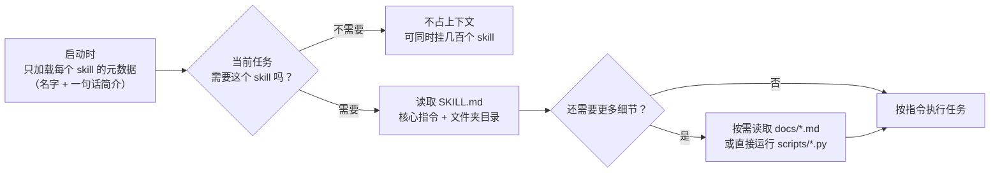
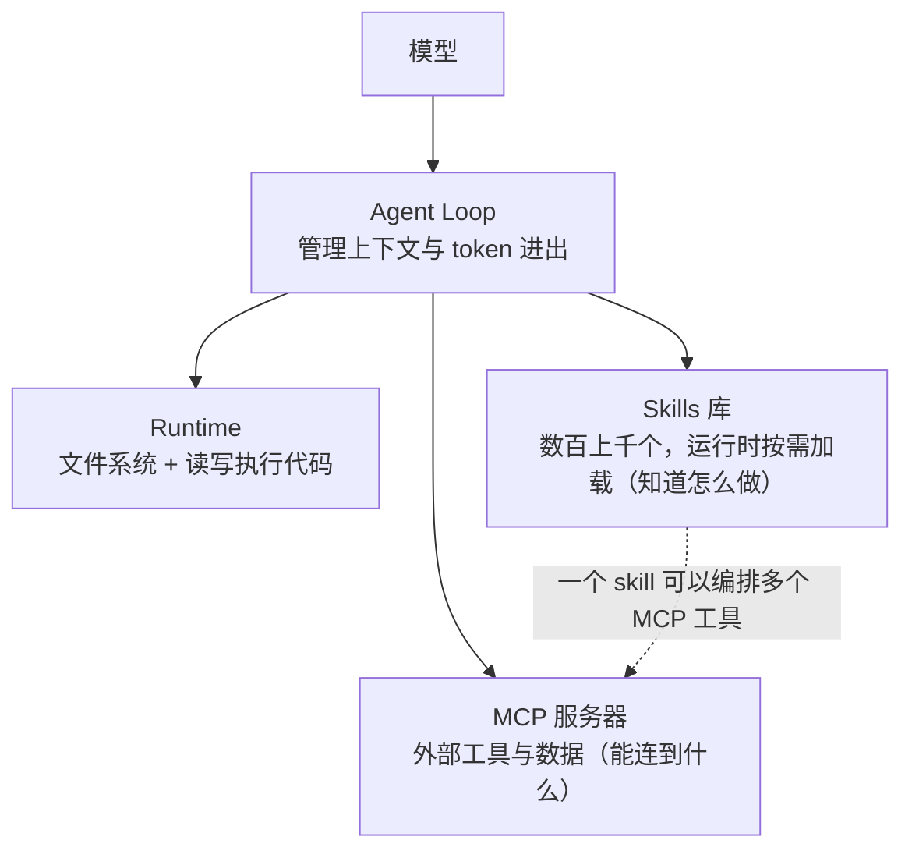

# 别再造新代理了，去写 Skills：Anthropic 讲 Agent Skills 为什么只是一个文件夹

Claude Code

**一句话看懂**：Agent Skills 的两位创建者认为，通用代理（模型 + bash + 文件系统）已经够聪明了，缺的是“领域经验”。Skills 就是把经验装进一个普通文件夹：一份 `SKILL.md` 说明，加上脚本和资料；平时只露出名字和简介，需要时才加载全文。MCP 负责“能连到什么”，Skills 负责“知道怎么做”。

## 读完你能带走的 6 条收获

1. **代理缺的往往不是智能，而是经验。** 讲者的比喻：报税你会找 300 IQ 的数学天才，还是找有经验的税务师（见第 2 节）？
2. **一个 skill 就是一个文件夹。** 刻意做得朴素，人和代理都能写，能放进 Git、网盘、压缩包里分享（见 3.1）。
3. **代理反复写同一段代码，就让它存进 skill 当工具。** 下次直接运行，结果更一致、更省时间（见 3.2）。
4. **渐进加载是为了装得下几百个 skill。** 启动时只看名字和简介，用到才读全文，再按需读附属文件（见 3.3）。
5. **MCP 和 Skills 分工不同。** MCP 提供和外部世界的连接，Skills 提供专业知识；一个 skill 可以编排多个 MCP 工具（见 3.5）。
6. **skill 越来越像软件。** 测试、版本、依赖管理是讲者说的下一步，当时都还在做（见 3.6）。

::: tip 小白先懂这几个词
- [Agent Skills（技能包）](/glossary#skills)：一个文件夹，内含 `SKILL.md`（核心说明 + 目录）以及可选的脚本、文档、素材。
- [Progressive Disclosure（渐进加载）](/glossary#progressive-disclosure)：启动时模型只看到技能的元数据（名字、简介），用到时才读 `SKILL.md`，再按需读其他文件。
- Procedural Knowledge（程序性知识）：“怎么做某件事”的经验，比如报税流程、公司内部的代码规范。
- [MCP](/glossary#mcp)：让代理连接外部工具和数据的协议。
- Agent Runtime（代理运行时）：给代理提供文件系统、能读写和执行代码的环境。
- [skill-creator](/glossary#skill-creator)：Anthropic 提供的“用来创建技能的技能”。
:::

## 1. 基本信息

<YouTube id="CEvIs9y1uog" title="Don't Build Agents, Build Skills Instead" />

| 项目 | 内容 |
|---|---|
| 讲者 / 频道 | Barry Zhang、Mahesh Murag（Anthropic，Agent Skills 创建者）／ **AI Engineer**（AI Engineer Code Summit 2025） |
| 发布日期 | 2025-12-08 |
| 时长 | 16:22（纯演讲，无问答） |
| 使用工具 | Claude Code、Claude Agent SDK、Agent Skills、MCP |
| 分析依据 | AI Engineer 官网演讲页的带时间戳文字稿（ai.engineer/talks/CEvIs9y1uog-agent-skills，2026-10-14 重新抓取）+ 视频截图。英文引号内容是文字稿原话，逐字照录；“我觉得”开头的段落是本站评论，不是讲者观点。 |

## 2. 这篇在回答什么

先看讲者开场的一句话：代理已经天天在用了，但

<Trans zh="我们还是有 slop（粗糙的产出）">“We still have slop, right?”</Trans>

为什么？讲者先讲了他们这一年认识上的变化。

以前他们以为，不同领域的代理会长得很不一样，每个都要有自己的工具和脚手架。做完 Claude Code 后，他们发现 Claude Code 其实是一个通用代理，因为

<Trans zh="代码不只是一个使用场景，而是通往数字世界的通用接口">“code is not just a use case, but a universal interface to the digital world”</Trans>

比如做一份财报：调 API 拉数据、在文件系统里整理、用 Python 分析、输出成各种文件格式，全靠代码就能完成。

于是脚手架变得很薄：

::: tr 核心脚手架一下子变得很薄，只剩 bash 和文件系统……但我们很快遇到了另一个问题，那就是领域专业知识。
> "The core scaffolding has suddenly become as thin as just bash and file system, which is great and really scalable, but we very quickly run into a different problem, and that problem is domain expertise."
:::

讲者用报税打比方：你想让谁帮你报税？300 IQ 的数学天才 Mahesh，还是有经验的税务师 Barry？Barry 说他每次都选 Barry，因为他不想让天才从第一性原理推导今年的税法，他要的是稳定的执行。

<Trans zh="今天的代理很像 Mahesh。它们很聪明，但缺少专业经验。">“Agents today are a lot like Mahesh. They're brilliant, but they lack expertise.”</Trans>

具体说，代理缺三样东西：前置的重要上下文、吸收你经验的能力、随时间进步的能力。Skills 就是为这个设计的。演讲回答了四个问题：

## 3. 怎么做

### 3.1 Skill 就是一个文件夹

讲者的定义：

::: tr Skills 是有组织的文件集合，为代理打包可组合的程序性知识。换句话说，它们就是文件夹。
> "Skills are organized collections of files that package composable procedural knowledge for agents. In other words, they're folders."
:::

“程序性知识”就是“怎么做某件事”的经验：品牌规范怎么套、报表怎么出、内部系统怎么用。

**为什么是文件夹？** 讲者说这种朴素是刻意的。他们希望任何人或代理，只要有一台电脑，就能创建和使用 skill。文件夹也能和你已有的东西配合：

<Trans zh="你可以用 Git 做版本管理，可以扔进 Google Drive，也可以打成 zip 分享给团队">“You can version them in Git, you can throw them in Google Drive, and you can zip them up and share it with your team.”</Trans>

文件这种基本单元已经用了几十年，没必要换。

<figure class="shot"><figcaption>📷 视频截图 · <a href="https://www.youtube.com/watch?v=CEvIs9y1uog&t=180s" target="_blank" rel="noopener">3:00</a> · 一个 skill 的样子：<code>anthropic_brand/</code> 文件夹里有 <code>SKILL.md</code>、两份说明文档和一个 Python 脚本 <code>apply_template.py</code>。</figcaption></figure>

### 3.2 把反复生成的代码存成脚本

既然是文件夹，skill 里就可以放脚本，当工具用。

讲者先说传统工具（tool calling 里预先定义的工具）的三个毛病：

- 有些工具说明写得含糊；
- 模型用不顺时，没法改工具，只能卡在那里；
- 工具描述一直占着上下文窗口。

代码能解决这些问题：它自带文档，可以修改，平时躺在文件系统里，用到时才拿出来。

讲者的例子很具体：

::: tr 我们一直看到 Claude 一遍又一遍地写同一个给幻灯片套样式的 Python 脚本，于是干脆让 Claude 把它存进 skill，作为给未来的自己用的工具。
> "We kept seeing Claude write the same Python script over and over again to apply styling to slides, so we just asked Claude to save it inside of the skill as a tool for his version, uh, f-for his future self."
:::

之后直接运行这个脚本，

<Trans zh="这让一切都更一致、更高效">“that makes everything a lot more consistent and a lot more efficient”</Trans>

我觉得这是整场演讲里最容易马上用上的一条。判断标准很简单：**你在会话记录里看到代理第二次写差不多的脚本，就该让它存下来。** 存下来的脚本还可以被测试、被评审，比每次重新生成可靠得多。

### 3.3 渐进加载：为了装得下几百个 skill

skill 能装的东西越来越多，问题就来了：上下文窗口放不下。讲者说，他们要保护上下文窗口，

<Trans zh="这样我们才能装下几百个技能，让它们真正可组合">“so that we can fit in hundreds of skills and make them truly composable”</Trans>

办法是分层加载：

::: tr 运行时只把这些元数据展示给模型，仅仅表明它拥有这个技能。当代理需要用某个技能时，它可以读入 SKILL.md 的其余部分，里面有核心指令和整个文件夹的目录。
> "At runtime, only this metadata is shown to the model just to indicate that it has the skill. When an agent needs to use a skill, it can read in the rest of the SKILL.md, which contains the core instruction and directory for the rest of the folder."
:::

文件夹里的其他东西，只是为了方便取用而组织好的。

<figure class="shot"><figcaption>📷 视频截图 · <a href="https://www.youtube.com/watch?v=CEvIs9y1uog&t=290s" target="_blank" rel="noopener">4:50</a> · “Skills are progressively disclosed”：先是 SKILL.md 的元数据，再是正文，附属文档只在需要时读取。</figcaption></figure>

讲者的总结是：

<Trans zh="skill 就是这些：组织好的文件夹，里面有当工具用的脚本">“They're organized folders with scripts as tools.”</Trans>

我觉得这个设计带来一个容易忽略的后果：**元数据决定了 skill 会不会被用到**。代理只看名字和简介来判断要不要加载，所以简介要写清楚“什么时候用我”，而不只是“我是什么”。

### 3.4 谁在写 skill，写成什么样

讲者说，发布 5 周后，这个简单的设计已经长出了

<Trans zh="一个由数千个技能组成、增长很快的生态">“a very quickly growing ecosystem of thousands of skills”</Trans>

大致分三类：

| 类型 | 演讲中的例子 |
|---|---|
| 基础技能 | Anthropic 的文档技能（创建、编辑专业级 Office 文档）；K-Dense 的科研技能（EHR 数据分析、生物信息学 Python 库） |
| 合作方技能 | Browserbase 为其开源浏览器自动化工具 Stagehand 做的技能；Notion 帮 Claude 理解并调研整个工作区的技能 |
| 企业 / 团队技能 | 财富 100 强公司用来教代理组织最佳实践和内部软件用法；服务数千到数万开发者的研发效能团队，用来教 Claude Code 内部代码规范 |

Mahesh 说，企业里的热度最高。

他还观察到三个趋势：

- **skill 越来越复杂。** 最简单的仍是一个 SKILL.md 加几段说明，但已经有 skill 打包了软件、可执行文件、脚本和素材。今天写一个 skill 要几分钟到几小时，以后可能像软件一样要几周、几个月开发和维护。
- **skill 在编排 MCP。** 开发者用 skill 把多个 MCP 工具串成工作流，处理更复杂的外部数据。
- **非技术人员在写 skill。** 财务、招聘、会计、法务的人都在写。讲者认为这初步验证了他们的设想：skill 能让不写代码的人也扩展通用代理。

### 3.5 在通用代理架构中的位置

讲者认为通用代理的架构正在收敛成几块：

- **Agent loop**：管理模型的上下文，决定哪些 token 进出；
- **Runtime**：提供文件系统，能读写和执行代码；
- **MCP 服务器**：外部世界的工具和数据；
- **Skills 库**：几百上千个技能，代理在处理具体任务时才决定拉进上下文。

MCP 和 Skills 的分工，讲者说得很清楚：

::: tr 在这些情况下，MCP 提供与外部世界的连接，而 skills 提供专业知识。
> "MCP is providing the connection to the outside world, while skills are providing the expertise."
:::

讲者说，今天给代理加一个新领域的能力，

<Trans zh="可能只需要给它配上合适的一组 MCP 服务器和合适的技能库">“might just involve equipping it with the right set of MCP servers and the right library of skills”</Trans>

Anthropic 发布 Skills 后马上推出的金融服务和生命科学产品，就是各配一组 MCP 服务器和一组 skill（演讲没有给出效果数据）。

<figure class="shot"><figcaption>📷 视频截图 · <a href="https://www.youtube.com/watch?v=CEvIs9y1uog&t=596s" target="_blank" rel="noopener">9:56</a> · “Skills: the complete picture”：左边 MCP 服务器提供连接，中间是代理循环，右边文件系统里放着技能库。</figcaption></figure>

### 3.6 下一步：像对待软件一样对待 skill

skill 变复杂了，讲者说他们想

<Trans zh="开始像对待软件一样对待技能">“starting to treat skills like we treat software”</Trans>

具体是三件事（演讲时都是“想做”，不是已完成）：

- **测试与评测**：工具要能检查代理是否在对的时机、为对的任务加载和触发 skill；还要能衡量装了 skill 后的输出质量是否达标。
- **版本管理**：skill 变了，代理行为也会变，要能清楚追踪演进历史。
- **显式依赖**：skill 可以声明依赖其他 skill、MCP 服务器，以及环境里的软件包，让代理在不同运行环境里更可预测。

### 3.7 长远：组织的知识库和持续学习

**组织层面。** 讲者最期待的，是一个由组织里的人和代理共同维护、不断演进的能力知识库。你给代理反馈、教它组织知识，它就变好，团队里所有代理都跟着变好。新同事第一次用 Claude，它就已经知道团队在乎什么。社区里别人写的 skill，也能让你的代理更好用，就像别人写的 MCP 服务器一样。

**代理自己写 skill。** 讲者说 skill 是朝“持续学习”迈出的具体一步。统一的格式带来一个重要保证：

<Trans zh="Claude 写下的任何东西，都能被未来版本的它自己高效使用。这让学习真正可以迁移。">“Anything that Claude writes down can be used efficiently by a future version of itself. This makes the learning actually transferable.”</Trans>

但他也说明了边界：skill 不捕获所有信息，只捕获 Claude 在具体任务上能用的程序性知识。他们的目标是，和你共事第 30 天的 Claude 比第 1 天好得多。今天就可以用 skill-creator 让 Claude 帮你写 skill。

**结尾的类比。** 模型像处理器，投入巨大、潜力巨大，但单独用处有限；代理运行时像操作系统，负责调度资源；**skill 是应用层**。少数公司做处理器和操作系统，但几百万开发者在上面写软件，把领域经验写进去。讲者希望 skill 把这一层向所有人打开，

<Trans zh="只要把东西放进文件夹">“just by putting stuff in the folder”</Trans>

<figure class="shot"><figcaption>📷 视频截图 · <a href="https://www.youtube.com/watch?v=CEvIs9y1uog&t=918s" target="_blank" rel="noopener">15:18</a> · “Moving up the stack”：Models = 处理器，Agents（运行时）= 操作系统，Skills = 应用。</figcaption></figure>

## 4. 结果与局限

- 讲者称发布 5 周后已有数千个 skill（口述，没有给统计口径）。
- 演讲以架构观点为主，**没有量化的效果对比**；金融服务、生命科学产品也没有给出效果数据。

::: warning 局限与注意
- **测试、版本、依赖管理在演讲时都是计划中的方向**，实际进展请以 Anthropic 最新文档为准。
- **“只是个文件夹”不等于维护成本低。** 讲者自己也预计复杂 skill 要几周到几个月开发和维护。
- **skill 是否被加载由代理决定。** 元数据写不清楚，会导致该用时不用、不该用时乱用。
- **skill 里的脚本会被执行。** 用社区的 skill 前，要像审依赖一样审它的脚本。
:::

## 5. 结论

这场演讲的结论在标题里：**别再为每个领域造一个新代理，去写 skill。**

理由是一条链：

1. 通用代理（模型 + bash + 文件系统）已经够聪明，缺的是领域经验。
2. 经验可以装进文件夹：一份 SKILL.md，加脚本和资料。
3. 渐进加载让一个代理能挂几百个 skill，而不撑爆上下文。
4. MCP 管连接，skill 管经验；两者配合就能进入一个新领域。

我觉得最值得马上做的是两件小事：**代理第二次写同一段脚本时，让它存进 skill；写 skill 时，把简介写成“什么时候用我”。**

### 你可以这样试

- [ ] 翻一翻最近的会话，找一段代理写过两次以上的脚本，让它存进一个 skill 的 `scripts/` 目录。
- [ ] 把 CLAUDE.md / AGENTS.md 里只对某类任务有用的长篇说明，迁移成一个 skill，根规则文件只留普遍适用的内容。
- [ ] 给你的每个 skill 检查一遍简介：它有没有写清楚“遇到什么任务时该用我”？
- [ ] 让 Claude 用 skill-creator 帮你把一个团队流程写成 skill，放进 Git，请同事评审。

::: details 读完自测（点开看答案）
1. **讲者说今天的代理缺的是什么？** 不是智能，而是领域经验：缺前置上下文、吸收不了你的经验、不会随时间进步。
2. **为什么 skill 要设计成文件夹？** 任何人或代理都能创建和使用，还能直接用 Git、网盘、压缩包管理和分享。
3. **渐进加载分哪几层？** 元数据 → SKILL.md 全文（核心指令 + 目录）→ 按需读其他文件或运行脚本。
4. **MCP 和 skill 怎么分工？** MCP 提供和外部世界的连接，skill 提供专业知识。
5. **skill 会捕获代理的所有记忆吗？** 不会，只捕获能在具体任务上用的程序性知识。
:::
