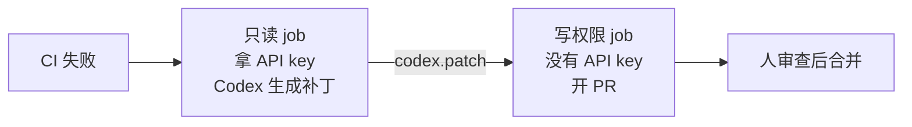
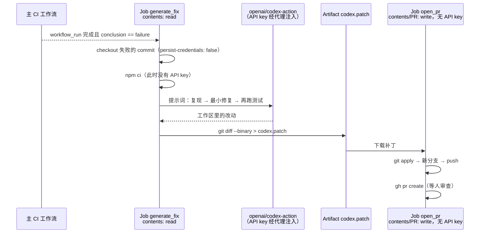

# CI 挂了让代理自动修：密钥、仓库代码和写权限为什么不能放在一起

<div class="meta-tags"><span class="tool-tag tool-codex">Codex</span></div>

<div class="hook">

**一句话看懂**：`codex exec` 让 Codex 不开界面、在脚本和 CI 里跑。OpenAI 官方给的“CI 失败自动修”范例，核心不是提示词，而是**权限布局**：拿 API key 的 job 只能读仓库，能写仓库的 job 拿不到 API key，两者之间只传一个补丁文件。旧版教程把三样东西放进同一个 job，已经被官方归档，标注“不要照抄”。

</div>

## 读完你能带走的 7 条收获

1. **代理进 CI，先设计权限，再写提示词。** API key、执行仓库代码、仓库写权限，任意两样都不要在同一个 job 里出现（见 3.2、3.3）。
2. **不要把 `OPENAI_API_KEY` 设成 job 级环境变量。** 同一个 job 里的构建脚本、测试、依赖的生命周期钩子都能读到它（见 3.2）。
3. **两个 job 之间只传补丁。** 生成方 `contents: read`，发布方有写权限但没有密钥，中间用 artifact 传 `codex.patch`（见 3.3）。
4. **`codex exec` 的 stdout 只有最终答案**，进度在 stderr，所以能直接接管道；要逐步事件就加 `--json`，要稳定字段就加 `--output-schema`（见 3.1）。
5. **管道有两种写法**：“提示词 + stdin”把输出当上下文，`codex exec -` 把整个 stdin 当提示词（见 3.1）。
6. **Action 的 `read-only` 不等于保护密钥。** 真正保护内存里密钥的是默认的 `drop-sudo` 或低权限用户（见 3.4）。
7. **PR 标题、issue 正文、提交信息都是攻击面**，进提示词前要清洗，还要看 HTML 注释里有没有藏东西（见 3.4、第 5 节）。

::: tip 小白先懂这几个词
- [`codex exec`](/glossary#codex-exec)：Codex 的非交互模式，适合放进脚本、CI、定时任务。
- GitHub Actions / workflow_run：GitHub 的 CI 系统；`workflow_run` 指“另一个工作流跑完后触发我”。
- [Sandbox（沙箱）模式](/glossary#sandbox)：`read-only`（默认只读）、`workspace-write`（可改工作目录）、`danger-full-access`（完全放开）。
- [Patch Artifact（补丁产物）](/glossary#patch-artifact)：把改动导出成 `.patch` 文件，交给下一个 job 使用。
- [Prompt Injection（提示词注入）](/glossary#prompt-injection)：PR 标题、issue 正文里藏着的恶意指令被喂给代理。
- JSONL：每行一个 JSON 对象的日志格式，方便脚本逐行解析。
:::

## 1. 基本信息

<SourceCard type="官方文档" title="Non-interactive mode（Codex 文档，另见 Codex GitHub Action）" author="OpenAI" date="持续更新的文档页（抓取于 2026-10-14）" url="https://developers.openai.com/codex/noninteractive" />

| 项目 | 内容 |
|---|---|
| 主链接 | https://developers.openai.com/codex/noninteractive （跳转至 https://learn.chatgpt.com/docs/non-interactive-mode ） |
| 配套 | https://developers.openai.com/codex/github-action ；Action 源码 https://github.com/openai/codex-action |
| 对照（旧版） | https://developers.openai.com/cookbook/examples/codex/autofix-github-actions （已归档） |
| 类型 | 官方产品文档（两页合计约 2.2 万字符） |
| 作者 | OpenAI |
| 日期 | 持续更新的文档，没有固定发布日期 |
| 使用工具 | Codex CLI（`codex exec`）、`openai/codex-action@v1`、GitHub Actions |
| 分析依据 | OpenAI Codex 官方文档《Non-interactive mode》与《Codex GitHub Action》的 Markdown 版本（2026-10-14 重新抓取全文并逐字核对），以及已归档的 OpenAI Cookbook《Autofix CI failures on GitHub with Codex CLI》页顶的归档说明。文档持续更新，参数名和默认值以抓取时为准。英文引用和 YAML 为原文摘录。“我觉得”开头的段落是本站评论，不是官方观点。 |

## 2. 这篇在回答什么

设想一个常见的偷懒写法：在 GitHub Actions 里装好 Codex，把 `OPENAI_API_KEY` 写进 job 的 `env`，给 job 开 `contents: write`，然后 `npm ci`、跑测试、让 Codex 修、直接推分支。

能跑通，但有个问题：`npm ci` 会执行几百个依赖包的安装脚本，测试会执行仓库里的代码。只要其中一个被人动过手脚，它就能读到你的 API key，还能用 job 的写权限改你的仓库。OpenAI 早期的 cookbook 就是这么写的，现在页面顶部挂着“归档、不要照抄”。

所以这两页文档真正回答的是三个问题：

1. 怎么让 Codex 在没人值守的地方跑，并给出机器能读的结果？（3.1）
2. 旧写法错在哪？（3.2）
3. 正确的布局长什么样，Action 又提供了哪些权限开关？（3.3、3.4）

另外还有认证、断点续跑和排错这些落地细节（3.5）。



## 3. 怎么做

### 3.1 `codex exec`：把 Codex 当成一个命令行工具

`codex exec` 的设计很像普通 Unix 工具：**进度写到 stderr，最终答案写到 stdout**。所以它可以直接接在管道里：

```bash
codex exec "generate release notes for the last 10 commits" | tee release-notes.md
```

常用开关：

| 用法 | 作用 |
|---|---|
| `codex exec "任务"` | 默认**只读沙箱**；只有最终消息进 stdout |
| `--sandbox workspace-write` | 允许改工作目录；`danger-full-access` 只在隔离 runner 或容器里用 |
| `--json` | stdout 变成 JSONL 事件流：`thread.started`、`turn.started`、`turn.completed`、`turn.failed`、`item.*`、`error` |
| `-o <path>` | 把最终消息另存一份到文件 |
| `--output-schema schema.json` | 让最终回答符合 JSON Schema，下游按字段读 |
| `--ephemeral` | 不把会话记录写到磁盘 |
| `codex exec resume --last "…"` | 接着上一次会话继续，适合两段式流水线 |

`--full-auto` 已经不支持了。原文：<Trans zh="更新脚本，改用 --sandbox workspace-write，或者用 --approve-for-me 把审批请求交给自动审查，配合 workspace-write 沙箱。">“Update scripts to use `--sandbox workspace-write`, or use `--approve-for-me` to route approval requests through automatic review with the workspace-write sandbox.”</Trans>

**两种管道写法。** 第一种，你自己写指令，把别的命令的输出当上下文喂进去：

::: tr 把 npm test 的输出交给 Codex：总结失败的测试并给出最小可能的修复建议，结果同时写入 test-summary.md。
```bash
npm test 2>&1 \
  | codex exec "summarize the failing tests and propose the smallest likely fix" \
  | tee test-summary.md
```
:::

文档还给了几个同类例子：`tail -n 200 app.log` 找根因、`curl -vv` 排查 TLS、`gh run view 123456 --log` 写一条 Slack 更新，或者直接 `| gh pr comment 789 --body-file -` 发到 PR 里。

第二种，整个提示词都由脚本生成，用 `codex exec -` 表示“stdin 就是提示词”：

```bash
generate_prompt.sh | codex exec - --json > result.jsonl
```

**结构化输出。** 下游脚本要判断“风险高不高”，就别让它去解析一段自然语言。官方例子是用 schema 规定字段：

```bash
codex exec "Extract project metadata" \
  --output-schema ./schema.json \
  -o ./project-metadata.json
```

我觉得这一节最值得记住的是“只读是默认”。很多人第一次在 CI 里跑，发现 Codex 改不了文件，就顺手加 `danger-full-access`。正确的做法是先问自己：这个任务真的要写吗？总结日志、写评论都不需要。

### 3.2 旧版教程为什么被归档

旧版 cookbook 的前提就写着：把 `OPENAI_API_KEY` 作为环境变量配进仓库设置；工作流里同一个 job 既有写权限，又跑 `npm ci` 和测试。现在页面顶部是这样一段：

::: tr 归档示例——请使用当前的 CI 指南。下面的工作流把 API key 暴露给整个 job，并且把“执行仓库控制的代码”和“仓库写权限”放在了一起。不要照抄这种凭证和权限布局。
> "Archived example — use the current CI guidance. The workflow below exposes an API key to the whole job and combines repository-controlled execution with repository write permissions. Do not copy that credential and permission layout."
:::

为什么危险，当前文档说得很直接：<Trans zh="构建脚本、测试、依赖的生命周期钩子，或同一 job 中被攻陷的 action，都能读取这些环境变量。">“Build scripts, tests, dependency lifecycle hooks, or a compromised action in the same job can read those environment variables.”</Trans>

注意这里的思路：问题不在 Codex 会不会乱来，而在**同一个 job 里还跑着别人写的代码**。你的 `package.json` 依赖了几百个包，每个包都能带 `postinstall` 脚本。只要环境变量里有密钥，它们就都能读。

不在 GitHub Actions 里时，文档的建议是：<Trans zh="只给需要它的那一次 Codex 调用设置 CODEX_API_KEY，并确保同一个进程环境里没有不可信代码在跑。">“set `CODEX_API_KEY` only for the Codex invocation that needs it, and make sure no untrusted code runs in the same process environment.”</Trans> 也就是写成 `CODEX_API_KEY=<api-key> codex exec ...` 这样的单次内联，而不是 `export`。

### 3.3 当前推荐：生成补丁和开 PR 分成两个 job



官方给出的 6 步模式：

1. 主 CI 工作流以失败结束时，触发后续工作流；
2. 用**只读**权限 checkout 失败的 commit；
3. 在 Codex 之前跑安装等准备命令，**这些步骤拿不到 API key**；
4. 运行 Codex GitHub Action；
5. 把 Codex 的本地改动保存为补丁 artifact；
6. 在另一个 job 里应用补丁并开 PR。

文档对两个 job 的权限说得很清楚：<Trans zh="Codex 所在的 job 只有 contents: read。Codex 运行后，它只把 diff 序列化成 artifact。open_pr job 拿到仓库写权限，但拿不到 OPENAI_API_KEY。">“The Codex job below has only `contents: read`. After Codex runs, it only serializes the diff as an artifact. The `open_pr` job receives repository write permissions, but it does not receive `OPENAI_API_KEY`.”</Trans>

完整 YAML（原文摘录，2026-10-14 抓取；示例假设是 Node.js 项目，安装和测试命令按你的技术栈改）：

::: tr 工作流“CI 失败时由 Codex 自动修复”：generate_fix 只读、通过 Action 使用密钥并生成补丁；open_pr 有写权限、无密钥，应用补丁后开 PR。
```yaml
name: Codex auto-fix on CI failure

on:
  workflow_run:
    workflows: ["CI"]
    types: [completed]

jobs:
  generate_fix:
    if: ${{ github.event.workflow_run.conclusion == 'failure' }}
    runs-on: ubuntu-latest
    permissions:
      contents: read
    outputs:
      has_patch: ${{ steps.diff.outputs.has_patch }}
    steps:
      - uses: actions/checkout@v5
        with:
          ref: ${{ github.event.workflow_run.head_sha }}
          fetch-depth: 0
          persist-credentials: false

      - uses: actions/setup-node@v4
        with:
          node-version: "20"

      - name: Install dependencies
        run: |
          if [ -f package-lock.json ]; then npm ci; fi

      - name: Run Codex
        uses: openai/codex-action@v1
        with:
          openai-api-key: ${{ secrets.OPENAI_API_KEY }}
          prompt: |
            The CI workflow "${{ github.event.workflow_run.name }}" failed for commit
            ${{ github.event.workflow_run.head_sha }}.

            Run `npm test --silent` to reproduce the failure. Identify the minimal
            change needed to make the tests pass, implement only that change, and
            run `npm test --silent` again.

            Do not refactor unrelated files.

      - name: Create patch artifact
        id: diff
        run: |
          git add -N .
          git diff --binary HEAD > codex.patch
          if [ -s codex.patch ]; then
            echo "has_patch=true" >> "$GITHUB_OUTPUT"
          else
            echo "has_patch=false" >> "$GITHUB_OUTPUT"
          fi

      - name: Upload patch artifact
        if: steps.diff.outputs.has_patch == 'true'
        uses: actions/upload-artifact@v4
        with:
          name: codex-fix-patch
          path: codex.patch
          if-no-files-found: error

  open_pr:
    runs-on: ubuntu-latest
    needs: generate_fix
    if: needs.generate_fix.outputs.has_patch == 'true'
    permissions:
      contents: write
      pull-requests: write
    steps:
      - uses: actions/checkout@v5
        with:
          ref: ${{ github.event.workflow_run.head_sha }}
          fetch-depth: 0

      - uses: actions/download-artifact@v4
        with:
          name: codex-fix-patch

      - name: Apply Codex patch
        run: git apply --index codex.patch

      - name: Open pull request
        env:
          GH_TOKEN: ${{ github.token }}
          FAILED_HEAD_BRANCH: ${{ github.event.workflow_run.head_branch }}
          FAILED_HEAD_SHA: ${{ github.event.workflow_run.head_sha }}
          RUN_ID: ${{ github.event.workflow_run.run_id }}
        run: |
          branch="codex/auto-fix-$RUN_ID"

          git config user.name "github-actions[bot]"
          git config user.email "41898282+github-actions[bot]@users.noreply.github.com"
          git switch -c "$branch"
          git commit -m "Auto-fix failing CI via Codex"
          git push origin "$branch"

          {
            echo "Codex generated this patch after CI failed for \`$FAILED_HEAD_SHA\`."
            echo
            echo "Review the changes before merging."
          } > pr-body.md

          gh pr create \
            --base "$FAILED_HEAD_BRANCH" \
            --head "$branch" \
            --title "Auto-fix failing CI via Codex" \
            --body-file pr-body.md
```
:::

有几个细节容易漏看：

- **`persist-credentials: false`**：checkout 不把 GitHub token 留在 `.git/config` 里，Codex 和依赖脚本都拿不到。
- **`git add -N .` 再 `git diff --binary`**：`-N` 让新建文件也进 diff，`--binary` 保住二进制改动。没有补丁就输出 `has_patch=false`，第二个 job 直接不跑。
- **提示词很窄**：先复现，只做“让测试通过的最小改动”，再跑一遍，<Trans zh="不要重构无关文件。">“Do not refactor unrelated files.”</Trans>
- **PR 正文提醒人审**：<Trans zh="合并前请审查这些改动。">“Review the changes before merging.”</Trans> 补丁永远进 PR，不直接推到失败的分支上。

Action 文档里的 PR 审查示例也是同一个布局：`codex` job 只读，把 `final-message` 交给另一个有 `pull-requests: write` 的 job 去发评论。我觉得这说明“两段式”不是 autofix 专用的技巧，而是**所有让代理在 CI 里产出东西的默认布局**：代理那一侧只产出数据，有权限的那一侧只搬运数据。

### 3.4 Codex GitHub Action 的权限开关

为什么在 GitHub Actions 里要用 Action，而不是自己装 CLI？因为 Action 会<Trans zh="安装 Codex、启动一个 Responses API 代理，并按可配置的安全策略运行 Codex">“installing Codex, starting a Responses API proxy, and running Codex with a configurable safety strategy”</Trans>，密钥由代理持有，不进 Codex 的环境。

| 输入 | 作用 |
|---|---|
| `safety-strategy`（默认 `drop-sudo`） | 运行 Codex 前移除 sudo，本 job 内不可逆，用来保护内存里的密钥；Windows 必须设 `unsafe` |
| `unprivileged-user` + `codex-user` | 以指定的低权限账户运行 Codex，要确保它能读写 checkout 目录 |
| `sandbox` | `read-only` / `workspace-write` / `danger-full-access`，选能完成任务的最窄选项 |
| `read-only` | 不改文件、不联网，**但仍然带着提权运行** |
| `allow-users` / `allow-bots` | 限制谁能触发；默认只有有写权限的用户 |
| `prompt` / `prompt-file` | 二选一；建议提示词放 `.github/codex/prompts/`，和代码一起审查 |
| `codex-args`、`model`、`effort`、`codex-version`、`codex-home` | 透传 CLI 参数、选模型、钉住版本、共享配置 |
| `output-file` / `final-message` | 拿到最终消息，供后续步骤发评论或上传 |

表里最反直觉的一条是 `read-only`。原文：<Trans zh="不要只依赖 read-only 来保护密钥。">“Don't rely on `read-only` alone to protect secrets.”</Trans> 只读管的是 Codex 能不能改文件，管不了进程有没有权限去翻内存。保护密钥靠的是去掉 sudo 或换低权限用户。

官方安全清单共 5 条，最值得记住的三条：

- <Trans zh="对来自 PR、commit message 或 issue 正文的提示词输入做清洗，以防提示词注入。喂给 Codex 之前检查 HTML 注释或隐藏文本。">“Sanitize prompt inputs from pull requests, commit messages, or issue bodies to avoid prompt injection. Review HTML comments or hidden text before feeding it to Codex.”</Trans>
- <Trans zh="把 Codex 作为 job 的最后一步运行，这样后续步骤不会继承意外的状态改动。">“Run Codex as the last step in a job so later steps don't inherit any unexpected state changes.”</Trans>
- <Trans zh="多租户 runner 上绝不要让 Action 处于 unsafe 模式。">“Never leave the action in `unsafe` mode on multi-tenant runners.”</Trans>

另外两条是：限制谁能触发工作流；怀疑代理日志或输出泄露了密钥，就立刻轮换。

### 3.5 落地细节：认证、断点续跑和常见报错

文档里还散着几条边界条件，实际接入时常会碰到：

- **一定要在 git 仓库里跑。** Codex 用这个检查防止破坏性改动；确定环境安全，才用 `--skip-git-repo-check` 跳过。
- **CI 要可复现，就别读个人配置。** `--ignore-user-config` 不加载 `$CODEX_HOME/config.toml`，`--ignore-rules` 跳过用户和项目的 execpolicy `.rules` 文件。
- **必需的 MCP 起不来就直接失败。** 配置里 `required = true` 的 MCP server 初始化失败时，`codex exec` 报错退出，而不是悄悄少一个工具继续跑。
- **用 ChatGPT 账号而不是 API key 跑 CI？** 文档放在“进阶”折叠里，默认仍推荐 API key，因为好发放、好轮换。`~/.codex/auth.json` 要当密码对待；原文：<Trans zh="公开或开源仓库不要用这套流程。">“Do not use this workflow for public or open-source repositories.”</Trans>
- **两段式任务**：先 `codex exec "review the change for race conditions"`，再 `codex exec resume --last "fix the race conditions you found"`，第二步能看到第一步的上下文。

Action 的排错清单也很实用：`prompt` 和 `prompt-file` 不能同时写；代理没写出 server info，多半是 API key 没传或无效；`drop-sudo` 之后出现权限错误，就在 Action 之前先 `chmod -R g+rwX "$GITHUB_WORKSPACE"`，或者改用低权限用户的写法。

## 4. 结果与局限

这是产品文档，没有效果数据，也没有说自动修复的成功率。它交付的是一套**可以照抄的工作流模板**和一份权限清单：CI 失败 → 只读 job 产出最小补丁 → 无密钥的 job 开一个等人审查的 PR。

::: warning 局限与注意
- 自动修复只适合“失败能被测试复现”的情况。flaky test、环境问题、外部服务挂了，都可能让它做出错误修改，所以必须走 PR 人审，不要直接推主分支。
- 提示词里的“最小修复”只是约束，不是保证。审查时要特别看它有没有改测试本身来“让测试通过”。
- 两段式布局挡住的是**密钥泄露**和**越权写仓库**，挡不住补丁本身有问题。补丁里如果有恶意改动（比如被提示词注入诱导），只有人审能拦住。
- Windows runner 需要 `safety-strategy: unsafe`，官方明确说不要在多租户 runner 上这样用。
- 文档持续更新，参数会变：`--full-auto` 已被移除，旧版 Action 的输入名也和现在不同，以官方页面为准。
:::

## 5. 结论

把代理接进 CI，第一件事不是写提示词，而是画清楚三样东西的边界：**API key、执行仓库代码、仓库写权限**。官方的答案是把它们拆到两个 job：生成改动的一侧只读、拿密钥；发布改动的一侧能写、不拿密钥；中间只传一个补丁文件。

另一条同样重要：**把不可信输入当作攻击面**。PR 标题、issue 正文、提交信息进入提示词之前要清洗，HTML 注释里也可能藏着指令。

我觉得最稳的入门顺序是：先在本地用管道（`npm test 2>&1 | codex exec "..."`）体验它能给出什么；再在 CI 里做只读用途，比如总结失败日志、发 PR 评论；最后才上自动修复，并且始终让人来按合并键。

### 你可以这样试

- [ ] 在本地跑一次：`npm test 2>&1 | codex exec "summarize the failing tests and propose the smallest likely fix"`，看看输出能不能直接用。
- [ ] 写一个 `schema.json`（例如 `{risk_level, files, summary}`），用 `codex exec --output-schema` 生成一份 PR 风险报告。
- [ ] 在一个测试仓库里，照官方两段式 YAML 配置 “Codex auto-fix on CI failure”，故意写错一个测试触发它。
- [ ] 检查你现有的工作流：有没有把任何 AI API key 设成 job 级环境变量，同时又跑了 `npm ci` 或测试？

::: details 读完自测（点开看答案）
1. **旧版 cookbook 的工作流哪里不安全？** API key 设成 job 级环境变量，并且同一个 job 既跑仓库代码又有写权限，依赖钩子或被攻陷的 action 能读到密钥。
2. **新版布局中两个 job 各有什么权限？** `generate_fix` 只有 `contents: read` 并通过 Action 使用密钥；`open_pr` 有写权限但没有 API key。
3. **Action 设成 `read-only` 能保护密钥吗？** 不能，它仍带着提权运行；保护密钥靠默认的 `drop-sudo` 或低权限用户。
4. **想让 stdin 整个作为提示词，该怎么写？** `codex exec -`。
:::
