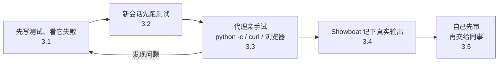

# 测试全绿就能交了吗：Simon Willison 的四条测试与验收模式

<div class="meta-tags"><span class="tool-tag tool-general">通用（不限工具）</span></div>

<div class="hook">

**一句话看懂**：Simon Willison 在《Agentic Engineering Patterns》的“测试与 QA”几章里给了几句极短的提示词：“Use red/green TDD”“First run the tests”，再让代理用 `python -c`、`curl`、浏览器自动化去“手动测试”，用 Showboat 记下真实输出。最后一条规矩是：**没自己审过的代码，不要丢给同事 review**。

</div>

## 读完你能带走的 6 条收获

1. **“Use red/green TDD”一句话就能装进整套测试先行的纪律**，关键是先看到测试失败（见 3.1）。
2. **新会话的第一句话说“First run the tests”**：告诉代理有测试、让它学会怎么跑、顺便感知项目规模（见 3.2）。
3. **测试全绿不等于能用**：让代理用 `python -c`、`curl`、真实浏览器亲手试一遍（见 3.3）。
4. **手动测试发现的问题，再用 red/green TDD 修**，这样它就进了永久测试（见 3.3）。
5. **让代理“出示工作记录”**：Showboat 的 `exec` 记录命令和真实输出，防止代理写下它“希望”发生的事（见 3.4）。
6. **没审过的代码别交给同事**：PR 要能用、要小、要有上下文和证据，连 PR 描述也要自己读过（见 3.5）。

::: tip 小白先懂这几个词
- Agentic Engineering（代理式工程）：专业工程师用能生成**并执行**代码的编码代理来放大自身能力；和“完全不看代码”的 Vibe Coding 相对。
- TDD（测试驱动开发）：先写测试，再写实现。
- [Red / Green](/glossary#red-green-tdd)：先看到测试**失败**（红），再让它**通过**（绿）。
- `python -c`：把一段 Python 代码直接交给解释器执行，适合快速试验。
- [Playwright / Rodney / agent-browser](/glossary#playwright)：让代理操作真实浏览器的工具。
- [Agentic Manual Testing（代理手动测试）](/glossary#agentic-manual-testing)：测试通过后，让代理像人一样亲手把程序跑一遍。
- [Showboat](/glossary#showboat)：Simon 写的工具，让代理把测试过程（命令 + 真实输出 + 截图）记录成 Markdown 文档。
:::

## 1. 基本信息

<SourceCard type="指南" title="Agentic Engineering Patterns（测试与 QA 章节）" author="Simon Willison" date="2026-02-23 起连载" url="https://simonwillison.net/guides/agentic-engineering-patterns/" />

| 项目 | 内容 |
|---|---|
| 链接 | https://simonwillison.net/guides/agentic-engineering-patterns/ |
| 介绍文章 | https://simonwillison.net/2026/Feb/23/agentic-engineering-patterns/ |
| 类型 | 个人博客上的连载指南（文章） |
| 作者 | Simon Willison（Django 联合创始人、Datasette 作者） |
| 发布日期 | 2026-02-23 起连载，章节持续更新 |
| 涉及工具 | Claude Code 等编码代理；`uv` / pytest、Playwright、Rodney、agent-browser、Showboat |
| 分析依据 | 指南中 “Red/green TDD”“First run the tests”“Agentic manual testing”“Anti-patterns: things to avoid” 四章原文（2026-10-14 重新抓取，引语逐字核对）及指南首页。章节会持续更新，以抓取时版本为准。这是作者的个人经验总结，没有实验数据；Rodney、Showboat 是作者自己的项目。“我觉得”开头的段落是本站评论，不是作者观点。 |

## 2. 这篇在回答什么

你让代理写了一个功能，它说“测试全部通过”。现在能合并吗？

Simon Willison 的回答是：还不能。他的整套测试章节都围绕一句话展开：

::: tr 在代码真正执行过之前，永远不要假设 LLM 生成的代码能用。
> "Never assume that code generated by an LLM works until that code has been executed."
:::

围绕这句话，四章分别回答了五个问题：

1. 怎么用一句话让代理先写测试？（3.1）
2. 新会话开始时，怎么让代理进入“有测试、要维护”的状态？（3.2）
3. 测试全绿之后，还要做什么？（3.3）
4. 怎么让代理证明它真的测过？（3.4）
5. 交给同事之前，人要做什么？（3.5）



## 3. 怎么做

### 3.1 Red/green TDD：一句话装进整套纪律

指南这一章的第一句就是结论：

::: tr “Use red/green TDD”是让编码代理产出更好结果的一种简洁得令人愉快的方式。
> ""Use red/green TDD" is a pleasingly succinct way to get better results out of a coding agent."
:::

**是什么**：TDD 是测试驱动开发，每段代码都配有证明它能用的自动化测试。最严格的形式是测试先行：先写测试，确认它们失败，再改实现直到通过。“红”是看着测试失败，“绿”是确认它们通过了。

**为什么适合代理**：作者说，代理有两个常见风险：写出不能用的代码，或者写出用不上的代码，或者两者都有。测试先行同时防住这两种错误，还顺手留下一套防回归的测试。项目越大，新改动搞坏旧功能的可能越大，完整的测试集是保住这些功能最有效的办法。

**为什么一定要先看到失败**：

::: tr 如果你跳过这一步，就可能写出一个本来就能通过的测试，也就没有真正检验和确认你的新实现。
> "If you skip that step you risk building a test that passes already, hence failing to exercise and confirm your new implementation."
:::

**怎么做**：不用解释什么是 TDD。作者说，每个好模型都把 “red/green TDD” 理解成那句长得多的话的缩写：用测试驱动开发，先写测试，确认失败，再实现让它通过。他的示例提示词只有一行：

::: tr 写一个 Python 函数，从 markdown 字符串里提取标题。使用 red/green TDD。
> "Build a Python function to extract headers from a markdown string. Use red/green TDD."
:::

我觉得这招的妙处在于：它没有教模型新东西，而是用一个模型熟悉的术语，唤醒它已经学过的整套工程纪律。

### 3.2 First run the tests：新会话的第一句话

**为什么测试不再可选**：作者说，以前不写测试的借口是费时、代码变得快时重写测试很贵。现在代理几分钟就能把测试整理好，这些借口不成立了。而且：

::: tr 如果代码从来没有执行过，它部署到生产环境后能不能用，纯靠运气。
> "If the code has never been executed it's pure luck if it actually works when deployed to production."
:::

测试还能帮代理熟悉一个已有的代码库：你问 Claude Code 某个现有功能，它很可能会去找相关的测试来读。

**怎么做**：作者每次在已有项目上开新会话，第一句话都是这句的某个变体：

```text
First run the tests
```

他的 Python 项目配好了 `pyproject.toml`，所以会直接说：

```text
Run "uv run pytest"
```

**为什么有效**：这几个字同时做了三件事：

1. 告诉代理这里有测试，并逼它弄清楚怎么跑。这几乎保证了它以后会再跑测试，确认自己没弄坏东西。
2. 多数测试工具会报出测试数量。这能粗略说明项目有多大、多复杂，也暗示代理想了解更多可以去搜测试本身。
3. 让代理进入测试心态。跑过测试之后，它很自然会在后面补上自己的测试。

作者把它和 3.1 并列：又是一句四个词的提示词，装进了模型里早已有的大量工程纪律。

### 3.3 Agentic manual testing：测试通过 ≠ 能用

**是什么**：作者说，编码代理的定义特征是**能执行它自己写的代码**。这正是它比只会吐代码的 LLM 有用得多的原因。

**为什么测试不够**：

::: tr 代码通过了测试，不代表它按预期工作。
> "Just because code passes tests doesn't mean it works as intended."
:::

写过自动化测试的人都见过：测试全绿，代码却以很明显的方式坏掉了，比如服务一启动就崩，关键的界面元素没显示，或者漏了测试没覆盖的细节。作者自己的习惯是，功能进发布之前要亲眼看到它工作。他发现，让代理也“手动测试”很有价值，经常能发现自动测试没发现的问题。

**怎么做**：“手动”测什么样，取决于代码是什么。作者给了几个对应的提示词：

| 场景 | 做法 | 作者用的提示词 |
|---|---|---|
| Python 库 | `python -c "..."` 直接把代码交给解释器 | ``Try that new function on some edge cases using `python -c` `` |
| 其他语言 | 写一个演示文件，编译运行；放在 `/tmp`，免得误提交进仓库 | ``Write code in `/tmp` to try edge cases of that function and then compile and run it`` |
| JSON API | 起开发服务器，用 `curl` 探索 | ``Run a dev server and explore that new JSON API using `curl` `` |

“explore”这个词值得留意。作者说，让代理去“探索”，它往往会把新 API 的各个方面都试一遍，很快覆盖大量范围。

**发现问题后**：作者会让代理用 red/green TDD 修复，这样新情况就进了永久的自动化测试。

**浏览器界面**：带交互式网页界面的项目，手动测试更重要。作者说，过去十年自动化真实浏览器的工具进步很大，代理也很会用：

- **Playwright**：微软的开源库，多语言绑定，能驱动主流浏览器引擎。告诉代理 “test that with Playwright” 可能就够了。
- **agent-browser**：Vercel 做的 Playwright 命令行封装，专为编码代理设计。
- **Rodney**：作者自己的项目，用 Chrome DevTools Protocol 直接控制 Chrome。

他用 Rodney 测试的提示词：

::: tr 启动开发服务器，然后用 `uvx rodney --help` 测试新首页，看截图确认菜单在正确的位置。
> "Start a dev server and then use `uvx rodney --help` to test the new homepage, look at screenshots to confirm the menu is in the right place"
:::

这句话里藏了三个技巧：

1. `uvx` 会在第一次调用时自动安装 Rodney；
2. `rodney --help` 专门写成能让代理一次学会怎么用这个工具；
3. “look at screenshots” 提示代理去截图，并用自己的视觉能力判断页面长什么样。

作者还提到一个变化：很多开发者以前不爱写浏览器自动化测试，因为它们出了名地不稳定，HTML 改一点就挂一片。让代理来维护这些测试，跟着设计改动更新它们，摩擦小了很多。

我觉得这一节最值得抄的是那张表：针对不同代码，给代理一句具体的“怎么亲手试”。比起笼统地说“请自测”，这样代理几乎不会糊弄过去。

### 3.4 用 Showboat 让代理“出示工作记录”

手动测试不只能多抓问题，还能留下东西：说明代码怎么用、证明它怎么被测过。作者说，他对“让代理出示工作记录”这个挑战很着迷。能看到演示或有记录的实验，是确认代理把任务做全了的好办法。

他为此写了 Showboat，常用的提示词是：

::: tr 运行 `uvx showboat --help`，然后创建一个 `notes/api-demo.md` 的 showboat 文档，用它来测试并记录那个新 API。
> "Run `uvx showboat --help` and then create a `notes/api-demo.md` showboat document and use it to test and document that new API."
:::

Showboat 有三个关键命令：

- `note`：往文档里追加一段 Markdown 说明；
- `exec`：记录一条命令，执行它，再记录它的输出；
- `image`：往文档里加一张图，比如用 Rodney 截的网页截图。

其中 `exec` 最重要，因为它把命令和真实结果绑在一起：

::: tr 它让你看到代理做了什么、结果是什么，而且设计上就是为了防止代理作弊，把它希望发生的事写进文档。
> "This shows you what the agent did and what the result was, and is designed to discourage the agent from cheating and writing what it hoped had happened into the document."
:::

我觉得这是整组模式里最聪明的设计：不是要求代理“诚实地写报告”，而是让报告里的输出只能由工具填进去。

### 3.5 反模式：把没审过的代码丢给同事

最后一章讲反模式。作者说这一条很常见，也让人非常沮丧：

::: tr 不要提交你自己没审过的代码的 PR。
> "Don't file pull requests with code you haven't reviewed yourself."
:::

**为什么**：如果你开了一个几百甚至几千行、代理替你写的 PR，自己却没确认它能用，<Trans zh="你就是在把真正的工作委派给别人">“you are delegating the actual work to other people”</Trans>。作者的话说得很直接：他们自己也能提示一个代理，<Trans zh="那你到底提供了什么价值？">“What value are you even providing?”</Trans>

第一轮审查是你的责任，不该外包给别人。

**好的 PR 是什么样**：

1. **代码能用，而且你确信它能用。** 你的工作是交付能用的代码。
2. **改动足够小**，审的人不用背太多认知负担。几个小 PR 胜过一个大 PR；用代理来拆提交、处理 Git 很容易。
3. **带上下文**：这个改动服务于什么更高层的目标？链接到相关 issue 或规格。

**PR 描述也要审**：代理写的 PR 描述看起来很有说服力。作者说，期待别人去读你自己都没读过、没核对过的文字，是不礼貌的。

**附上证据**：既然把没审的代码丢给别人这么容易，作者建议附上某种证据，表明你自己下过功夫：怎么手动测的记录、对具体实现选择的说明，甚至功能运行的截图和视频。

## 4. 结果与局限

这四章是作者的经验总结，没有实验或量化数据。可以确认的是它们给了可以直接复制的提示词和工具。

::: warning 局限与注意
- **个人经验**：“很管用”“几乎保证”这类判断来自作者自己的项目，没有对照数据。
- **工具多是作者自己的**：Rodney 和 Showboat 是作者的项目，你可以换成 Playwright、agent-browser，或任何能记录“命令 + 真实输出”的方式。
- **Python 偏向**：`uv run pytest`、`python -c` 的例子都来自 Python 项目，其他语言要找对应的做法。
- **指南持续更新**：章节内容会变，本文以 2026-10-14 抓取的版本为准。
- **记录不能代替自己确认**：Showboat 文档是证据，但交给同事前仍要自己审（3.5）。
:::

## 5. 结论

测试全绿还不能交。作者的顺序是：先写测试、看它失败；新会话先跑一遍测试；测试通过后让代理亲手试；用工具记下真实输出；最后你自己审过，才交给别人。

我觉得这组模式之所以好用，是因为每一步都短到能直接塞进提示词里，同时又有一个“防作弊”的设计：先看到失败，防止写出本来就过的测试；`exec` 记录真实输出，防止代理编报告。

### 你可以这样试

- [ ] 下次让代理写新函数时，在提示词末尾加一句 “Use red/green TDD”，看它是不是先跑出了失败。
- [ ] 在已有项目开新会话时，第一句话说 “First run the tests”。
- [ ] 功能做完、测试通过后，再让代理用 `python -c` 或 `curl` 试几个边界情况。
- [ ] 提 PR 前，先自己读一遍代理写的 PR 描述，并附上一条手动测试记录或截图。

::: details 读完自测（点开看答案）
1. **为什么一定要先看到测试失败？** 否则可能写出一个本来就能通过的测试，根本没检验新实现。
2. **“First run the tests”同时起了哪三个作用？** 告诉代理有测试并让它学会怎么跑；测试数量提示项目规模；让代理进入测试心态。
3. **Showboat 的哪个命令最重要，为什么？** `exec`，它把命令和真实输出一起记下，防止代理把希望发生的事写进文档。
4. **好的 PR 有哪三个特点？** 能用且你确信能用；足够小；带上下文。
:::
