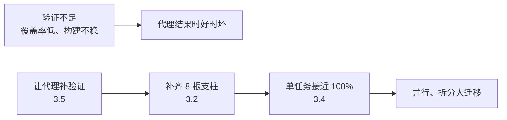
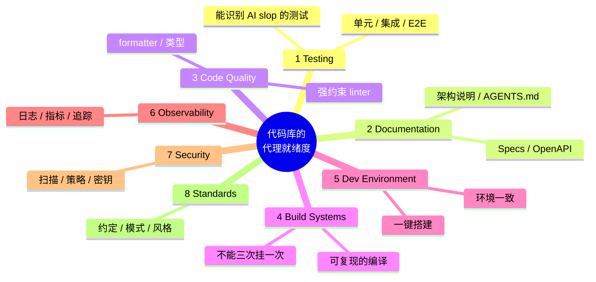

# 代理不好用，往往不是工具的问题：Factory CTO 讲“让代码库为代理做好准备”

通用（不限工具）

**一句话看懂**：Factory 联合创始人兼 CTO Eno Reyes 认为，限制编码代理的不是模型能力，而是你的代码库有多少**自动化验证**：测试、文档、linter、构建、开发环境、可观测性、安全、规范。人类能靠手动测试和经验绕过这些缺口，代理不能。与其花 45 天比较哪个工具在 SWE-bench 上高 10%，不如把验证补齐，所有工具都会变好用。

## 读完你能带走的 6 条收获

1. **AI 能做好什么，取决于能不能验证结果。** 最适合交给代理的任务有客观标准、验证快、噪声低，还能给出“对了 70%”这样的渐进信号（见 3.1）。
2. **用 8 根支柱给代码库打分**，并追问两个更高的标准：linter 能不能把代码卡到资深工程师的水平？测试能不能在 AI 写出烂代码时失败？（见 3.2）
3. **人能容忍的缺口，会变成代理的天花板**：50% 的覆盖率、三次挂一次的构建，人会手动补，代理不会（见 3.2）。
4. **单个任务做不到接近 100% 成功，就别谈并行和大迁移**；能“搜到”规则，不等于能“发明”规则（见 3.4）。
5. **资深工程师用得好、初级工程师用不好，往往说明有没写下来的规矩**，而不是初级工程师不会用工具（见 3.6）。
6. **让代理去补验证**：问它 linter 哪里不够严，让它补测试。环境变好，代理变好，又有更多时间改环境（见 3.5）。

::: tip 小白先懂这几个词
- Verification（验证）/ Validation（校验）：自动判断一个改动对不对，比如测试、lint、类型检查。
- [Asymmetry of Verification（验证的不对称性）](/glossary#asymmetry-of-verification)：很多问题“验证答案”比“求出答案”容易得多。
- [Specification-Driven Development（规格驱动开发）](/glossary#spec-driven-development)：先写清要什么、怎么验证，再让代理生成，最后验证和迭代。
- Opinionated Linter（强约束的 linter）：规则严格到能把代码风格和质量拉到资深工程师水平。
- [AGENTS.md](/glossary#agents-md)：几乎所有编码代理都支持的开放规则文件标准。
- [Droid](/glossary#droid)：Factory 自家编码代理的名字。
:::

## 1. 基本信息

<YouTube id="ShuJ_CN6zr4" title="Making Codebases Agent Ready" />

| 项目 | 内容 |
|---|---|
| 讲者 / 频道 | Eno Reyes（Factory 联合创始人兼 CTO）／ **AI Engineer**（AI Engineer Code Summit 2025） |
| 发布日期 | 2025-12-22 |
| 时长 | 15:33 |
| 使用工具 | 与工具无关；提到 Factory 的 Droid、AGENTS.md、Browserbase 等 |
| 分析依据 | YouTube 英文字幕（yt-dlp，2026-10-14 重新抓取并逐字核对引语），对照 AI Engineer 官网该演讲页面的讲稿整理版（ai.engineer/talks/ShuJ_CN6zr4-making-codebases-agent-ready），以及视频截图（8 根支柱的名称来自 4:30 的幻灯片）。英文引用均来自字幕，保留了口语里的停顿词。讲者是 Factory CTO，演讲中有自家产品的推介；45 天、10%、5–7 倍、“前 1–5%”等数字是修辞或预测，不是测量结果。“我觉得”开头的段落是本站评论，不是讲者观点。 |

## 2. 这篇在回答什么

同一个编码代理，在有的公司能同时开好几个、做大规模迁移；在另一些公司，连一个小任务都时好时坏。很多团队的第一反应是换工具，花一个多月比较各家的 benchmark 分数。

Eno Reyes 的回答是：先别换工具，先看看你的代码库能不能**自动判断一个改动对不对**。他说很多代码库测试覆盖率只有五六成，构建三次挂一次，人类工程师都忍了，因为他们会手动补测、知道什么时候重试。代理没有这些默会的经验：

::: tr 但当你开始把 AI 代理引入软件开发生命周期时——我不只是指交互式编码，而是方方面面：审查、文档、测试——这会让它们的能力崩掉。
> "but when you start introducing AI agents into your software development life cycle, and I don't just mean in interactive coding, but really across the board, right? Uh review, documentation, testing, all this stuff. Um this breaks their capabilities."
:::

这场 15 分钟的演讲回答了五个问题：

1. 为什么“能不能验证”决定了 AI 能做什么？（3.1）
2. 怎么判断自己的代码库够不够“可验证”？（3.2）
3. 有了验证，开发流程怎么变？选工具的思路怎么变？（3.3）
4. 什么时候才能并行跑多个代理？（3.4）
5. 验证不够，怎么补？谁来补？（3.5、3.6）

## 3. 怎么做

### 3.1 为什么“能验证”决定 AI 能做什么

讲者从 Karpathy 的 Software 2.0 说起。传统软件是“写规格”：输入是 x，算法做这些步骤，输出是 y。另一种思路是“靠验证来自动化”：只要能说清目标、能检查答案对不对，就可以让系统在大量候选解里搜索。前沿模型的后训练用了大量这种可验证的任务。讲者的结论是：

::: tr AI 系统能解决什么问题，它的前沿和边界，基本上就是一个函数：你能不能指定一个目标，并在可能的解空间里搜索。
> "the sort of frontier and boundary of what can be solved by AI systems is really just a uh sort of an input function of whether or not you can specify an objective and search through the space of possible uh solutions, right?"
:::

接着他引用了 Jason Wei 讲“验证的不对称性”的博客：很多任务验证答案比求出答案容易得多。最适合 AI 的问题有五个特点：有客观真相、验证快、能大规模并行验证、噪声低、信号是连续的，不只是对或错，而是“对了 30%、70%、100%”。

<figure class="shot"><figcaption>📷 视频截图 · <a href="https://www.youtube.com/watch?v=ShuJ_CN6zr4&t=150s" target="_blank" rel="noopener">2:30</a> · “Asymmetry of Verification”：可验证任务的五个属性。</figcaption></figure>

软件开发恰好非常符合这些条件。过去二三十年，行业在自动化验证上投入了大量工作：单元测试、端到端测试、QA，还有 Browserbase、computer use 这类让前端和视觉改动也能自动验证的工具。讲者认为，这就是编码代理成为目前最先进代理的原因。

### 3.2 给你的代码库打分：8 根验证支柱

讲者把软件的验证基础设施归成 8 根支柱：

<figure class="shot"><figcaption>📷 视频截图 · <a href="https://www.youtube.com/watch?v=ShuJ_CN6zr4&t=270s" target="_blank" rel="noopener">4:30</a> · 8 根验证支柱：测试、文档、代码质量、构建、开发环境、可观测性、安全、规范。</figcaption></figure>

对专业工程师来说，“有没有 formatter、有没有 linter”几乎都是“当然有”。讲者想要的是更高的标准，也就是 3.1 里说的“连续信号”。他提了两个自检问题：

- <Trans zh="你的 linter 是否严格到能让编码代理写出的代码永远达到资深工程师的水平？">“do you have llinters that are so opinionated that a coding agent will always make code that is exactly at the level of what your senior engineers will produce?”</Trans>
- <Trans zh="你的测试会不会在引入 AI slop 时失败、在引入高质量 AI 代码时通过？">“Do you have tests that will fail when AI slop has been introduced? Uh, and when highquality AI code is introduced, those tests pass, right?”</Trans>

为什么大多数代码库达不到？因为人类很擅长在没有自动验证的情况下应付过去。覆盖率五六成，剩下的手动测；构建三次挂一次，<Trans zh="公司里每个人都暗暗讨厌它，但没人吭声">“everyone at your company secretly hates it but no one says anything”</Trans>。到了几万名工程师规模的组织，这种水平甚至成了默认标准。讲者承认，靠人的组织在这个水平上也能运转，但代理不行：它分不清哪个失败该重试，哪个“通过”其实不可信。

我觉得这一节最有用的是把“代码库质量”换了一个角度看：以前补测试、修不稳定构建，是为了让人少受罪；现在它直接决定代理能不能用。很多团队一直拖着的技术债，突然有了很具体的回报。

### 3.3 开发循环变成“规格 → 生成 → 验证 → 迭代”

有了严格的验证，开发流程会变。传统循环是“理解问题、设计方案、写代码、测试”；用代理时，它变成：

1. **规格**：说清要做什么，以及用什么条件验证；
2. **生成**：让代理产出候选实现；
3. **验证**：用自动化检查，加上你自己的直觉；
4. **迭代**：根据检查结果改实现，或者把规格说得更清楚。

<figure class="shot"><figcaption>📷 视频截图 · <a href="https://www.youtube.com/watch?v=ShuJ_CN6zr4&t=420s" target="_blank" rel="noopener">7:00</a> · 规格 + 验证 = 可靠的 AI 生成代码；对比“提示一下，然后祈祷它能用”。</figcaption></figure>

讲者说，这种“规格驱动开发”正在渗进各种工具：很多工具有 spec mode、plan mode，Factory 的 Droid 也有，还有整个围绕这种流程设计的 IDE。

这也改变了“该买哪个工具”的问题。他给了一个对比：

::: tr 对一个组织来说，最好的决定是什么？是花 45 天比较市面上每一个编码工具，然后断定某个工具稍微好一点，因为它在 SWE-bench 上准 10%？还是改变组织的实践，让所有这些编码代理都能成功，然后挑一个开发者喜欢的？
> "what is like the best decision for you to make as an organization? Is it spending 45 days comparing every single possible coding tool in the space and then determining that one tool is slightly better because it's 10% more accurate at Swebench or is it making changes to your organizational practices that enable all of these coding agents to succeed and then picking one that you're, you know, developers like"
:::

注意，45 天和 10% 是讲者的修辞，不是某次真实评测。

### 3.4 先把单任务做到接近 100%，再谈并行

很多团队想一步跳到“同时开五个代理”“让代理做大规模迁移”。讲者说，这些都建立在一个前提上：

::: tr 如果你没法自动验证一个 PR 是否基本成功、代码会不会把生产搞挂，你就不可能同时并行好几个代理。
> "if you cannot automatically validate whether or not a uh a PR is like reasonably successful or has code that won't definitely break prod, uh you are not going to be parallelizing several like agents at once, right?"
:::

道理很简单：你连一个改动都没法可靠地判断，生成十个改动只是把审查负担乘以十。大迁移还多一个要求：能把项目拆成可以单独执行、单独验证的子任务。

基本单位是一个“结果明确、做法明确、验证方式明确”的单任务。讲者说，这种任务如果做不到接近 100% 成功，更复杂的用法就别想规模化了。这里的“接近 100%”是他提出的门槛，不是测出来的数据。

代码审查也一样。想要高质量的 AI 代码审查，你得有写给 AI 看的文档。讲者区分了两件事：代理会越来越会搜索，越来越会自己找到该跑哪个 lint、哪个测试；

::: tr 但它们不会凭空变出这些验证标准。
> "but they won't get better at just randomly creating this validation criteria out of thin air. Right?"
:::

所以他认为开发者的角色会转向“打理软件生长的环境和花园”：设定约束、搭自动化、把团队的主见一点点写进去。

### 3.5 让代理帮你补验证：正反馈循环

补验证听起来工作量很大，但讲者指出，现在有一个以前没有的帮手：代理本身。你可以问它“我们的 linter 哪里不够严”，也可以让它生成测试。

他引用了 Factory 一位工程师 Alvin 的话：<Trans zh="烂测试也比没有测试强。">“a slop test is better than no test.”</Trans> 讲者承认这句话有点争议，但有前提：这个测试在改动正确、并且大致符合你要的规格时会通过。有了它，人会去完善它，其他代理也会注意到这些测试，照着它们的模式写。

这就形成了一个正反馈循环：

::: tr 如果你有更好的代理，它们会让环境更好，环境会让代理更好，这又意味着你有更多时间让环境更好。
> "If you have better agents, they will make the environment better which will make the agents better which will mean you have more time to make the environment better."
:::

而且这个循环对所有工具都有效：代码审查工具、编码代理，都读同一份仓库标准和验证设施。

<figure class="shot"><figcaption>📷 视频截图 · <a href="https://www.youtube.com/watch?v=ShuJ_CN6zr4&t=730s" target="_blank" rel="noopener">12:10</a> · “The Path Forward”：评估 → 改进 → 部署 → 迭代。</figcaption></figure>

我觉得“烂测试也比没有好”要谨慎理解。讲者的前提是测试在正确改动时会通过，也就是说它至少测对了方向。一个只是让覆盖率数字好看、什么都不断言的测试，反而会给代理错误的信心。让代理补测试之后，要人看一眼它到底断言了什么。

### 3.6 组织层面：怎么评估、怎么投资、能走多远

**评估不用先采购。** 讲者说，如果公司连这 8 根支柱都没有，就有大量工作可以在“不买任何工具”的情况下先做。他也推介了 Factory 自己的评估工具和 ROI 分析，但强调大多数组织可以自己对照：有没有 linter、linter 有多好、有没有 AGENTS.md 这种几乎所有编码代理都支持的开放标准。

**初级工程师是一个信号。** 如果你能看到谁在用什么工具，可能会发现代理对资深工程师足够可靠，初级工程师却几乎用不起来。讲者说，原因往往不是他们不会用工具，而是<Trans zh="有一些你没有自动验证的小众做法">“there's these niche practices that you don't have automated validation for, right?”</Trans>资深工程师在提示词里、在审查时，默默替代理补上了这些知识。

他用大公司举例：在 Google 或 Meta，一个几乎没有背景知识的应届生，可以去把 YouTube 的某个边框改圆一点，而有相当把握不会把十亿用户的服务搞挂。原因是代码上线前要经过大量验证。代理面对的也是同样的情况：它就像那个没有背景知识的新人。

**投资方式变了。** 以前推进项目的思路是“我们要多招 10 个人”；讲者认为，现在还可以投资“环境反馈回路”，让现有的人、新招的人和代理都更有效。他还说，一个有主见的工程师，如果能把“软件该怎么写”变成可复用的检查，影响力能扩展到整个公司。

**能走多远。** 讲者描绘的终点是：客户报了一个问题，生成工单，代理接手实现，把结果交给开发者，开发者点批准，代码合并上线，整个循环一两个小时。他说这在技术上今天就可行，限制在于组织的验证标准，并预言这种投入带来的是 5 到 7 倍、而不是 1.5 到 2 倍的提升，还“保证”你会进入工程速度前 1% 到 5% 的组织。

我觉得这些数字应该当成鼓动，不是结论。但它的结构值得注意：即使在讲者“完全自主”的设想里，**开发者点批准**这一步也还在。

## 4. 结果与局限

这是一场观点性的演讲，没有实验数据。讲者提出的主要判断：

| 判断 | 性质 |
|---|---|
| 软件开发是 AI 的最前沿，因为它高度可验证 | 论证（引 Karpathy、Jason Wei） |
| 很多代码库覆盖率 50–60%、构建不稳，人能忍、代理不能 | 经验观察，没有数据 |
| 单任务要接近 100% 成功才能并行和拆分 | 讲者提出的门槛 |
| 45 天比较工具、SWE-bench 高 10% | 修辞例子 |
| 投入验证带来 5–7 倍提升、进入前 1–5% | 预测，带推销口吻 |

::: warning 局限与注意
- **讲者立场**：Factory 卖的正是“代理就绪度”评估和编码代理，演讲中有产品推介。不过他给出的 8 根支柱清单本身和工具无关，可以独立使用。
- **8 根支柱只有名字，没有评分标准**：演讲没说每根支柱怎样算“合格”。Factory 在演讲之后发布了更完整的就绪度框架（2026-01 的 Agent Readiness），本站没有收录。
- **“烂测试也比没有好”有前提**：测试要在正确改动时通过、大致符合规格。只为凑覆盖率的测试会误导代理。
- **不讨论成本**：把 linter 收严、把覆盖率从 50% 提到更高，需要多少投入、先补哪根支柱，演讲没有讲。
:::

## 5. 结论

代理在你的代码库里不好用，先别急着换工具。问问自己：**这个代码库能自动判断一个改动对不对吗？**

讲者的核心主张是：AI 不会自动补上你没写下来的工程标准。哪些代码可以接受、哪些不行，团队要自己决定，再写成测试、linter 和文档。这件事以前是“让人少受罪”，现在是“让代理能干活”的前提。好消息是，代理本身可以帮你补。

我觉得最容易上手的一步是看初级工程师：他们用代理卡在哪里，往往就是你缺的那条检查。

### 你可以这样试

- [ ] 拿 8 根支柱给你的仓库打个分：每根写一句“现在有什么、缺什么”。
- [ ] 让代理回答：“我们的 linter 配置在哪些方面不够严格？列出 5 条可以加的规则。”
- [ ] 找一个“三次挂一次”的不稳定测试或构建，修好它。
- [ ] 问问团队里的初级工程师，用代理时最常被哪类问题卡住，把答案写成 AGENTS.md 或一条检查。

::: details 读完自测（点开看答案）
1. **讲者认为限制编码代理的主要因素是什么？** 组织的自动化验证，而不是模型能力。
2. **可验证任务的五个特点是什么？** 客观真相、验证快、可扩展、低噪声、连续信号。
3. **为什么单任务成功率是并行的前提？** 没法可靠判断一个改动，生成多个改动只会放大审查负担。
4. **初级工程师用不好代理，讲者认为通常说明什么？** 有一些没有自动验证的小众做法，资深工程师在默默补。
:::
