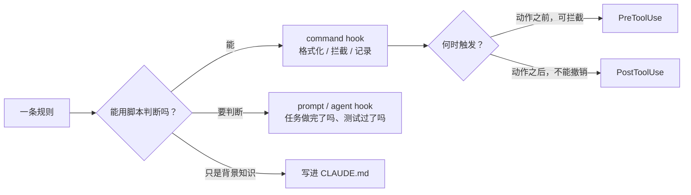
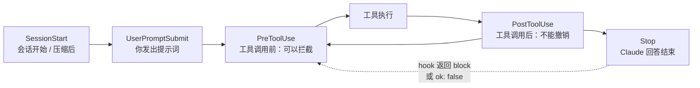

# 哪些规则不能靠模型自觉：Claude Code Hooks 官方指南（附 Gemini CLI 对照）

<div class="meta-tags"><span class="tool-tag tool-claude">Claude Code</span></div>

<div class="hook">

**一句话看懂**：写进 CLAUDE.md 的规则，模型可能照做，也可能忘掉；写成 hook 的规则，Claude Code 在固定时刻**一定会执行**。官方指南给了一整套可以照抄的 `settings.json`：等你输入时弹通知、改完文件自动格式化、拦住对 `.env` 的修改、压缩后补回约定、收工前跑测试。关键性质只有一条：hook 只能把权限**收紧**，不能放宽。

</div>

## 读完你能带走的 7 条收获

1. **能用脚本判断的规则，写成 hook，不要只写在 CLAUDE.md 里。** 规则文件是建议，hook 是一定执行的命令（见第 2 节、第 4 节）。
2. **第一个 hook 先加“需要我时弹通知”。** 一个 `Notification` hook 就能让你离开终端去干别的（见 3.7）。
3. **拦截用 `PreToolUse` + 退出码 2，补救用 `PostToolUse`。** 后者发生在工具执行之后，撤销不了（见 3.3、第 4 节）。
4. **hook 的 deny 在 `--dangerously-skip-permissions` 下照样生效，allow 却绕不过 settings 里的 deny 规则。** 所以它适合做团队底线（见 3.3）。
5. **只匹配 `Edit|Write` 会漏掉用 Bash 改的文件。** 要全覆盖，就加一个每轮扫描工作区的 Stop hook（见 3.2）。
6. **“做完了吗”这种要判断的条件，交给 prompt / agent 类型的 Stop hook**，并处理 `stop_hook_active` 防止无限续跑（见 3.5）。
7. **hook 不生效时，九成是 JSON 的问题**：shell 配置文件多打了一行输出，或者字段放错了层级。用 `claude --debug` 查（见 3.8）。

::: tip 小白先懂这几个词
- [Hooks（钩子）](/glossary#hooks)：在代理生命周期的固定时刻自动运行的脚本。
- PreToolUse / PostToolUse：工具调用**之前** / **之后**触发的事件；前者可以拦截，后者只能补救。
- [Stop Hook](/glossary#stop-hook)：Claude 每次回答结束时触发的 hook。
- Matcher（匹配器）：决定 hook 只对哪些工具或场景生效，例如 `Edit|Write`。
- Exit code 2：hook 脚本以退出码 2 结束，表示“拦下这个动作”，stderr 里的文字会作为理由交给 Claude。
- [Prompt / Agent Hook](/glossary#prompt-agent-hook)：不跑 shell 命令，而是让模型（或带工具的子代理）来判断条件是否满足。
:::

## 1. 基本信息

<SourceCard type="官方文档" title="Automate actions with hooks" author="Anthropic（Claude Code 文档）" date="持续更新的文档页（抓取于 2026-10-14）" url="https://code.claude.com/docs/en/hooks-guide" />

| 项目 | 内容 |
|---|---|
| 主链接 | https://code.claude.com/docs/en/hooks-guide |
| 完整参考 | https://code.claude.com/docs/en/hooks （事件的输入输出格式） |
| 对照 | https://developers.googleblog.com/tailor-gemini-cli-to-your-workflow-with-hooks/ （Edi Palencia、Jack Wotherspoon、Abhi Patel，Google，2026-01-28） |
| 类型 | 官方产品文档（Markdown 版约 6 万字符） |
| 作者 | Anthropic |
| 日期 | 持续更新的文档，没有固定发布日期 |
| 使用工具 | Claude Code（`settings.json`、`/hooks`）、`jq`、Prettier、direnv；对照部分为 Gemini CLI |
| 分析依据 | Claude Code 官方文档《Automate actions with hooks》的 Markdown 版本（`code.claude.com/docs/en/hooks-guide.md`，2026-10-14 重新抓取全文并逐字核对），以及 Google Developers Blog《Tailor Gemini CLI to your workflow with hooks》（2026-01-28，2026-10-09 抓取）。文档持续更新，事件名、默认值和版本号以抓取时为准。英文引用和配置均为原文摘录。“我觉得”开头的段落是本站评论，不是官方观点。 |

## 2. 这篇在回答什么

假设你在 CLAUDE.md 里写了一句“永远不要改 `.env`”。十次里九次 Claude 都记得。第十次，上下文很长，它忘了。

这就是规则文件的天花板：它是写给模型看的“建议”，照不照做，取决于模型当时注意到了什么。有些事情不能靠自觉，比如“每次改完都要格式化”“永远不许改 `.env`”“测试没过不许收工”。文档开头就说明了 hooks 的定位：

::: tr Hooks 是用户定义的 shell 命令，Claude Code 在生命周期的特定时刻运行它们。这带来确定性的控制：某些动作一定会发生，而不是依赖 LLM 自己选择去运行它们。
> "Hooks are user-defined shell commands. Claude Code runs them at specific points in its lifecycle, which gives you deterministic control: certain actions always happen rather than relying on the LLM to choose to run them."
:::

这份指南按“常见需求”组织，每个需求给一段能直接粘进 `settings.json` 的配置。我把它重新归成五个问题：

1. hook 在什么时候触发、写在哪个文件？（3.1）
2. 怎样在改完文件后自动做事？（3.2）
3. 怎样拦住危险动作，拦的时候怎么告诉 Claude 原因？（3.3）
4. 怎样把容易丢的上下文补回来？（3.4）
5. 那些要“判断”而不是“匹配”的条件，怎么检查？（3.5）

后面再补上通知、自动批准、审计这些日常用法（3.7），以及最常见的坑（3.8）。



## 3. 怎么做

### 3.1 hook 在什么时候触发、写在哪里

先看生命周期。抓取时文档列出了 30 多种事件，最常用的是下面这几个：



其余的事件也值得知道名字，用到时再查：`Notification`（需要你输入时）、`PermissionRequest`（要弹权限框时）、`ConfigChange`（配置文件被改）、`CwdChanged`（工作目录变了）、`FileChanged`（被监视的文件变了）、`PreCompact` / `PostCompact`（压缩前后）、`SubagentStart` / `SubagentStop`、`SessionEnd`。

hook 有五种类型：`command`（跑 shell 命令，最常用）、`http`（把事件 POST 到一个 URL）、`mcp_tool`（调用 MCP 工具）、`prompt`（让模型做一次判断）、`agent`（派一个能用工具的子代理去核实，实验功能）。同一个事件匹配到多个 hook 时，它们**并行**运行。

配置放在哪个文件，决定了 hook 的作用范围（节选原文表格）：

| 位置 | 作用范围 | 能否共享 |
|---|---|---|
| `~/.claude/settings.json` | 你的所有项目 | 否，只在本机 |
| `.claude/settings.json` | 单个项目 | 可以提交到仓库 |
| `.claude/settings.local.json` | 单个项目 | 否 |
| Managed policy settings | 整个组织 | 由管理员控制 |
| 插件的 `hooks/hooks.json` | 启用插件时 | 随插件分发 |
| Skill / 子代理的 frontmatter | skill 被调用后 / 子代理运行期间 | 随文件分发 |

在 Claude Code 里输入 `/hooks` 可以按事件浏览所有已配置的 hook。想临时全部关掉，在 settings 里写 `"disableAllHooks": true`（managed settings 里的 hook 仍然会跑）。

我觉得最实用的分工是：团队底线（格式化、保护文件）放 `.claude/settings.json` 跟代码一起提交；通知这类个人偏好放 `~/.claude/settings.json`。

### 3.2 改完文件自动格式化（PostToolUse）

这是最常见的用法：每次 Claude 用 `Edit` 或 `Write` 改完文件，就对那个文件跑 Prettier。原理是 Claude Code 把这次工具调用的 JSON 写进 hook 的 stdin，`jq` 从里面取出文件路径。

::: tr 在项目的 .claude/settings.json 里：每次 Edit 或 Write 之后，用 jq 取出被改文件的路径，交给 Prettier 格式化。
```json
{
  "hooks": {
    "PostToolUse": [
      {
        "matcher": "Edit|Write",
        "hooks": [
          {
            "type": "command",
            "command": "jq -r '.tool_input.file_path' | xargs npx prettier --write"
          }
        ]
      }
    ]
  }
}
```
:::

要注意一个漏洞：Claude 也可能用 `Bash` 命令改文件（比如 `sed -i`），这时 `Edit|Write` 匹配不到。文档给了三种补法：

- 想在某个文件变化时（不管谁改的）都触发，用 `FileChanged` hook；
- 必须看到每一处改动（如合规扫描、审计日志）时，加一个**每轮扫描一次工作区**的 `Stop` hook；
- 或者也匹配 `Bash|PowerShell`，在脚本里用 `git status --porcelain` 列出改过的文件。

matcher 只能按工具名过滤。想再细一点，可以用 `if` 字段，它用权限规则的写法同时看工具名和参数。比如只在 Claude 跑 `git` 命令时才运行检查脚本：

::: tr 只有 Bash 命令匹配 git * 时才启动 check-git-policy.sh，其他 Bash 命令不启动这个进程。
```json
{
  "hooks": {
    "PreToolUse": [
      {
        "matcher": "Bash",
        "hooks": [
          {
            "type": "command",
            "if": "Bash(git *)",
            "command": "\"$CLAUDE_PROJECT_DIR\"/.claude/hooks/check-git-policy.sh"
          }
        ]
      }
    ]
  }
}
```
:::

`if` 会检查复合命令里的每个子命令：`npm test && git push` 会触发，`echo $(git log)` 也会触发。文档说明这个过滤是“尽力而为”的，Claude Code 判断不出命令会跑什么时，就照样运行 hook。另外 `if` 只在工具类事件上有效，加在别的事件上，hook 就不会运行。

### 3.3 拦住危险动作：退出码 2、结构化 JSON 和多个 hook 的合并

hook 在工具执行**之前**运行，脚本从 stdin 读到这次调用的 JSON，用退出码告诉 Claude Code 怎么办。文档的例子是保护敏感文件：

::: tr 保存为 .claude/hooks/protect-files.sh：读取要改的文件路径，如果命中 .env、package-lock.json 或 .git/，就把原因写到 stderr 并以退出码 2 拦下。
```bash
#!/bin/bash
# protect-files.sh

INPUT=$(cat)
FILE_PATH=$(echo "$INPUT" | jq -r '.tool_input.file_path // empty')

# Normalize Windows backslash separators so the patterns below match
FILE_PATH="${FILE_PATH//\\//}"

PROTECTED_PATTERNS=(".env" "package-lock.json" ".git/")

for pattern in "${PROTECTED_PATTERNS[@]}"; do
  if [[ "$FILE_PATH" == *"$pattern"* ]]; then
    echo "Blocked: $FILE_PATH matches protected pattern '$pattern'" >&2
    exit 2
  fi
done

exit 0
```
:::

再在 `.claude/settings.json` 里注册：

::: tr 在任何 Edit 或 Write 之前运行上面的脚本。$CLAUDE_PROJECT_DIR 指向项目根目录。
```json
{
  "hooks": {
    "PreToolUse": [
      {
        "matcher": "Edit|Write",
        "hooks": [
          {
            "type": "command",
            "command": "\"$CLAUDE_PROJECT_DIR\"/.claude/hooks/protect-files.sh"
          }
        ]
      }
    ]
  }
}
```
:::

退出码的含义：

- `0`：hook 不反对。对 PreToolUse 来说**不等于批准**，正常的权限流程照常进行。
- `2`：拦下这个动作，stderr 的内容作为反馈交给 Claude，让它换个做法。
- 其他退出码：大多数事件按非阻塞错误处理，动作照常进行，记录里出现一条 `hook error` 提示。

退出码只能表达“拦”或“不说话”。想要更细的控制，就以 0 退出，往 stdout 打一个 JSON。比如拒绝的同时告诉 Claude 该用什么：

::: tr 拒绝这次工具调用，并把“为了性能请用 rg 代替 grep”这个理由交给 Claude。
```json
{
  "hookSpecificOutput": {
    "hookEventName": "PreToolUse",
    "permissionDecision": "deny",
    "permissionDecisionReason": "Use rg instead of grep for better performance"
  }
}
```
:::

`permissionDecision` 有四个值：`allow`（跳过权限弹窗）、`deny`（取消并把理由交给 Claude）、`ask`（照常弹框问你）、`defer`（只在 `-p` 无头模式下可用，让外层 SDK 程序接手）。文档建议一个 hook 只选一种方式：要么退出码 2 加 stderr，要么退出码 0 加 JSON，不要混用。

最重要的一条性质，是 hook 和权限模式的关系：

::: tr PreToolUse hook 在任何权限模式检查之前触发……返回 permissionDecision: "deny" 的 hook 即使在 bypassPermissions 模式或使用 --dangerously-skip-permissions 时也会拦下这个工具调用。
> "`PreToolUse` hooks fire before any permission-mode check, in every permission mode, including `dontAsk`. A hook that returns `permissionDecision: "deny"` blocks the tool even in `bypassPermissions` mode or with `--dangerously-skip-permissions`."
:::

反过来不成立：hook 返回 `"allow"` 绕不过 settings 里的 deny 规则。也就是说，**hook 只能收紧限制，不能放宽**。

多个 hook 同时匹配时怎么算？文档的规则是：所有 hook 都跑完再合并，PreToolUse 取**最严格**的结果，顺序是 `deny` > `defer` > `ask` > `allow`。注意“都跑完”的含义，原文强调：

> "One hook returning `deny` doesn't stop sibling hooks from executing."

<Trans zh="不要指望一个 hook 的 deny 能阻止另一个 hook 产生副作用。">“Don't rely on one hook's `deny` to suppress side effects in another hook.”</Trans> 文档举的例子是两个挂在 `Bash` 上的 hook：一个把每条命令写进日志，一个遇到 `rm -rf` 就退出码 2。Claude 想跑 `rm -rf /tmp/build` 时，命令被拦下了，但日志里照样记了一笔。

还有一个竞态：多个 PreToolUse hook 都用 `updatedInput` 改写工具参数时，最后跑完的那个生效，而并行运行的顺序是不确定的。所以不要让两个 hook 改同一个工具的输入。

### 3.4 把容易丢的上下文补回来（SessionStart）

上下文快满时，[压缩](/glossary#compaction)会把对话总结成摘要，细节可能丢失。文档的做法是用 `compact` 匹配器，在每次压缩后重新注入提醒：

::: tr 每次压缩后，把“用 Bun 不用 npm、提交前跑 bun test、当前冲刺是 auth 重构”这段提醒加回 Claude 的上下文。
```json
{
  "hooks": {
    "SessionStart": [
      {
        "matcher": "compact",
        "hooks": [
          {
            "type": "command",
            "command": "echo 'Reminder: use Bun, not npm. Run bun test before committing. Current sprint: auth refactor.'"
          }
        ]
      }
    ]
  }
}
```
:::

`echo` 可以换成任何有输出的命令，比如 `git log --oneline -5`。文档也提醒：如果是**每次会话开始**都要注入的内容，应该写进 CLAUDE.md，而不是 hook。

同样的思路还能补“环境”。很多项目用 direnv 按目录切换环境变量，但 Claude 的 Bash 工具自己不会感知这些变化。文档的办法是 `SessionStart` 加 `CwdChanged` 两个 hook，都把变量写进 `CLAUDE_ENV_FILE`，Claude Code 会在每条 Bash 命令前先执行这个文件：

::: tr 会话开始时和每次切换目录时，都把 direnv 导出的环境变量写进 CLAUDE_ENV_FILE。
```json
{
  "hooks": {
    "SessionStart": [
      {
        "hooks": [
          {
            "type": "command",
            "command": "direnv export bash > \"$CLAUDE_ENV_FILE\""
          }
        ]
      }
    ],
    "CwdChanged": [
      {
        "hooks": [
          {
            "type": "command",
            "command": "direnv export bash > \"$CLAUDE_ENV_FILE\""
          }
        ]
      }
    ]
  }
}
```
:::

每个有 `.envrc` 的目录要先跑一次 `direnv allow`。用 devbox 或 nix 的，把命令换成 `devbox shellenv`。如果只想在 `.envrc` 或 `.env` 变化时重载，用 `FileChanged`，matcher 写 `.envrc|.env`（这里是按字面文件名拆开，不是正则）。

另一个注入口是 `UserPromptSubmit`：每次你发提示词时，hook 可以用 `additionalContext` 加一段背景，比如当前分支和发布冻结信息。坑在于这个字段必须嵌在 `hookSpecificOutput` 里，放在 JSON 顶层会被**静默忽略**（见 3.8）。

### 3.5 收工前让模型检查：prompt hook 与 agent hook

有些条件不是脚本能判断的，比如“用户要求的事都做完了吗”。这时可以用 `type: "prompt"`，让一个 Claude 模型来判断。返回 `"ok": false` 时，`reason` 会作为下一条指令交给 Claude，它会接着干：

::: tr Stop hook：让模型检查所有任务是否完成；没完成就返回 ok: false 和“还剩什么要做”。
```json
{
  "hooks": {
    "Stop": [
      {
        "hooks": [
          {
            "type": "prompt",
            "prompt": "Check if all tasks are complete. If not, respond with {\"ok\": false, \"reason\": \"what remains to be done\"}."
          }
        ]
      }
    ]
  }
}
```
:::

如果判断条件永远无法满足，模型可以同时返回 `"impossible": true`，Claude Code 就放行，不再续跑。prompt hook 也能挂在 `PreToolUse` 上：默认拒绝后这一轮直接结束，加上 `continueOnBlock: true` 才会把理由作为工具错误交回 Claude，让它调整后继续。

如果要真正**跑测试**才能判断，就用 `type: "agent"`。它会派出一个能读文件、跑命令的子代理，默认超时 60 秒，最多 50 轮工具调用。文档注明 agent hook 仍是实验功能，生产环境优先用 command hook：

::: tr Stop hook：派一个子代理运行单元测试并检查结果，测试没全过就不让 Claude 停下；超时 120 秒。
```json
{
  "hooks": {
    "Stop": [
      {
        "hooks": [
          {
            "type": "agent",
            "prompt": "Verify that all unit tests pass. Run the test suite and check the results. $ARGUMENTS",
            "timeout": 120
          }
        ]
      }
    ]
  }
}
```
:::

::::: warning Stop hook 的死循环保护
如果 Stop hook 连续 8 次拦住 Claude（期间没有任何工具调用），Claude Code 会强行放行。自己写的 Stop hook 脚本应先检查输入里的 `stop_hook_active` 字段，已经是 `true` 就直接退出，原文示例：

::: tr 如果 stop_hook_active 已经是 true，就直接放行（exit 0），避免无限续跑。
```bash
#!/bin/bash
INPUT=$(cat)
if [ "$(echo "$INPUT" | jq -r '.stop_hook_active')" = "true" ]; then
  exit 0  # Allow Claude to stop
fi
# ... rest of your hook logic
```
:::
:::::


我觉得 agent 类型的 Stop hook 最接近“验收代理”的思路（对照 [[16§3.4]] 的评估者）：写代码的人说做完了不算，另一个带工具的检查者说了才算。只是默认 60 秒的超时，跑不完大一点的测试套件，示例里特意把 `timeout` 调到了 120。

### 3.6 对照：Gemini CLI 的 hooks


Google 在 2026 年 1 月给 Gemini CLI 加上了几乎同样的机制，把 hooks 比作代理的“中间件”（middleware）。事件名不同（`BeforeTool`、`AfterTool`、`AfterAgent` 等），配置结构几乎一样。博客的完整示例是拦截写入密钥的 `BeforeTool` hook，配置部分原文如下：

::: tr .gemini/settings.json：Gemini 每次调用 write_file 或 replace 之前，先运行项目里的 block-secrets.sh 扫描要写入的内容。
```json
{
  "hooks": {
    "BeforeTool": [
      {
        "matcher": "write_file|replace",
        "hooks": [
          {
            "name": "secret-scanner",
            "type": "command",
            "command": "$GEMINI_PROJECT_DIR/.gemini/hooks/block-secrets.sh",
            "description": "Prevent committing secrets"
          }
        ]
      }
    ]
  }
}
```
:::

对应的脚本保存为 `.gemini/hooks/block-secrets.sh`，博客原文如下。注意它用 JSON 里的 `"decision": "deny"` 表达拒绝，退出码仍是 0；正则只是示例，覆盖不了所有密钥格式。

::: tr block-secrets.sh：从 stdin 读取 hook 输入，用 jq 取出要写入的内容；匹配到常见密钥模式就返回结构化的拒绝（deny），否则放行（allow）。
```bash
#!/usr/bin/env bash
# Read hook input from stdin
input=$(cat)

# Extract content being written using jq
content=$(echo "$input" | jq -r '.tool_input.content // .tool_input.new_string // ""')

# Check for common secret patterns
if echo "$content" | grep -qE 'api[_-]?key|password|secret|AKIA[0-9A-Z]{16}'; then
  # Return structured denial to the agent
  cat <<EOF
{
  "decision": "deny",
  "reason": "Security Policy: Potential secret detected in content.",
  "systemMessage": "Security scanner blocked operation"
}
EOF
  exit 0
fi

# Allow the operation
echo '{"decision": "allow"}'
exit 0
```
:::

脚本发现疑似密钥时返回 `{"decision": "deny", ...}`，代理会收到拒绝理由并自己修正。博客还提到，社区的 Ralph 扩展就是用 `AfterAgent` hook 拦截“完成”信号、让 Gemini CLI 继续循环，这和 Claude Code 官方 Ralph 插件的思路相同（对比见 [[24§3.4]]）。博客给的三条建议很实用：

- <Trans zh="保持 hook 快速：它们是同步运行的，脚本的任何延迟都会拖慢代理的响应。">“Keep hooks fast: Because they run synchronously, any delay in your script will delay the agent’s response”</Trans>
- <Trans zh="使用具体的匹配器，而不是让 hook 对每个工具都运行。">“Use specific matchers: Instead of running a hook for every single tool, use the `matcher` property”</Trans>
- <Trans zh="安全第一：hook 以你的用户权限执行，启用项目级 hook 前一定要审查它的来源。">“Security first: Hooks execute with your user privileges, so always review the source of project-level hooks before enabling them.”</Trans>

### 3.7 更多日常用法：通知、自动批准、审计、HTTP

文档还有四个配置，单拿出来都很实用。

**需要你时弹通知。** 这是文档“第一个 hook”的教程：离开终端去干别的，Claude 等你输入时桌面会弹提示。macOS 的写法如下（Linux 换成 `notify-send 'Claude Code' 'Claude Code needs your attention'`，Windows 用 PowerShell 弹对话框）：

::: tr 加到 ~/.claude/settings.json：Claude 等待输入或权限时，用 osascript 弹一条 macOS 桌面通知；matcher 为空表示所有通知类型都触发。
```json
{
  "hooks": {
    "Notification": [
      {
        "matcher": "",
        "hooks": [
          {
            "type": "command",
            "command": "osascript -e 'display notification \"Claude Code needs your attention\" with title \"Claude Code\"'"
          }
        ]
      }
    ]
  }
}
```
:::

matcher 可以细分通知类型：`permission_prompt` 是权限框等了约 6 秒，`idle_prompt` 是 Claude 回答完约 60 秒你还没打字。文档提醒了两个静默失败：macOS 的 Script Editor 没有通知权限时命令会悄悄失败，要去“系统设置 > 通知”里打开；Linux 的 `notify-send` 需要桌面通知守护进程，SSH 和大多数容器里没有。测试方法是按 `Shift+Tab` 切到 manual 模式，让 Claude 做一件要权限的事，然后切走窗口。

**自动批准某一类权限请求。** 例子是每次计划写完都要点“继续”的 `ExitPlanMode`。`PermissionRequest` hook 往 stdout 写 `"behavior": "allow"`，Claude Code 就替你回答：

::: tr 只对 ExitPlanMode 这一种权限请求，自动回答“允许”。
```json
{
  "hooks": {
    "PermissionRequest": [
      {
        "matcher": "ExitPlanMode",
        "hooks": [
          {
            "type": "command",
            "command": "echo '{\"hookSpecificOutput\": {\"hookEventName\": \"PermissionRequest\", \"decision\": {\"behavior\": \"allow\"}}}'"
          }
        ]
      }
    ]
  }
}
```
:::

文档的警告很直接：matcher 要尽量窄。写成 `.*` 或留空，就会自动批准**所有**权限请求，包括写文件和跑 shell 命令。

**审计配置变更。** `ConfigChange` 在 settings 或 skills 文件被外部改动时触发。文档的例子用 `jq` 把每次变更的时间、来源和文件路径追加到 `~/claude-config-audit.log`；想阻止变更生效，就退出码 2 或返回 `{"decision": "block"}`。

**HTTP hook。** `type: "http"` 把和 command hook 一样的 JSON POST 到一个地址，适合团队共用的审计服务。请求失败或返回非 2xx 时默认是非阻塞错误、动作照常进行；要“服务挂了就拦住”，得设 `onFailure: "block"`。header 里的 `$VAR` 只解析 `allowedEnvVars` 里列出的变量。

### 3.8 常见坑：hook 不触发、报错、JSON 不生效

这份文档没有问答环节，但最后一章“Limitations and troubleshooting”就是官方版的常见问题。按症状整理如下：

| 症状 | 常见原因和办法 |
|---|---|
| hook 根本没跑 | `/hooks` 里看它在不在正确的事件下；matcher **区分大小写**；确认 Pre / Post 没搞反 |
| 记录里出现 `PreToolUse hook error` | 脚本意外以非 0 退出。先手动喂一段 JSON 测：`echo '{"tool_name":"Bash","tool_input":{"command":"ls"}}' \| ./my-hook.sh`；`command not found` 就用绝对路径或 `${CLAUDE_PROJECT_DIR}`；忘了 `chmod +x` |
| `/hooks` 里看不到刚加的 hook | JSON 不合法（不允许尾逗号和注释）；文件放错位置；组织开了 `allowManagedHooksOnly`，只跑管理员的 hook |
| Claude 停不下来，最后报 Stop hook 拦太多次 | 连续 8 次拦截后强制放行；脚本里检查 `stop_hook_active`；确实要更多轮，用 `CLAUDE_CODE_STOP_HOOK_BLOCK_CAP` 调高 |
| JSON 合法，但决定不生效、也没报错 | shell 配置文件（如 `~/.bashrc`）无条件 `echo` 了一行，stdout 不再以 `{` 开头，被当成普通文本；或者 `permissionDecision`、`additionalContext` 放到了顶层，没嵌进 `hookSpecificOutput` |

第五行最隐蔽，因为 hook 以 0 退出，记录里什么错误都没有。文档给的修法是让 profile 里的输出只在交互式 shell 里执行：

::: tr 写在 ~/.zshrc 或 ~/.bashrc 里：只有交互式 shell（$- 里含 i）才打印，hook 跑在非交互式 shell 里，就不会多出这一行。
```bash
# In ~/.zshrc or ~/.bashrc
if [[ $- == *i* ]]; then
  echo "Shell ready"
fi
```
:::

想看 hook 到底干了什么：按 `Ctrl+O` 打开记录视图；要看完整的退出码、stdout 和 stderr，就用 `claude --debug-file /tmp/claude.log` 启动，另开一个终端 `tail -f`。

还有几条设计时要记住的限制：command hook 只能通过 stdout、stderr 和退出码沟通，**不能触发 `/` 命令或工具调用**；默认超时 command / http 是 10 分钟、prompt 30 秒、agent 60 秒，`SessionEnd` 的所有 hook 加起来只有 1.5 秒。

## 4. 结果与局限

这是一份操作指南，没有效果数据。它的价值在于把“规则”分成了三类：

| 写在哪 | 适合什么 | 例子 |
|---|---|---|
| CLAUDE.md / AGENTS.md | 需要判断、每次会话都要知道的背景 | 项目结构、为什么这样设计 |
| command hook | 必须每次都执行、能用脚本判断的规则 | 格式化、禁止改 `.env`、记录命令 |
| prompt / agent hook | 需要判断、但要在固定时刻检查的条件 | 收工前确认任务做完、测试通过 |

::: warning 局限与注意
- `PostToolUse` 发生在工具执行之后，**不能撤销**已经发生的动作；要拦截就用 `PreToolUse`。
- `Stop` hook 在 Claude **每次**回答结束时触发，不只是任务完成时；用户中断时不触发，API 出错时触发的是 `StopFailure`。
- 只匹配 `Edit|Write` 会漏掉通过 `Bash` 改文件的情况（见 3.2）；`if` 字段的命令过滤也只是尽力而为。
- 一个 hook 返回 deny，不会阻止同一事件上其他 hook 的副作用（见 3.3）。
- `PermissionRequest` 自动批准的 matcher 一旦写宽，就等于关掉了权限确认（见 3.7）。
- command hook 用你的用户权限运行。克隆别人的仓库时，先看看 `.claude/settings.json` 里有没有 hook。
- agent hook 是实验功能，行为可能会变。
- 文档持续更新：10 月 9 日和 14 日两次抓取之间，matcher 和事件列表就有变化，部分功能标注了最低版本号；以官方页面为准。
:::

## 5. 结论

这份指南真正讲的是一件事：**把“希望模型记得”的规则，换成“一定会执行”的检查。**

判断方法很简单：能用脚本判断的，写成 command hook；需要判断的，用 prompt 或 agent hook 在固定时刻检查；只是背景知识的，留在 CLAUDE.md。而 hook 的定位是底线：它的 deny 连跳过权限模式都挡得住，它的 allow 却绕不过 deny 规则。

我觉得每个项目最先该加的是三个：需要你时弹通知、`PreToolUse` 保护敏感文件、收工前跑测试的 Stop hook。前两个十分钟就能配好，第三个最能减少“它说做完了，其实测试没过”的情况。

### 你可以这样试

- [ ] 把 3.7 的通知 hook 加进 `~/.claude/settings.json`，切到 manual 模式让 Claude 做一件要权限的事，确认桌面会弹通知。
- [ ] 在练习仓库里加上 3.2 的 Prettier hook，让 Claude 写一行带单引号的 JS，看文件是否被自动改成双引号。
- [ ] 加上 3.3 的 `protect-files.sh`，让 Claude 往 `.env` 加一行注释，确认它被拦下并收到 `Blocked:` 提示；再让它用 `sed` 改一次，看看会不会漏网。
- [ ] 用 3.8 的方法手动喂 JSON 测一次你的脚本，确认退出码符合预期。
- [ ] 想想你的 CLAUDE.md 里哪三条规则其实可以写成脚本，把它们改成 hook。

::: details 读完自测（点开看答案）
1. **hook 和 CLAUDE.md 里的规则最大的区别是什么？** hook 是确定性的，在固定时刻一定会执行；CLAUDE.md 里的规则要靠模型自己注意到并选择照做。
2. **PreToolUse hook 以退出码 0 结束，是否等于批准这次工具调用？** 不是。0 只表示 hook 不反对，正常的权限流程照常进行；退出码 2 才是拦截。
3. **hook 返回 allow，能绕过 settings 里的 deny 规则吗？** 不能。hook 的 deny 在跳过权限模式下也生效，但 allow 绕不过 deny 规则，所以 hook 只能收紧。
4. **为什么要检查 `stop_hook_active`？** 防止 Stop hook 一直拦着 Claude 不让停，形成无限续跑；Claude Code 在连续拦截 8 次后也会强制放行。
5. **hook 打印了合法 JSON 却不生效，先查什么？** stdout 前面有没有 shell 配置文件多打的一行，以及字段有没有嵌在 `hookSpecificOutput` 里。
6. **Gemini CLI 里对应 PreToolUse 的事件叫什么？** `BeforeTool`。
:::
