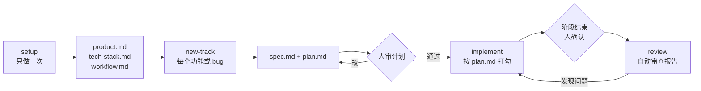

# 把代理的记忆放进仓库：Gemini CLI 的 Conductor 和“上下文驱动开发”

<div class="meta-tags"><span class="tool-tag tool-gemini">Gemini CLI</span></div>

<div class="hook">

**一句话看懂**：和代理聊了一下午定下的需求和计划，关掉终端就没了。Google 的 Conductor 把它们写成仓库里的 Markdown：项目背景一份、每个需求一份 `spec.md` 和 `plan.md`，人审过计划才动手，代理按清单打勾、每步留下提交记录，每个阶段结束停下来等人说“可以”。后来又补上了做完后的自动审查。

</div>

## 读完你能带走的 6 条收获

1. **上下文是一种要管理的产物，不是聊天记录。** 产品、技术栈、团队流程各写一个文件，谁来跑命令都一样（见 3.1）。
2. **每个需求先出 spec 和 plan，人审过才写代码。** 改计划里一句话，比代码写完再返工便宜（见 3.2）。
3. **进度存在文件里，就能停、能换机器、能换人。** 每个任务 `[ ]` → `[~]` → `[x]`，后面还附上提交号（见 3.3）。
4. **把团队纪律写成代理每次都读的模板。** `workflow.md` 规定了 TDD、覆盖率、偏离技术栈先停下来改文档（见 3.4）。
5. **阶段结束时，代理测试失败最多修两次，然后必须停下来问人；人明确说 yes 才继续**（见 3.4）。
6. **做完后对照计划、规范、测试再审一遍。** 问题会作为新的 Review Fixes 阶段追加到 `plan.md`（见 3.5）。

::: tip 小白先懂这几个词
- [Gemini CLI](/glossary#gemini-cli)：Google 的开源终端编码代理，可以安装扩展（extension）。
- [Context-driven Development（上下文驱动开发）](/glossary#context-driven-development)：把项目背景当成和代码一样受管理的文件，每次交给代理的任务都从这些文件出发。
- Track（轨道）：Conductor 对“一个功能或一个 bug 修复”这类工作单元的叫法。
- [Spec（规格）](/glossary#spec)：要做什么、为什么做的详细说明。
- [Brownfield（棕地项目）](/glossary#brownfield)：已经有大量代码的老项目，和从零开始的 greenfield 相对。
:::

## 1. 基本信息

<SourceCard type="文章" title="Conductor: Introducing context-driven development for Gemini CLI" author="Keith Ballinger、Jay Kornder、Sherzat Aitbayev（Google）" date="2025-12-17" url="https://developers.googleblog.com/conductor-introducing-context-driven-development-for-gemini-cli/" />

| 项目 | 内容 |
|---|---|
| 链接 | https://developers.googleblog.com/conductor-introducing-context-driven-development-for-gemini-cli/ |
| 后续更新 | https://developers.googleblog.com/conductor-update-introducing-automated-reviews/ （Sherzat Aitbayev、Mahima Shanware、Jay Kornder，2026-02-13） |
| 代码仓库 | https://github.com/gemini-cli-extensions/conductor （Apache-2.0） |
| 类型 | 官方工程博客（文章） |
| 作者 | Keith Ballinger、Jay Kornder、Sherzat Aitbayev |
| 发布日期 | 2025-12-17 |
| 使用工具 | Gemini CLI + Conductor 扩展（`gemini extensions install https://github.com/gemini-cli-extensions/conductor`） |
| 分析依据 | Google Developers Blog 的两篇文章：《Conductor: Introducing context-driven development for Gemini CLI》（2025-12-17）和《Conductor Update: Introducing Automated Reviews》（2026-02-13），以及 GitHub 仓库 `gemini-cli-extensions/conductor` 的 README 和 `skills/conductor-setup/assets/workflow.md` 模板（Apache-2.0 许可）。均于 2026-10-14 重新抓取并逐字核对。英文引用为原文摘录；“我觉得”开头的段落是本站评论，不是作者观点。 |


## 2. 这篇在回答什么

你有没有过这种经历：和代理来回讨论了半天，定好了要做什么、按什么顺序做，它也开始干了。然后会话断了，或者第二天换了台电脑，或者同事要接手。之前定下的东西全在聊天记录里，要么找不到，要么得重新讲一遍。

Conductor 的发布文章开头引了富兰克林的话：

::: tr “不做计划，就是在计划失败。”然而在 AI 时代，我们常常直接冲进实现，没有先弄清楚到底要做什么。
> Benjamin Franklin said: "Failing to plan is planning to fail". Yet, in the age of AI, we often dive straight into implementation without establishing a clear understanding of what we are building.
:::

它给出的办法叫“上下文驱动开发”（context-driven development）：

::: tr 把项目的上下文从聊天窗口里搬出来，直接放进代码库。把上下文当作和代码并列、受管理的产物，你的仓库就成了单一事实来源。
> It unlocks context-driven development by shifting the context of your project out of the chat window and directly into your codebase. By treating context as a managed artifact alongside your code, you transform your repository into a single source of truth
:::

文章说这适合<Trans zh="比简单代码修改更复杂的任务">“tasks more complex than simple code edits”</Trans>。整个流程分三步，后来补了第四步：



这篇回答五个问题：项目背景怎么写下来（3.1）、每个需求怎么先定再做（3.2）、执行状态怎么保存（3.3）、团队的规矩怎么让代理遵守（3.4）、做完后怎么验（3.5）。

## 3. 怎么做

### 3.1 第一步：把项目背景写成文件

第一个问题：每次开新会话，代理都不了解项目，你得从头介绍。Conductor 的办法是运行一次 setup，通过交互问答把项目背景写成文件。发布文章里列了三类：

- **Product**：用户是谁、产品目标、主要功能；
- **Tech stack**：语言、数据库、框架等技术偏好；
- **Workflow**：团队怎么干活，比如是否遵循测试驱动开发。

现在的 README 又多了一类 **Product guidelines**（文风、品牌话术、视觉风格），生成的文件是 `conductor/product.md`、`product-guidelines.md`、`tech-stack.md`、`workflow.md`、`code_styleguides/` 和 `tracks.md`。

这些文件对整个团队生效。文章举的例子是，团队定好测试策略后，Gemini 会自动沿用，<Trans zh="不管是哪位开发者运行这个命令">“regardless of which developer runs the command”</Trans>。目标是让不同人做的功能，看起来像出自同一个团队之手。

对已有大量代码的老项目（brownfield），文章承认这正是 AI 工具的弱项，因为它们不了解项目的历史和架构。Conductor 会先发起一次交互，帮你写出架构、规范和目标的基础文档，之后每做一个功能，就更新这份共享上下文。

### 3.2 第二步：每个需求开一个 track，先写规格和计划

第二个问题：代理一拿到需求就开写，等你发现方向不对，代码已经写了一堆。

Conductor 把每个功能或 bug 修复叫一个 track（工作单元）。开一个 track 时，它不写代码，先帮你生成两个文件：

- **Spec（规格）**：<Trans zh="这次具体要做什么、为什么做？">“What are we building and why?”</Trans>
- **Plan（计划）**：<Trans zh="可执行的待办清单，分为阶段、任务和子任务">“An actionable to-do list containing Phases, Tasks, and Sub-tasks.”</Trans>

它会根据 3.1 里的项目背景给每一项建议答案，你来改。README 里的写法是这样的：

```bash
/conductor:conductor-new-track "Add a dark mode toggle to the settings page"
```

生成的文件放在 `conductor/tracks/<track_id>/` 下：`spec.md`、`plan.md` 和 `metadata.json`。**人审过计划之后才进入下一步。** README 的口号概括得很准：<Trans zh="量两次，切一次">“Measure twice, code once.”</Trans>

### 3.3 第三步：按计划执行，状态存在文件里

第三个问题：长任务中途停下来，代理就不知道做到哪了。

计划通过后运行 implement，代理逐项完成 `plan.md` 里的任务并打勾。

::: tr 因为状态保存在文件里，你可以停下来去喝杯咖啡，回来接着做，不会丢失进度。
> "Because the state is saved in a file, you can stop, grab coffee, and resume later without losing your place."
:::

`workflow.md` 模板把“打勾”规定得很细。每个任务的生命周期是：

1. 按顺序从 `plan.md` 里选下一个任务；
2. 动手前把 `[ ]` 改成 `[~]`，表示进行中；
3. 写测试、写实现（见 3.4）；
4. 提交代码，并用 `git notes` 给这个提交附上任务摘要：任务名、改了什么、动了哪些文件、为什么改；
5. 把 `[~]` 改成 `[x]`，后面附上提交号的前 7 位；
6. 把 `plan.md` 的改动单独提交一次。

这样 `plan.md` 不只是待办清单，还是一份能追溯到每个提交的进度账本。README 里的 revert 命令就靠它：它能按 track、阶段、任务来回滚，而不只是按提交号。

### 3.4 团队纪律写进 `workflow.md`

第四个问题：团队的规矩（先写测试、覆盖率、别随便换技术栈）怎么让代理每次都遵守？Conductor 的办法是把它写成代理每次都会读的模板。`workflow.md` 开头的“指导原则”（2026-10-14 抓取的版本，原文节选）：

::: tr 指导原则：1. 计划是唯一事实来源，所有工作都要记录在 plan.md；2. 技术栈是有意选择的，改动前先写进 tech-stack.md；3. 测试驱动开发，先写单元测试；4. 所有模块代码覆盖率目标 >80%；5. 用户体验优先；6. 非交互、适应 CI：优先用非交互命令，对 watch 模式的工具设置 CI=true，保证只执行一次。
```markdown
## Guiding Principles

1.  **The Plan is the Source of Truth:** All work must be tracked in `plan.md`
2.  **The Tech Stack is Deliberate:** Changes to the tech stack must be
    documented in `tech-stack.md` *before* implementation
3.  **Test-Driven Development:** Write unit tests before implementing
    functionality
4.  **High Code Coverage:** Aim for >80% code coverage for all modules
5.  **User Experience First:** Every decision should prioritize user experience
6.  **Non-Interactive & CI-Aware:** Prefer non-interactive commands. Use
    `CI=true` for watch-mode tools (tests, linters) to ensure single execution.
```
:::

每个任务的中间是一个 Red / Green 循环：先写会失败的测试，并且<Trans zh="运行测试，确认它们按预期失败">“Run the tests and confirm that they fail as expected.”</Trans>；再写最少的代码让测试通过；然后重构、检查覆盖率。这和 [[25§3.1]] 讲的 Red/Green TDD 是同一套纪律，只是写成了代理每次都会读到的文件。

如果实现和技术栈不一致，模板要求代理先停下来：

::: tr 如果实现和技术栈不一致：停止实现；用新设计更新 tech-stack.md；加一条带日期的说明，解释为什么改；再继续实现。
```markdown
7.  **Document Deviations:** If implementation differs from tech stack:

    -   **STOP** implementation
    -   Update `tech-stack.md` with new design
    -   Add dated note explaining the change
    -   Resume implementation
```
:::

最值得注意的是**阶段完成协议**：每当一个任务恰好结束了 `plan.md` 里的一个阶段，代理要做一整套检查：

1. 用 `git diff --name-only <上一个检查点> HEAD` 列出这个阶段改过的文件，每个代码文件都要有对应的测试，没有就补；
2. 先说出要跑的测试命令，再执行。失败了可以修，但<Trans zh="最多提出两次修复">“a **maximum of two times**”</Trans>，两次后还失败就必须停下来报告，问用户怎么办；
3. 读 `product.md`、`product-guidelines.md` 和 `plan.md`，给人写一份手动验证步骤（前端写启动命令、打开哪个地址、应该看到什么；后端写一条 curl 和期望的返回）；
4. 问用户<Trans zh="这符合你的预期吗？请回复 yes 确认，或者告诉我需要改什么。">“**Does this meet your expectations? Please confirm with yes or provide feedback on what needs to be changed.**”</Trans>，然后暂停，没有明确的 yes 不继续；
5. 把测试命令、手动验证步骤和用户的确认写成验证报告，用 `git notes` 挂到这个阶段的最后一个提交上，并在 `plan.md` 的阶段标题后写 `[checkpoint: <sha>]`。

我觉得这个协议是整个 Conductor 里最值得抄的部分，不用 Conductor 也能用。“最多修两次”防止代理在一个失败上无限打转；“没有明确的 yes 不继续”把人放在每个阶段的出口；验证报告挂在 git notes 上，过几个月还能查到当时是怎么验的。

### 3.5 做完后再审一遍：Automated Review

最后一个问题：代理说做完了，怎么知道真做完、做对了？2026 年 2 月的更新加入了 Automated Review：代理做完任务后，Conductor 生成一份实现后报告，包含五项检查：

| 检查项 | 内容（据原文概括） |
|---|---|
| Code review | 对新文件做静态和逻辑分析，例如异步代码里的竞态、空指针风险、会导致运行时异常的逻辑错误 |
| Plan compliance | 对照 `plan.md` 和 `spec.md`，确认每个阶段都完成、没有漏掉核心需求 |
| Guideline enforcement | 检查是否遵守项目的风格指南和规划阶段生成的规范文件 |
| Test-suite validation | 运行相关的单元测试和集成测试，把结果和覆盖率写进报告 |
| Basic security review | 扫描硬编码的 API key、可能的个人信息泄露、不安全的输入处理 |

发现的问题按 High / Medium / Low 分级，并给出具体文件路径。文章对这一步的定位是：

::: tr 这种细致程度确保了“代理式”开发不等于“无人监督”的开发。它形成的工作流是：AI 提供劳动力，开发者在自动验证的支持下负责高层架构把关。
> "This level of detail ensures that "agentic" development doesn't mean "unsupervised" development. Instead, it creates a workflow where the AI provides the labor and the developer provides the high-level architectural oversight, backed by automated verification."
:::

现在的 README 把“发现问题之后怎么办”分成三种情况：

| 情况 | 做法 |
|---|---|
| 代理还在做，你发现了缺口 | 直接在对话里说，代理调整后验证再完成这个任务 |
| 任务或阶段已标完成，事后发现问题 | 运行 review，审查代理会在 `plan.md` 里追加一个 `Review Fixes` 阶段，把修复当作正式任务跟踪 |
| 实现根本就错了 | 运行 revert，回滚相关提交，把任务状态重置为 `[ ]`，换个思路重来 |

第二种做法很聪明：修复不在聊天里悄悄做掉，而是变成计划里的新阶段，同样要打勾、留提交、过阶段检查点。

## 4. 结果与局限

两篇博客都是产品发布文章，**没有给出效果数据**。可以确认的是这个工具的演进：

- 2025-12：以 Gemini CLI 扩展的形式发布预览版，命令是 `/conductor:setup`、`/conductor:newTrack`、`/conductor:implement`。
- 2026-02：加入 Automated Review。
- 2026-10-14 抓取时，README 已把它描述为面向多种编码代理（包括 Antigravity 和 Claude Code）的插件，命令改名为 `/conductor:conductor-setup`、`/conductor:conductor-new-track` 等，另有 status、revert、review；也可以直接用自然语言触发，比如“Let's start a new track to add a login screen”。README 致谢 Keith Ballinger 早先的 `.conductor` 项目是它的基础。

::: warning 局限与注意
- **会多花 token**。README 原文提醒：<Trans zh="Conductor 的规格驱动方式需要阅读和分析项目的上下文、规格和计划，这会增加 token 消耗，尤其是在大型项目或规划、实现阶段较长时。">“Conductor's spec-driven approach involves reading and analyzing your project's context, specifications, and plans. This can lead to increased token consumption, especially in larger projects or during extensive planning and implementation phases.”</Trans>
- 命令名和文件布局一直在变，照着本文操作前先看仓库最新 README。
- 改一行代码不值得开 track，官方定位就是“比简单改动更复杂的任务”。
- 自动审查是同一套代理体系的自查，不能代替人审和 CI。五项检查的效果，文章没有给数据。
- 阶段检查点每次都要停下来等人，代理不能无人值守地连续跑完多个阶段；这是设计选择，不是缺陷，但要心里有数。
:::

## 5. 结论

Conductor 的核心主张是一句话：**代理的记忆要放在仓库里，而不是聊天记录里。**

背景写成文件，谁来跑都一样；需求写成 spec 和 plan，人先审；进度写进 `plan.md`，每一步都连着一个提交；规矩写进 `workflow.md`，代理每次都读；阶段结束停下来等人确认；做完再对照计划审一遍，问题变成新的计划阶段。

我觉得就算不装 Conductor，也有两样东西可以今天就搬进自己的项目：一份带“最多修两次就停、阶段结束等人说 yes”的工作流文件，以及“修复也要进计划”的习惯。它们解决的是代理最常见的两种失控：在一个错误上打转，和悄悄改掉人没看过的东西。

### 你可以这样试

- [ ] 在练习项目里按 README 装上 Conductor（选你用的代理），运行 setup，看它生成了哪些文件。
- [ ] 开一个小功能的 track，**先别执行**，花 5 分钟读 `spec.md` 和 `plan.md`，改掉你不同意的地方。
- [ ] 执行中途关掉终端，重新打开后让代理接着做，确认它能从 `plan.md` 的 `[~]` 状态恢复。
- [ ] 不用 Conductor 的话，把“测试失败最多修两次，然后停下来问我”写进你的 AGENTS.md 或 CLAUDE.md。
- [ ] 做完后运行 review，看它有没有在 `plan.md` 里追加 Review Fixes 阶段。

::: details 读完自测（点开看答案）
1. **Conductor 说的“上下文驱动开发”指什么？** 把项目背景、规格和计划当成和代码一样受管理的文件放在仓库里，让每次代理交互都从这些文件出发，而不是依赖聊天记录。
2. **一个 track 会生成哪两个关键文件？** `spec.md`（做什么、为什么）和 `plan.md`（阶段、任务、子任务的清单）。
3. **`plan.md` 里一个任务的状态怎么变？** `[ ]` → `[~]`（进行中）→ `[x]`，后面附提交号前 7 位。
4. **阶段完成协议里，测试一直失败怎么办？** 最多提出两次修复，还失败就必须停下来报告并问用户。
5. **事后发现已完成的任务有问题，review 会怎么处理？** 在 `plan.md` 里追加一个 Review Fixes 阶段，把修复当作正式任务跟踪。
:::
