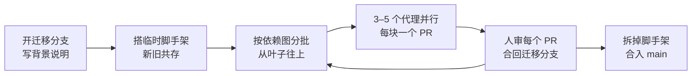

# 几百个文件的迁移，一个代理为什么做不完：OpenHands 讲怎么把大重构拆给并行代理

OpenHands

**一句话看懂**：依赖升级、框架迁移、清理代码坏味道这类活很适合自动化，但一个代理一次做不完：它会迁完 100 个服务里的 3 个，然后说剩下的要招 6 个人。OpenHands CEO Robert Brennan 的办法是：**开一条迁移分支、写好背景说明，按依赖关系把任务拆成“一个代理能一次做完、一个人能快速判断对错”的小块，先只同时跑 3–5 个代理，每块经人审再合并**；目标是 90% 自动化，不是 100%。后半场是动手练习：用 OpenHands SDK 让一个代理扫描漏洞，再给每个漏洞派一个代理去修。

## 读完你能带走的 7 条收获

1. **大任务单代理做不完，原因一半在代理、一半在人**：上下文不够、偷懒、错误累积；人也说不清直觉、不知道怎么拆、没有完成标准（见 3.1）。
2. **编排的目标是 90% 自动化**，人要审每个代理的中间产物，而不只是最后的合并结果（见 3.2）。
3. **新手先只跑 3–5 个并发代理**，再多人就审不过来（见 3.2）。
4. **好的子任务有四个条件**：一个代理一次做完、能并行、能快速验证、依赖清晰。这和给工程师团队拆活是一回事（见 3.4）。
5. **按依赖图从叶子往上做**；需要新旧共存时，先搭一层临时脚手架，每迁完一块都能测（见 3.3、3.4）。
6. **验证器找问题、修复器开 PR、人审后解锁下一批**，直到依赖图全部变绿（见 3.3）。
7. **代理学到的东西，靠人审过的共享 AGENTS.md 传递最实用**；共享全部上下文会撑爆窗口，让代理互发消息又太不确定（见 3.5）。

::: tip 小白先懂这几个词
- [OpenHands](/glossary#openhands)：开源的编码代理平台，可以本地运行，也有云端版本和 Agent SDK。
- [Definition of Done（完成标准）](/glossary#definition-of-done)：什么样算“做完了”，要在开工前说清楚。
- [Migration Scaffolding（迁移脚手架）](/glossary#migration-scaffolding)：迁移期间临时加的兼容代码，让新旧两套实现能同时运行，迁完再删掉。
- [Microagent（微代理）](/glossary#microagent)：OpenHands 里一段给代理看的 Markdown 背景说明，作用类似 AGENTS.md。
- [Codemod](/glossary#codemod)：批量改写代码的自动化脚本或工具。
- [Human-in-the-Loop（人在环中）](/glossary#human-in-the-loop)：流程中关键步骤由人确认。
:::

## 1. 基本信息

<YouTube id="rcsliSIy_YU" title="Automating Large Scale Refactors with Parallel Agents - Robert Brennan, OpenHands" />

| 项目 | 内容 |
|---|---|
| 讲者 / 频道 | Robert Brennan（OpenHands 联合创始人兼 CEO），同事 Calvin 演示 Refactor SDK ／ AI Engineer |
| 发布日期 | 2026-01-08 |
| 时长 | 1:16:21 |
| 使用工具 | OpenHands（CLI、Web 应用）、OpenHands Agent SDK、OpenHands Refactor SDK（内部工具演示）、Docker agent server、trivy |
| 分析依据 | YouTube 完整自动字幕（en-orig，2026-10-15 重新取得；旧版只整理了前 35 分钟，这次按全长片段分析重写）+ 视频截图。字幕是自动生成的，“OpenHands”“CVE”“Zustand”等常识别错，Calvin 的演示是加速录屏，部分句子残缺；约 70 分钟以后几乎只剩碎片，没有分析。引语只取识别清楚的句子。“我觉得”开头的段落是本站评论。 |

## 2. 这篇在回答什么

假设你要把前端的状态管理从 Redux 换成 Zustand，或者把几百个 Spark 2 作业升到 Spark 3。你把任务交给一个代理，结果会怎样？讲者试过：

<Trans zh="代理会说：“好，我迁移了你 100 个服务里的 3 个，剩下的需要招一个 6 人团队来做。”">“Okay, I migrated three of your 100 services. I need to hire a team of six people to do the rest.”</Trans>

这类任务的共同点，讲者在开场就说了：

<Trans zh="这些任务非常适合自动化。你可以把代理扔上去，但它们往往太大，没法一次搞定。">“these are tasks that are super automatable. Uh you can throw agents at them, but they tend to be way too big for like you know a single just one shot.”</Trans>

所以需要“编排”：把大任务拆开，分给多个代理，再把结果收拢。全场回答五个问题：

1. 为什么一个代理做不完？谁需要编排？（3.1）
2. 人在环中的编排流程长什么样？（3.2）
3. 依赖图上怎么分批、验证、修复？（3.3）
4. 好的子任务有什么标准，有哪几种拆法？（3.4）
5. 代理们学到的东西怎么共享？（3.5）

后半场是用 SDK 做漏洞批量修复的动手练习（3.6），中间穿插现场问答（3.7）。

## 3. 怎么做

### 3.1 为什么一个代理做不完，谁需要编排

**适合编排的任务**是重复、可自动化、但量很大的活。讲者举了很多例子：

- **漏洞修复**：一个客户有数万名开发者、数千个仓库，每出一个开源漏洞都要排查所有仓库、提 PR、升级依赖、修破坏性 API 改动。讲者说他们用 OpenHands 编排后，修复速度提高了 30 倍；现在每出一个新漏洞就自动起一个会话扫描、修改、开 PR，下游团队只需验证并点合并。
- **现代化**：给 Python 代码补类型注解、把单体拆成微服务、升级 Java 版本、把 Spark 2 作业升到 Spark 3、OpenHands 自己把前端从 Redux 迁到 Zustand。
- **技术债**：找出并删掉没用的代码；有客户用 SDK 盯着 Datadog 日志，每出现一种新错误模式，就让代理去代码里加错误处理。

**为什么一次做不完。** 讲者分成两边：

| 代理的问题 | 人的问题 |
|---|---|
| 上下文有限，任务太长或代码库太大，压缩后代理会迷失 | 自己对问题的直觉很难传达给代理 |
| 偷懒：做几个就把剩下的推回来 | 不知道怎么拆，不知道代理一次能做多少 |
| 缺乏你代码库的领域知识 | 需要在代理工作中途审查、批准 |
| 错误会累积：开头一个小错，每一步都重复 | 没有真正的完成标准 |

<figure class="shot"><figcaption>📷 视频截图 · <a href="https://www.youtube.com/watch?v=rcsliSIy_YU&t=800s" target="_blank" rel="noopener">13:20</a> · 为什么需要编排：左边是代理的问题，右边是人的问题。</figcaption></figure>

讲者也强调，不是每个开发者都要编排。他认为大多数人未来几年仍会在本地用单个代理做日常的新功能和修 bug；只有一小部分早期采用者在用编排处理大批技术债。对一般软件开发，提升大概是大家常说的 20%；只有漏洞修复、代码库现代化这类特定任务，才可能把几年的活压到几周。

### 3.2 人在环中的编排流程

单代理的循环大家都熟悉：给提示词，代理干活（你可能守着它，每条命令都按 Y），看结果，不满意再提示。编排多了三步：先把大任务拆成一个个代理能单独完成的任务；每个任务派一个代理；最后把所有结果收拢成一个改动合进代码库。

讲者特别强调，人要审的不只是最后的合并结果，还有每个代理的中间产物：

<Trans zh="我常跟大家说，目标不是把这个流程 100% 自动化，而是 90% 左右。">“I like to tell folks the goal is not to automate this process 100%. It's something like 90% automation.”</Trans>

他说这仍然是一个数量级的生产力提升。难点在于怎么拆，才能每一步都能验证，最后不会得到一团乱码。

**Git 工作流。** 讲者常用的做法：

1. 在仓库里新开一条分支；
2. 用 AGENTS.md 或 OpenHands 的 microagent 给这条分支加一段高层背景，比如“我们在把 Redux 迁到 Zustand”；
3. 需要的话，先搭好脚手架（见 3.4）；
4. 从这条分支派出一批代理，它们的成果都提交回这条分支，逐步累积；
5. 全部做完后拆掉脚手架，把分支合进 main。

<figure class="shot"><figcaption>📷 视频截图 · <a href="https://www.youtube.com/watch?v=rcsliSIy_YU&t=1000s" target="_blank" rel="noopener">16:40</a> · 讲者常用的 Git 工作流：迁移分支、背景说明、脚手架、并行代理、拆脚手架、合并。</figcaption></figure>

**同时跑几个。** 讲者给新手的建议：

<Trans zh="我建议把自己限制在大约 3 到 5 个并发代理。超过这个数，你的脑子就开始转不过来了。">“I would suggest limiting yourself to about three to five concurrent agents. Uh I find more than that your brain starts to break.”</Trans>

规模化的团队会同时跑几百甚至几千个代理，但那时不是一个人审所有结果，而是代理把 PR 发给各个团队。

### 3.3 依赖图分批：验证器、修复器、人审

同事 Calvin 用内部工具 Refactor SDK 演示了一次真实的大规模清理：去除 OpenHands 代码库里的代码坏味道。光核心代理部分就有约 380 个文件、6 万行代码。

**第一步：画依赖图，分批。** 每个节点是一个文件，边是谁导入谁。整张图是一团乱麻，这正是大规模重构难的原因。要把它切成“PR 大小”的批次：一个代理能处理、一个人能看懂。分批方法有很多，图论算法能给出更强的结构保证，但演示里直接用目录结构，让语义相关的文件落在同一批。然后再画一张“批次图”：节点是批次，边是批次之间继承下来的依赖，一屏就能看清整体结构。工具还给每批显示复杂度指标，提醒人对复杂的批次多加小心；也能标出空文件这种可疑批次，留个备注。

**第二步：验证器找问题。** 验证器可以是程序化的（跑一条命令，适合单元测试、lint、类型检查），也可以是语言模型。因为要找的是代码坏味道，演示用的是 LLM 验证器，按给定的规则看代码。

<figure class="shot"><figcaption>📷 视频截图 · <a href="https://www.youtube.com/watch?v=rcsliSIy_YU&t=1340s" target="_blank" rel="noopener">22:20</a> · 配置一个基于 LLM 的验证器，提示词里写明要找哪些代码坏味道。</figcaption></figure>

简单的批次验证通过，在图上变绿；有一批文件较复杂，验证失败变红，报告逐个文件列出问题。目标很直接：让批次图上每个节点都变绿。验证要按依赖顺序推进，先挑不依赖其他未处理批次的。

**第三步：修复器开 PR。** 修复器同样有几种：跑一条命令；把整批交给语言模型一步修好；或者最强的一种，用 Agent SDK 起一个代理，在干净的代码副本里工作，能跑测试、看代码、查文档。每个修复器都产出一个整洁的 PR 等人批准。演示里那个 PR 只改了几百行，主要是把一大段代码抽成函数，描述里写了发现的问题、做了什么改动和给审查者的说明。修复完还要重新验证。

完整流程是：验证器找问题，修复器起代理修，人审合并，解锁依赖它的批次，重复，直到整张图变绿。Calvin 说他们已经用这个工具做了不少大改动，包括补类型和改进测试。

### 3.4 怎么拆：四条标准、三种策略

**好的子任务满足四条标准。**

1. **一个代理一次能做完**：放得进一个提交、一个 PR。你不想跟每个子代理来回改，最好扫一眼就能盖章合并。
2. **能并行**：如果代理一个接一个串行跑，还不如一个代理从头做到尾。
3. **能快速验证**：最好看一眼 CI 是不是全绿就有把握，或者点开应用、跑条命令就能确认。
4. **依赖和顺序清晰**：做完 A 才能做 B、C、D，它们做完才能做 E。

<figure class="shot"><figcaption>📷 视频截图 · <a href="https://www.youtube.com/watch?v=rcsliSIy_YU&t=1700s" target="_blank" rel="noopener">28:20</a> · 好的子任务应满足的条件。</figcaption></figure>

讲者的总结是：这和给一个工程师团队拆活非常像。

**三种拆法。**

| 策略 | 怎么做 | 适合 |
|---|---|---|
| 逐个处理 | 按文件、目录、函数或类一个个过，最后收成一个 PR | 彼此依赖不多的改动，比如给 Python 代码库补类型注解 |
| 依赖树 | 像 Calvin 那样从依赖图的叶子节点（工具文件等）开始，依赖它们的再往上，一路做到应用入口 | 大多数情况下更好、更有章法 |
| 脚手架 | 先搭一层让新旧两个世界同时存在的代码 | 迁移期间需要应用一直能跑 |

脚手架的例子是 OpenHands 自己的 Redux 迁 Zustand：先让代理搭一层脚手架，让 Redux 和 Zustand 能同时工作。讲者说这“很丑”，不是你真想要的代码，但它让每个组件迁完后都能测试应用。然后给每个组件派一个并行代理；全部迁完后拆掉脚手架，代码里再也没有 Redux，一切正常。好处是不用一次全改完，每个代理做完都能拿到反馈。

我觉得“能快速验证”这一条最容易被忽略。很多人拆任务只看大小，不看验证成本。如果每个 PR 都要人花半小时才能判断对错，3–5 个代理就已经把人压垮了。脚手架的价值也在这里：它让每一小步都有一个能跑的应用可测。

### 3.5 代理学到的东西怎么共享

大项目做着做着，你会发现最初的理解不完整；10 个代理可能都卡在同一个问题上，你希望把解法传给所有人。讲者比较了四种做法：

| 做法 | 问题 |
|---|---|
| 共享一切：每个代理看到所有其他代理的上下文 | 等于一个代理串行做，上下文很快撑爆，没用 |
| 人手动传：在每个代理的对话里粘一句“用 1.2.3 版，不要 1.2.2”，或者人去改 AGENTS.md、microagent | 要人守着，不可扩展 |
| 代理自己改共享的 AGENTS.md，比如学到新东西就提一个 PR 改它 | 代理有时会记些不重要的东西，推得太积极；加人审有帮助 |
| 给代理一个互发消息的工具，广播或点对点 | 最前沿，好玩但难做对：增加了系统的不确定性。讲者举了一份报告里的例子：两个代理互相对话，陷入互祝“zen perfection”的循环 |

我觉得第三种（代理提议、人审过再进 AGENTS.md）是现在最实用的折中，也和本站其他资料里“规则文件要人维护”的做法一致（参见 [[20]]）。

### 3.6 动手练习：用 SDK 批量修漏洞

后半场是一个动手练习：写一个脚本，输入一个 GitHub 仓库，扫描开源依赖的漏洞，然后**每个漏洞派一个代理**去修并开 PR。

设计是两段：

1. **扫描代理**：先让一个代理看仓库，自己决定怎么扫。讲者说这正是用代理的好处：它能根据语言判断是用 trivy 扫 Docker 镜像，还是对 package.json 跑 npm audit。
2. **修复代理**：拿到漏洞列表后，每个漏洞起一个代理，研究能不能修，升级依赖，修掉破坏性的 API 改动，开 PR。好处是 PR 好了就能合；一个卡住不影响其他：

<Trans zh="也许我们能解决 90% 或 95%，不需要做到 100% 才有价值。">“maybe we get to 90% or 95% solved. Uh we don't have to get to 100% in order to have any value here.”</Trans>

准备工作：新建一个 GitHub 仓库；一个 GitHub classic token（只要 repo 权限，用来开 PR）；一个 LLM key；用 Docker 起一个 agent server，代理都在这个容器里干活。讲者说这样更安全，规模大时可以换成 Kubernetes 集群。仓库里放一个 microagent（按惯例叫 `repo.md`），写上 SDK 文档和仓库的链接，给代理背景。

SDK 的骨架很简单：创建 LLM，把它和工具（终端、文件编辑、任务跟踪）一起交给 Agent，给一个工作区，然后运行。扫描代理在容器里运行时发现没装 trivy，就自己装上再扫；结果写进一个 JSON 文件，脚本再通过工作区对象执行命令把它取回来。

练习中途也出了岔子：代理第一次没写对 SDK 的 API，讲者把报错贴回去让它重试；好几位听众在安装 CLI 时遇到问题。约 70 分钟以后字幕只剩碎片，看不出练习最后跑到哪一步。

### 3.7 问答 / 讨论

现场问答都穿插在练习里，有几条值得记下：

- **AGENTS.md 还是 microagent？** 用支持 AGENTS.md 的工具就写 AGENTS.md；OpenHands 里对应的是 microagent，`repo.md` 按惯例描述当前仓库。这一步是可选的，但能让代理少走弯路。
- **为什么用 CLI 演示？** 讲者说他平时更喜欢用 Web 界面，让代理推送代码，真要本地改再拉下来；现场用 CLI 只是为了展示脚本能在本地跑。
- **CLI 跑着跑着能不能打断？** 可以暂停，然后输入纠正，或者直接输入 continue。
- **SDK 里的 observation event 是什么？** 代理的整个轨迹由两类事件组成：action（模型返回的动作，基本就是工具调用）和 observation（这个动作的结果，比如命令输出）。
- **为什么一个个粘贴提示词、把代码堆在一个脚本里？** 讲者承认这只是为了演示“用 SDK 搭东西是什么感觉”，有更好的组织方式；他们有一个按类拆分的漏洞修复示例仓库。

## 4. 结果与局限

- **数字是讲者口述**：30 倍的漏洞修复提速、一般开发 20% 的提升，都没有给出对照或测量方法。
- **Refactor SDK 是内部工具演示**：录屏加速，没有展示失败案例和整体耗时；字幕识别也较差，细节以截图为准。
- **3–5 个代理、90% 自动化是经验建议**，不是实验结论。
- **动手练习没有完整收尾**：约 70 分钟后字幕残缺，看不到修复代理最终开出的 PR。
- **推广成分不重**，主要是 OpenHands 产品和免费额度的介绍。

## 5. 结论

大重构交给代理，难点不在开多少个代理，而在拆分：拆到每一块一个代理能一次做完、一个人能很快判断对错，再按依赖顺序推进，用脚手架让每一步都可测。编排的目标是 90%，剩下的 10% 留给人审查和收尾。

我觉得这场演讲最值得带走的是那四条拆分标准，它们和工具无关。下次要让代理做大迁移时，先别急着开代理，花时间画依赖图、定完成标准、想好怎么验证每一块。互不依赖的新功能并行开发，可以对照 [[23]] 的 worktree 做法。

**你可以这样试**

1. 挑一个你一直拖着的迁移，先开一条迁移分支，在 AGENTS.md 里写一段“我们在做什么、为什么、完成标准是什么”。
2. 列出依赖关系，从最底层的工具文件开始，拆成几个 PR 大小的任务。
3. 只开 3 个代理，每个 PR 都自己审，看自己一小时能审几个，再决定要不要加代理。
4. 如果迁移期间应用会跑不起来，先让代理搭一层新旧共存的脚手架。

**读完自测**

- 讲者列了哪些“代理的问题”和“人的问题”？
- 好的子任务要满足哪四个条件？为什么“能并行”很重要？
- 脚手架为什么要先搭、最后拆？
- 代理之间共享上下文的四种做法，各有什么问题？
