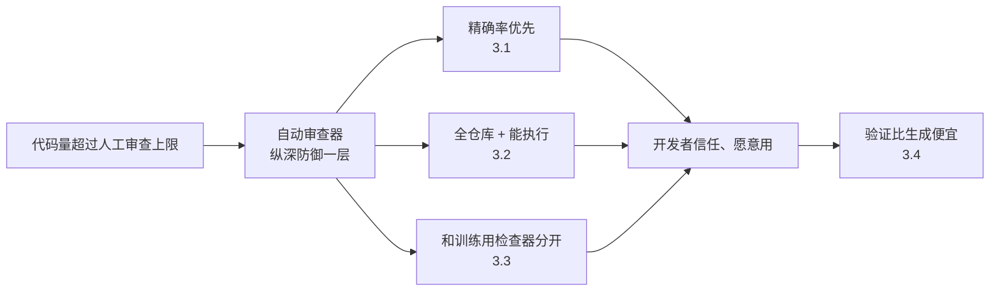

# AI 审查 AI 写的代码，该少报还是多报：OpenAI 的大规模代码验证经验

Codex

**一句话看懂**：代理写代码的速度已经超过人能仔细审查的速度，所以 OpenAI 专门训练了一个代理式代码审查器（Codex 的 `/review`）。他们的经验有四条：**精确率比召回率更重要**，误报多的审查器会被开发者绕开；**审查者要能读整个仓库、能运行代码**，只看 diff 不够；**训练时用的检查器不能直接拿来给人用**，两者优先级相反；**验证可以比生成便宜**，审查者用一小部分 token 就能抓到大部分已知的严重问题。部署后，审查评论有 52.7% 让作者改了代码。

## 读完你能带走的 6 条收获

1. **审查器先求“报得准”，再求“报得全”。** 一个又慢又吵的防线会被人绕开，等于没有（见 3.1）。
2. **一条审查意见值不值得发，可以算一笔账**：发现真问题的收益，减去人核实它的成本，再减去误报的代价（见 3.1）。
3. **多报还是少报应该能调**：用任务指令或 `AGENTS.md` 告诉审查器“只报最关键的”还是“尽量多报”（见 3.1）。
4. **只给 diff 的审查最快，但会漏掉改动和依赖之间的交互。** 给审查者仓库访问和执行能力，召回和精确率都更高（见 3.2）。
5. **训练用的检查器可以“过敏”，给人用的审查器不行。** 用同一个验证器两头兼顾，两头都会失败（见 3.3）。
6. **证伪一个改动比写出正确的改动便宜**，但干净的审查不是安全保证，它只是纵深防御里的一层（见 3.4、4）。

::: tip 小白先懂这几个词
- Precision / Recall（精确率 / 召回率）：报出来的问题有多少是真的 / 真问题有多少被报出来。
- Reward Model（奖励模型）：训练时给模型输出打分、引导模型学习的那个模型或规则。
- Defense in Depth（纵深防御）：多层独立防线叠加，不依赖任何单一一层。
- Alignment Tax（对齐税）：为了安全多付出的成本，比如变慢、变烦。
- [AGENTS.md](/glossary#agents-md)：给编码代理看的项目规则文件。
:::

## 1. 基本信息

<SourceCard type="文章" title="A Practical Approach to Verifying Code at Scale" author="Maja Trębacz、Sam Arnesen、Albin Cassirer、Max Johnson、Xin Lin、Thibault Sottiaux（OpenAI，与 Codex 团队合作）" date="2025-12-01" url="https://alignment.openai.com/scaling-code-verification/" />

| 项目 | 内容 |
|---|---|
| 链接 | https://alignment.openai.com/scaling-code-verification/ |
| 类型 | 研究博客（文章），OpenAI Alignment Research Blog |
| 作者 | Maja Trębacz、Sam Arnesen、Albin Cassirer、Max Johnson、Xin Lin、Thibault Sottiaux，与 Codex 团队合作 |
| 发布日期 | 2025-12-01 |
| 使用工具 | Codex 代码审查（`/review`、Codex Cloud 的 Code Review、PR 评论 `@codex review`）；模型 GPT-5-Codex、GPT-5.1-Codex-Max |
| 分析依据 | 原文全文，2026-10-14 用 curl 重新抓取并逐字核对引语。文中 3 张图只能读到图注，具体数据点无法提取。所有数字均为 OpenAI 自报。“我觉得”开头的段落是本站评论。 |

## 2. 这篇在回答什么

你的团队开始让代理写大量代码。一天几十个 PR，每个都要人仔细看，很快就看不过来了。自然的想法是：再让一个 AI 来审查。

但这立刻带来几个问题。AI 审查器每个 PR 都挑出十几条“问题”，一半是误会，开发者两周后就不看了。它只看 diff，不知道这个函数在别处被怎么调用。它和写代码的是同一个模型，会不会互相包庇？

作者的出发点很直接：

::: tr 我们不能假设生成代码的系统是可信或正确的，必须检查它们的工作。
> "We cannot assume that code-generating systems are trustworthy or correct; we must check their work."
:::

他们把自动代码审查定位成<Trans zh="纵深防御">“defense-in-depth”</Trans>策略里的一层输出监控，和思维链监控、行为测试等并列。全文回答四个问题：

1. 审查器该多报还是少报？（3.1）
2. 审查器需要看到多少代码、能做什么？（3.2）
3. 训练代码模型时用的检查器，能直接拿来审查吗？（3.3）
4. 让 AI 审查 AI，划不划算、靠不靠谱？（3.4）

最后是部署以后看到的结果和风险（第 4 节）。

## 3. 怎么做

### 3.1 精确率比召回率更重要

很多防线失败，不是因为技术上错了，而是因为太难用：

<Trans zh="一个又慢、又吵、又麻烦的系统会被绕过。">“A system that is slow, noisy, or cumbersome will be bypassed.”</Trans>

所以部署审查器时，他们明确接受了一个取舍：适度降低召回率，换来高信号质量和开发者的信任。先优化信噪比，再在不损害可靠性的前提下提高召回。

一条意见值不值得发？作者给了一个公式。意思是：一条审查意见的价值 = 它是对的概率 × 它帮你省下的成本 − 人核实它的成本 − 它是错的概率 × 误报造成的损失。

::: tr 期望收益要大于核实成本和误报损失。
> "We want the expected benefit from seeing a proposed bug finding to outweigh the expected cost to verify it and the damage from a false alarm."
:::

按这个算法，有些**技术上正确**的意见也可能是负价值。原文的例子是：在一份个人研究笔记里指出注释有错别字，可能就不值得。

这个平衡点不是固定的。作者说他们做了一个“有立场的猜测”，但这个取舍应该能通过自定义任务指令，或包级、仓库级的 `AGENTS.md` 来调整。原文图 1 展示了同一个模型在不同指导语下的表现，从<Trans zh="只输出最关键、最确定的破坏性问题">“only output the most critical and certain breaking issues”</Trans>到<Trans zh="尽可能多地分享发现">“share as many findings as possible”</Trans>。

我觉得这个公式最大的用处，是给“该不该在审查规则里加这一条”提供了一个具体的判断方法。一条规则如果大部分时候报的都是风格问题，那它的核实成本和误报代价很可能大于收益。

### 3.2 只看 diff 不够：要能读整个仓库、能运行代码

以前大多数 AI 代码审查的做法是：把改动的 diff 交给模型，可能再附一点周围的代码。这样最快，但：

<Trans zh="它常常漏掉关于整个代码库的重要上下文，以及这个改动和它的依赖之间的交互。">“it often misses important context about the whole codebase and the interaction of the change with its dependencies.”</Trans>

作者给 GPT-5 加上仓库访问和代码执行能力做了评估，结论是审查器更强了：抓到更多关键问题，误报也更少。再做专门的代码审查训练，效果还会提升。

原文图 2 是在热门开源仓库最近的提交上做的人工评估。图注说：用默认提示词、只看 PR diff 的 GPT-5 能发现不少高影响问题，但误报很多；专门为高信噪比训练的 GPT-5-Codex，评论更不容易是错的或不重要的。

他们也提到早期研究 CriticGPT（2024 年 6 月）影响了方法，但它面向更简单的任务，不适合实际部署。新审查器补上的是推理、工具使用、仓库级上下文，以及精确率和延迟目标。

### 3.3 训练时的“检查器”和交给人用的审查者不是一回事

这一节讲的是一个容易被忽略的区别。训练代码生成模型时，也要有自动检查给输出打分（奖励模型）。它和给人用的代码审查看起来很像，但：

<Trans zh="它们解决的是根本不同的问题，因此需要不同的设计。">“they solve fundamentally different problems and therefore require different designs.”</Trans>

两者的优先级正好相反：

| | 训练时的检查器 | 部署给人用的审查器 |
|---|---|---|
| 优先目标 | 尽可能多抓错误，不怕误报 | 不过度断言意图，建立用户信任 |
| 能不能“过敏” | 可以 | 不行 |
| 能用的信息 | 任务的额外信息，能精确检查是否遵守指令 | 模糊的真实代码，规格不全，规范在变 |
| 适用范围 | 训练任务 | 跨语言、跨领域都要稳 |

用一个验证器兼顾两边会怎样？

<Trans zh="两种场景都可能失败。">“risks failure in both.”</Trans>

作者的解释是：生成器如果在训练中过度讨好奖励信号，可能学到损害下游审查质量的行为，比如过于谨慎或刻板的输出，让用户烦躁。所以他们把训练面向人类工作流的审查器当成 Codex 训练里的一个单独任务，同时密切观察它给 Codex 自己生成的代码打分的效果。

### 3.4 验证可以比生成便宜

先看部署数据：

- Codex 对**完全由 Codex cloud 生成**的 PR，有 36% 会留评论；这些评论里 46% 让作者改了代码。
- 对**人写的 PR**，这个比例是 53%。

为什么 AI 审查 AI 能有效？作者的解释是生成和验证之间存在一个推理成本的差距：

::: tr 生成一个正确的代码改动通常需要大范围搜索和大量 token，而证伪一个改动通常只需要有针对性地提出假设并检查。
> "Generating a correct code change often requires broad search and many tokens, while falsifying a proposed change usually needs only targeted hypothesis generation and checks."
:::

他们做了一个受控研究：拿上一代审查模型提出、已经被人确认过的评论当测试集，改变审查器的推理预算。结果是：

- 即使预算只有生成器 token 花费的一小部分，审查器也能抓到大部分作者确认过的高严重度问题；
- 增加的预算主要用于改善校准、减少误报；
- 但审查**模型生成的代码**时，性能随思考预算降低下降得更快，审查人写的代码则一直更好。作者认为这暗示验证难度可能存在分布偏移。

作者也写清了这个研究的局限：测试集只包含人已经发现的问题。如果审查器多花时间提出了新发现，这个评估无法判断新发现对不对。

还有一个担心：生成器和审查器是**同一个底层模型**（脚注说训练方法不同）。它会不会学会悄悄规避自己的检查？作者说没有干净的直接测量方法，只能用代理指标：比较审查器在 Codex 生成的 PR 和人写的 PR 上提出可操作问题的频率，同时承认分布有偏差。到目前为止：

<Trans zh="审查器同样有效，说明监督并没有被实质性削弱。">“the reviewer remains similarly effective, suggesting that oversight is not being meaningfully weakened.”</Trans>

## 4. 结果与局限

部署情况（均为 OpenAI 自报）：

| 项目 | 数字 |
|---|---|
| 内部使用 | 每个 PR 都自动审查；很多工程师 push 前在 CLI 跑 `/review` |
| 评论被作者用代码修改回应的比例 | 52.7%（常常借助 Codex 修改） |
| 外部规模 | 截至 2025 年 10 月，每天处理超过 10 万个外部 PR |
| 评论的表情反应 | 超过 80% 是正面的 |
| 其他 | 帮助验证高风险实验，防止阻塞发布的问题；合并后需要 bug 修复跟进的 PR 变少（未给数字） |

作者特别提醒了过度依赖的风险：

::: tr 团队可能开始把一次干净的审查当成安全保证，而不是一层防御。
> "Teams could start treating a clean review as a guarantee of safety rather than as one layer of defense."
:::

他们希望大家把审查器当辅助工具，而不是替代仔细判断。结论部分还提到一个副产品：内部部署发现了真实的生产缺陷，也暴露了他们之前“可信”数据集里的评测不一致。

::: warning 局限与注意
- 文中有三个容易混淆的比例：36%（Codex 生成 PR 中留评论的比例）、46% 与 53%（Codex 生成 / 人写 PR 的评论导致改代码的比例）、52.7%（整体评论导致改代码的比例），口径不同，不要混用。
- 三张图只有图注，具体的召回率、精确率数字读不到。
- 推理预算研究的测试集只含人已发现的问题，无法评估新发现。
- “同一个模型会不会规避自己的检查”只用了间接指标，作者自己也承认有分布偏差。
- 作者来自 OpenAI，评估对象是自家模型；文末附了 Codex Code Review 的使用方式。
:::

## 5. 结论

这篇最值得带走的是一个反直觉的判断：**一个审查器有没有用，首先取决于人愿不愿意看它的意见**。所以精确率比召回率重要，误报的代价要算进去，审查规则要能按团队调整。其次，审查器要能看到整个仓库、能跑代码，只看 diff 会漏掉最要紧的交互问题。

我觉得最该记住的是作者自己的提醒：AI 审查通过，只说明这一层防线没发现问题，不说明代码没问题。

### 你可以这样试

- [ ] 翻一下你的 AI 审查器最近 20 条意见，标出哪些真的让你改了代码，算一个自己的“采纳率”。
- [ ] 在 `AGENTS.md` 里写明审查的取舍，例如“只报会导致错误行为或安全问题的改动，不报风格问题”，对比前后的采纳率。
- [ ] 如果你的审查工具只看 diff，试一次让代理在完整仓库里、能跑测试的情况下审查同一个 PR，对比两次的结果。

### 读完自测

1. 作者用什么公式判断一条审查意见值不值得发？为什么技术上正确的意见也可能是负价值？
2. 只给 diff 的审查器主要漏掉什么？
3. 训练时的检查器和部署给人用的审查器，优先级有什么不同？
4. 为什么作者认为验证可以比生成便宜？他们的研究有什么局限？
