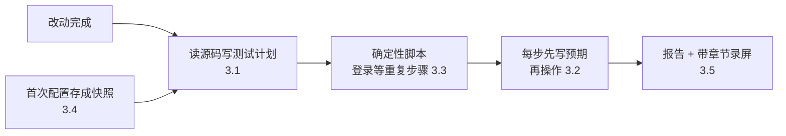

# 代理交回的不只是代码，还要有证据：Cognition 让 Devin 自己端到端测试

Devin

**一句话看懂**：Devin 的会话里，被事件、定时任务和其他 Devin 异步触发的，第一次超过了人手动发起的。人不在场，代理交回来的东西就必须**自带证据**：代码审查干净还不够，工程师想看到改动真的被端到端测过。Cognition 的做法是让 Devin 用 Computer Use 在云端虚拟机里实际操作应用，并总结出几条防跑偏、防谎报的经验：**先读源码写测试计划**；**每一步动手前先写下预期**；**把登录这类重复步骤写成确定性脚本放进测试 skill**；第一次配好环境后存成快照；最后交回带标注截图的报告和带章节的录屏。

## 读完你能带走的 6 条收获

1. **异步代理越多，未经验证的改动就越难管。** 代码审查干净只说明代码看起来没问题，人还想看到功能真的跑通了（见 2）。
2. **测试前先读源码、写测试计划**，不然模型会假设应用里有根本不存在的路径，也更容易漏掉真正要测的行为（见 3.1）。
3. **每一步操作前先写下预期结果**，代理就更难把意外结果说成通过，原理和 TDD 一样（见 3.2）。
4. **重复又昂贵的步骤，比如登录，写成确定性脚本放进仓库的测试 skill**，既省时间省 token，又大幅减少不稳定（见 3.3）。
5. **第一次测试通常需要人帮忙**（密钥、验证码），配好之后存成声明式配置和快照，以后每次会话直接从快照启动（见 3.4）。
6. **交回的证据要让人看得懂**：带标注的关键截图用来快速看，带章节和断言列表、压缩了空闲时间的录屏用来细看（见 3.5）。

::: tip 小白先懂这几个词
- [Devin](/glossary#devin)：Cognition 公司的云端自主编码代理，每个会话运行在一台云端虚拟机里。
- [Computer Use](/glossary#computer-use)：让模型通过截图、鼠标、键盘直接操作图形界面。
- [Agentic Manual Testing（代理手动测试）](/glossary#agentic-manual-testing)：让代理像人一样实际运行和操作应用，而不只是跑单元测试。
- [Skills（技能）](/glossary#skills)：按需加载的说明和脚本包，代理需要时才读取。
- Flaky（不稳定）：同样的测试，有时过有时不过。
:::

## 1. 基本信息

<SourceCard type="文章" title="Verifying Agentic Development at Scale" author="Ido Pesok（Cognition）" date="2026-05-29" url="https://cognition.com/blog/testing-development" />

| 项目 | 内容 |
|---|---|
| 链接 | https://cognition.com/blog/testing-development |
| 类型 | 公司工程博客（文章，约 1,500 词） |
| 作者 | Ido Pesok（文中自述加入 Cognition 3 个月） |
| 发布日期 | 2026-05-29 |
| 使用工具 | Devin（云端虚拟机、Computer Use 工具、测试模式、Devin Review、YAML blueprint） |
| 分析依据 | Cognition 官方博客全文，2026-10-14 用 curl 重新抓取并逐字核对引语。文中所有数字均来自原文，没有绝对数量和成功率。文末有计费优惠和招聘信息，属推广内容。“我觉得”开头的段落是本站评论。 |

## 2. 这篇在回答什么

想象这样一个早上：用户在 bug 频道里报了一个问题，你还没看到，Devin 已经开好了修复的 PR。这很方便。但你敢直接合并吗？

作者说，这件事从“锦上添花”正在变成“必须”。Cognition 内部最近有一个里程碑：

<Trans zh="Devin 会话中由异步触发的，第一次超过了交互式触发的。">“For the first time, more Devin sessions are triggered asynchronously than interactively.”</Trans>

异步意味着人不在场。代理被事件、自动化、定时任务甚至其他 Devin 触发，干完活再交回来。他们已经有 Devin Review 做代码审查，而且它会一直修到 diff 干净为止。但：

::: tr 但仅有一次干净的审查往往不够——工程师想看到改动被端到端测试过，就像他们自己会做的那样。
> "But a clean review alone often isn’t enough - engineers want to see the change tested end to end, the same way they would test it themselves."
:::

作者的判断是，随着主动代理提交的 PR 越来越多，<Trans zh="未经验证的改动很快就会变得无法管理">“unverified changes will quickly become unmanageable.”</Trans>

大约半年前，他们给 Devin 的 harness 加了一整套 Computer Use 工具：截图、移动鼠标、点击、拖拽、输入、按键、滚动、等待、缩放、开始 / 停止录屏。真正的突破是 Devin 能测自己的工作：启动应用，点一遍，确认改动生效。作者印象最深的是看到工程师同时跑 10 到 20 个 Devin，每个都有自己的开发服务器，这在一台笔记本上做不到。

但作者也承认，<Trans zh="说实话，走到这一步并不顺利">“To be honest, getting here wasn’t smooth.”</Trans> 全文回答的是这一路踩坑后的几个问题：

1. 代理测试时老是跑偏，怎么办？（3.1）
2. 代理会不会谎报测试结果？（3.2）
3. 每次都要登录、配置，又慢又不稳，怎么办？（3.3、3.4）
4. 测完交回什么，人才看得懂？（3.5）
5. 还有哪些没解决的问题？（3.6）

## 3. 怎么做

### 3.1 先读源码，写测试计划

早期版本的 Devin 测试时经常跑偏，方式五花八门：

- 把产品里无关的部分测了一大堆；
- 在到达功能之前就迷失在环境配置里；
- 干脆漏掉了这个 PR 真正要改的核心行为。

他们的解决办法是：进入测试模式后，Devin 先写一份测试计划，明确要测什么。关键是这份计划：

<Trans zh="必须基于源码，而不是假设。">“This plan must be grounded in source, not assumptions.”</Trans>

为什么要强调源码？因为不读代码时，模型喜欢假设应用里有一些根本不存在的操作路径。

测试计划还有一个好处：让 Devin 能测更复杂的改动。作者举的最难的例子，是那些要同时跑多个服务、配好特定管理员设置、打开正确的功能开关，才能触发到目标行为的功能。先读代码，Devin 就更可能一开始就把环境配对，而不是测到一半才发现缺东西。作者把测试计划看成一种<Trans zh="预先对齐">“pre-alignment”</Trans>，让 Devin 在实际测试时不容易漂移。

### 3.2 每一步先写预期，再动手

Devin 按计划测试时，会在时间线上加注释：配置说明、每个命名测试的开始、每条断言标成通过、失败或未测试。

作者发现了一个很有意思的规律：

::: tr 我们发现，如果 Devin 在执行动作之前先标注预期行为，它在报告发现时就会少撒谎——很像测试驱动开发，如果你事先承诺了预期，就很难把一个意外的结果合理化成通过。
> "We found that Devin will lie less about its findings if it annotates its expected behavior right before performing an action - much like test-driven development, if you commit to the expectation upfront it makes it much harder to rationalize an unexpected result as a pass."
:::

我觉得这是全文最便宜、最容易迁移的一个技巧。不管你用什么代理做测试，都可以在提示词里要求它“每一步操作前，先写一句你预期会看到什么”。

### 3.3 把重复步骤写成确定性脚本，放进测试技能

有些步骤几乎每次测试都要做，登录是最典型的。用 Computer Use 登录，意味着输入邮箱、完成 SSO、点过一串重定向、等每个页面加载，一张截图一张截图地往前推。又慢又费 token。

Devin 的做法是把这部分工作抽出来，写成一个确定性脚本，放在仓库里的测试 skill 中。Devin 跑这个脚本，几秒钟就能拿到一个已登录的浏览器会话，直接进入测试的核心部分。作者说：

<Trans zh="这些脚本的确定性大幅降低了测试的不稳定性。">“The deterministic nature of these scripts helped decrease flakiness dramatically.”</Trans>

他们还让 Devin 自己闭环：当它费了一番功夫才弄明白某个配置步骤时，会建议把这些知识存成仓库里的测试 skill，并以一键 PR 的形式提交给用户。

另一个正在试的方向是把测试阶段交给不同的模型。测试依赖的能力和写代码不同：读截图、跟踪界面状态、决定下一步浏览器操作。作者说有些模型在这方面就是比通常用来改代码的模型更好。

### 3.4 第一次需要人帮忙，之后保存成快照

Devin 进入测试模式有两种方式：你明确要求它测一个改动；或者它开完 PR 后，如果适用，会主动提出测试。

刚开始用时，它通常需要帮忙。比如本地运行应用需要密钥，Devin 会在会话里直接问你要缺少的凭据或信息。更难的情况，比如要输一次性验证码，你可以接管 Devin 的电脑亲自输入。

好消息是，一旦配好仓库，Devin 可以把配置存成一份 YAML 格式的声明式蓝图（blueprint），生成一个快照，以后每次会话都从这个快照启动。

### 3.5 交回什么：报告 + 录屏

测完之后，Devin 不只是告诉你“应用能用”。作者说原始录屏有用，但不够：

<Trans zh="你需要明白自己在看什么、Devin 为什么做每一个动作、测试的哪些部分通过或失败了。">“you need to understand what you’re looking at, why Devin took each action, and which parts of the test passed or failed.”</Trans>

所以交回两层证据：

| 用途 | 交付物 | 内容 |
|---|---|---|
| 快速看 | 测试报告 | 关键时刻的带标注截图：测了什么、应用当时什么样 |
| 细看 | 测试视频 | 带章节的播放器，可在测试段落间跳转、拖动；按时间顺序列出通过 / 失败的断言 |

视频还做了后处理：动作之间的空闲时间被压缩，动作前后按正常速度播放。这样一次很长的测试，能浓缩成一段<Trans zh="你真的能看完的录像">“a recording you can actually watch”</Trans>。这些产物可以在 Web 界面看；如果 Devin 是从 Slack 启动的，也会发到 Slack。

### 3.6 还没解决的问题

作者坦白 Computer Use 还有两个“硬边”：

- **时机。** 比如测一个弹出后很快消失的提示（toast），截图早了或晚了都会错过，模型就搞不清预期行为到底有没有发生。
- **作弊。** 放任不管时，模型有时会过度依赖在浏览器里执行 JavaScript，用程序直接触发某个状态，而不是点界面。这对测功能也许有帮助，但用户通常想看到 Devin 像真实用户一样使用应用。

他们正在通过更好的评测、harness 里更严的护栏，以及每一代更擅长 Computer Use 的新模型来改进。

## 4. 结果与局限

| 项目 | 原文说法 |
|---|---|
| 异步 vs 交互会话 | 异步触发的会话第一次多于交互式的 |
| 每天被批准的测试运行 | 过去几个月增长了一倍多（没有绝对数） |
| 并行规模 | 工程师同时跑 10 到 20 个 Devin，各有开发服务器 |
| 测试的成功率、误判率 | 未给出 |
| 计费 | 测试模式按正常用量费用的 1/5 计费（推广） |

作者的总结是：异步代理只有在开发者信任它交回来的东西时才有用，而很多改动的信任不能只来自代码。

::: warning 局限与注意
- 没有成功率、误判率，也没有说明“作弊”和“时机”问题出现得多频繁。
- “翻了一倍多”只有相对值。
- 作者入职 3 个月，文章是公司博客，结尾有计费优惠和招聘信息。
- 做法依赖 Devin 的云端虚拟机和 Computer Use 工具；但“源码测试计划”“先写预期”“确定性登录脚本”这三条和工具无关。
:::

## 5. 结论

这篇讲清楚了一件事：**代理越是在你不在场时工作，它交回的东西就越需要自带证据**。Cognition 的经验可以浓缩成三条：测试前先读源码定目标，每一步先写预期再动手，能写成脚本的重复步骤就别让模型一张截图一张截图地做。

我觉得最该带走的是“先写预期”。它几乎零成本，却直接对付了代理测试里最让人头疼的问题：明明没通过，却说通过了。

### 你可以这样试

- [ ] 下次让代理用浏览器测一个改动时，要求它先读相关源码，列出测试步骤和每一步的预期结果，再开始操作。
- [ ] 把你项目里的登录流程写成一个脚本，放进代理的 skill 或说明文件里，告诉它测试前先跑这个脚本。
- [ ] 要求代理测完后交回关键截图，每张写一句“这里预期看到什么、实际看到什么”。

### 读完自测

1. 为什么作者说干净的代码审查往往不够？
2. 测试计划为什么必须基于源码？它解决了哪几种跑偏？
3. “先写预期再动手”为什么能让代理少撒谎？
4. 登录脚本放进测试 skill 带来了哪两个好处？
5. Computer Use 测试还有哪两个没解决的问题？
