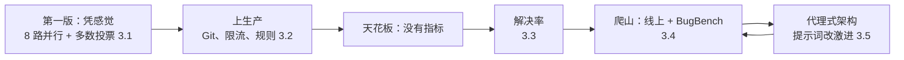

# 怎么知道 AI 审查机器人真的有用：Cursor 用“解决率”把 Bugbot 从 52% 爬到 70%

Cursor

**一句话看懂**：做 PR 审查机器人，最难的不是让它报 bug，而是知道它报得好不好。Cursor 的 Bugbot 第一版靠 8 次并行审查加多数投票压误报，凭感觉调到能上线；真正的转折是发明了一个指标——**解决率**：PR 合并时，机器人报出的 bug 里有多少被作者在最终代码里修掉了。有了它才能“爬山”：40 次主要实验把解决率从 52% 提到 70% 以上。最大的一次提升来自改成**代理式架构**，而这时提示词的方向反过来了：以前要压着模型少报，现在模型太谨慎，要鼓励它多报。

## 读完你能带走的 6 条收获

1. **没有指标时，可以用“多次独立审查 + 多数投票”压误报**：同一个 diff 打乱顺序跑 8 遍，只留多数次都发现的问题（见 3.1）。
2. **团队特有的规矩，比如不安全的数据库迁移，写成可配置的规则**，不要硬编码进系统（见 3.2）。
3. **衡量审查机器人，别看点赞点踩，看作者有没有真的改。** “解决率”直接回答了它有没有发现工程师愿意修的真问题（见 3.3）。
4. **有了指标再迭代，会发现很多“好主意”其实让效果变差。** 要线上指标和离线基准一起看（见 3.4）。
5. **换成代理式架构后，取舍方向可能反转**：固定流程时要压着模型少报，代理式时模型反而太谨慎，要鼓励它多报（见 3.5）。
6. **代理式审查器的行为很大程度由工具决定**：工具设计的小改动，对结果影响很大；上下文可以让它运行时自己取（见 3.5）。

::: tip 小白先懂这几个词
- [Bugbot](/glossary#bugbot)：Cursor 的 PR 代码审查代理，自动检查逻辑错误、性能问题和安全漏洞。
- [Resolution Rate（解决率）](/glossary#resolution-rate)：机器人报出的 bug 中，在 PR 合并时已被作者修复的比例。
- [Majority Voting（多数投票）](/glossary#majority-voting)：多次独立运行，只保留多数次都发现的结果。
- [Hill-climbing（爬山式迭代）](/glossary#hill-climbing)：有了一个可靠的指标后，每次小改动都用指标检验，变好就保留。
- [Benchmark（基准测试）](/glossary#benchmark)：固定的测试集，用于比较不同版本的效果。
:::

## 1. 基本信息

<SourceCard type="文章" title="Building a better Bugbot" author="Jon Kaplan（Cursor）" date="2026-01-15" url="https://cursor.com/blog/building-bugbot" />

| 项目 | 内容 |
|---|---|
| 链接 | https://cursor.com/blog/building-bugbot |
| 类型 | 公司研究博客（文章，约 1,200 词） |
| 作者 | Jon Kaplan |
| 发布日期 | 2026-01-15 |
| 使用工具 | Cursor Bugbot（GitHub PR 审查）、Bugbot rules、Bugbot Autofix（Beta） |
| 分析依据 | Cursor 官方博客全文，2026-10-14 用 curl 重新抓取并逐字核对引语。文中所有数字均来自原文，为 Cursor 自报；BugBench 和 40 次实验的细节未公开。“我觉得”开头的段落是本站评论。 |

## 2. 这篇在回答什么

你的团队接了一个 AI 审查机器人。一个月后，有人说它挺有用，有人说它净报废话。到底该信谁？评论下面的点赞点踩？还是哪位工程师的一句“我觉得它最近变好了”？

Cursor 做 Bugbot 时也卡在这里。他们一开始全靠感觉：

<Trans zh="如果某种配置看起来误报更少，我们就采用它。">“If it seemed one configuration had fewer false positives, we adopted it.”</Trans>

这样确实做出了一个能上线的版本，但很快遇到天花板：

::: tr 没有衡量进展的指标，我们就无法定量评估 Bugbot 在真实环境中的表现，这给我们能把它推多远设了上限。
> "Without a metric to measure progress, we couldn't quantitatively assess Bugbot's performance in the wild, and that put a ceiling on how far we could push it."
:::

后来的结果是这样的：上线以来跑了 40 次主要实验，解决率从 52% 提到 70% 以上，平均每次审查标记的 bug 从 0.4 个涨到 0.7 个，每个 PR 被解决的 bug 从约 0.2 个涨到约 0.5 个，翻了一倍多。版本 1 在 2025 年 7 月发布，版本 11 在 2026 年 1 月。

全文顺着这条路回答五个问题：

1. 没有指标时，怎么先把误报压下来？（3.1）
2. 上生产还要补哪些工程？（3.2）
3. 审查机器人到底该怎么衡量？（3.3）
4. 有了指标，怎么迭代？（3.4）
5. 架构换成代理式之后，什么变了？（3.5）

## 3. 怎么做

### 3.1 第一版：多次并行审查 + 多数投票

最早尝试做审查代理时，模型还不够强，审查没什么用。模型变强后，他们试了各种模型、流水线、过滤器和上下文管理方式，边做边问内部工程师的感受。

早期最有效的一招是**多次并行审查 + 多数投票**。每一路审查拿到的 diff 顺序都不同，这会把模型推向不同的推理路线。如果几路都独立报了同一个问题，就更可能是真 bug。

经过几周内部的定性迭代，上线的版本是这样一条流水线（原文七步）：

1. 跑 8 路并行审查，每路随机打乱 diff 顺序；
2. 把相似的 bug 归到同一个桶；
3. 多数投票，滤掉只在一路里出现的 bug；
4. 把每个桶合并成一条清晰的描述；
5. 过滤不想要的类别，比如编译器警告、文档错误；
6. 用一个验证模型再筛一遍误报；
7. 和之前几次运行已经发过的 bug 去重。

为什么打乱 diff 顺序有用？因为模型读代码有位置偏好，顺序不同，注意力就会落在不同地方。多路结果重合的部分，才是“不管怎么读都会发现”的问题。

### 3.2 上生产：工程基础 + 团队自定义规则

能用和好用之间还隔着一堆工程。为了让 Bugbot 在实际中跑得动，他们：

- 用 Rust 重写了 Git 集成，让仓库访问又快又稳，并尽量少拉数据；
- 加了限流监控、请求批处理和基于代理的基础设施，在 GitHub 的限制下运行。

用的团队多了，又出现一个需求：每个代码库都有自己的规矩，比如<Trans zh="不安全的迁移、内部 API 的错误用法">“unsafe migrations or incorrect use of internal APIs”</Trans>。他们加了 Bugbot rules，让团队自己写这些检查，而不是把它们硬编码进系统。

### 3.3 衡量真正重要的东西：解决率

这是全文的核心。他们设计的指标叫**解决率**：

<Trans zh="它在 PR 合并时，用 AI 判断哪些 bug 真的被作者在最终代码里解决了。">“It uses AI to determine, at PR merge time, which bugs were actually resolved by the author in the final code.”</Trans>

这个指标本身也要验证。开发时，他们和 PR 作者一起抽查了每个例子，发现 LLM 几乎全部判对了“解决了”还是“没解决”。原文没有给出具体的准确率数字。

为什么不用点赞点踩？作者的回答是：

<Trans zh="对评估效果的团队来说，它比轶事反馈或评论上的表情反应清楚得多。">“For teams evaluating effectiveness, it's a much clearer signal than anecdotal feedback or reactions on comments.”</Trans>

道理很简单。点个赞很便宜，改代码很贵。作者愿意改代码，才说明这条意见真的有用。现在 Bugbot 的仪表板上就突出显示这个指标。

我觉得解决率也有它的盲区：作者改了，不等于那里真有 bug；作者没改，也可能是他错了。它衡量的是“工程师愿意采纳”，而不是“问题真实存在”。不过在审查这件事上，前者本来就是最终目标。

### 3.4 有了指标，才能“爬山”

有了解决率，他们第一次可以<Trans zh="基于真实信号而不是感觉来爬山">“hill-climb on the basis of real signal, rather than just feel.”</Trans>。

评估分两头：

- **线上**：看真实的解决率；
- **离线**：用 BugBench，一个由人工标注 bug 的真实代码 diff 组成的基准。

他们在模型、提示词、迭代次数、验证器、上下文管理、类别过滤、代理式设计等方向做了几十次实验。结果出乎意料：

<Trans zh="很多改动出人意料地让我们的指标退步了。">“Many changes, surprisingly, regressed our metrics.”</Trans>

也就是说，早期凭感觉做的很多判断其实是对的。这本身就是指标的价值：它告诉你哪些“看起来更好”的改动应该丢掉。

### 3.5 改成代理式架构：提示词从“克制”变“激进”

最大的提升来自原文所说的“今年秋天”（按发布时间推算是 2025 年秋），他们把 Bugbot 改成了完全代理式的设计：代理可以推理 diff、调用工具，自己决定在哪里深挖，而不是走固定的几路审查。

这逼着他们重新思考提示词：

::: tr 早期版本里，我们要约束模型以减少误报。但用代理式方法时，我们遇到了相反的问题：它太谨慎了。
> "With earlier versions of Bugbot we needed to restrain the models to minimize false positives. But with the agentic approach we encountered the opposite problem: it was too cautious."
:::

于是他们改用激进的提示词，鼓励代理调查每一个可疑的模式，宁可多报也不要漏报。

代理式架构还打开了两个新的实验方向：

- **静态上下文改成动态上下文**。他们减少预先塞给模型的上下文，观察它怎么适应。结果模型总能在运行时自己拉取需要的额外上下文，不必事先全部提供。
- **迭代工具本身**。模型的行为由它能调用的工具决定，工具设计或可用性的小改动都会对结果产生很大影响。他们反复调整这套接口，直到模型行为稳定符合预期。

我觉得这一节最值得记住的是：“精确率优先”还是“宁可多报”不是一个固定的信条。OpenAI 的审查器选择精确率优先（[[31§3.1]]），Cursor 在固定流程时也是这么做的；但换成代理式架构后，同一个团队要往反方向纠偏。能告诉你该往哪边调的，只有指标。

## 4. 结果与局限

| 项目 | 原文数字（Cursor 自报） |
|---|---|
| 主要实验次数 | 40 次 |
| 解决率 | 52% → 70% 以上 |
| 每次运行标记的 bug | 0.4 → 0.7 个 |
| 每个 PR 解决的 bug | 约 0.2 → 约 0.5 个 |
| 版本 | V1（2025-07）→ V11（2026-01）；新版本报得更多，误报没有相应增加 |
| 规模 | 每月审查超过 200 万个 PR；Cursor 内部所有代码都跑 Bugbot |

接下来的方向：Bugbot Autofix（Beta）会自动启动一个 Cloud Agent 修复审查发现的 bug；之后要让 Bugbot 运行代码验证自己的报告，遇到复杂问题时做深度研究，还在试一个持续扫描代码库、不等 PR 的常驻版本。

::: warning 局限与注意
- 解决率衡量的是作者有没有改，不等于问题真实存在；“LLM 几乎全部判对”没有给出具体数字。
- BugBench 没有公开，40 次实验的具体内容和每次的效果也没有公开。
- “误报没有相应增加”没有给误报率数字。
- 文章是 Cursor 的产品博客，客户名单和结尾的试用链接属推广内容。
:::

## 5. 结论

这篇最值得带走的不是 Bugbot 本身，而是做 AI 审查的方法：**先找到一个和最终目标对齐的指标，再做实验**。对审查机器人来说，最终目标是工程师真的去修，所以“解决率”比点赞点踩可信得多。

我觉得第二条值得带走的是：架构变了，取舍方向可能跟着反过来。不要把“少报”或“多报”当成原则，要让数据告诉你。

### 你可以这样试

- [ ] 拿你的 AI 审查工具最近 20 个 PR，手工数一下：它报了几条，合并时作者改了几条。这就是你自己的解决率。
- [ ] 如果误报太多，试一次“同一个 PR 跑 3 遍，只看至少 2 遍都报了的问题”，对比采纳率。
- [ ] 把团队里口头传的审查规矩（比如“迁移不能删列”）写成审查工具能读的规则。

### 读完自测

1. Bugbot 第一版的七步流水线里，哪几步是用来压误报的？
2. 解决率怎么算？为什么作者认为它比表情反应好？
3. 有了指标以后，他们发现了什么出人意料的事？
4. 改成代理式架构后，提示词为什么要从“克制”改成“激进”？
