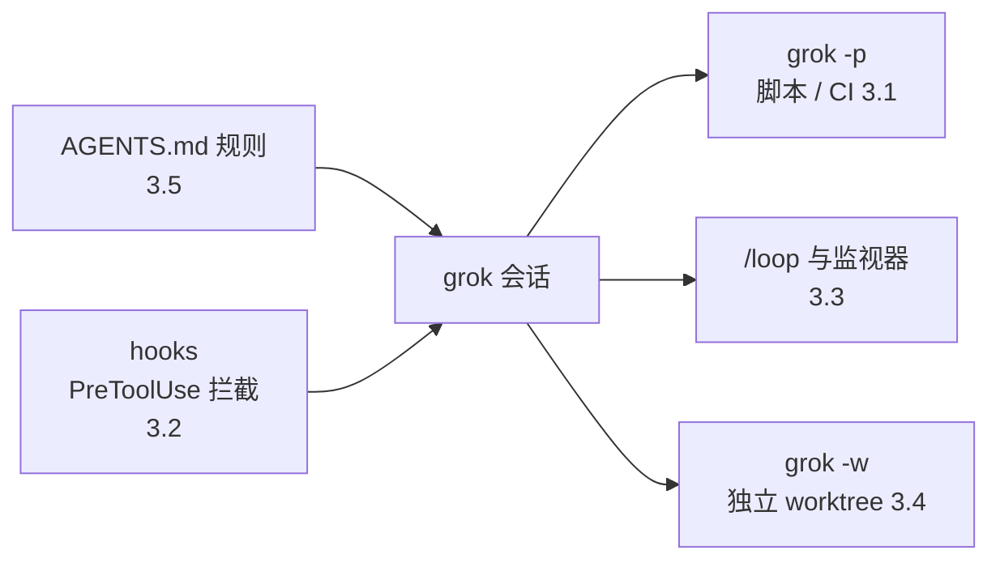

# 让 Grok Build 跑进脚本和 CI：headless、hooks、/loop 与 worktree 的边界

<div class="meta-tags"><span class="tool-tag tool-grokbuild">Grok Build</span></div>

<div class="hook">

**一句话看懂**：想让 Grok Build 在没人盯着的时候干活，官方文档给了五块积木：`grok -p` 在脚本和 CI 里跑一次就退出；hooks 在工具调用前拦下危险命令；`/loop` 定时重复一个提示词；`grok -w` 让每个代理在独立的 worktree 里工作；`AGENTS.md` 让规则每次会话自动生效。它还刻意兼容 Claude Code 和 Cursor 的 hook 文件和规则文件。但要记住一条：**hook 自己出错时是放行的**，只有明确的拒绝才会拦截。

</div>

## 读完你能带走的 6 条收获

1. **脚本和 CI 里用 `grok -p ... --output-format json`，再加 `--no-auto-update`**，避免后台更新检查干扰自动化（见 3.1）。
2. **hook 是“故障放行”的**：超时、崩溃、输出格式错误，工具调用都会照常执行。关键的安全检查不能只靠 hook（见 3.2）。
3. **只有 `PreToolUse` 能拦截**，其他事件只能记录和通知；拦截写退出码 2，或输出 `{"decision": "deny"}`（见 3.2）。
4. **项目里的 hook 要先信任才会运行**，信任决定同时覆盖项目的 MCP 和 LSP；打开陌生仓库前先看 `.grok/hooks/` 和 `.claude/settings.json`（见 3.2）。
5. **`/loop` 适合定时检查，监视器适合实时日志**；监视器脚本要筛选输出，否则每一行都会打断对话（见 3.3）。
6. **并行代理放进 worktree，规则写进 `AGENTS.md`**；用 `grok inspect` 确认它到底读了哪些规则文件（见 3.4、3.5）。

::: tip 小白先懂这几个词
- [Grok Build](/glossary#grok-build)：xAI 的终端编码代理（命令是 `grok`）。
- [Headless（无界面模式）](/glossary#headless)：不打开交互界面，一条命令跑完就退出，适合脚本和 CI。
- [Hooks（钩子）](/glossary#hooks)：在代理生命周期的固定时刻自动运行的脚本。
- [Fail-open（故障放行）](/glossary#fail-open)：检查程序自己出错时，默认放行而不是拦截。
- [ACP（Agent Client Protocol）](/glossary#acp)：编辑器和编码代理之间通信的协议，让 IDE 能把代理当作后端来调用。
- [Git Worktree](/glossary#worktree)：同一个仓库检出多个工作目录，每个目录一个分支，互不干扰。
:::

## 1. 基本信息

<SourceCard type="官方文档" title="Hooks" author="xAI · Grok Build 文档（另含 Headless & Scripting、AGENTS.md、Background Tasks、Worktrees 等页）" date="持续更新的文档页（抓取于 2026-10-14）" url="https://docs.x.ai/build/features/hooks" />

| 项目 | 内容 |
|---|---|
| Hooks | https://docs.x.ai/build/features/hooks |
| Headless & Scripting | https://docs.x.ai/build/cli/headless-scripting |
| AGENTS.md（项目规则） | https://docs.x.ai/build/features/project-rules |
| Background Tasks | https://docs.x.ai/build/features/background-tasks |
| Worktrees / Subagents | https://docs.x.ai/build/features/worktrees ／ https://docs.x.ai/build/features/subagents |
| 类型 | 官方产品文档 |
| 作者 | xAI |
| 使用工具 | Grok Build CLI（`grok`） |
| 分析依据 | xAI 官方 Grok Build 文档的六个页面：Hooks、Headless & Scripting、AGENTS.md 项目规则、Background Tasks、Worktrees、Subagents。2026-10-14 重新抓取 Markdown 版全文（合计约 1.4 万字符）并逐字核对。文档持续更新，命令和参数以官方页面为准。配置和命令均为原文摘录。文档没有效果数据。“我觉得”开头的段落是本站评论，不是官方观点。 |

## 2. 这篇在回答什么

你在终端里用 Grok Build 用顺手了，接下来自然会想：能不能让它每天早上自己跑一遍测试？能不能放进 CI，失败时给出总结？团队的规则和安全检查，能不能不靠每个人每次提醒？

这几页官方文档回答的就是“怎样让它无人值守地跑”。我把内容归成五个问题：

1. 怎样在脚本、CI 或者自己的程序里调用它？（3.1）
2. 怎样在它执行危险命令之前拦下来？拦不住的时候会怎样？（3.2）
3. 怎样让一个任务定时重复，或者盯着一个日志？（3.3）
4. 多个代理同时改一个仓库，怎样不互相覆盖？（3.4）
5. 团队规则写在哪，它到底读了哪些文件？（3.5）



## 3. 怎么做

### 3.1 Headless：在脚本和 CI 里跑一次

最基本的用法就是一行：

```bash
grok -p "Your prompt here"
```

常用参数：

| 参数 | 作用 |
|---|---|
| `-p, --single <PROMPT>` | 发一个提示词，跑完退出 |
| `-m, --model <MODEL>` | 选模型 |
| `-s, --session-id <ID>` | 创建或恢复一个命名的 headless 会话 |
| `-r, --resume <ID>` / `-c, --continue` | 恢复指定会话 / 继续当前目录最近一次会话 |
| `--cwd <PATH>` | 设定工作目录 |
| `--output-format <FMT>` | `plain`（给人看）、`json`（结束时一个 JSON 对象）、`streaming-json`（逐行 JSON 事件） |
| `--always-approve` | 自动批准所有工具调用 |
| `--no-alt-screen` | 不接管整个终端，直接内联输出 |

headless 会话保存在 `~/.grok/sessions`，所以可以做“两段式”任务：第一次 `-s nightly` 分析，第二次 `-r nightly` 接着修。

**CI 里加 `--no-auto-update`。** 文档专门提了：在脚本、CI 这类自动化环境里用 `-p` 或 ACP 时，传 `--no-auto-update`（比如 `grok --no-auto-update -p "..."`）跳过后台更新检查；也可以在 `~/.grok/config.toml` 的 `[cli]` 下设 `auto_update = false` 永久关掉。

```bash
grok -p "List TODO comments" --output-format json
grok -p "Explain the architecture" --output-format streaming-json
```

**ACP：给编辑器和自己的程序用。** 如果你要的不是一次性命令，而是把 Grok 当成一个后端集成进 IDE 或工具，用 `grok agent stdio`。它通过 stdin/stdout 上的 JSON-RPC 说 ACP 协议。文档给了一个完整的 Node 脚本，流程是 `initialize` → `authenticate` → `session/new` → `session/prompt`。有一个容易踩的点：<Trans zh="session/prompt 返回的是完成元数据，助手的文字本身是以 session/update 块的形式到达的。">“`session/prompt` returns completion metadata; the assistant text itself arrives as `session/update` chunks.”</Trans> 所以你的客户端要自己拼接 `agent_message_chunk` 里的文字。

对照 Codex：它的同类命令是 `codex exec`，默认只读沙箱（[[22§3.1]]）。Grok Build 这边，“要不要自动批准”是由 `--always-approve` 显式打开的。我觉得在 CI 里用 `--always-approve` 时，应该把 runner 本身当成沙箱：不放生产凭据，权限尽量小。

### 3.2 Hooks：在工具调用前拦下危险命令

hook 是一个 shell 命令或 HTTP 端点，Grok 在生命周期的某个事件发生时调用它。用途包括：执行前拦下危险命令、记录工具使用、编辑后跑格式化、回合结束时发通知。

**写在哪。** hook 是 JSON 文件：个人的放 `~/.grok/hooks/*.json`，项目的放 `<project>/.grok/hooks/*.json`。最省事的一点是兼容：

::: tr Claude Code（.claude/settings.json）和 Cursor（.cursor/hooks.json）的 hook 文件也会被读取，包括 Cursor 的驼峰式事件名。
> "Claude Code (`.claude/settings.json`) and Cursor (`.cursor/hooks.json`) hook files are read as well, including Cursor's camelCase event names."
:::

一个最小配置（原文）：

::: tr 在 Bash 工具执行前运行 bin/safety-check.sh，超时 10 秒。
```json
{
  "hooks": {
    "PreToolUse": [
      {
        "matcher": "Bash",
        "hooks": [{ "type": "command", "command": "bin/safety-check.sh", "timeout": 10 }]
      }
    ]
  }
}
```
:::

`matcher` 是对工具名的正则（`Bash`、`Read`、`Edit` 这些 Claude 的工具名会自动映射），省略就匹配全部；`type` 是 `command` 或 `http`（POST 到 `url`）；`timeout` 单位是秒，**默认 5 秒**。

**项目 hook 要先信任。** 第一次打开带 hook 的仓库，要用 `/hooks-trust` 或启动时加 `--trust` 授权。这个决定存在 `~/.grok/trusted_folders.toml`，而且**同时覆盖项目的 MCP 和 LSP 服务器**。我觉得这正是兼容读取的另一面：别人仓库里的 `.claude/settings.json` 你可能从没细看过，一旦信任，里面的命令也会在你机器上跑。

**事件。** 一共十几个：`SessionStart` / `SessionEnd`、`UserPromptSubmit`、`PreToolUse`、`PostToolUse` / `PostToolUseFailure`、`PermissionDenied`、`Stop` / `StopFailure`、`Notification`、`SubagentStart` / `SubagentStop`、`PreCompact` / `PostCompact`。其中只有一个能拦截：<Trans zh="某个工具即将运行——唯一的阻断事件">“A tool is about to run — the only blocking event”</Trans>，也就是 `PreToolUse`。

**脚本怎么写。** 事件以 JSON 从 stdin 传入，带 `hookEventName`、`sessionId`、`cwd`、`workspaceRoot`，工具事件还有 `toolName` 和 `toolInput`；环境变量里有 `GROK_HOOK_EVENT`、`GROK_HOOK_NAME`、`GROK_SESSION_ID`、`GROK_WORKSPACE_ROOT`。`PreToolUse` 的 hook 可以往 stdout 写：

```json
{ "decision": "deny", "reason": "Unsafe command detected" }
```

**最关键的一条：故障放行。**

::: tr 退出码 0 放行，退出码 2 拒绝。其他一切——超时、崩溃、格式错误的输出——都是故障放行：失败会记录在会话里，但工具调用照常执行。只有明确的 deny 才会拦截。
> "Exit code 0 allows, exit code 2 denies. Everything else — timeouts, crashes, malformed output — is fail-open: the failure is recorded in the session but the tool call proceeds. Only an explicit `deny` blocks."
:::

这意味着什么？假设你的 `safety-check.sh` 要调一个远程服务判断命令是否安全，某天这个服务慢了 6 秒，超过默认的 5 秒超时，那条命令就**直接放行了**。Claude Code 也类似，只有退出码 2 或明确的拒绝决定才拦截（[[28§3.3]]）。

我觉得结论很清楚：hook 适合做“大多数时候拦住手滑”的护栏，不适合做唯一的安全边界。真正不能出事的检查，要在 CI、沙箱或权限层再做一道；hook 脚本本身要快、要简单、尽量不依赖网络。

### 3.3 /loop 与监视器：定时重复和实时盯日志

Grok 可以在对话继续的同时，在后台跑命令、子代理和监视器。几个快捷键：`Ctrl+G` 打开任务面板，`/tasks` 看一份快照，`Ctrl+B` 把正在前台跑的命令转到后台。代理自己也会把开发服务器、构建这类长命令放到后台。

**定时提示词 `/loop`：**

```text
/loop 5m Check if the test suite passes and report any failures
```

规则：间隔可以写 `Ns`（最少 60 秒）、`Nm`、`Nh`、`Nd`；提示词**立即触发一次**，然后按间隔重复，每次都是一个新的代理回合；loop **7 天后过期**，同时最多 50 个定时任务。

**监视器：** 要盯的是实时事件流而不是定期检查时，代理可以把一个监视器挂到脚本上，脚本每打印一行，就变成对话里的一条通知。比如“盯着部署日志，有错误就告诉我”。文档的提醒是：<Trans zh="监视器脚本要有选择性——每一行输出都会打断对话。">“Keep monitor scripts selective — every output line interrupts the conversation.”</Trans> 所以给它的应该是 `tail -f deploy.log | grep -i error`，而不是整份日志。

另外，回合进行中提交的提示词会排队而不会丢掉，`Ctrl+;` 打开队列面板，`/queue` 列出来。

我觉得 `/loop` 的定位是“会话里的定时器”，不是 cron：它活在会话里，7 天过期。要长期、可靠地定时跑，还是用系统的定时任务或 CI 去调 `grok -p`。

### 3.4 Worktree 与子代理：并行时互不覆盖

worktree 会话跑在仓库的一个隔离副本里，并行的代理不会覆盖彼此的文件。几个事实：

- 需要 git 仓库，副本放在 `~/.grok/worktrees/<repo>/<name>`；
- **从当前 HEAD 开始，包括未提交的改动**；
- 它是真正的 git 检出，detached 在起点提交上，用普通的 git 操作把改动落地。

```bash
grok -w
grok --worktree=feat "refactor module X" # = keeps the prompt out of the name
grok -w --ref main "fix the flaky test"  # clean checkout of the ref
grok -w -r <session-id>                  # resume in a fresh worktree
```

注意第三行：如果你不想把本地没提交的改动带进去，用 `--ref main` 从干净的分支开始。界面里还有 `/fork --worktree`（把当前会话分叉到 worktree）和 `Ctrl+W`。

**worktree 不会自动清理。** 结束或删除会话，worktree 都还在；`gc` 只在你手动调用时运行。清理命令：`grok worktree list`、`grok worktree show <id>`、`grok worktree rm <ids...>`（可加 `--dry-run`）、`grok worktree gc --max-age 7d`（同时清掉没被进程占用的闲置 worktree）。

**子代理** 是有独立上下文的子会话，完成后把摘要交回父会话；父会话分派并行工作时，子代理也可以申请 worktree 隔离。内置三种：`general-purpose`（完整能力）、`explore`（只读、只搜索，不能跑 shell、不能改文件）、`plan`（只写实现计划）。自定义类型放 `.grok/agents/` 或 `~/.grok/agents/`。personas 只是行为覆盖层（语气、关注点、约定），不改能力。

### 3.5 规则文件：AGENTS.md，也读 CLAUDE.md

项目规则是 Grok 每次会话都会载入上下文的 Markdown 文件。编码约定、构建和测试命令、架构说明，写进仓库根目录的 `AGENTS.md`，就不用每次会话再说一遍。

**加载顺序**：先读 `~/.grok/` 的全局规则，再读从仓库根到当前工作目录的每一层目录（不在 git 仓库里就只读当前目录）；冲突时**越深的文件优先**。

每一层目录里，它会读 `AGENTS.md`、`Agents.md`、`AGENT.md`、`CLAUDE.md`、`Claude.md`、`CLAUDE.local.md`，以及 `.grok/rules/` 里的每个 `*.md`（为了兼容，也读 `.claude/rules/` 和 `.cursor/rules/`）。被 `.gitignore` 忽略的文件会跳过，所以 `CLAUDE.local.md` 这类个人覆盖不会混进共享上下文。

monorepo 可以每个包一份：

```text
my-monorepo/
  AGENTS.md                # repo-wide rules
  packages/
    frontend/AGENTS.md     # "Use React. Prefer CSS modules."
    backend/AGENTS.md      # "Use Express. Follow REST conventions."
```

文档有一句值得记住：<Trans zh="文件全文加载，没有大小上限；简短、具体的指令比长指令更能被可靠地遵守。">“Files are loaded in full, with no size cap; short, specific instructions are followed more reliably than long ones.”</Trans>

只想对一次运行加规则，用 `--rules "..."`（追加到系统提示词），或 `--system-prompt-override`（整个替换）。不确定它读了哪些文件，就跑：

```bash
grok inspect
```

它会列出找到的每个规则文件，带路径和大概的 token 数。我觉得这是排查“它为什么不按规矩来”的第一步：先确认规则文件真的被读到了，再去改措辞。

## 4. 结果与局限

这是产品文档，没有效果数据。它交付的是一组可以组合的能力：

| 想做的事 | 用什么 | 关键边界 |
|---|---|---|
| 脚本 / CI 里跑一次 | `grok -p ... --output-format json` | 加 `--no-auto-update`；`--always-approve` 要配合隔离环境 |
| 集成进编辑器或程序 | `grok agent stdio`（ACP） | 回答文字从 `session/update` 块里拼 |
| 执行前拦截 | `PreToolUse` hook | 只有它能拦；超时（默认 5 秒）、崩溃都放行 |
| 定时重复 | `/loop 5m ...` | 最短 60 秒，7 天过期，最多 50 个 |
| 并行不冲突 | `grok -w` | 包含未提交改动；不自动清理 |
| 团队规则 | `AGENTS.md` | 越深越优先；`grok inspect` 核对 |

::: warning 局限与注意
- **hook 故障放行**：最需要警惕的一条。依赖网络或较慢的检查脚本，超时就等于没拦。
- **兼容读取有两面**：Claude Code、Cursor 的 hook 和规则文件都会被读取，迁移方便，但打开陌生仓库并信任后，里面的 hook 也会运行。
- **`/loop` 不是可靠的定时任务**：它随会话存在，7 天过期。
- **worktree 包含未提交改动**，有时这不是你想要的，用 `--ref` 指定干净起点。
- 文档在持续更新，参数和事件名以官方页面为准。
:::

## 5. 结论

Grok Build 的自动化能力不新奇：headless、hooks、定时任务、worktree、规则文件，几家主流代理都有。它的特点是**刻意兼容**：直接读取 Claude Code 和 Cursor 的 hook 文件，直接读 `CLAUDE.md` 和 `.cursor/rules/`。如果团队里几种工具混用，一份配置可以三家共享。

但把它放进无人值守的流程之前，要记住一个默认值：**hook 出错就放行**。所以 hook 用来挡手滑，CI、沙箱和权限才是真正的边界。

### 你可以这样试

- [ ] 在 CI 里加一步：`grok --no-auto-update -p "summarize failing tests" --output-format json`，把结果作为 artifact 保存。
- [ ] 写一个 `PreToolUse` hook，拦截 `rm -rf` 和 `git push --force`，然后故意让脚本 `sleep 6`，确认超时时它确实放行了。
- [ ] 跑一次 `grok inspect`，看看它读到了哪些规则文件，有没有你不知道的 `CLAUDE.md`。
- [ ] 用 `grok -w --ref main "..."` 开两个并行任务，完成后用 `grok worktree list` 和 `rm` 清理。

::: details 读完自测（点开看答案）
1. **哪个事件能拦截工具调用？** 只有 `PreToolUse`。
2. **hook 脚本超时了会怎样？** 故障放行：记录在会话里，工具调用照常执行。默认超时 5 秒。
3. **`/loop` 最短间隔和有效期是多少？** 最短 60 秒，7 天后过期。
4. **两个目录里的 `AGENTS.md` 冲突时，听谁的？** 离工作目录更近（更深）的那份。
:::
