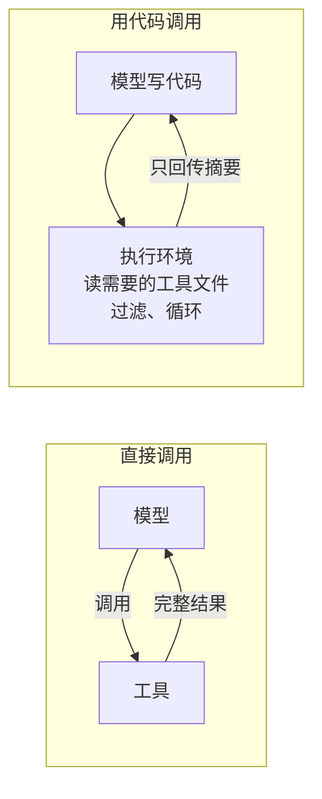

# 工具太多把上下文撑爆怎么办：Anthropic 的“用代码调用 MCP”

<div class="meta-tags"><span class="tool-tag tool-general">通用（不限工具）</span></div>

<div class="hook">

**一句话看懂**：代理接的 MCP 工具越多，就越慢、越贵，因为两样东西都在吃上下文：**所有工具的定义一开始就全塞进去**，以及**每次调用的中间结果都要经过模型**。Anthropic 的办法是把 MCP 服务器包装成文件系统里的代码 API，让代理写代码去调用：用到哪个工具才读哪个文件，大数据在代码里过滤完再给模型看。文中的例子把 token 用量从 15 万降到 2,000，减少 98.7%。代价是你得有一个安全的代码执行沙箱。

</div>

## 读完你能带走的 6 条收获

1. **工具多了变慢变贵，有两个原因**：定义全部预先加载；中间结果穿过模型，有时还要穿两次（见 3.1、3.2）。
2. **把工具做成文件，代理按需读取。** 先列目录，再只读要用的那几个文件，这就是渐进披露（见 3.3、3.4）。
3. **大数据在代码里处理完再交给模型**：一万行的表，模型只需要看 5 行和一个总数（见 3.4）。
4. **循环、条件、轮询写成代码**，比让模型一轮一轮地调工具再 sleep 更省，也更快（见 3.4）。
5. **敏感数据可以完全不经过模型**：留在执行环境里，或者由客户端替换成占位符再还原（见 3.4）。
6. **代价是要有沙箱、资源限制和监控。** 工具少、数据小的时候，直接调用更简单（见 3.5、第 4 节）。

::: tip 小白先懂这几个词
- [MCP](/glossary#mcp)：Model Context Protocol，让代理接入外部工具和数据的开放标准。
- [Tool Call（工具调用）](/glossary#tool-call)：模型输出一段结构化请求，由 harness 去执行对应的工具，再把结果交回模型。
- [Code Execution with MCP / Code Mode](/glossary#code-execution-mcp)：把 MCP 工具包装成代码 API，让代理写代码调用，而不是逐个直接调用工具。
- [Progressive Disclosure（渐进披露）](/glossary#progressive-disclosure)：先只给目录和摘要，需要时再加载细节。
- [Sandbox（沙箱）](/glossary#sandbox)：隔离的执行环境，限制代码能访问的文件、网络和资源。
:::

## 1. 基本信息

<SourceCard type="文章" title="Code execution with MCP: Building more efficient agents" author="Adam Jones、Conor Kelly（Anthropic）" date="2025-11-04" url="https://www.anthropic.com/engineering/code-execution-with-mcp" />

| 项目 | 内容 |
|---|---|
| 链接 | https://www.anthropic.com/engineering/code-execution-with-mcp |
| 类型 | 公司工程博客（文章） |
| 作者 | Adam Jones、Conor Kelly |
| 发布日期 | 2025-11-04 |
| 适用范围 | 任何支持 MCP 且有代码执行环境的代理（文中示例为 TypeScript） |
| 分析依据 | Anthropic Engineering 博客《Code execution with MCP: Building more efficient agents》全文，2026-10-14 重新抓取并逐字核对。文中数字和代码均为原文摘录；98.7% 来自文中单个示例，不是基准测试。“我觉得”开头的段落是本站评论，不是作者观点。 |

## 2. 这篇在回答什么

假设你给代理接了 Google Drive、Salesforce、Slack、GitHub 等十几个 MCP 服务器，加起来几百个工具。然后让它做一件很简单的事：

> "Download my meeting transcript from Google Drive and attach it to the Salesforce lead."

它会变得又慢又贵。为什么？作者给了两个原因：

::: tr 随着连接的工具增多，一开始就加载所有工具定义、并让中间结果穿过上下文窗口，会拖慢代理并增加成本。
> "However, as the number of connected tools grows, loading all tool definitions upfront and passing intermediate results through the context window slows down agents and increases costs."
:::

这篇文章回答三个问题：

1. 工具多了，上下文具体被什么吃掉？（3.1、3.2）
2. 用代码调用 MCP，具体怎么做？（3.3）
3. 这样做有什么好处，又要付出什么？（3.4、3.5）



## 3. 怎么做

### 3.1 问题一：工具定义一次性塞满上下文

大多数 MCP 客户端会把**所有**工具的定义一开始就放进上下文。一个定义大概长这样：

```text
gdrive.getDocument
     Description: Retrieves a document from Google Drive
     Parameters:
                documentId (required, string): The ID of the document to retrieve
                fields (optional, string): Specific fields to return
     Returns: Document object with title, body content, metadata, permissions, etc.
```

一个定义不长，但乘以几百上千就不一样了：

::: tr 当代理连接了数千个工具时，它在读到请求之前，就要先处理几十万个 token。
> "In cases where agents are connected to thousands of tools, they’ll need to process hundreds of thousands of tokens before reading a request."
:::

也就是说，用户的问题还没看到，上下文已经用掉一大块，每次请求都要为这些定义付钱、等时间。

### 3.2 问题二：中间结果要经过模型两次

第二个问题更隐蔽。直接调用工具时，每个结果都要回到模型那里，模型再决定下一步：

```text
TOOL CALL: gdrive.getDocument(documentId: "abc123")
        → returns "Discussed Q4 goals...\n[full transcript text]"
           (loaded into model context)
TOOL CALL: salesforce.updateRecord(
			objectType: "SalesMeeting",
			recordId: "00Q5f000001abcXYZ",
  			data: { "Notes": "Discussed Q4 goals...\n[full transcript text written out]" }
		)
		(model needs to write entire transcript into context again)
```

会议记录先作为结果读进来一次，又作为参数写出去一次。作者算了一笔账：一场 2 小时的销售会议，可能要多处理 5 万个 token；文档再大一点，可能直接超出上下文窗口，整个流程就断了。

还有一个准确性问题：<Trans zh="面对大文档或复杂数据结构时，模型在工具调用之间复制数据更容易出错。">“With large documents or complex data structures, models may be more likely to make mistakes when copying data between tool calls.”</Trans> 模型“抄写”几万字，本来就不是它该干的活。

### 3.3 方案：把 MCP 服务器变成文件树

现在很多代理都有代码执行环境，于是作者的思路是：**别让模型直接调工具，而是把 MCP 服务器呈现成代码 API，让模型写代码去调。**

实现方式有很多，文中给的一种是：为所有已连接的 MCP 服务器生成一棵文件树。

```text
servers
├── google-drive
│   ├── getDocument.ts
│   ├── ... (other tools)
│   └── index.ts
├── salesforce
│   ├── updateRecord.ts
│   ├── ... (other tools)
│   └── index.ts
└── ... (other servers)
```

每个工具一个文件，文件里是一个很薄的包装函数：

::: tr 每个工具对应一个文件：声明输入输出类型，内部调用 callMCPTool 转发给真正的 MCP 工具。
```ts
// ./servers/google-drive/getDocument.ts
import { callMCPTool } from "../../../client.js";

interface GetDocumentInput {
  documentId: string;
}

interface GetDocumentResponse {
  content: string;
}

/* Read a document from Google Drive */
export async function getDocument(input: GetDocumentInput): Promise<GetDocumentResponse> {
  return callMCPTool<GetDocumentResponse>('google_drive__get_document', input);
}
```
:::

开头那个“从 Drive 取会议记录、写进 Salesforce”的任务，就变成了几行代码：

```ts
// Read transcript from Google Docs and add to Salesforce prospect
import * as gdrive from './servers/google-drive';
import * as salesforce from './servers/salesforce';

const transcript = (await gdrive.getDocument({ documentId: 'abc123' })).content;
await salesforce.updateRecord({
  objectType: 'SalesMeeting',
  recordId: '00Q5f000001abcXYZ',
  data: { Notes: transcript }
});
```

会议记录从 Drive 直接流到 Salesforce，一次都没进模型的上下文。

代理怎么知道有哪些工具？像人一样逛文件系统：先列出 `./servers/` 看有哪些服务器，再只读这次要用的 `getDocument.ts` 和 `updateRecord.ts`。

::: tr 这把 token 用量从 15 万降到了 2,000——时间和成本节省了 98.7%。
> "This reduces the token usage from 150,000 tokens to 2,000 tokens—a time and cost saving of 98.7%."
:::

作者还提到，Cloudflare 发表过类似的发现，把这种做法叫做 “Code Mode”。核心洞察一样：大模型很擅长写代码，就该利用这个长处。

### 3.4 带来的五个好处

**1. 渐进披露。** 模型很会浏览文件系统，所以工具定义可以用到时再读。另一种做法是给服务器加一个 `search_tools` 工具，比如搜 “salesforce” 只加载相关工具；再给它一个“详细程度”参数（只要名字 / 名字加描述 / 完整定义和 schema），代理可以先粗看再细看。

**2. 结果在进入上下文之前就过滤好。** 比如取一张 1 万行的表：

```ts
// With code execution - filter in the execution environment
const allRows = await gdrive.getSheet({ sheetId: 'abc123' });
const pendingOrders = allRows.filter(row => 
  row["Status"] === 'pending'
);
console.log(`Found ${pendingOrders.length} pending orders`);
console.log(pendingOrders.slice(0, 5)); // Only log first 5 for review
```

模型看到的是 5 行，而不是 1 万行。聚合、跨数据源 join、只取某几个字段，都可以这样做。

**3. 控制流写成代码。** 循环、条件、错误处理，用熟悉的代码写，而不是让模型一次次调工具。比如等 Slack 里出现部署完成的消息：

```ts
let found = false;
while (!found) {
  const messages = await slack.getChannelHistory({ channel: 'C123456' });
  found = messages.some(m => m.text.includes('deployment complete'));
  if (!found) await new Promise(r => setTimeout(r, 5000));
}
console.log('Deployment notification received');
```

这比在代理循环里交替调用“查消息”和 “sleep” 高效得多。作者还指出，条件判断交给执行环境，也省掉了等模型判断一个 `if` 的首 token 延迟。

**4. 隐私。** 中间结果默认留在执行环境里，模型只看到你明确 `log` 或 `return` 的东西。更敏感的场景，harness 可以自动把敏感数据换成占位符。比如把表格里的客户联系方式导入 Salesforce，代理就算打印出来，看到的也是：

```ts
[
  { salesforceId: '00Q...', email: '[EMAIL_1]', phone: '[PHONE_1]', name: '[NAME_1]' },
  ...
]
```

等数据传给下一个 MCP 工具时，MCP 客户端再查表还原。真实的邮箱、电话、姓名从 Google Sheets 流到 Salesforce，**从不经过模型**。作者说，这还可以用来定义确定性的安全规则：数据能从哪里流到哪里。

**5. 状态和 skills。** 有了文件系统，代理可以把中间结果写进文件，下次接着做；也可以把跑通的代码存成可复用的函数，比如 `./skills/save-sheet-as-csv.ts`。再给这些函数配一个 `SKILL.md`，就成了模型可以引用的 skill。作者的说法是，时间长了，代理会给自己攒出一套更高层的工具箱。

我觉得第 5 条把这篇和 Skills（[[21]]）连了起来：skill 本质上也是“先给目录、用到再读”，只是这里的内容换成了可执行的代码。

### 3.5 代价：你需要一个安全的执行环境

作者没有回避代价：

::: tr 注意，代码执行本身也会带来复杂度。运行代理生成的代码，需要一个安全的执行环境，有恰当的沙箱、资源限制和监控。这些基础设施要求会增加运维开销和安全考量，而直接调用工具可以避开这些。
> "Note that code execution introduces its own complexity. Running agent-generated code requires a secure execution environment with appropriate sandboxing, resource limits, and monitoring. These infrastructure requirements add operational overhead and security considerations that direct tool calls avoid."
:::

所以这不是“永远更好”的方案，而是一笔要算的账：省下的 token、延迟和更好的组合能力，要和搭沙箱、做监控的成本放在一起比。

作者在总结里说，这些问题看起来新（上下文管理、工具组合、状态持久化），其实软件工程里都有已知的解法，代码执行只是把这些成熟的模式用到代理身上。

## 4. 结果与局限

文中唯一的量化结果来自一个示例：

| 场景 | 直接调用 | 用代码调用 |
|---|---|---|
| Drive → Salesforce 的示例任务 | 约 150,000 token | 约 2,000 token（−98.7%） |
| 2 小时会议记录在两次调用间传递 | 额外约 50,000 token | 不经过模型 |
| 1 万行表格筛选 | 1 万行进上下文 | 模型只看 5 行 |

::: warning 局限与注意
- **98.7% 是单个示例**，不是在一组任务上测出来的；实际节省取决于工具数量和数据量。
- **需要安全的代码执行环境**：沙箱、资源限制和监控都是额外的运维成本；工具少、数据小时，直接调用更简单。
- **PII 占位符是一种可能的实现**，文中是“设想一下”的写法，没说哪个产品已经内置。
- 模型要多写一步代码，代码写错就要调试；文中没有讨论代码出错的比例和处理方式。
- 这是协议作者 Anthropic 的文章，没有和其他做法（比如精简工具数量）做对照实验。
:::

## 5. 结论

工具多了，问题不在“工具太多”，而在**把所有东西都塞给模型**：所有定义，所有中间结果。这篇的答案是让模型写代码：工具做成文件，用到才读；数据在代码里处理，只把摘要交给模型。

同一个问题还有另一种思路：Amp 选择少接 MCP、精心打磨少数工具（[[35§3.2]]）。我觉得两者并不冲突：工具不多时，精选就够了；工具多到几十个服务器时，按需加载加上代码执行才划算。前提是你已经有一个可靠的沙箱。

### 你可以这样试

- [ ] 数一数你的代理接了多少个 MCP 工具，看看会话一开始工具定义占了多少上下文（很多客户端有 `/context` 之类的命令）。
- [ ] 找一个“取大数据 → 筛选 → 写回”的任务，让代理写一个脚本完成，而不是逐个调用工具。
- [ ] 把一段反复用到的脚本存成一个 skill：一个函数文件加一份 `SKILL.md`。
- [ ] 如果要在生产里用代码执行，先列出沙箱的三件事：能访问哪些文件和网络、资源上限、日志在哪看。

::: details 读完自测（点开看答案）
1. **工具多了，上下文被哪两样东西吃掉？** 预先加载的全部工具定义，以及在调用之间穿过模型的中间结果。
2. **代理怎么发现有哪些工具？** 列出 `./servers/` 目录，再只读需要的工具文件；或者用 `search_tools`。
3. **怎样让敏感数据不经过模型？** 中间结果留在执行环境里只打印需要的部分，或由 MCP 客户端把 PII 替换成占位符、在下一次调用时还原。
4. **这个方案的主要代价是什么？** 需要安全的代码执行环境：沙箱、资源限制、监控。
:::
