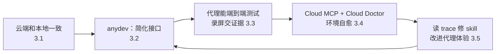

# 把开发环境当成给代理用的产品：Cursor 云端代理环境怎么搭

Cursor

**一句话看懂**：Cursor 想让云端代理在自己的虚拟机里测试改动，结果发现第一道坎不是模型，而是自家 monorepo 在云端根本跑不顺。他们的结论是：**开发环境本身就是一个产品，只不过用户是代理**。做法分四步：让云端和本地一致；用一个统一的 CLI（`anydev`）把杂乱的构建命令收起来；用 Cursor Cloud MCP 让代理检查自己的环境；再让定时运行的 Cloud Doctor 自动排查故障、修 skill、开 PR。原文给出的结果是：云端代理写的合并 PR，从去年 12 月的约十分之一，涨到现在的一半以上。

## 读完你能带走的 6 条收获

1. **代理测不了改动，常常是因为环境跑不起来，而不是不懂代码。** 先让云端虚拟机能像本地一样开发（见 3.1）。
2. **给代理注入密钥之前，先把防线搭好**：出站网络限制、受限的 git 访问、提交里的密钥扫描、工具结果里的密钥脱敏（见 3.1）。
3. **命令太绕时，写 skill 只能帮到边缘。** 更有效的是把接口本身变简单：一个 CLI 启动所有服务、自带 `--help`、替代理看着长时间运行的进程（见 3.2）。
4. **环境能跑起来以后，云端代理才真正比本地代理有价值**：它能端到端测试、录屏，把证据交给人（见 3.3）。
5. **环境一直在变，所以要让代理能自查、自愈**：给它一个检查环境的工具，再加一个定期巡检、能开修复 PR 的自动化（见 3.4）。
6. **读代理的 trace，找出它在哪里绕了远路**，然后修 skill、简化流程，下一个代理就更顺（见 3.5）。

::: tip 小白先懂这几个词
- [Background / Cloud Agent（后台 / 云端代理）](/glossary#background-agent)：在远程虚拟机里运行的代理，有自己的电脑。
- [Monorepo](/glossary#monorepo)：把多个项目放在同一个代码仓库里。
- [Skills](/glossary#skills)：按需加载的说明文件夹，告诉代理某类事怎么做。
- [MCP](/glossary#mcp)：让代理调用外部工具和数据的协议。
- [Secret Redaction（密钥脱敏）](/glossary#secret-redaction)：工具输出里的密钥值被遮掉，代理读不到。
- [Computer Use](/glossary#computer-use)：代理像人一样操作屏幕、鼠标和键盘。
:::

## 1. 基本信息

<SourceCard type="文章" title="How we set up our cloud agent environment" author="Mathew Hogan、Arvind Saripalli（Cursor）" date="2026-07-30" url="https://cursor.com/blog/cloud-agent-environment" />

| 项目 | 内容 |
|---|---|
| 链接 | https://cursor.com/blog/cloud-agent-environment |
| 类型 | 公司研究博客（文章，标注 7 min read） |
| 作者 | Mathew Hogan、Arvind Saripalli |
| 发布日期 | 2026-07-30 |
| 使用工具 | Cursor Cloud Agents、自研 CLI `anydev`、Cursor Cloud MCP、Cloud Doctor 自动化、recordScreen 工具 |
| 分析依据 | Cursor 官方博客原文全文，2026-10-14 用 curl 重新抓取并逐字核对引语。“十分之一 → 一半以上”的数字来自原文正文，配图折线图无法提取具体数据点。原文没有给出 `anydev` 的代码或命令示例，也没有给出 Cloud Doctor 的成功率。文末有咨询联系方式和客户案例链接，属推广内容。“我觉得”开头的段落是本站评论。 |

## 2. 这篇在回答什么

设想你给代理配了一台云端虚拟机，希望它改完代码自己跑一遍、点一遍、确认没问题再交给你。结果它连服务都起不来：本地是 Mac，云端是 Linux；构建命令有十几个参数；某个脚本要先跑另一个脚本；长时间运行的构建挂了也没人管。

这正是 Cursor 在自家 monorepo 上遇到的事。他们的总结是：

::: tr 把我们的 monorepo 改造成适合云端代理的样子，让我们认识到：开发环境本身就是一个产品，只是它的用户是代理。
> "Getting our monorepo working for cloud agents taught us that the development environment is a product in its own right, only one whose users are agents."
:::

把环境当产品，就要回答产品的几个基本问题：

1. 用户能不能用起来？云端和本地怎么保持一致，密钥怎么安全地交出去？（3.1）
2. 用户会不会用？命令太绕时，文档有没有用？（3.2）
3. 用起来之后能做成什么？（3.3）
4. 坏了怎么办？（3.4）
5. 怎么越用越顺？（3.5）

最后作者留了三个自查问题（3.6）。

## 3. 怎么做

### 3.1 云端和本地开发保持一致

第一步其实是每个第一次搭远程开发环境的工程师都经历过的事：让仓库在云端虚拟机里能跑。

Cursor 的开发者大多在 Mac 上本地开发，云端虚拟机却是 Linux。于是他们把各种开发工具和安装脚本改成平台无关，能在 Ubuntu 上运行；再把关键的开发依赖写进一个 Cursor 定义的 Dockerfile，作为云端代理的起始镜像。

能跑之后，下一个问题是密钥。代理要连数据库、调内部服务，就得拿到密钥。Cursor 和安全团队一起，在云端代理产品里加了四道防线：

- **出站网络限制**：代理只能访问允许的地址。
- **范围受限、经过代理的 git 远程访问**：代理只能碰它该碰的仓库。
- **提交和提交信息里的密钥扫描**：防止代理把密钥写进 git 历史。
- **工具结果里的密钥脱敏**：

<Trans zh="即使代理试图读取，也读不到密钥的值。">“which prevents the agent from reading secret values even if it tries.”</Trans>

为什么要这么多层？因为代理有电脑、有密钥，还会自己执行命令。最后一层尤其关键：它不靠代理“自觉”，而是让代理在工具输出里根本看不到密钥。

### 3.2 给代理一个更简单的接口：anydev

环境在 Ubuntu 上跑起来了，代理还是跑不好代码。作者说这并不意外：

<Trans zh="我们的开发体验很乱，要学习和记住大量构建命令、构建参数和工具脚本。">“our devex was messy and involved learning and remembering numerous build commands, build flags, and utility scripts.”</Trans>

第一反应是写 skills，告诉代理每个部分怎么构建、怎么运行。效果有限：

::: tr Skills 可以写清楚正确的命令，但这些命令本身就很绕，到处是坑。
> "Skills can document the right commands, but those commands themselves were convoluted and filled with footguns."
:::

于是他们换了思路：不是把复杂的东西解释清楚，而是把它变简单。他们做了一个叫 `anydev` 的 CLI：

- 代理用它启动**所有**服务；
- 常用工具脚本也统一从 `anydev` 走；
- 每个子命令都有 `--help` 菜单，说明怎么用；
- 自带一个 supervisor 进程，监控并重启长时间运行的构建命令，<Trans zh="把这份责任完全从模型身上拿走">“removing that responsibility from the model entirely”</Trans>。

作者的评价是：skills 帮着说明怎么用 `anydev`，但更大的变化是代理不用再拼多步构建命令、躲隐藏的坑、盯着长进程。

我觉得这是全文最值得记住的一句判断。很多团队遇到代理跑不起项目，第一反应是往 `AGENTS.md` 或 skills 里写更多说明。这篇的经验是：如果人自己都要记一堆参数，那该改的是工具，不是文档。这和 Skills 作者“把经验写成 skills”（[[21§3.3]]）的建议并不矛盾，只是先后不同：先把接口理顺，再写说明。

### 3.3 能自证的云端代理

`anydev` 之后，云端代理才开始真正比本地代理有价值。因为它有自己的电脑、有 computer use、有 recordScreen 录屏工具，再加上一个能用的开发环境，它可以端到端测试自己的改动，并且：

<Trans zh="向用户证明自己工作的正确性。">“prove the correctness of their work to the user.”</Trans>

具体表现是：有人修了一个 bug 报告，代理把自己录的演示视频发到 Slack；代理开 PR 时，把演示放在 PR 里。作者说，很多任务里，工程师可以直接合并、部署云端代理写的代码，<Trans zh="完全不用在本地检出这个分支">“without ever checking out the branch locally”</Trans>。

原文配了一个例子：一个内部云端代理在自己的云端环境里使用 Cursor 代理，测试改进后的代理会话重试逻辑。

### 3.4 自愈的环境：Cursor Cloud MCP 与 Cloud Doctor

能跑起来不等于一直能跑。代码库在变，依赖在变，密钥会轮换，网络策略会调整。

为此他们做了 **Cursor Cloud MCP**。为什么用 MCP？因为它提供可动态发现的工具，接口改了也不用重建代理循环。云端代理用它检查自己的环境：安装失败、出站策略、变更过的密钥等等，出了问题能自己诊断、更快恢复。

在这之上，他们又搭了一个叫 **Cloud Doctor** 的自动化。它做四件事：

1. 定期检查失败；
2. 记住哪些错误可能是偶发的、哪些是真问题；
3. 做根因分析；
4. 在高置信度时开 PR 修复问题。

“高置信度”具体怎么判断、Cloud Doctor 开的 PR 有多少被合并，原文没有给出。

### 3.5 改进“代理体验”

环境健康了，代理有时还是会绕远路：用错 skill，在虚拟机里踩本可避免的坑，或者走一个比必要更长的流程。

Cloud Doctor 在这里还有第二份工作：读其他代理的 trace，找出三类问题：

- 代理在哪一步走错了；
- 哪些 skill 或命令有误导性；
- 哪些工作流系统性地慢。

然后修 skill、简化路径或改环境，<Trans zh="让下一个代理更轻松">“so the next agent has an easier time”</Trans>。

这就形成了一个循环：代理用环境 → 留下 trace → Cloud Doctor 读 trace → 改进环境 → 下一个代理用得更顺。作者说，正是这个循环让他们能在内部扩大云端代理的使用，现在云端代理写了他们发布的大部分代码。

### 3.6 你的环境准备好了吗：三个问题

原文最后留了三个自查问题（原文摘录）：

::: tr 代理能用到和开发者一样的工具和数据吗？代理能找到记录开发者实际工作方式的 skills 吗？代理能测试和验证核心工作流吗？
> "Do agents have access to the same tools and data a developer would?"
:::

后两个问题是：<Trans zh="代理能找到记录开发者实际工作方式的 skills 吗？">“Can agents find skills that document how your developers actually work?”</Trans> 和 <Trans zh="代理能测试和验证核心工作流吗？">“Can agents test and verify core workflows?”</Trans>

这三个问题和 Factory CTO 的“8 根验证支柱”（[[26§3.2]]）可以对照着用：那边问代码库能不能判断改动对不对，这边问代理能不能把代码跑起来、测起来。

## 4. 结果与局限

| 项目 | 原文说法 |
|---|---|
| 云端代理写的合并 PR 占比 | 去年 12 月约十分之一，现在一半以上（7 天滚动占比折线图） |
| 发布的代码 | “大部分”由云端代理写 |
| `anydev` 命令、代码 | 未给出 |
| Cloud Doctor 开 PR 的数量、合并率 | 未给出 |

::: warning 局限与注意
- 占比数字是公司自报，没有说明统计口径（比如“代理写的 PR”怎么界定、人改了多少）。
- `anydev` 是内部工具，原文没有代码、命令或配置示例，要自己实现。
- Cloud Doctor 的“高置信度”阈值、误报情况都没讲。
- 文章出自 Cursor，结尾有咨询入口和客户案例链接，带推广成分；做法本身和工具无关，可以借鉴。
:::

## 5. 结论

这篇最重要的观点是：代理能不能干好活，很大程度上取决于它所在的环境。把环境当产品，要做的事和对人做产品差不多：先让它能用，再让它好用，然后持续看用户（代理）在哪里卡住。

我觉得最该带走的是顺序：先简化接口，再写文档。命令太绕时，写再多 skill 也只能帮到边缘。

### 你可以这样试

- [ ] 让代理在一个干净的云端或容器环境里从零启动你的项目，记下它卡住的每一步。
- [ ] 数一数启动所有服务需要几条命令、几个参数；超过三条，考虑包成一个带 `--help` 的脚本。
- [ ] 翻几份代理的会话记录，找出它反复重试或绕远路的地方，改对应的 skill 或命令。
- [ ] 用 3.6 的三个问题给自己的仓库打个分。

### 读完自测

1. Cursor 给云端代理加了哪四道密钥防线？哪一道不依赖代理“自觉”？
2. 为什么作者说 skills 只帮到了边缘？他们后来怎么解决的？
3. Cloud Doctor 做哪两类工作？
4. 原文给出的三个自查问题是什么？
