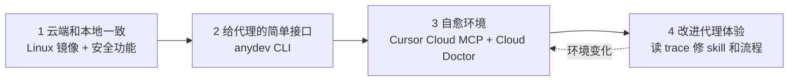

# 把开发环境当成给代理用的产品：Cursor 云端代理环境怎么搭

Cursor

**一句话看懂**：Cursor 想让云端代理在自己的虚拟机里测试改动，第一件事是让自家 monorepo 能在云端跑起来。他们的结论是：**开发环境本身就是一个产品，只不过用户是代理**。做法分四步：让云端和本地开发一致；用一个统一的 CLI（`anydev`）把杂乱的构建命令收起来；用 Cursor Cloud MCP 让代理检查自己的环境；再让定时运行的 Cloud Doctor 自动排查故障、修 skill、开 PR。文中给出的结果是：云端代理写的合并 PR，从去年 12 月的约十分之一，涨到现在的一半以上。

::: info 为什么值得看
本站“打地基”阶段讲过规则文件、Skills 和“代码库是否 agent-ready”（[#26](/26-factory-agent-ready-codebases)），但都停在“代理怎么理解代码”。这篇补的是另一半：**代理能不能把代码跑起来、测起来**。它也说明了一件常被忽略的事：Skills 只能写清楚命令，命令本身太绕时，帮助有限。
:::

::: tip 小白先懂这几个词
- [Background / Cloud Agent（后台 / 云端代理）](/glossary#background-agent)：在远程虚拟机里运行的代理，有自己的电脑。
- [Monorepo](/glossary#monorepo)：把多个项目放在同一个代码仓库里。
- [Skills](/glossary#skills)：按需加载的说明文件夹，告诉代理某类事怎么做。
- [MCP](/glossary#mcp)：让代理调用外部工具和数据的协议。
- [Secret Redaction（密钥脱敏）](/glossary#secret-redaction)：工具输出里的密钥值被遮掉，代理读不到。
- [Computer Use](/glossary#computer-use)：代理像人一样操作屏幕、鼠标和键盘。
:::

## 1. 基本信息

<SourceCard type="文章" title="How we set up our cloud agent environment" author="Mathew Hogan、Arvind Saripalli（Cursor）" date="2026-07-30" url="https://cursor.com/blog/cloud-agent-environment" />

| 项目 | 内容 |
|---|---|
| 链接 | https://cursor.com/blog/cloud-agent-environment |
| 类型 | 公司研究博客（文章） |
| 作者 | Mathew Hogan、Arvind Saripalli |
| 发布日期 | 2026-07-30 |
| 使用工具 | Cursor Cloud Agents、自研 CLI `anydev`、Cursor Cloud MCP、Cloud Doctor 自动化、recordScreen 工具 |
| 分析依据 | Cursor 官方博客原文全文，2026-10-12 用 curl 抓取。英文引用为原文摘录；“十分之一 → 一半以上”的数字来自原文，文中的折线图无法提取具体数据点。文中没有给出 `anydev` 的代码或命令示例。 |

## 2. 做了什么

::: tr 把我们的 monorepo 改造成适合云端代理的样子，让我们认识到：开发环境本身就是一个产品，只是它的用户是代理。
> "Getting our monorepo working for cloud agents taught us that the development environment is a product in its own right, only one whose users are agents."
:::

作者把要做的事概括成三件：让云端和本地开发一致；让仓库足够清楚，代理不靠口口相传的知识也能运行和测试代码；在代码库变化时保持环境健康。

结果用一句话说明：<Trans zh="12 月，云端代理大约写了合并进 Cursor monorepo 的十分之一的 PR。现在，它们写了一半以上。">“In December, cloud agents authored roughly one in ten PRs merged to the Cursor monorepo. Today, they write more than half.”</Trans>

## 3. 怎么做的

### 3.1 云端和本地开发保持一致

- Cursor 的开发者多数在 Mac 上本地开发，而云端虚拟机跑的是 Linux。他们把各种开发工具和安装脚本改成能在 Ubuntu 虚拟机上运行，并把关键依赖放进一个 Dockerfile，作为云端代理的起始镜像。
- 和安全团队合作，给云端代理产品加了几项安全功能，让用户敢把需要的密钥放进代理环境：出站网络限制、有范围限制并经过代理转发的 git 远程访问、提交和提交信息里的密钥扫描，以及工具结果里的密钥脱敏。

::: tr 工具结果中的密钥脱敏，能防止代理读到密钥值，即使它主动去读。
> "secret redaction in tool results, which prevents the agent from reading secret values even if it tries."
:::

### 3.2 给代理一个更简单的接口：anydev

环境能跑之后，代理还是不太会运行他们的代码。原因是开发体验本身就乱：要记很多构建命令、构建参数和工具脚本。

他们先写了 Skills，但效果有限：

::: tr Skills 能记录正确的命令，但这些命令本身就很绕，到处是坑。
> "Skills can document the right commands, but those commands themselves were convoluted and filled with footguns."
:::

于是他们做了一个 CLI，叫 `anydev`：

- 代理用它启动所有服务，常用工具脚本也经过它转发；
- 每个子命令都有 `--help` 说明；
- 内置一个 supervisor 进程，负责监控和重启长时间运行的构建命令，<Trans zh="把这项责任完全从模型身上拿走">“removing that responsibility from the model entirely”</Trans>。

作者的判断是，Skills 有帮助，但更大的变化是代理不用再拼凑多步构建命令、躲隐藏的坑、盯长时间运行的进程。

### 3.3 能自证的云端代理

有了能跑的环境，加上 Computer Use、`recordScreen` 工具，代理就能端到端测试自己的改动，并向用户证明结果是对的。它们可以在有人修复 bug 报告时，把自己录的演示视频发到 Slack，或者贴到自己开的 PR 上。

::: tr 对很多任务来说，工程师现在可以放心地合并和部署云端代理的代码，而不用在本地 checkout 这个分支。
> "For many tasks, engineers could now confidently merge and deploy cloud agent code without ever checking out the branch locally."
:::

### 3.4 自愈的环境：Cursor Cloud MCP 与 Cloud Doctor

环境一直在变，要保持可用，就要不断调整它怎么运行、能访问什么。

- **Cursor Cloud MCP**：云端代理用它检查自己环境里的安装失败、出站策略、变更的密钥等，从而自己诊断和修复问题。选 MCP 的理由是：<Trans zh="它提供可以动态发现的工具，接口可以改，而不用重建代理循环">“it gave us dynamically discoverable tools with interfaces we could change without rebuilding the agent loop”</Trans>。
- **Cloud Doctor**：一个定时运行的自动化。它会检查失败、记住哪些错误可能是暂时的、哪些是重要的，做根因分析，并且<Trans zh="在把握很高时开 PR 修复问题">“can open PRs to fix issues with high confidence”</Trans>。

### 3.5 改进“代理体验”

环境健康了，代理有时仍会绕远路来验证改动：用错 skill、在虚拟机里踩到本可避免的问题、走比必要更慢的流程。

Cloud Doctor 的代理也会读其他代理的 trace，找出哪里出了错、哪些 skill 或命令有误导、哪些流程系统性地慢，然后修 skill、简化路径或改环境，<Trans zh="让下一个代理更轻松">“so the next agent has an easier time”</Trans>。

### 3.6 你的环境准备好了吗：三个问题

原文结尾给出三个自查问题（逐字摘录，2026-10-12 抓取）：

::: tr 代理能用到和开发者一样的工具和数据吗？代理能找到记录开发者实际工作方式的 skills 吗？代理能测试和验证核心流程吗？
> - Do agents have access to the same tools and data a developer would?
> - Can agents find skills that document how your developers actually work?
> - Can agents test and verify core workflows?
:::

## 4. 结果如何

| 指标 | 原文数据 |
|---|---|
| 云端代理写的合并 PR 占比（Cursor monorepo） | 去年 12 月约十分之一 → 现在一半以上 |
| 云端代理写的代码 | <Trans zh="现在写了我们发布代码的大部分">“now author a majority of the code we ship”</Trans> |
| 环境自动修复 | Cloud Doctor 在高把握时开 PR；修复数量、成功率未给出 |

::: warning 局限与注意
- 这是 Cursor 介绍自家产品的博客，结尾有“联系我们”的推广，并链接到客户案例。
- `anydev`、Cursor Cloud MCP、Cloud Doctor 都是内部工具，文中没有给出代码、命令或配置，无法照抄。
- PR 占比是 Cursor 自己一个仓库的数据；“PR 数”不等于工作量或质量，文中也没有给出这些 PR 的回滚率或审查情况。
- “自愈”的效果只有定性描述，没有给出修复成功率或误修的例子。
:::

## 5. 可借鉴之处

1. **把开发环境当产品做，用户是代理**：代理跑不起来，很多时候不是模型笨，是环境乱。
2. **Skills 救不了太绕的命令**：先把命令本身简化成一个统一入口，再用 skill 记录这个入口怎么用。
3. **长时间运行的进程交给程序管**：构建、dev server 由 supervisor 监控和重启，不让模型去“盯进程”。
4. **安全功能是放权的前提**：出站限制、范围受限的 git 访问、密钥扫描和脱敏，让人敢把密钥交给代理环境。
5. **让代理能看到自己的环境**：给它一个检查安装、网络策略、密钥状态的工具，它才能自己排障。
6. **读代理的 trace 来改环境**：代理绕远路的地方，就是 skill、命令或环境该改的地方。这和“每个错误都改环境”的自愈层是同一个思路（[[27§3.5]]、[[23§3.4]]）。

### 你可以这样试

- [ ] 用原文的三个问题给自己的仓库打分：代理有没有和你一样的工具和数据？有没有记录真实工作方式的 skill？能不能测试核心流程？
- [ ] 数一数“把项目跑起来”需要几条命令。超过三条，就写一个统一入口脚本（如 `make dev`），每个子命令带 `--help`，再在 AGENTS.md 里只写这个入口。
- [ ] 翻最近 5 次代理会话记录，找出代理反复试错的命令或步骤，改掉对应的 skill 或脚本。

::: details 读完自测（点开看答案）
1. **为什么只写 Skills 不够？** Skills 能记录正确的命令，但命令本身很绕、到处是坑；要先用 `anydev` 把命令简化。
2. **`anydev` 的 supervisor 解决什么问题？** 监控和重启长时间运行的构建命令，把这项责任从模型身上完全拿走。
3. **Cursor Cloud MCP 和 Cloud Doctor 分别做什么？** 前者让代理检查自己环境的安装、出站策略、密钥等；后者定时检查失败、做根因分析，在高把握时开 PR 修复，还会读 trace 改进 skill 和流程。
4. **原文的三个自查问题是什么？** 工具和数据是否与开发者一致；能否找到记录真实工作方式的 skills；能否测试和验证核心流程。
:::
