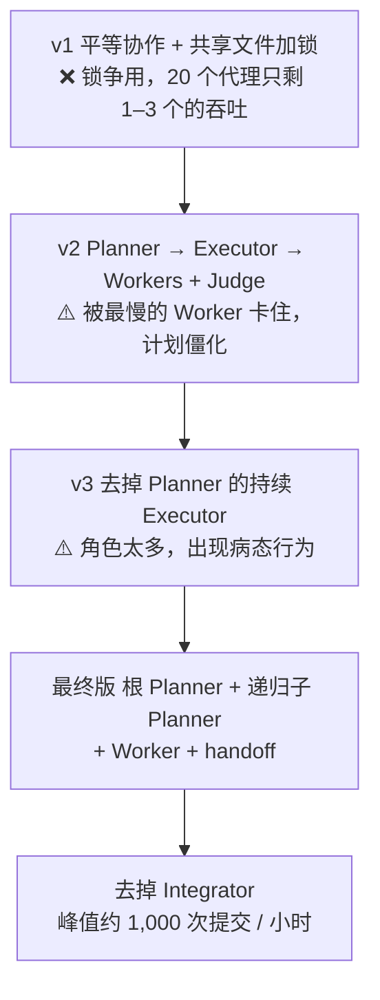
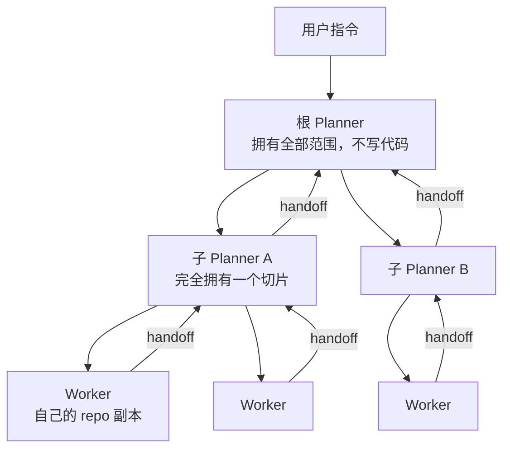

# 数千个代理连跑一周：Cursor 多代理 harness 为什么改了五版

Cursor

**一句话看懂**：这是 [#18](/18-cursor-scaling-long-running-agents) 的续篇。Wilson Lin 把 Cursor 的多代理 harness 怎么一版一版改出来讲透了：平等协作加锁文件，失败；加上 Planner / Executor / Judge，太僵；去掉 Planner，执行者身兼九职，崩溃；最终版是**递归的 Planner + 只管自己任务的 Worker + 交接报告**。峰值约每小时 1,000 次提交。最反直觉的结论是：**不要求每次提交都正确，系统反而跑得更好。**

## 读完你能带走的 7 条收获

1. **先做可观测性，再调 harness。** 带时间戳记下所有消息、动作和输出，然后让 Cursor 自己去日志里找模式（见 3.1）。
2. **别让代理自己用锁协调。** 20 个代理抢一个锁文件，吞吐只剩 1–3 个；没有结构时，也没人愿意接大任务（见 3.2）。
3. **一个代理身兼太多角色就会出病态行为**：随机睡觉、自己写代码、过早宣布完成（见 3.3）。
4. **最终结构是“责任树”**：Planner 只拆任务不写代码，Worker 只做自己那份、不和别人说话，做完写交接报告往上传（见 3.4）。
5. **要求每次提交 100% 正确，会让几百个代理一起卡死。** 接受小而稳定的错误率，发布前再用一个 green 分支收尾（见 3.5）。
6. **规模会放大坏指令。** “实现规范”太模糊，代理就钻进冷门功能；性能、依赖这些“默认大家都懂”的事，要明写（见 3.6）。
7. **约束比指令有效，数字比形容词有效。** “不许留 TODO”胜过“记得写完”；“生成 20–100 个任务”胜过“生成很多任务”（见 3.6）。

::: tip 小白先懂这几个词
- [Harness（代理外壳）](/glossary#harness)：包在模型外面、负责调度和工具的那层程序。
- [Planner / Worker / Judge](/glossary#planner-worker-judge)：规划者拆任务、执行者做任务、裁判判断是否继续。
- [Handoff（交接报告）](/glossary#handoff)：Worker 做完后交给 Planner 的总结，含做了什么、发现、担忧和偏差。
- [Drift（漂移）](/glossary#drift)：代理跑久了偏离目标。
- [Long-running Agent（长时代理）](/glossary#long-running-agent)：连续自主工作数小时到数周的代理。
:::

## 1. 基本信息

<SourceCard type="文章" title="Towards self-driving codebases" author="Wilson Lin（Cursor）" date="2026-02-05" url="https://cursor.com/blog/self-driving-codebases" />

| 项目 | 内容 |
|---|---|
| 链接 | https://cursor.com/blog/self-driving-codebases |
| 类型 | 公司研究博客（文章） |
| 作者 | Wilson Lin |
| 发布日期 | 2026-02-05 |
| 使用工具 | Cursor 自研 Rust 多代理 harness，跑在单台大型 Linux 虚拟机上；早期用 Opus 4.5 试验，后改用 GPT-5.1 / GPT-5.2 |
| 前篇 | [#18 数百个代理协作写浏览器](/18-cursor-scaling-long-running-agents) |
| 分析依据 | Cursor 官方博客原文全文，2026-10-14 重新用 curl 抓取全文（约 3,800 词）并逐字核对。英文引用为原文摘录。文中所有数字来自原文；成本未给出。原文没有给出完整的系统提示词，只有几句示例指令（见 3.6）。“我觉得”开头的段落是本站评论，不是作者观点。 |

. 做了什么

## 2. 这篇在回答什么

如果你有 10 倍的算力，能不能换来 10 倍有用的产出？

作者原话是：<Trans zh="我们能不能多花 10 倍算力，换来 10 倍有意义的吞吐？">“Could we spend 10x more on compute to get 10x more meaningful throughput?”</Trans>

他的试验对象是从零写一个浏览器。选它，是因为浏览器够复杂，能暴露前沿模型的短板，而且有很多需要协同的子系统。

起点很朴素。他先让 Opus 4.5 写一份浏览器引擎的详细计划，然后反复说“keep going”。很快失败了：模型忘了自己在做什么，离完成还很远就宣布成功，还会卡在复杂细节里。但它在小块代码上写得不错。所以问题不在能力，而在**任务太大，必须拆**。

接着他让代理画出依赖图，手动给每块任务派代理、停了就推一把。吞吐上去了，质量没变好，因为代理之间不能沟通，没人看全局。后来他们发现 GPT-5.1 / 5.2 更能精确地照指令做事，适合长时任务，就把 harness 换成了 OpenAI 模型。

真正的问题从这里开始：一个代理太慢，很多代理怎么协作？文章按时间讲了五版设计，我把它归成四个问题：

1. 怎么知道系统哪里出了问题？（3.1）
2. 代理之间怎么分工，谁对结果负责？（3.2–3.4）
3. 为了吞吐，哪些东西可以放松？（3.5）
4. harness 稳定以后，瓶颈转到了哪里？（3.6）

## 3. 怎么做

### 3.1 先把可观测性做好

他们用一个简单的 Rust harness，跑在**单台**资源充足的 Linux 虚拟机上，SSH 进去用终端界面操控。故意不上分布式系统，省掉一整层复杂度。

省下的精力花在了可观测性上：记录所有代理消息、系统动作和命令输出，带时间戳，可以分析、可以回放。这些日志不只给人看，也<Trans zh="喂回 Cursor，用来筛查大量数据、快速找出模式">“piping back into Cursor to sift through large amounts of data and quickly find patterns”</Trans>。

为什么这很重要？作者的观察是，多代理系统里的大问题会**反复出现**，遍布很多代理和很多工具调用。例如，他们发现争用太多，是因为很多代理同时在跑 `git restore`；然后用 Cursor 分析日志、对照提示词，找出行为和预期不一致的原因。

我觉得这是全文最容易被跳过、却最该先抄的一步。后面每一版设计的改动，都是从日志里看出来的，不是拍脑袋想出来的。

### 3.2 第一版：平等协作 + 锁（失败）

最简单的想法：所有代理角色相同，通过一个共享状态文件看别人在做什么、认领任务、更新文件。人尽量少规定，让代理自己协调。

很快失败了，原因有三层：

- **代理不会用锁。** 持有锁太久、忘记释放、在不该加锁或解锁时操作，<Trans zh="更多的提示词也没用">“more prompting didn't help”</Trans>。
- **锁本身拖慢一切。** <Trans zh="20 个代理会降到 1–3 个的吞吐，大部分时间花在等锁上">“20 agents would slow to the throughput of 1-3 with most time spent waiting on locks.”</Trans> 给代理一个“等别人做完”的工具，它们也很少用。改成无锁的乐观并发控制，开销少了，混乱还在。
- **没有结构就没人担责。** 代理都在躲冲突，挑小而安全的改动，没有谁愿意接大而复杂的任务、为整个项目负责。

第三点是关键。锁的问题可以靠技术绕开，“没人负责”绕不开。

### 3.3 第二、三版：加角色，再删角色

**第二版：分角色。** 为了让代理有归属和责任，他们拆出三种角色：

- **Planner** 先定下确切的做法和交付物；
- **Executor** 是唯一的主代理，负责把计划完整做完，可以给 Worker 派任务，吞吐随 Worker 线性增长；
- **Judge** 在 Executor 做完后独立判断：完成了吗，要不要再来一轮？

很多协调问题就此解决：有一个角色专门负责执行，Worker 就能只盯自己的任务。但新问题是整个系统**被最慢的 Worker 卡住**，太僵了。计划一次定死，发现新问题也很难调整，有的代理走错方向，要等下一轮才能纠正。

**第三版：持续执行者。** 去掉独立的 Planner，让 Executor 自己边规划边派活。它是唯一的主代理，不用把计划写下来，不用死守一份计划，也不用干等所有 Worker。

为了防止长时间运行后漂移，他们加了一组“保鲜”机制：

- `scratchpad.md` 要**经常重写**，而不是一直往后追加；
- 每个代理到了上下文上限就自动总结；
- 系统提示词里加入自我反思和对齐提醒；
- 鼓励代理随时转向、挑战假设。

系统变得很灵活。代理照指令做到完成的能力也还不错，所以 Judge 被删掉了，保持简单。

然后病态行为出现了。原文列得很具体：持续执行者会 <Trans zh="随机睡眠、停止运行代理、自己动手干活、拒绝规划、只派出少数几个很窄的任务、合并不好 Worker 的改动，并过早宣布完成">“sleep randomly, stop running agents, do work itself, refuse to plan and spawn more than a few narrowly focused tasks, not properly merge worker changes, and claim premature completion”</Trans>。

原因是它同时要做九件事：规划、探索、调研、派任务、检查 Worker、审代码、改代码、合并、判断是否结束。作者的总结很直白：<Trans zh="回头看，它被压垮了也说得通">“In retrospect, it makes sense it was overwhelmed.”</Trans>

### 3.4 最终设计：递归 Planner + Worker + 交接报告

最终版把前面所有教训合在一起，形成一棵“责任树”：

- **根 Planner**：拥有用户指令的全部范围，理解当前状态，派出具体、有针对性的任务；自己不写代码，也不知道任务被谁领走。
- **子 Planner**：Planner 觉得范围可以再分时，派生子 Planner，完全拥有被委派的那一片。这是递归的。子 Planner 让 Worker 能快速扇出，同时整个系统始终有代理负责；大项目里，单个 Planner 也不会因为管得太多而“隧道视野”。
- **Worker**：领任务，独自负责做完；不知道整个系统，不和其他 Planner 或 Worker 沟通；在自己的 repo 副本上工作，做完写一份交接报告。

交接报告是让这棵树“活”起来的东西：

::: tr 交接报告不只写做了什么，还包括重要的备注、担忧、偏差、发现、想法和反馈。
> "The handoff contains not just what was done, but important notes, concerns, deviations, findings, thoughts, and feedback."
:::

Planner 把交接报告当作后续消息收下。即使 Planner 已经“做完”，它也会继续收到更新、拉最新代码、继续规划。信息就这样一层层传给视野更全局的负责人，<Trans zh="没有全局同步或互相串话的开销">“without the overhead of global synchronization or cross-talk”</Trans>。

他们还删掉了原来负责全局质量控制和合并的 **Integrator**：几百个 Worker 只有一道关，很快成了瓶颈（#18 也提到这一点，见 [[18§3.4]]）。改提示词没用，最后干脆删了。

作者顺带说了一句：<Trans zh="有意思的是，这确实很像今天一些软件团队的运作方式">“Interestingly, this does represent how some software teams operate today.”</Trans>

我觉得这个设计的精髓是“每个代理只对一件事负责”。Planner 不写代码，Worker 不看全局，信息只沿着树往上走。和 v1 比，它解决的不是锁，而是“谁负责”。

### 3.5 有意的取舍：接受小而稳定的错误率

系统峰值约每小时 1,000 次提交，一周 1,000 万次工具调用，启动后不需要人干预。作者强调，这个吞吐是**有意取舍**换来的。

**第一个取舍：不要求每次提交都正确。** 要求 100% 正确时，系统严重串行化。一个小错误，比如 API 改动或拼写错误，就能让整个系统停摆：Worker 跑出自己的范围去修无关的东西，很多代理一拥而上修同一个问题，互相踩脚。

放松之后，代理可以相信别的问题很快会被别的代理修掉。这一点之所以成立，是因为整棵责任树覆盖了整个代码库。结果是：

> "The error rate remains small and constant, perhaps rarely completely clean but steady and manageable, not exploding or deteriorating."

作者由此推测：理想的高效系统会接受一定错误率，但需要一个最终的 “green” 分支，由一个代理定期打快照、在发布前快速修一遍。注意这是推论，文中没有给出实现。

**第二个取舍：容忍同步开销。** 多个代理有时会改同一个文件、重构同一段代码。他们不去彻底消灭冲突，也不过度设计，而是接受短暂的动荡，让系统自己收敛。代价是多花一些 token、局部有争用；换来的是整体更简单，更容易对齐模型、观察和管理。

我觉得这一节和 Anthropic C 编译器实验的思路正好相反：那边强调测试必须近乎完美，靠测试质量把关（[[17§3.3]]）。差别可能在规模，几百个代理同时提交时，“每次都绿”的成本会指数级上升。

### 3.6 基础设施和指令的经验

harness 稳定以后，瓶颈转移到了两个意想不到的地方。

**瓶颈一：磁盘。** 每次多代理运行都独占一台大机器，大多数运行峰值几百个代理，刚好吃满机器。限制了代理的内存之后，磁盘成了热点：单体项目里几百个代理同时编译，构建产物每秒读写好几 GB。作者的结论是：

> "the project structure, architectural decisions, and developer experience can affect token and commit throughput"

因为时间都花在编译上，而不是思考和写代码。后来一次运行把单体拆成了很多独立的 crate，等编译的时间大幅减少，吞吐是之前的好几倍。

他还提了两个开放问题：Git 和 Cargo 都用共享锁做并发控制，能不能借用数据库里成熟的并发机制？每个代理都有一份 repo 副本，大部分文件相同，能不能加上写时复制和去重？

**瓶颈二：指令。** 一开始他们把精力放在 harness 上，很快发现指令更重要。原因很简单：这本质上还是一个编码代理，只是时间和算力多了几个数量级，<Trans zh="这会放大一切，包括不够好、不够清楚的指令">“This amplifies everything, including suboptimal and unclear instructions.”</Trans> 文中的例子：

- “实现规范”这种指令太模糊，代理会钻进冷门功能，而不是聪明地排优先级；
- 性能要求是“默认大家都懂”的，但要明确写出来、再加上强制超时，代理才会兼顾；
- 复杂部分会写出内存泄漏和死锁，人一眼能看出来，代理未必；需要显式的进程级资源管理工具，让系统能优雅恢复；
- 第一版无 JS 浏览器收敛到了一个无法演进成完整浏览器的架构，这是初始规范的失败；
- 明明说了“从零写浏览器”，代理还是引入了本可以自己实现的依赖；后来一次运行写明了依赖原则和禁用库清单，才纠正过来。

那次运行还做了大重构，仓库一度严重损坏，但多代理系统几天内收敛回了能跑的代码。作者说这说明系统能 <Trans zh="在完全损坏的状态下坚持住，而不是进一步恶化或卡住">“holding across totally broken states instead of degrading further or getting stuck”</Trans>。

**提示词怎么写。** 作者总结了四条，每条都可以直接用：

1. 只教模型不会的（多代理协作）和你这里特有的（怎么跑测试、部署流程），会的不用教。<Trans zh="把模型当成一个聪明的新员工：懂工程，但不懂你的代码库和流程">“Treat the model like a brilliant new hire who knows engineering but not your specific codebase and processes.”</Trans>
2. <Trans zh="约束比指令更有效">“Constraints are more effective than instructions.”</Trans> 原文的例子是 <Trans zh="“不许有 TODO，不许有半成品”比“记得把实现写完”效果更好">“"No TODOs, no partial implementations" works better than "remember to finish implementations."”</Trans>
3. 高层任务别写成清单。列出具体要做的事，模型会只盯着这些，没列的反而被降了优先级。
4. 说范围时给数字。“生成很多任务”往往只生成一点，这是保守的默认；“生成 20–100 个任务”让模型明白要有野心，行为差别很大。

### 3.7 三条系统设计原则

文章最后总结了三条原则：

- **反脆弱**：代理越多，个别代理失败的概率越大，系统要扛得住，让别的代理恢复或换路。
- **靠实证，不靠假设**：用数据和观察来调整，而不是照搬人类组织或现有系统的设计。
- **明确为吞吐设计**：接受一个小而稳定、需要最后对账的错误率，而不是追求每时每刻都完美。

作者还说，做对了的系统往往简单得优雅，但事先不知道哪种简单方案能成，只能多试。当前设计开销很小，token 吞吐线性增长，之后没有再做大的改版。

## 4. 结果与局限

**原文给出的结果：**

| 指标 | 数值 |
|---|---|
| 连续运行 | 一周，启动后无需人工干预 |
| 峰值提交 | 约每小时 1,000 次 |
| 工具调用 | 一周约 1,000 万次 |
| 单次运行规模 | 大多数峰值几百个代理，跑在一台大机器上 |
| 拆 crate 后 | 吞吐是之前的好几倍（原文没给具体倍数） |

::: warning 局限与注意
- **没有成本数字。** 一周、上千万次工具调用花了多少钱，原文没说。
- **没有质量数字。** 浏览器本来就不打算对外用，作者也说代码有瑕疵，只说“几乎全部能跑”。错误率“小而稳定”是描述，没有给数值。
- **“green 分支”只是推论**，原文没有给出实现。
- **提示词只给了几句例子**，没有完整的系统提示词。
- **一个特殊的项目。** 从零写浏览器、有大量公开规范可以参照，和改一个业务代码库差别很大。
- 研究博客，结尾提到部分功能会开放给部分用户试用，有产品导向。
:::

## 5. 结论

这篇文章的主线是：**多代理系统的难点不在“并行”，而在“谁负责”。**

v1 没人负责，大家都挑小活；v3 一个人负责所有事，被压垮；最终版让每个代理只对一件事负责，Planner 拆任务，Worker 做任务，交接报告把信息往上传。在这之上，再用“接受小错误率”换吞吐。

harness 稳定以后，瓶颈就转到了人这边：指令写得清不清楚，项目结构能不能让几百个代理同时编译。

我觉得对普通团队最有用的不是递归 Planner，而是三条小经验：先做日志和回放；scratchpad 要重写而不是追加；写提示词时用约束和数字，别用形容词。

### 你可以这样试

- [ ] 给你的代理运行加上带时间戳的完整日志，跑完让代理自己读日志，找出重复出现的问题。
- [ ] 把 `scratchpad.md` 或进度文件改成“每次重写”，而不是一直往后追加。
- [ ] 让子代理做完后写一份交接报告，至少包括：做了什么、发现了什么、担心什么、和要求有哪些偏差。
- [ ] 检查你的提示词，把“记得做 X”改写成“不许出现 Y”，把“很多”改成具体的数字范围。
- [ ] 如果几个并行代理总在等编译，先看看能不能把项目拆成更小的模块。

::: details 读完自测（点开看答案）
1. **v1 平等协作失败的根本原因是什么？** 锁难用、争用严重（20 个代理只剩 1–3 个的吞吐），更关键的是没有结构，没人愿意接大任务、为整体负责。
2. **持续执行者为什么会出现病态行为？** 它同时承担规划、探索、调研、派任务、检查、审代码、改代码、合并、判断结束九种角色，被压垮了。
3. **最终设计里，Worker 和谁沟通？** 不和任何其他 Planner 或 Worker 沟通，只在做完后写交接报告交给派任务的 Planner。
4. **为什么不要求每次提交都 100% 正确？** 会让系统串行化，一个小错误就让大量代理挤去修同一个问题；接受小而稳定的错误率，最后再用 green 分支收尾。
5. **为什么磁盘会成为瓶颈？** 几百个代理在单体项目里同时编译，构建产物读写每秒好几 GB；拆成独立 crate 后吞吐提升了好几倍。
:::
