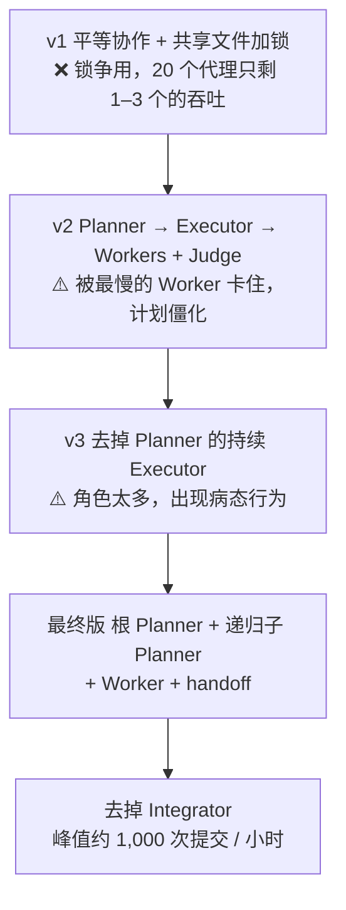
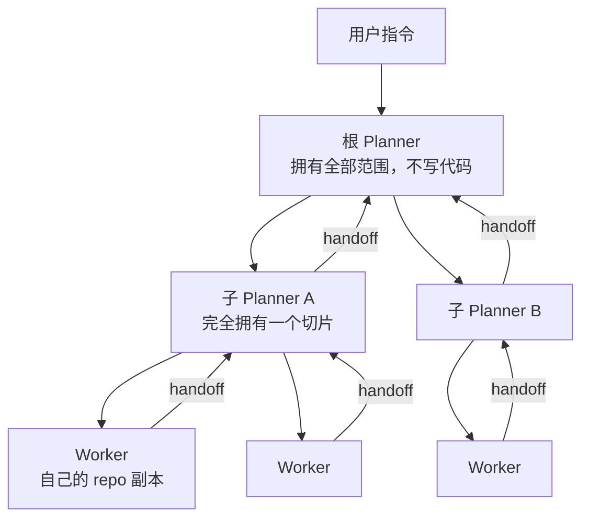

# 数千个代理连跑一周：Cursor 多代理 harness 的五次改版

Cursor

**一句话看懂**：这是 [#18](/18-cursor-scaling-long-running-agents) 的续篇。作者 Wilson Lin 详细讲了 Cursor 的多代理 harness 是怎么一版一版改出来的：平等协作 + 锁文件（失败）→ Planner / Executor / Worker + Judge → 去掉 Planner 的“持续执行者”（角色太多而崩溃）→ 最终的**根 Planner + 递归子 Planner + 只管自己任务的 Worker + 交接报告（handoff）**。系统峰值约每小时 1,000 次提交、一周 1,000 万次工具调用。最值得带走的是三条取舍：**接受一个小而稳定的错误率**、写好意图比调 harness 更重要、约束比指令更有效。

::: info 为什么值得看
#18 给出了结构和结果；这篇讲**为什么每一版会失败、怎么发现的**，以及基础设施和提示词上的经验。它属于“看原理”：主要贡献是解释多代理 harness 为什么这样设计有效。和 Anthropic 的 C 编译器实验（[#17](/17-anthropic-c-compiler-agent-teams)）、Planner / Generator / Evaluator（[#16](/16-anthropic-harness-design-long-running-apps)）放在一起读，差异很清楚。
:::

::: tip 小白先懂这几个词
- [Harness（代理外壳）](/glossary#harness)：包在模型外面、负责调度和工具的那层程序。
- [Planner / Worker / Judge](/glossary#planner-worker-judge)：规划者拆任务、执行者做任务、裁判判断是否继续。
- [Handoff（交接报告）](/glossary#handoff)：Worker 做完后交给 Planner 的总结，含做了什么、发现、担忧和偏差。
- [Drift（漂移）](/glossary#drift)：代理跑久了偏离目标。
- [Long-running Agent（长时代理）](/glossary#long-running-agent)：连续自主工作数小时到数周的代理。
:::

## 1. 基本信息

<SourceCard type="文章" title="Towards self-driving codebases" author="Wilson Lin（Cursor）" date="2026-02-05" url="https://cursor.com/blog/self-driving-codebases" />

| 项目 | 内容 |
|---|---|
| 链接 | https://cursor.com/blog/self-driving-codebases |
| 类型 | 公司研究博客（文章） |
| 作者 | Wilson Lin |
| 发布日期 | 2026-02-05 |
| 使用工具 | Cursor 自研 Rust 多代理 harness，跑在单台大型 Linux 虚拟机上；早期用 Opus 4.5 试验，后改用 GPT-5.1 / GPT-5.2 |
| 前篇 | [#18 数百个代理协作写浏览器](/18-cursor-scaling-long-running-agents) |
| 分析依据 | Cursor 官方博客原文全文，2026-10-12 用 curl 抓取。英文引用为原文摘录。文中所有数字来自原文；成本未给出。原文没有给出完整的系统提示词，只有几句示例指令（见 3.6）。 |

## 2. 做了什么

研究项目是一个浏览器，作者选它的理由是：足够复杂，能暴露前沿模型的局限，又有很多需要协同的子系统。

最初的单代理尝试很快失败：模型<Trans zh="忘了自己在做什么，经常在离完成很远时就宣布成功，还会卡在复杂的实现细节上">“lost track of what it was doing, frequently stopped to proclaim success despite being far from it, and got stuck on complex implementation details”</Trans>。接下来的问题是：

::: tr 我们能不能多花 10 倍算力，换来 10 倍有意义的吞吐？
> "Could we spend 10x more on compute to get 10x more meaningful throughput?"
:::

## 3. 怎么做的

### 3.1 先把可观测性做好

他们用一个简单的 Rust harness，跑在单台资源充足的 Linux 虚拟机上，避免分布式系统的复杂度。一开始就投入做可观测性：记录所有代理消息、系统动作和命令输出，带时间戳，便于分析和回放。这些日志不只给人看，也<Trans zh="喂回 Cursor，用来筛查大量数据、快速找出模式">“piping back into Cursor to sift through large amounts of data and quickly find patterns”</Trans>。

例如，他们发现争用太多是因为很多代理同时在跑 `git restore`，然后用 Cursor 分析日志并对照提示词，找出行为和预期不一致的原因。

### 3.2 第一版：平等协作 + 锁（失败）

所有代理角色相同，通过一个共享状态文件看别人在做什么、认领任务、更新文件。问题：

- 代理持有锁太久、忘记释放、在不该加锁或解锁时操作，<Trans zh="更多的提示词也没用">“more prompting didn't help”</Trans>。
- 争用严重：<Trans zh="20 个代理会降到 1–3 个的吞吐，大部分时间花在等锁上">“20 agents would slow to the throughput of 1-3 with most time spent waiting on locks.”</Trans>
- 改用无锁的乐观并发控制，减少了开销，但没有消除混乱。
- 没有结构，就没有代理愿意接大而复杂的任务，都挑小而安全的改动。

### 3.3 第二、三版：加角色，再删角色

- **第二版**：Planner 先定方案和交付物，交给唯一负责的 Executor，Executor 派任务给 Worker；Executor 做完后由独立的 Judge 判断是否完成、要不要再跑一轮。这解决了很多协调问题，但系统<Trans zh="被最慢的 Worker 卡住，太僵化">“bottlenecked by the slowest worker. It was too rigid.”</Trans>，而且所有计划都在一开始做完，发现新问题时难以调整。
- **第三版（持续执行者）**：去掉独立的 Planner，Executor 自己规划、派任务；加入“保鲜”机制（见下）后，Judge 也被删掉以保持简单。

保鲜机制（原文四条）：`scratchpad.md` 要经常重写而不是追加；单个代理到上下文上限时自动总结；系统提示词里加入自我反思和对齐提醒；鼓励代理随时转向、质疑假设。

但这个持续执行者开始出现病态行为：随机睡眠、停止运行代理、自己动手干活、只派几个很窄的任务、没合并好 Worker 的改动、过早宣布完成。原因是它同时承担了规划、探索、调研、派任务、检查 Worker、审代码、改代码、合并、判断是否结束——<Trans zh="回头看，它被压垮是说得通的">“In retrospect, it makes sense it was overwhelmed.”</Trans>

### 3.4 最终设计：递归 Planner + Worker + 交接报告

- **根 Planner**：拥有用户指令的全部范围，理解当前状态，派出具体、有针对性的任务；自己不写代码，也不知道任务被谁领走。
- **子 Planner**：Planner 觉得范围可以再分时，派生子 Planner，完全拥有被委派的那一片。这是递归的。
- **Worker**：领任务，独自负责做完；不知道整个系统，不和其他 Planner 或 Worker 沟通；在自己的 repo 副本上工作，做完写一份交接报告。

::: tr 交接报告不只写做了什么，还包括重要的备注、担忧、偏差、发现、想法和反馈。
> "The handoff contains not just what was done, but important notes, concerns, deviations, findings, thoughts, and feedback."
:::

Planner 把交接报告当作后续消息收下。即使 Planner 已经“做完”，它也会继续收到更新、拉最新代码、继续规划。信息就这样一层层传给视野更全局的负责人，<Trans zh="没有全局同步或互相串话的开销">“without the overhead of global synchronization or cross-talk”</Trans>。

他们还删掉了原来负责全局质量控制和合并的 **Integrator**：几百个 Worker 只有一道关，很快成了瓶颈（#18 也提到这一点，见 [[18§3.4]]）。

### 3.5 有意的取舍：接受小而稳定的错误率

- **提交正确率**：要求每次提交都 100% 正确时，系统严重串行化：一个小错误（如 API 变更或拼写错误）就让整个系统停下，Worker 跑出自己的范围去修无关问题，很多代理挤在一起修同一个问题。放宽之后，<Trans zh="错误率保持小而稳定，也许很少完全干净，但稳定可控，不会爆炸或恶化">“The error rate remains small and constant, perhaps rarely completely clean but steady and manageable, not exploding or deteriorating.”</Trans> 作者的推论是：发布前需要一个“green”分支，由一个代理定期打快照、做一轮快速修复。
- **同步开销**：多个代理有时改同一个文件，他们不去彻底消除，而是接受短暂的混乱，让系统自己收敛。

### 3.6 基础设施和指令的经验

**基础设施**：每次运行用一台大机器，大多数运行峰值几百个代理。限制了代理的内存后，磁盘成了热点：几百个代理同时编译单体项目，构建产物读写达到每秒好几 GB。作者的结论是，项目结构、架构和开发体验会直接影响 token 和提交吞吐，因为时间都花在编译上了。后来一次运行把项目拆成多个独立的 crate，等待编译的时间少很多，吞吐提高了几倍。

**指令（意图）**：系统等于一个有多出几个数量级时间和算力的编码代理，<Trans zh="这会放大一切，包括不够好、不清楚的指令">“This amplifies everything, including suboptimal and unclear instructions.”</Trans> 原文给的例子：

- “spec implementation” 这类模糊指令，让代理钻进冷门、很少用的功能，而不是合理排优先级；
- 性能要求只是默认假设时代理不会管，必须写明并强制超时；
- 没写依赖原则时，代理会引入本可自己实现的依赖；后来写明哪些库不能用，才纠正过来；
- 第一版无 JavaScript 的浏览器收敛到一个无法演进成完整浏览器的架构，作者认为<Trans zh="这是初始规格的失败">“This was a failure of the initial specification.”</Trans>

**提示词**（原文四条经验）：

- 不要教模型已经会的东西，只教它不知道的（如多代理协作）或领域特有的（如怎么跑测试、你的部署流程）。
- 约束比指令更有效：

  ::: tr “不要 TODO，不要半成品实现”比“记得把实现做完”效果更好。
  > "No TODOs, no partial implementations" works better than "remember to finish implementations."
  :::

- 更高层的任务避免“打勾心态”：列出具体事项，会让模型只盯着它们，没列的就被降了优先级。
- 讲范围时给具体数字：<Trans zh="&quot;生成很多任务&quot;往往只生成一点；&quot;生成 20–100 个任务&quot;才传达出范围要大">“"generate many tasks" tend to produce a small amount”</Trans>，而 “Generate 20-100 tasks” 带来的行为差别很大。

### 3.7 三条系统设计原则

原文总结：**反脆弱**（代理越多，单个失败越常见，系统要能承受并让其他代理恢复）；**用经验而不是假设驱动**（靠数据和观察调整，而不是照搬人类组织或现有系统设计）；**明确为吞吐设计**（接受小而稳定的错误率，最后再做一轮整合修复）。

## 4. 结果如何

| 指标 | 原文数据 |
|---|---|
| 峰值提交速度 | 约每小时 1,000 次提交 |
| 工具调用 | 一周内约 1,000 万次 |
| 人工干预 | 系统启动后不需要人干预 |
| 单次运行规模 | 大多数运行峰值几百个代理，每次运行一台大机器 |
| 重构成 crate 后 | 仓库严重损坏，几天内收敛回能工作的代码；吞吐是之前的数倍 |
| 成本 | 未给出 |

::: warning 局限与注意
- 浏览器是研究项目，作者明说<Trans zh="不打算对外使用，预计代码会有瑕疵">“not intended to be used externally and we expected the code to have imperfections”</Trans>。
- “接受错误率”是为了吞吐的取舍，前提是有一个最终的修复 / 整合环节；文中这一环节只是推论，没有给出实现。
- 作者认为这套结构和一些软件团队的运作方式相似，是“涌现行为”，这只是观点，没有实验对照。
- 没有给出成本、错误率的具体数字，也没有公开 harness 代码或完整提示词。
:::

## 5. 可借鉴之处

1. **先做可观测性，再调系统**：带时间戳记录所有代理消息和命令输出，再让代理帮你分析日志，比靠猜快得多。
2. **一个代理别扛太多角色**：同时规划、派活、审代码、合并、判断结束，就会出现睡眠、过早宣布完成等病态行为。拆成 Planner 和 Worker。
3. **Worker 做完写交接报告**：不只写做了什么，还要写担忧、偏差和发现，让上层能继续规划。
4. **别要求每次提交都完美**：大规模并行时，100% 正确的门槛会让系统串行化；接受小而稳定的错误率，最后留一轮整合修复。
5. **开发体验影响代理吞吐**：编译慢、共享锁多，代理就把时间花在等待上；拆模块、减少共享锁有直接收益。
6. **用约束和数字写指令**：“不要 TODO”比“记得做完”有效；“20–100 个任务”比“很多任务”有效。

### 你可以这样试

- [ ] 在你给代理的长任务提示词里，把“记得完成实现”改成一条约束，如“不要留 TODO，不要半成品实现”，对比两次结果。
- [ ] 让子代理做完任务后按固定格式交回：做了什么 / 发现 / 担忧 / 偏离计划之处。
- [ ] 给代理会话加日志（带时间戳），跑完后让代理读日志，找出它反复卡住的步骤。

::: details 读完自测（点开看答案）
1. **第一版为什么失败？** 共享文件加锁导致争用：代理持锁太久、忘记释放，20 个代理只剩 1–3 个的吞吐；没有结构时代理只挑小而安全的改动。
2. **持续执行者为什么出现病态行为？** 它同时承担太多角色：规划、探索、调研、派任务、检查、审查、修改、合并和判断结束。
3. **最终设计里 Worker 的职责是什么？** 领任务、独自做完、不和其他代理沟通、在自己的 repo 副本上工作，做完写交接报告。
4. **为什么不要求每次提交都 100% 正确？** 会让系统严重串行化，代理挤在一起修同一个小错；接受小而稳定的错误率，最后用一个“green”分支做修复。
:::
