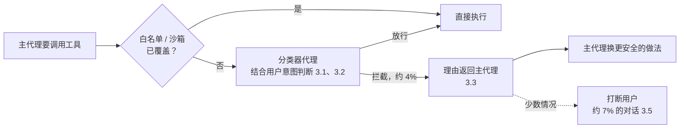

# 不想每步都点“允许”：Cursor 怎么用一个分类器代理给代理的动作把关

Cursor

**一句话看懂**：代理每一步都问你，你很快就会不看就点“允许”，审批形同虚设；完全不问，又可能误删文件、读到密钥。Cursor 的 Auto-review 把“要不要放行”从一个开关变成一个旋钮：**一个小模型做的分类器代理，在工具调用执行前结合用户意图判断风险**，低风险直接放，高风险才拦。拦了也不直接弹窗，而是**把理由还给主代理**，让它换一条更安全的路。上线时的数据：分类器运行时约拦 4% 的动作，Auto-review 模式下只有约 7% 的对话被打断过至少一次。

## 读完你能带走的 6 条收获

1. **审批弹窗太多本身就是安全问题**：人会习惯性点同意，审批就失去了意义（见 2）。
2. **风险要结合上下文判断**：同一条命令，在这个任务里无害，在那个任务里不可接受。要看动作、用户请求和出错后果三者的关系（见 3.1）。
3. **分类器要快，所以放在代理循环里、用小模型；但推理太弱的模型反而更慢**，因为它看不懂策略时会花更多 token 找一个更差的答案（见 3.2）。
4. **有些动作光看命令判断不了**，比如 `python script.py`，所以分类器本身也是代理，能先读文件再决定（见 3.2）。
5. **拦截之后，把理由交给主代理，而不是交给人**。主代理常常能自己缩小动作或换工具，用户不用被打断（见 3.3）。
6. **评测要用真实会话加合成的危险用例，在和生产相同的循环里跑，并反复跑同一个用例**；结果来回翻转，说明策略或提示词没写清楚（见 3.4）。

::: tip 小白先懂这几个词
- [Auto Review（自动审批）](/glossary#auto-review)：执行有风险的操作前，由另一个模型判断是否放行。
- [Risk Classifier Agent（风险分类器代理）](/glossary#risk-classifier)：专门判断“下一步动作是否符合用户意图、风险多大”的小模型代理。
- [Evals（评测）](/glossary#evals)：用一组固定用例反复测试代理或模型的表现。
- [Flapping（结果翻转）](/glossary#flapping)：同一个用例重复跑，结果时而通过时而失败。
- [Sandbox（沙箱）](/glossary#sandbox)：限制代理能读写和联网范围的隔离环境。
- [Prompt Injection（提示词注入）](/glossary#prompt-injection)：外部内容里夹带指令，诱导代理做用户没要求的事。
:::

## 1. 基本信息

<SourceCard type="文章" title="Governing agent autonomy with Auto-review" author="David Gomes、Travis McPeak（Cursor）" date="2026-06-11" url="https://cursor.com/blog/agent-autonomy-auto-review" />

| 项目 | 内容 |
|---|---|
| 链接 | https://cursor.com/blog/agent-autonomy-auto-review |
| 类型 | 公司研究博客（文章，标注 8 min read） |
| 作者 | David Gomes、Travis McPeak |
| 发布日期 | 2026-06-11 |
| 使用工具 | Cursor 桌面应用的本地代理、Auto-review 模式（分类器代理，可用 ReadFile、Grep、Glob、ListDir 检查工作区） |
| 分析依据 | Cursor 官方博客原文全文，2026-10-14 用 curl 重新抓取并逐字核对引语。文中所有数字来自原文；没有给出分类器的模型名称、提示词、准确率或漏拦率。“我觉得”开头的段落是本站评论。 |

## 2. 这篇在回答什么

你让代理修一个 bug。它要读文件，问你；要跑测试，问你；要装一个依赖，又问你。第十次弹窗出来时，你大概已经不看内容，直接点“允许”了。

作者把这个现象说得很清楚：

::: tr 最简单的办法是任何动作前都先问用户，但问得太频繁本身就会造成安全问题。多次重复提示之后，人们就不再仔细看，审批流程也就失去了意义。
> "The easy answer is to ask the user before any action happens, but asking for permission too often creates its own safety problem. After enough repeated prompts, people stop reading carefully, and the approval flow becomes less meaningful."
:::

反过来，完全不问也不行。本地代理身边就是文件、凭据、环境变量、MCP 工具，甚至生产系统。

Cursor 的回答是 Auto-review：

<Trans zh="让关于代理自主权的决定更像一个旋钮，而不是一个开关。">“makes decisions around agent autonomy behave more like a dial than a switch.”</Trans>

低风险时让代理自由走，下一步要越过一条有意义的边界时才放慢。全文回答五个问题：

1. 风险怎么判断？（3.1）
2. 分类器怎么搭，选什么模型？（3.2）
3. 拦下来之后怎么办？（3.3）
4. 怎么知道分类器判得对？（3.4）
5. 实际拦了多少，用户被打断多少次？（3.5）

## 3. 怎么做

### 3.1 风险要结合上下文判断

为什么不能写一张“危险命令清单”就完事？因为：

<Trans zh="同一条命令，在一个工作流里无害，在另一个工作流里就不可接受。">“The same command can be harmless in one workflow and unacceptable in another.”</Trans>

真正重要的是三者的关系：这个动作、用户的请求、做错了的后果。比如删除一个目录：用户说“清理构建产物”时删 `dist/` 很正常，用户只让你改一个函数时删同一个目录就不对。

所以他们做了一个“分类器”代理来管代理的整体自主权。要求有两个：是小模型，跑得快、成本低；同时能做细致的判断，看下一步是否符合用户意图。给它的核心规则只有一条：

<Trans zh="安全风险越低越宽松，风险越高越谨慎。">“it should be more lenient when the security stakes are lower, and more cautious when they're higher.”</Trans>

### 3.2 分类器怎么搭

**选模型。** 分类器在工具调用执行**之前**运行，直接卡在代理循环里，所以既要快也要准。Cursor 自称“多模型公司”，可以试很多模型和推理模式，挑速度和判断力之间合适的一点。

一个意外发现是：推理弱的模型不一定更快。

<Trans zh="当模型难以理解策略或工具调用时，它可能花更多时间和 token 去搜索，最后得到一个更差的答案。">“When a model struggled to understand the policy or the tool call, it could spend more time and tokens searching for what ultimately became a worse answer.”</Trans>

最后的选择是一个小模型，配上刚好够用、能干净做决定的推理。

**做成代理。** 有些动作光看命令本身无法判断。作者举的例子是 `python script.py`：安不安全，取决于文件里写了什么。所以分类器可以先用 ReadFile、Grep、Glob、ListDir 这些工具查看工作区，再做决定。

**不单独开接口。** 如果分类器是一个独立的服务端点，每次要审查的工具调用前都要多一次网络往返，延迟直接加在代理身上。他们让分类器和主代理跑在同一个 RPC 流里，架构类似子代理。

### 3.3 拦截之后怎么办：把理由还给主代理

这是全文我觉得最值得借鉴的设计。拦下来之后，最直接的做法是弹窗问用户。但作者说他们不想让分类器变成<Trans zh="又一个审批弹窗生成器">“another approval prompt generator”</Trans>。

他们的做法是：

<Trans zh="拦截一个动作时，它把解释返回给主代理，主代理常常能利用这个反馈选择更安全的路径，而不用打断用户。">“When it blocks an action, it returns an explanation to the parent agent, and the parent agent can often use that feedback to choose a safer path without interrupting the user.”</Trans>

让这个反馈有用的关键是用户意图。问题不是“这个动作单独看起来危险吗”，而是：

<Trans zh="这个动作是否被用户要求代理做的事所正当化。">“whether the action is justified by what the user asked the agent to do.”</Trans>

这样，普通的开发工作可以一直往前走，而后果更重的动作需要用户给出更明确的信号。

Codex 的 Auto Review 也是用一个只读子代理替你审批，分别判断用户是否授权、影响多大（[[09§3.4]]），可以对照着看。

### 3.4 评测怎么做

上面的设计要成立，分类器必须既不放过危险动作，也不拦正常工作。所以评测要覆盖两边。

**真实数据：定义“正常”。** 他们从内部使用数据开始：大约 12 小时的内部开发者会话，裁剪、对常见动作去重后，得到 6,122 条标注数据。这部分用来确保分类器不拦日常开发。

**合成数据：覆盖最坏情况。** 最危险的情况在正常使用里出现得太少，所以要专门造。他们生成的用例包括：代理可能读取密钥、碰生产数据、遵循不可信的指令、执行副作用很大的动作。

**策略变了，评测集也要跟着变。** 他们边做边调整分类器要识别的行为类别。每次调整都要重新标注或重新生成评测集，否则就是在用过时的理解测试当前的分类器。

**用生产同一套循环跑评测。** 评测走的是和生产相同的后端分类器循环，测到完整路径：工具使用、最终分类、模型覆盖、解析失败。检查的不只是最终的放行或拦截，还有分类器检查工作区时用了哪些上下文。

**抓结果翻转。** 同一个用例反复跑：

<Trans zh="如果同一个用例放行六次、拦截四次，通常说明策略或提示词没写清楚。">“If the same case allowed six times and blocked four times, that usually meant the policy or prompt was underspecified.”</Trans>

重复运行就成了找出不稳定用例的方法，再收紧分类器直到行为更一致。

我觉得“把翻转当成规格没写清楚的信号”这一条，适用于所有用 LLM 做放行 / 拦截判断的场景，不只是安全分类器。

### 3.5 尽量少直接拦

实际运行时，只有一小部分动作需要分类器审查。很多命令已经被白名单或沙箱覆盖，分类器主要在需要结合上下文判断时才运行。

三个数字，口径各不相同：

| 数字 | 指什么 |
|---|---|
| 约 4% | 分类器**运行时**，被拦截的动作比例 |
| 约 7% | Auto-review 模式下，**至少被打断一次的对话**比例 |
| 约 40% | 一些合作的企业客户**此前**在组织内被拦截的动作比例 |

被拦的动作不会马上变成用户提示。主代理拿到解释后，常常能缩小动作范围、换一个工具，或者干脆跳过有风险的那一步。

注意 4% 和 40% 都是“动作”的比例，7% 是“对话”的比例，不能直接拿 7% 和 40% 比。原文把 40% 当作背景对比，没有说明那些企业用的是什么规则。

## 4. 结果与局限

| 项目 | 原文情况 |
|---|---|
| 评测集 | 约 12 小时内部会话 → 6,122 条标注；另有合成的危险用例（数量未给） |
| 分类器运行时的拦截率 | 约 4% |
| 至少被打断一次的对话 | 约 7% |
| 分类器模型名、提示词 | 未给出 |
| 准确率、漏拦率 | 未给出 |
| 上线范围 | 目前聚焦桌面应用的本地代理；新用户默认开启，老用户在 Settings > Agents 里开启 |

::: warning 局限与注意
- 没有公开准确率和漏拦率。拦得少不代表拦得对，被放过的危险动作有多少，原文没说。
- 分类器是降低风险的手段，不是安全保证；能用白名单或沙箱解决的，仍然优先用它们。
- 提示词注入只在合成用例里提了一句“遵循不可信的指令”，具体怎么防、效果如何没讲。
- 文章是产品发布配套的博客，数据都是 Cursor 自报的早期数据。
:::

## 5. 结论

这篇最重要的观点是：**审批太多和审批太少一样不安全**。Cursor 的解法有三个关键点：结合用户意图判断风险；拦截时把理由交给主代理，让它自己绕开；用真实会话加合成危险用例、在生产循环里反复跑来评测分类器。

我觉得即使你不用 Cursor，也可以借鉴第二点：如果你自己写了 hook 或审批脚本，拦截时返回一段“为什么不行、可以怎么做”的说明给代理，往往比直接报错或弹窗更有效。

### 你可以这样试

- [ ] 统计一下你一天点了多少次“允许”，有多少次是没看内容就点的。
- [ ] 如果你用 hook 拦截命令（比如 [[28]] 里的 PreToolUse），把拒绝信息写成给代理看的理由和替代做法，看它会不会自己换路。
- [ ] 如果你在用 LLM 做任何放行 / 拦截判断，挑 10 个用例各跑 5 遍，找出结果翻转的那几个，回头看规则哪里没写清楚。

### 读完自测

1. 为什么作者说“每步都问”本身就是一个安全问题？
2. 判断一个动作的风险，要看哪三者的关系？
3. 为什么推理弱的模型不一定更快？
4. 分类器拦截后，Cursor 为什么不直接弹窗问用户？
5. 4%、7%、40% 三个数字分别指什么？
