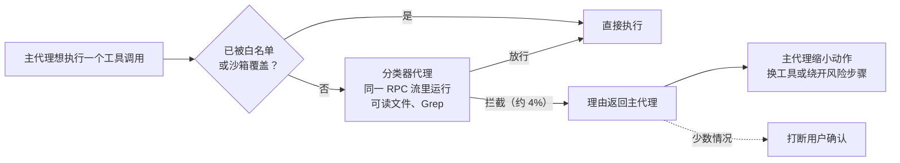

# 让代理少问一点又不出事：Cursor Auto-review 分类器怎么做、怎么评测

Cursor

**一句话看懂**：每个动作都问用户，用户很快就不看直接点“同意”，审批形同虚设。Cursor 的 Auto-review 在代理执行工具调用之前，用一个**小模型做的分类器代理**结合上下文判断风险：风险低就放行，风险高就拦下，并把理由还给主代理，让它换一条更安全的路，而不是直接打断用户。这篇最有价值的是**评测怎么做**：从约 12 小时内部会话整理出 6,122 条标注数据，加上合成的高风险用例；评测跑在和生产完全相同的后端分类器循环里；同一用例重复跑，找出结果来回翻转的不稳定用例。

::: info 为什么值得看
“做验证”阶段讲过怎么评测代理（[#19](/19-anthropic-demystifying-agent-evals)），但多是方法论。这篇是一个**把 evals 接进真实产品链路**的具体例子：数据从哪来、策略变了怎么办、怎么测“不稳定”。它也和 Codex 的 Auto Review（[[09§3.4]]）是同类设计，可以对照着读。
:::

::: tip 小白先懂这几个词
- [Auto Review（自动审批）](/glossary#auto-review)：执行有风险的操作前，由另一个模型判断是否放行。
- [Risk Classifier Agent（风险分类器代理）](/glossary#risk-classifier)：专门判断“下一步动作是否符合用户意图、风险多大”的小模型代理。
- [Evals（评测）](/glossary#evals)：用一组固定用例反复测试代理或模型的表现。
- [Flapping（结果翻转）](/glossary#flapping)：同一个用例重复跑，结果时而通过时而失败。
- [Sandbox（沙箱）](/glossary#sandbox)：限制代理能读写和联网范围的隔离环境。
- [Prompt Injection（提示词注入）](/glossary#prompt-injection)：外部内容里夹带指令，诱导代理做用户没要求的事。
:::

## 1. 基本信息

<SourceCard type="文章" title="Governing agent autonomy with Auto-review" author="David Gomes、Travis McPeak（Cursor）" date="2026-06-11" url="https://cursor.com/blog/agent-autonomy-auto-review" />

| 项目 | 内容 |
|---|---|
| 链接 | https://cursor.com/blog/agent-autonomy-auto-review |
| 类型 | 公司研究博客（文章） |
| 作者 | David Gomes、Travis McPeak |
| 发布日期 | 2026-06-11 |
| 使用工具 | Cursor 桌面应用的本地代理、Auto-review 模式（分类器代理，可用 ReadFile、Grep、Glob、ListDir 检查工作区） |
| 分析依据 | Cursor 官方博客原文全文，2026-10-12 用 curl 抓取。英文引用为原文摘录。文中所有数字来自原文；没有给出分类器的模型名称、提示词、准确率或召回率。 |

## 2. 做了什么

问题来自两个方向：代理需要自主才高效；但本地代理离文件、凭据、环境变量、MCP 工具和生产系统都很近，自主就有风险。最简单的办法是每步都问，可是：

::: tr 问得太频繁本身就会造成安全问题。重复提示多了，人就不再认真读，审批流程也就失去了意义。
> "asking for permission too often creates its own safety problem. After enough repeated prompts, people stop reading carefully, and the approval flow becomes less meaningful."
:::

Auto-review 的思路是把自主权做成<Trans zh="更像一个旋钮，而不是开关">“more like a dial than a switch”</Trans>：风险低时代理自由行动，下一步跨过重要边界时才慢下来。

## 3. 怎么做的

### 3.1 风险要结合上下文判断

同一条命令，在一个工作流里无害，在另一个里不可接受。关键是<Trans zh="动作、用户的请求，以及判断错误的后果，这三者之间的关系">“the relationship between the action, the user's request, and the consequence of being wrong”</Trans>。

给分类器的核心规则是：安全风险低时更宽松，风险高时更谨慎。

### 3.2 分类器怎么搭

- **模型选择**：分类器在工具调用执行前运行，处在代理循环的关键路径上，要快也要准。一个意外发现是推理更少的模型并不总是更快：<Trans zh="当模型难以理解策略或工具调用时，它会花更多时间和 token 去找答案，最后答案反而更差">“When a model struggled to understand the policy or the tool call, it could spend more time and tokens searching for what ultimately became a worse answer.”</Trans> 最终选择的是推理能力刚好够用的小模型。
- **做成代理**：有些动作光看命令判断不了。`python script.py` 是否安全取决于文件内容，所以分类器可以先用 ReadFile、Grep、Glob、ListDir 检查工作区再决定。
- **不单独建分类接口**：每次多一次网络往返都会增加延迟，所以分类器<Trans zh="和主代理跑在同一个 RPC 流里，架构类似子代理">“runs in the same RPC stream as the parent agent, using an architecture similar to subagents”</Trans>。

### 3.3 拦截之后怎么办：把理由还给主代理

他们不想让分类器变成又一个审批弹窗生成器。拦截时，它把解释返回给主代理，主代理常常能据此换一条更安全的路，不用打断用户。

::: tr 问题不在于一个动作孤立地看是否危险，而在于用户让代理做的事情能否支持这个动作。
> "The question is not whether an action looks risky in isolation. The question is whether the action is justified by what the user asked the agent to do."
:::

### 3.4 评测怎么做

这是全文最有借鉴价值的部分：

1. **用内部使用数据画出“正常工作”的样子**：分类器既要抓住危险动作，又不能挡住日常开发。他们从<Trans zh="大约 12 小时的内部开发者会话开始，裁剪并对常见动作去重，得到 6,122 条标注数据">“roughly 12 hours of internal developer sessions, then cut that down and deduplicated common actions into 6,122 labeled rows”</Trans>。
2. **用合成数据补最坏情况**：最糟的情况在日常使用中太少见。他们生成了代理可能读取密钥、碰生产数据、听从不可信指令或产生大范围副作用的用例。
3. **策略变了，评测集也要跟着变**：改了分类器要识别的行为类别后，必须重新标注或重新生成评测集，否则<Trans zh="就是在用对问题的过时理解测试当前的分类器">“we would be testing the current classifier against an outdated understanding of the problem”</Trans>。
4. **评测跑在生产同一条链路上**：评测通过和生产相同的后端分类器循环运行，覆盖工具调用、最终分类、模型覆盖设置和解析失败；不仅检查最终的放行 / 拦截，也检查分类器检查工作区时用到的上下文。
5. **找“翻转”的用例**：

   ::: tr 如果同一个用例放行六次、拦截四次，通常说明策略或提示词写得不够明确。
   > "If the same case allowed six times and blocked four times, that usually meant the policy or prompt was underspecified."
   :::

   重复运行能找出这些不稳定用例，再收紧分类器，直到行为更一致。

### 3.5 尽量少直接拦

实际中只有一小部分动作需要分类器审查，很多命令已经被白名单或沙箱覆盖；分类器主要处理需要结合上下文判断的动作。

## 4. 结果如何

| 指标 | 原文数据 |
|---|---|
| 分类器运行时拦截的比例 | 约 4% |
| Auto-review 模式下至少被打断一次的对话 | 全局约 7% |
| 对照：部分企业客户之前 | 组织内约 40% 的动作被拦截 |
| 内部评测集 | 约 12 小时会话 → 6,122 条标注数据，另加合成数据 |
| 默认状态 | 新用户默认开启；老用户在 Settings > Agents 里开启 |

::: warning 局限与注意
- 这是 Cursor 介绍新功能的博客，发布时作者自己说<Trans zh="还很早期">“still early”</Trans>；目前只针对桌面应用里的本地代理。
- 没有给出分类器的准确率、漏拦率或误拦率，也没有给出模型名称和提示词；“4%”“7%”只是拦截和打断的比例，不能说明拦得对不对。
- “40%”是部分企业客户之前的情况，统计口径和 7% 不同（一个按动作，一个按对话），不能直接比较。
- 分类器是降低风险的手段，不是安全保证；被注入的指令能否骗过分类器，文中只说用合成用例覆盖过，没有给出结果。
:::

## 5. 可借鉴之处

1. **审批太多也是安全问题**：弹窗多了，人会麻木。把自主权做成“旋钮”，按风险高低决定是否停下。
2. **判断标准是“用户要求了没有”**：不是看动作本身吓不吓人，而是看它是否由用户的请求支撑。
3. **拦截时给理由，让代理自己找安全的路**：不是每次拦截都要升级给人。
4. **评测数据要两头都有**：真实会话代表“不该拦的日常工作”，合成用例代表“必须拦的最坏情况”。
5. **策略一改，评测集就要重标**：不然评测衡量的是旧的问题定义。
6. **评测跑生产同一条链路，并重复跑找翻转**：同一用例结果不稳定，说明策略或提示词没写清楚。这和 #19 的 pass@k / pass^k 是同一个问题的两面（[[19§3.5]]）。

### 你可以这样试

- [ ] 如果你在用 Cursor，打开 Settings > Agents 里的 Auto-review，观察一周被拦截和被打断的次数。
- [ ] 给你自己的 LLM 判断器（审查、分类、评分都行）挑 10 个用例，每个跑 5 次，把结果不一致的挑出来，改写提示词或判断标准。
- [ ] 从最近的代理会话里抽 20 个工具调用，手动标注“该放行 / 该拦”，作为你自己的第一份小评测集。

::: details 读完自测（点开看答案）
1. **为什么“每步都问用户”不安全？** 重复提示多了，人就不再认真读，审批失去意义。
2. **分类器为什么要做成代理？** 有些动作光看命令判断不了，比如 `python script.py` 要看文件内容，所以它可以用 ReadFile、Grep 等工具检查工作区。
3. **评测数据从哪来？** 约 12 小时内部开发会话去重后得到 6,122 条标注数据，再加上读密钥、碰生产数据、听从不可信指令等合成用例。
4. **“放行六次、拦截四次”说明什么？** 策略或提示词写得不够明确，需要收紧。
:::
