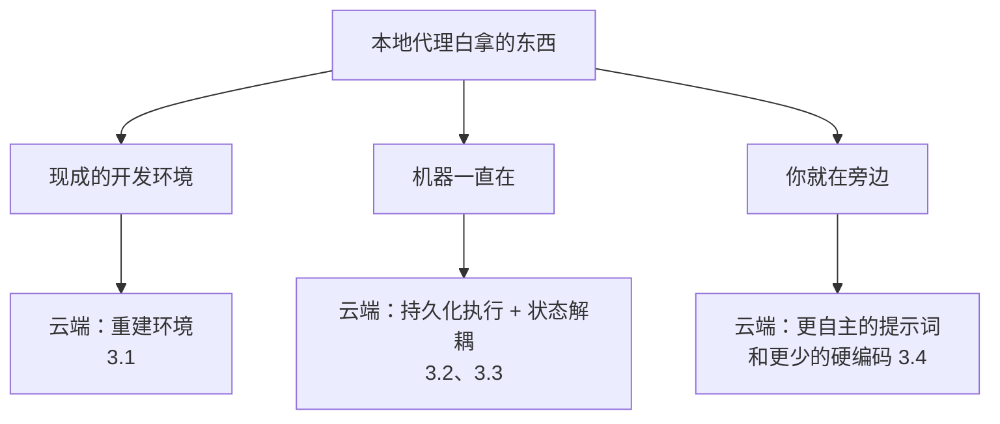

# 云端代理不只是把本地代理搬上服务器：Cursor 一年的四条教训

Cursor

**一句话看懂**：本地代理有很多东西是白拿的：你笔记本上现成的开发环境、你就坐在旁边、机器不会半路被回收。搬到云端，这些都得自己重建。Cursor 云端代理上线一年，Josh Ma 的结论是：这件事越来越像**在代理外面搭一层运行平台**。四条教训：完整的开发环境决定输出质量；长时任务要靠持久化执行（迁到 Temporal 后可靠性从“一个 9”到“两个 9”以上）；代理循环、机器、对话状态要拆开；模型变强以后，harness 要学会让开。

## 读完你能带走的 6 条收获

1. **云端代理输出质量变差，先查环境，别先怪模型。** 环境缺东西时通常不报错，只是结果悄悄变差（见 3.1）。
2. **云端代理要一整套“企业 IT”**：密钥脱敏、网络策略、凭证管理，以及 VM 的休眠、快照和分叉（见 3.1）。
3. **跑几小时到几周的任务，用现成的持久化执行框架**，别自己造重试和跨机调度。Cursor 迁到 Temporal 后，可靠性从“一个 9”提到“两个 9”以上（见 3.2）。
4. **workflow 要短**：一个任务一个 workflow，做完就退出，版本升级更容易（见 3.2）。
5. **代理循环、机器状态、对话状态分开管**，机器可以换、子代理可以比父代理活得久，客户端也能处理重试后的“回卷”（见 3.3）。
6. **模型变强后，把硬编码逻辑换成代理能用的工具**；云端提示词要鼓励代理更自主，因为在云端卡住等审批，可能一等就是几小时（见 3.4）。

::: tip 小白先懂这几个词
- [Background / Cloud Agent（后台 / 云端代理）](/glossary#background-agent)：在远程虚拟机里运行的代理，有自己的电脑。
- [Durable Execution（持久化执行）](/glossary#durable-execution)：把任务每一步的状态持久保存，机器挂了也能从断点继续，Temporal 是常用框架。
- [Harness（代理外壳）](/glossary#harness)：包在模型外面、负责工具、提示词和调度的那层程序。
- [Subagent（子代理）](/glossary#subagent)：主代理派出去做具体小事的分身。
- [Egress Control（出站网络限制）](/glossary#egress-control)：限制代理能访问哪些外部网络地址。
- [Computer Use](/glossary#computer-use)：代理像人一样操作屏幕。
:::

## 1. 基本信息

<SourceCard type="文章" title="What we’ve learned building cloud agents" author="Josh Ma（Cursor）" date="2026-06-02" url="https://cursor.com/blog/cloud-agent-lessons" />

| 项目 | 内容 |
|---|---|
| 链接 | https://cursor.com/blog/cloud-agent-lessons |
| 类型 | 公司研究博客（文章） |
| 作者 | Josh Ma |
| 发布日期 | 2026-06-02 |
| 使用工具 | Cursor Cloud Agents、Temporal（持久化执行）、CI Autofix、GitHub CLI、computer use 子代理（VNC + Chrome） |
| 分析依据 | Cursor 官方博客原文全文（约 1,500 词），2026-10-14 用 curl 重新抓取并逐字核对引语。数字来自原文，是公司自报，没有方法说明。文中没有代码或配置示例。注意：本文说内部“超过 40%”的 PR 来自云端代理，而两个月后的 [[37]] 说“一半以上”，是不同时间点的数据。“我觉得”开头的段落是本站评论，不是作者观点。 |

## 2. 这篇在回答什么

在笔记本上跑代理，你几乎不用操心环境：依赖装好了，数据库起着，测试命令能跑。代理停下来要权限，你一眼就看到。电脑也不会突然被换掉。

把同一个代理放进云端虚拟机，情况全变了。环境要从零重建；VM 可能被回收，推理服务可能抖动；代理卡住了，你可能几小时后才发现。作者开头就点明了这篇的主题：

::: tr 为什么这项工作越来越不像把本地代理移植到服务器上，而越来越像在它周围搭建一个运行层。
> "why the work increasingly looks less like porting a local agent to a server and more like building an operating layer around it."
:::

全文回答四个问题：

1. 云端代理的输出质量，最受什么影响？（3.1）
2. 跑几天的任务，怎样不因机器或服务故障而中断？（3.2）
3. 一个代理跨多台机器、子代理比父代理活得久，状态怎么管？（3.3）
4. harness 该替代理做多少事？（3.4）

最后是他们下一步的方向：让代理自己发现并修复环境问题（3.5）。

## 3. 怎么做

### 3.1 开发环境就是产品

作者说，一年下来最大的教训是：

::: tr 影响云端代理输出质量的最大单一因素，是确保它拥有一个完整的开发环境，就像开发者拥有的那样。
> "the single biggest factor in cloud agent output quality is ensuring it has a full development environment, like a developer has."
:::

难点不在“要装环境”，而在**环境不完整时你很难发现**：

::: tr 不会崩溃，也没有错误信息，往往唯一的迹象是输出质量的细微下降。你一开始可能注意不到；就算注意到了，也可能把它归咎于模型。
> "Instead of a crash or an error message, often the only indication is a subtle degradation in output quality. You might not notice it at first, or if you do, you might chalk it up to the model."
:::

比如测试数据库没起来，代理就没法验证自己的改动。它不会停下来报错，而是交出一份“看起来对”、但没人跑过的代码。作者说他们一次又一次追到同一个诊断：代理缺少执行或验证工作所需的环境。一年前这不太要紧，因为模型本来也用不好环境；模型变强以后，环境反而成了决定它能不能发挥全部能力的因素。

要做到“完整环境”，Cursor 重建了不少基础设施：

- 帮用户搭代理环境的更好工具；
- 在两条消息之间高效地休眠、恢复代理 VM；
- 快速、持久地给 VM 镜像做检查点、恢复和分叉的流水线；
- harness 和客户端的紧密集成，让代理和人都能理解、操作这个环境。

代理还要开 PR、拉依赖、查资料，所以需要受控的网络访问。作者的说法是，他们最后做出来的基本上是<Trans zh="给代理用的企业 IT">“enterprise IT for agents”</Trans>：密钥脱敏、网络策略、凭证管理一应俱全。Cursor 自己的仓库具体怎么为云端代理准备环境，见 [[37]]。

我觉得这一节对所有用云端代理的人都有用，不只是平台团队：**结果质量突然变差时，先检查代理能不能跑测试、能不能连上依赖服务**，再去怀疑模型。

### 3.2 长时代理需要持久化执行

云端代理跑在独立的 VM 里，好处是可以并行、可以交给它几小时的任务；代价是会碰上本地没有的故障：推理服务商宕机、pod 需要替换、EC2 节点挂掉。

Cursor 一开始用的是 work-stealing 架构：工作节点领取代理，一路循环到完成。这其实是把本地那一套原样搬到服务器上，作者说它很脆弱：<Trans zh="我们早期的云端代理 beta 经常只有一个 9 的可靠性。">“our early beta of cloud agents often operated at one 9 of reliability.”</Trans>（“一个 9”指 90% 左右。）

后来他们发现，自己快要把 Temporal 已经解决的持久化执行原语重造一遍了：重试机制、跨机器调度、节点故障下的持久性。于是干脆迁了过去。结果：

- 代理循环能扛住推理服务的抖动、pod 的休眠和恢复，以及**跨越几天甚至几周**的运行；
- 光是这次迁移就把可靠性提到了“两个 9”以上；
- Temporal 现在每天处理超过 5,000 万次 action，涉及超过 700 万个不同的 workflow；
- Cursor 内部超过 40% 的 PR 来自云端代理，而且还在增长。

架构上还有两条后来才学到的经验：

1. **从“永恒的”workflow 改成多个短 workflow**，每个完成一个任务就退出。好处是版本升级更容易：没有一个跑了三周的 workflow 卡在旧版本上。
2. **把 activity 拆得更细**，以便更准确地处理超时和重试。因为异步工具调用、子代理、推理服务故障，都改变了他们原来的假设。

我觉得这一节的教训可以推广：只要代理任务长到“中途一定会出点事”，就该把它当成分布式系统的问题，用成熟的工作流引擎，而不是在循环里多包几层 `try/except`。

### 3.3 代理循环、机器状态、对话状态分开管

云端代理已经不只是“一台机器上的一个循环”了：一个代理可能在一台机器上跑，再在好几台机器上派出异步子代理；也可能在本地开始，再把活交给云端。子代理甚至可能比父代理活得更久，或者跑在完全不同类型的 pod 上。

为此，Cursor 把三样东西拆成独立组件：**代理循环、机器状态、对话状态**。

- **循环放在 Temporal 里，不放在 VM 上。** 这样 pod 的生命周期可以单独管理，代理也能跑在不同类型的 pod 上，包括只读 VM、预热 VM 这类优化。
- **对话的存储和流式推送，从核心 workflow 里分出来。** 他们做了一个高效的只追加（append-only）存储，把对话更新推给网页和桌面客户端。

第二点里有一个很具体的细节：重试。

::: tr 如果代理循环的某一步在流式输出了一部分之后失败并重试，客户端能检测到这一点，把它的流回卷，显示新数据而不是旧数据。
> "if a step of the agent loop fails after streaming partial output and then gets retried, the client can detect this, rewind its stream, and show the new data instead of the old."
:::

持久化执行意味着“某一步会被重跑”，用户界面就必须能理解这件事，否则用户会看到半截旧输出接上一段新输出。Anthropic 的托管代理用的是同一个思路，把会话日志放在 harness 之外（[[45§3.2]]）。

### 3.4 知道什么时候让开

做 harness，要不停地重新判断：哪些行为由代码确定地做，哪些交给代理。作者讲了这个比例一年来的变化：

- **早期**：不太信任代理，harness 在每个任务后复查它的工作，强制 commit，再推送。
- **多仓库**：一年前要在 harness 里硬编码；现在只给代理仓库布局，暴露分支和 PR 的工具，让它自己决定怎么做。
- **CI Autofix**：早期版本的 harness 要自己抓 job 失败日志、写进 VM；现在只给代理 GitHub CLI，并把大输出自动写成它能搜索的文件。给代理的通知简单多了。

但作者强调，harness 不是在消失，而是**里面装的东西在变**。computer use 就是个例子：harness 里有一个专门的 computer use 子代理类型，有自己的模型路由、定制提示词和录屏；VNC 和 Chrome 属于环境，父代理和子代理共用，所以父代理也能直接用它们，比如跑一个 Playwright 脚本。之所以保留这层脚手架，是因为模型还没准备好自己处理 computer use，但**什么时候调用它，仍由代理决定**。

最后一条和提示词有关。云端的提示词要和本地不一样：

::: tr 我们鼓励它们更自主，因为阻塞的代价高得多。在本地，你知道代理什么时候停下来等权限；但在云端，它可能在那里干等好几个小时，你才回去看一眼。
> "We encourage them to be more autonomous, because the cost of blocking is much higher. Locally, you know when an agent has stopped and is waiting for permission, but in the cloud, it could sit there for hours before you go back and check on it."
:::

我觉得这条最容易被忽略。很多人把本地调好的提示词原样搬去后台跑，里面写满了“不确定就问我”。在云端，这句话等于“不确定就停工几小时”。

### 3.5 下一步：自愈的代理环境

作者说，他们想走出“手把手牵着代理”和“完全让开”的二选一。更好的模式是：**给代理一些理解周围系统的工具**。

具体目标是：代理能报告缺了密钥、网络被拦、或者环境在别的方面挡住了它，然后自己修复。Cursor 在另一篇研究博客里讲了一条实现路径，叫 autoinstall。文章结尾是一段产品推广，这里略过。

## 4. 结果与局限

文中的数字都是 Cursor 自报，没有给统计方法：

| 指标 | 数值 |
|---|---|
| 早期 work-stealing 架构的可靠性 | 常常只有“一个 9” |
| 迁到 Temporal 后 | 超过“两个 9” |
| Temporal 每天处理的 action | 超过 5,000 万 |
| 不同的 workflow 数 | 超过 700 万 |
| 内部来自云端代理的 PR 比例 | 超过 40%，仍在增长 |
| 单次运行时长 | 可跨越几天甚至几周 |

::: warning 局限与注意
- **没有代码、配置或 workflow 示例**，也没说“可靠性”具体怎么算。这是一篇经验总结，不是实现指南。
- **这是平台级投入**：Temporal、VM 快照、对话流回卷，对只是“用”云端代理的团队来说，主要价值在理解原理和排查思路，而不是照着搭。
- **数据有时间差**：本文（2026-06）说超过 40% 的 PR 来自云端代理，[[37]]（2026-07）说一半以上。
- 文章结尾有产品推广，第 3.5 节的 autoinstall 只是提到，没展开。
:::

## 5. 结论

云端代理难的地方不在模型，而在**把本地白拿的东西补回来**：完整的环境、扛得住故障的执行、能跨机器的状态、以及“你不在旁边”时代理该怎么做决定。

如果只记一件事，我觉得是：**云端代理的结果变差时，先查环境**。它不会报错，只会悄悄做得更差。

如果你在搭自己的云端代理平台，可以把这四条当检查清单：代理能跑测试吗？机器挂了，任务能从哪接着跑？对话状态在不在 VM 外面？提示词里有没有“不确定就问我”这种在云端会让它停工几小时的话？

### 你可以这样试

- [ ] 把你常用的后台代理任务挑一个，检查它在云端环境里能不能完整跑测试、能不能连上依赖服务。
- [ ] 读一遍你给后台代理的提示词，把“不确定就问我”改成“记录假设，继续做，在总结里列出来”。
- [ ] 如果你的代理任务经常超过一小时，评估一下用 Temporal 这类持久化执行框架替代自写的重试循环。
- [ ] 找一处 harness 里替代理做的硬编码逻辑，试着换成一个代理能调用的工具。

::: details 读完自测（点开看答案）
1. **为什么环境不完整很难发现？** 通常不会崩溃或报错，只是输出质量悄悄下降，还容易被归咎于模型。
2. **Cursor 为什么从 work-stealing 迁到 Temporal？** 原架构可靠性常常只有一个 9，而他们正要重造 Temporal 已有的重试、跨机调度和故障持久性。
3. **为什么要把“永恒”workflow 改成短 workflow？** 每个任务一个、做完就退出，版本升级更容易。
4. **云端代理的提示词为什么要更鼓励自主？** 在云端卡住等权限，可能几小时都没人发现。
:::
