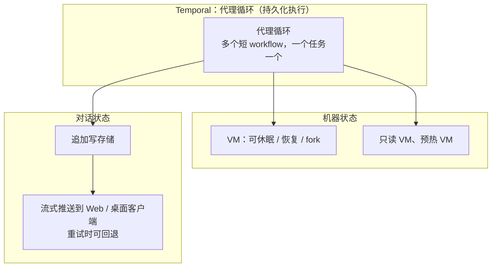

# 云端代理不只是把本地代理搬上服务器：Cursor 一年的四条教训

Cursor

**一句话看懂**：Cursor 云端代理上线一年，作者 Josh Ma 总结的结论是：这件事越来越不像“把本地代理移植到服务器”，而像**在代理外面搭一层运行平台**。四条教训：完整的开发环境是影响输出质量的最大因素，而且环境缺东西时往往不报错，只是质量悄悄变差；长时任务需要持久化执行，他们从自建的 work-stealing 架构迁到 Temporal，可靠性从“一个 9”提到“两个 9”以上；代理循环、机器状态和对话状态要拆开；模型变强后，要把逻辑从 harness 搬进代理能控制的工具里。

::: info 为什么值得看
本站“自动化”阶段已经讲了事件触发、CI 自动修复和 PR 机器人，但没有讲过**后台 / 云端代理本身的基础设施**：VM 挂了怎么办、跑几天的任务怎么不丢、子代理比父代理活得久怎么办。这篇给出了一手的工程答案和数字。它和 [#37](/37-cursor-cloud-agent-environment) 是同一团队的两篇：#37 讲 Cursor 自己的仓库怎么为云端代理准备环境，这篇讲云端代理产品怎么搭。
:::

::: tip 小白先懂这几个词
- [Background / Cloud Agent（后台 / 云端代理）](/glossary#background-agent)：在远程虚拟机里运行的代理，有自己的电脑。
- [Durable Execution（持久化执行）](/glossary#durable-execution)：把任务每一步的状态持久保存，机器挂了也能从断点继续，Temporal 是常用框架。
- [Harness（代理外壳）](/glossary#harness)：包在模型外面、负责工具、提示词和调度的那层程序。
- [Subagent（子代理）](/glossary#subagent)：主代理派出去做具体小事的分身。
- [Egress Control（出站网络限制）](/glossary#egress-control)：限制代理能访问哪些外部网络地址。
- [Computer Use](/glossary#computer-use)：代理像人一样操作屏幕。
:::

## 1. 基本信息

<SourceCard type="文章" title="What we’ve learned building cloud agents" author="Josh Ma（Cursor）" date="2026-06-02" url="https://cursor.com/blog/cloud-agent-lessons" />

| 项目 | 内容 |
|---|---|
| 链接 | https://cursor.com/blog/cloud-agent-lessons |
| 类型 | 公司研究博客（文章） |
| 作者 | Josh Ma |
| 发布日期 | 2026-06-02 |
| 使用工具 | Cursor Cloud Agents、Temporal（持久化执行）、CI Autofix、GitHub CLI、computer use 子代理（VNC + Chrome） |
| 分析依据 | Cursor 官方博客原文全文，2026-10-12 用 curl 抓取。英文引用为原文摘录，数字来自原文。文中没有代码或配置示例。注意：本文说内部“超过 40%”的 PR 来自云端代理，而两个月后的 #37 说“一半以上”，是不同时间点的数据。 |

## 2. 做了什么

云端代理现在跑在专属虚拟机上，有自己的环境、依赖和网络访问，可以并行、无人值守、做比笔记本上的本地代理更长的任务。这也带来了环境搭建、可靠性和编排上的挑战。

::: tr 这项工作越来越不像把本地代理移植到服务器上，而更像在它周围搭建一个运行层。
> "the work increasingly looks less like porting a local agent to a server and more like building an operating layer around it."
:::

## 3. 怎么做的

### 3.1 开发环境就是产品

::: tr 过去一年我们学到，影响云端代理输出质量的最大因素，是确保它有一个完整的开发环境，就像开发者有的那样。
> "Over the last year we’ve learned that the single biggest factor in cloud agent output quality is ensuring it has a full development environment, like a developer has."
:::

本地代理免费继承你笔记本上的开发环境；云端要从零重建，而且很难发现哪里没建好：

::: tr 往往没有崩溃或报错，唯一的迹象是输出质量轻微下降。你一开始可能注意不到，或者注意到了也归咎于模型。
> "Instead of a crash or an error message, often the only indication is a subtle degradation in output quality. You might not notice it at first, or if you do, you might chalk it up to the model."
:::

作者说一年前这不太重要，因为模型本来也用不好环境；模型变聪明后，环境成了决定性因素。要做到“完整环境”，需要重建不少基础设施（原文四条）：更好的环境构建工具；在消息之间高效休眠和恢复代理 VM；快速、持久地给 VM 镜像做 checkpoint、恢复和 fork 的流水线；harness 和客户端的紧密集成，让代理和人都能理解、操作这个环境。网络方面，代理需要受控的访问来开 PR、拉依赖、做调研，作者形容为<Trans zh="本质上是给代理用的企业 IT，包括密钥脱敏、网络策略和凭据管理">“essentially enterprise IT for agents, complete with secret redaction, network policies, and credential management”</Trans>。

### 3.2 长时代理需要持久化执行

云端代理跑在隔离的 VM 里，方便并行和委派几小时的任务，但也会遇到推理服务商故障、pod 被替换、EC2 节点宕机等问题。

- 最初用 work-stealing 架构：worker 节点领取代理并循环跑到完成。这是把本地做法搬到服务器上，很脆弱，<Trans zh="早期 beta 的可靠性常常只有一个 9">“our early beta of cloud agents often operated at one 9 of reliability”</Trans>。
- 他们发现自己快要重造 Temporal 已经解决的持久化执行原语（重试、跨机器调度、节点故障下的持久性），于是迁了过去。迁移之后：<Trans zh="仅这一项迁移就让我们超过了两个 9 的可靠性">“That migration alone took us past two 9s of reliability”</Trans>。
- 现在的代理循环能扛住推理服务的波动、pod 休眠和恢复，以及持续几天甚至几周的运行。
- workflow 的设计也在变：从“永生”的代理 workflow 改成多个短 workflow，完成一个任务就退出，方便版本升级；把 activity 拆细，以便更好地处理超时和重试（异步工具调用、子代理、推理服务故障改变了原来的假设）。

### 3.3 代理循环、机器状态、对话状态解耦

一个云端代理不再是一台机器上的一个循环：可能在一台机器上跑，异步子代理分布在几台机器上，或者本地开始再委派到云端；子代理甚至可能比父代理活得更久。

- 因为代理循环放在 Temporal 而不是 VM 上，pod 的生命周期可以独立管理，代理能跑在不同类型的 pod 上，包括只读 VM 或预热 VM。
- 对话一侧，存储和流式推送层从核心代理 workflow 中拆出来：一个追加写的存储，把对话更新流式推送到 Web 和桌面客户端。这一层考虑了重试：如果代理循环的某一步推送了部分输出后失败并重试，客户端能发现、回退流，显示新数据而不是旧数据。

### 3.4 知道什么时候让开

::: tr 构建云端代理 harness，意味着不断重新评估：多少行为是确定性的，多少交给代理。
> "Building a cloud agent harness means constantly reevaluating how much behavior is deterministic and how much gets handed to the agent."
:::

- **早期**：不太信任代理，harness 在每个任务后复查、强制 commit 并 push；多仓库要硬编码 harness 行为。**现在**：把仓库布局告诉代理，提供分支和 PR 工具，让它自己决定怎么做。
- **CI Autofix**：早期版本的 harness 里有抓取 CI 失败日志、写进 VM 的逻辑。现在<Trans zh="只是给代理 GitHub CLI 的访问权限，并把大的输出自动写成文件让它搜索">“we just give the agent access to the GitHub CLI and automatically write large outputs to files it can search through”</Trans>。
- **computer use 仍需要脚手架**：harness 里有专门的 computer use 子代理类型，有自己的模型路由、定制提示词和录屏。VNC 和 Chrome 属于环境，父代理和子代理共享，父代理也能直接用，比如跑 Playwright 脚本。作者说这是因为<Trans zh="模型还不太能独自处理 computer use，但何时调用仍由代理决定">“models aren't quite ready to handle computer use on their own, but the agent still controls when to invoke it”</Trans>。
- **提示词要鼓励更自主**：本地代理停下来等权限你会知道；云端代理可能干等几个小时你才回来看，所以阻塞的代价高得多。

### 3.5 下一步：自愈的代理环境

作者希望走出“手把手”和“完全放手”的二选一，给代理理解周围系统的工具：缺密钥、网络被拦、环境阻碍进展时，代理能报告，再自愈处理。原文提到他们的研究博客里有一条叫 “autoinstall” 的路径（本站未收录）。#37 的 Cursor Cloud MCP 和 Cloud Doctor 是这个方向在 Cursor 内部仓库的实践（[[37§3.4]]）。

## 4. 结果如何

| 指标 | 原文数据 |
|---|---|
| 可靠性 | 早期 work-stealing 架构常常只有一个 9；迁到 Temporal 后超过两个 9 |
| Temporal 规模 | 每天超过 5,000 万个 action，超过 700 万个不同 workflow |
| 运行时长 | 能跨几天甚至几周 |
| 内部 PR 来自云端代理的比例 | 超过 40%，仍在增长（本文发布时） |

::: warning 局限与注意
- 这是 Cursor 宣传自家云端代理的博客，结尾明说团队用 Cursor 就不用自己搭这些基础设施。
- 全文是架构层面的经验，没有代码、配置或 Temporal workflow 示例；“一个 9 / 两个 9”没有给出具体的统计口径。
- 大部分做法（VM 休眠恢复、镜像 fork、追加写流）需要平台级投入，个人或小团队很难照搬，更适合用来理解云端代理产品的取舍。
:::

## 5. 可借鉴之处

1. **代理质量变差时，先查环境**：环境缺东西常常不报错，只表现为输出变差，容易被误认为是模型的问题。
2. **长任务别自己造调度和重试**：需要跨机器、跨天运行时，用现成的持久化执行框架（如 Temporal）。
3. **workflow 要短**：一个任务一个 workflow，做完就退出，升级和重试都更简单。
4. **代理循环、机器、对话分开管**：机器可以休眠、换类型，对话流可以在重试时回退，互不牵连。
5. **模型变强后，把 harness 的硬编码逻辑换成工具**：比如不再替代理抓 CI 日志，而是给它 GitHub CLI，把大输出写成文件。这和“逐个拆脚手架”是同一个思路（[[16§3.5]]）。
6. **无人值守的代理要更自主**：云端阻塞的代价是几个小时，提示词要鼓励它自己往前走。

### 你可以这样试

- [ ] 下次觉得后台代理“变笨了”，先检查它的环境：依赖装全了吗？测试能跑吗？需要的密钥和网络访问有吗？
- [ ] 看看你给 CI 修复代理的脚本里，有没有替它抓日志、拼上下文的硬编码步骤；试着改成直接给它 `gh` CLI，并把大输出写进文件。
- [ ] 如果你自己在跑长时间的代理任务，记录一周内因为机器或 API 故障中断的次数，判断是否需要断点续跑。

::: details 读完自测（点开看答案）
1. **作者认为影响云端代理输出质量的最大因素是什么？** 有一个和开发者一样完整的开发环境。
2. **环境没建好时通常有什么迹象？** 往往没有崩溃或报错，只是输出质量轻微下降，容易被归咎于模型。
3. **为什么迁到 Temporal？** 自建的 work-stealing 架构很脆弱，可靠性常常只有一个 9；他们快要重造 Temporal 已有的重试、跨机器调度和故障持久性。迁移后超过两个 9。
4. **CI Autofix 的 harness 是怎么变简单的？** 不再在 harness 里抓 CI 失败日志写进 VM，而是给代理 GitHub CLI，并把大输出自动写成可搜索的文件。
:::
