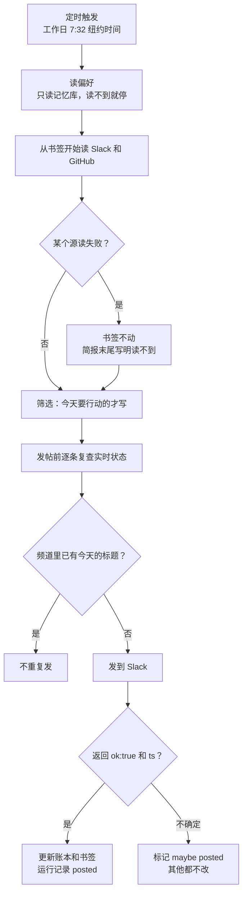

# 定时代理最怕“悄悄出错”：Anthropic 每日简报参考实现拆出的八个坑

<div class="meta-tags"><span class="tool-tag tool-claude">Claude Code</span></div>

<div class="hook">

**一句话看懂**：Anthropic 用 Claude Managed Agents 做了一个“每日简报”代理：工作日早上定时读 Slack 频道和 GitHub PR，只把今天需要处理的事发到 Slack。文章的价值不在功能，而在它逐个拆解的**失败方式**：读固定时间窗会漏或重复；数据源挂了会被当成“今天没事”；发帖失败却更新了书签，内容就永远丢了。最后归纳成六条规则：按书签读、读失败要明说、发帖前复查、确认发出再记账、每次重读偏好、只读权限 + 每次花费上限。

</div>

## 读完你能带走的 7 条收获

1. **按书签读，不按固定时间窗读。** 记下每个数据源上次读到哪里，任务晚跑、重跑都不会漏或重复（见 3.3）。
2. **读失败不等于今天没事。** 某个源读不到，书签不动，并在简报里写明（见 3.4）。
3. **确认消息真的发出去了，才更新账本和书签。** 拿不准就标“可能已发”，别的都不改（见 3.5）。
4. **只写今天要行动的事，发帖前逐条复查实时状态。** 一条过时的“还在等你”比漏掉十条更伤信任（见 3.6）。
5. **偏好每次都从文件重读，读不到就停。** 复制进提示词的偏好会一直执行你已经改掉的规则（见 3.7）。
6. **日期按读者的时区算。** 否则代理会把今天早上叫成“昨天”（见 3.7）。
7. **只读权限 + 花费上限。** 上限从正常运行成本的 3–5 倍起步；设太低时，简报看起来只是“变安静了”（见 3.8）。

::: tip 小白先懂这几个词
- [Routines / Automations（定时 / 事件触发任务）](/glossary#routines)：按时间表或事件自动启动的代理任务。
- [Bookmark（读取书签）](/glossary#bookmark-cursor)：记录每个数据源上次读到哪里，下次从那里接着读。
- [MCP](/glossary#mcp)：让代理调用外部工具和数据的协议。
- [Sandbox（沙箱）](/glossary#sandbox)：代理执行代码的隔离环境。
- [Prompt Injection（提示词注入）](/glossary#prompt-injection)：别人写的文本里夹带指令，诱导代理做事。
- [Credential Vault（凭据保险库）](/glossary#credential-vault)：密钥存放在沙箱外，代理只拿到占位符。
:::

## 1. 基本信息

<SourceCard type="文章" title="Building effective agent automations" author="Lance Martin、CJ Avilla（Anthropic）" date="2026-10-08" url="https://claude.dev/blog/building-effective-agent-automations/" />

| 项目 | 内容 |
|---|---|
| 链接 | https://claude.dev/blog/building-effective-agent-automations/ |
| 类型 | 官方博客（文章），附参考实现 |
| 作者 | Lance Martin、CJ Avilla |
| 发布日期 | 2026-10-08 |
| 使用工具 | Claude Managed Agents（beta）、`ant` CLI（`ant apply`）、GitHub MCP、Slack API、Claude Code 的 claude-api skill |
| 分析依据 | claude.dev 官方博客原文全文，2026-10-13 用 curl 抓取，2026-10-14 重新抓取全文（约 2,700 词）核对。文中配置和规则为原文逐字摘录（`agent.md` 正文只给出第 4、5 步，原文注明完整 8 步在仓库里，本站未收录）。英文引用为原文摘录。“我觉得”开头的段落是本站评论。 |

## 2. 这篇在回答什么

假设你写了一个每天早上给你发简报的代理。一个月后你才发现，GitHub 的 token 两周前就过期了，它每天都老老实实地报告“GitHub 上没什么事”。

这就是定时代理最大的问题：**它出错时不会报错，只会变安静。** 原文开头说的就是这个：

::: tr 但要做出有效的代理自动化很难：它们可能在没人注意的情况下失去对某个数据源的访问，或者不遵守我们的偏好。
> "But it’s difficult to build effective agent automations: they can lose access to a source without anyone noticing or fail to follow our preferences."
:::

Anthropic 的 Lance Martin 和 CJ Avilla 用 Claude Managed Agents 做了一个“每日简报”参考实现：工作日早上定时读 Slack 频道和 GitHub PR，只把今天需要处理的事发到 Slack。实现分六块（原文顺序）：数据源、唯一的输出目的地、代理配置（`agent.md`）、cron 定时、记忆（用户偏好 + 代理自己的状态）、护栏。

功能本身很普通，值钱的是每一块都配了一个“常见的失败方式”。我把它们归成四个问题：

1. 怎么读，才不会漏、不会重复、不会把故障当成没事？（3.2–3.4）
2. 怎么发，才不会发两遍或“以为发了”？（3.5）
3. 写什么，才让人愿意每天看？（3.6）
4. 跨运行的记忆和权限怎么管？（3.7、3.8）

下图是一次运行的完整流程：



## 3. 怎么做

### 3.1 代码和资源都是配置文件

参考实现的目录（原文摘录，2026-10-13 抓取）：

::: tr 目录结构：代理配置、部署（定时、时区、预算、首条消息）、网络白名单、用户偏好记忆库、代理状态记忆库、凭据保险库、资源 ID 锁文件、Slack 应用清单。
```text
daily-brief/
├── agent.md                        model, tools, instructions
├── deployment.md                   schedule, time zone, budget, input message
├── environment.yaml                network allowlist
├── memory_store_preferences.yaml   user preferences
├── memory_store_state.yaml         the agent's bookmarks, ledger, notes, and run records
├── vault.yaml                      the vault that holds the credentials
├── claude-lock.json                resource IDs, written by ant apply
└── slack/manifest.yaml             one bot app
```
:::

`ant apply` 读取这些文件，在 Claude API 工作区里创建资源，并把 ID 写进 `claude-lock.json`。之后自动化跑在 Anthropic 的基础设施上，本机不用常开。

### 3.2 凭据：代理只拿到占位符

凭据放在保险库（vault）里，真实值留在沙箱之外：GitHub 走 MCP，代理通过沙箱外的代理服务调用，服务按 URL 匹配凭据；Slack 走 `curl`，沙箱里只有一个占位符 `$SLACK_BOT_TOKEN`，<Trans zh="请求离开沙箱时，平台才会为你允许的主机换上真实 token">“As the request leaves the sandbox, the platform swaps in the real token for hosts you allow.”</Trans>

### 3.3 读取：按书签，不按固定时间窗

::: tr 一个常见错误是让代理读固定时间窗，比如“过去 24 小时”。运行晚了会留下空档，运行早了会重复。
> "A common mistake is asking the agent to read a fixed window like "the last 24 hours." A late run leaves a gap and an early run repeats items."
:::

做法是每个数据源一个书签：每次运行结束时，代理把每个源最新一条的时间戳写进 `bookmarks.json`。书签放在名为 `state` 的记忆库里，平台把它挂载到每次运行的沙箱 `/mnt/memory/` 下，并在运行之间保留。

### 3.4 读失败不等于今天没事

MCP 服务挂了或 token 过期时，运行照样开始，只是少了那个服务的工具；代理什么也看不到，于是报告“没有新内容”。`agent.md` 里的三条规则：书签不动；用其他源写简报；简报末尾用一行写明读不到什么（原文示例 “pull requests unavailable this run”）。

### 3.5 发帖：确认送达后才记账

记录和实际发出的内容不一致会出两种错：记了一条没发出的帖子，书签就往前走，那些内容永远不会被报告；不确定是否发出而重发，读者会收到两份。原文的三条规则：

1. 先在频道最近的消息里找今天的标题，已经有了就不发；
2. 只有 Slack 返回 `"ok": true` 和消息 `ts`，才算发出；
3. 确认之后才更新账本和书签。结果不明时标记为 “maybe posted”，其他什么都不改。

运行记录写在 `runs/<date>.md`：发帖前标记 “posting”，之后改为 “posted”（附消息 ID）或 “maybe posted”。

### 3.6 让简报短，并在发帖前复查

`agent.md` 第 4、5 步（原文逐字摘录，2026-10-13 抓取）：

::: tr 第 4 步“决定”：只有读者今天就会行动、或会改变他即将做的决定的事项才写一行；不确定就不写。大多数日子只有几条，有时一条都没有。“12 个待审查”这样的计数不算事项，只链接被卡住的那几个。账本里已有且仍未关闭的事项只写一行标记（“仍在等，第 3 天”），不重复报告；已关闭的直接去掉。偏好文件里已经撤掉的话题不要再提。
```text
4. Decide. An item earns a line when the reader would act on it today, or it changes a decision they are about to make. When unsure, leave it out. Most days that is a few items, sometimes none. A count ("12 open reviews") is not an item; link the ones that are blocked. An item already in the ledger and still open is carried as one marked line ("still waiting, day 3"), not re-reported; a closed item is dropped without comment. Do not bring back a topic the preferences file has retired.
```
:::

::: tr 第 5 步“验证”：你读的时候世界在变。每一条要报告的事项，发帖前都要重新查一次实时来源：已解决就去掉；仍未关闭但有变化就改写；无法确认就去掉并记进运行记录。一条过时的“还在等你”比漏掉十条更伤信任，所以不要含糊：要么断言，要么去掉。每个链接都从来源自己的链接字段复制，绝不手拼。
```text
5. Verify. The world moved while you read. For every item you will report, re-check its live source just before posting: resolved since you read it, drop it; still open but changed, fix the line; cannot confirm, drop it and list it in the run record's cuts. One stale "still waiting on you" costs more trust than ten missing items, so never hedge an item's status: assert it or drop it. Every link is copied from the source's own link field (a pull request's html_url, a Slack permalink), never assembled by hand.
```
:::

### 3.7 定时、时区和记忆

- **部署**定义代理、环境、首条消息、cron（原文 `"32 7 * * 1-5"`，`America/New_York`）、保险库、记忆库和预算。每次触发都开一个全新会话。
- **时区**：常见 bug 是代理按服务器时区把今早算成“昨天”。`timezone` 字段决定何时触发，首条消息的第二行告诉代理用哪个时区算日期。
- **两个记忆库**：`preferences` 归用户，对代理只读（读哪些频道和仓库、不写什么、长度上限、目的地）；`state` 归代理，可读写（书签、账本、运行记录、对偏好的修改建议、各数据源的行为笔记）。
- **每次重读偏好**：把偏好复制进提示词，会一直执行你已经改掉的规则。<Trans zh="如果读不到文件，它应该停下并说明，而不是用默认值继续跑">“If it can't read the file, it should stop and say so instead of running on defaults.”</Trans>
- **账本**：每条记录报告日期、来源、不变的 ID（Slack 消息时间戳或 PR 编号）和最近的状态，避免重复报告。

### 3.8 护栏：只读权限 + 花费上限

- 代理读的是别人写的消息和 issue，这些文本可能被当作指令。所以 GitHub token 和偏好库都只读，环境只能访问白名单主机。原文也承认：被植入的指令仍能改变简报内容（包括通过代理在运行之间保存的笔记），但<Trans zh="它不能写 GitHub，也不能改你的规则">“It can't write to GitHub or edit your rules.”</Trans> Slack 是例外，同一个 token 既读又发，所以只把机器人邀请进需要的频道。
- MCP 工具默认要人审批，而定时运行时没人在，所以 GitHub 工具集设为 `always_allow`，同时 token 只读。
- **花费上限**：从正常运行成本的 3–5 倍开始，看到真实数字后再收紧。触顶的运行会暂停而不是失败（停止原因 `budget_reached`），<Trans zh="所以上限设太低，看起来就像简报变安静了">“so a cap set too low looks like a brief that went quiet”</Trans>。

## 4. 结果与局限

文章是一份参考实现和经验总结，没有给出运行数据（准确率、成本、遗漏率均未给出）。原文最后归纳的六条规则：

::: tr 每个数据源从书签读，而不是固定时间窗；读失败要报告为读不到，绝不当作安静的一天；发帖前复查每一条；只有 Slack 确认才算发出，之后再更新书签和账本；每次运行都从代理不能编辑的库里重读偏好；只读的地方给只读权限，并限制每次运行的花费。
> - Read each source from a bookmark, not a fixed time window.
> - Report a failed read as unreadable, never as a quiet day.
> - Re-check every item right before posting.
> - Count a post as sent only when Slack confirms it, then update bookmarks and ledger.
> - Re-read your preferences every run, from a store the agent can't edit.
> - Give the agent read-only access wherever it only reads, and cap what each run can spend.
:::

::: warning 局限与注意
- 参考实现绑定 Claude Managed Agents（beta）和 `ant` CLI，配置格式可能变化；文中模型名为 `claude-sonnet-5-5`。
- 文章有推广自家平台的成分（结尾用 claude-api skill 一键生成配置）。
- 没有运行数据，只有设计原则；`agent.md` 其余 6 步要去仓库看。
- 原文承认提示词注入仍能影响简报内容，只读权限只是限制了危害范围。
:::

## 5. 结论

这篇文章的主线是：**定时代理的失败是安静的，所以每一步都要把“不确定”变成看得见的记录。**

读不到就写明读不到，书签不动；发没发出去拿不准，就标“可能已发”；事项状态拿不准，就删掉；偏好文件读不到，就停下。四条规则是同一个原则：宁可少说、宁可停下，也不要假装一切正常。

我觉得这套规则的适用面比 Managed Agents 广得多：任何 cron 跑的脚本、CI 里的定时任务、本站自己的每日选题流程，都能对照着检查一遍。最值得马上加的是“书签”和“确认送达再记账”。

**可借鉴之处：**


1. **按书签读，不按时间窗读**：任务早跑晚跑都不会漏或重。
2. **“没读到”和“没新内容”要分开**：读失败时书签不动，并在输出里写明。
3. **副作用先确认、再记账**：外部系统确认成功后才更新本地状态；不确定时宁可标记“可能已发”，什么都不改。
4. **发出前再查一次**：你读到的状态可能已经变了；查不到就去掉，不要含糊。
5. **偏好归人，状态归代理**：偏好库对代理只读、每次重读，读不到就停。
6. **无人值守 = 最小权限 + 花费上限**：上限从正常成本的 3–5 倍起步，注意触顶会“安静暂停”。

### 你可以这样试

- [ ] 检查你现有的定时代理任务：它是读“过去 24 小时”还是从上次位置读？改成每个源一个书签文件。
- [ ] 给任务加一条规则：任何数据源读取失败时，输出末尾写一行“本次未能读取：xxx”，书签不动。
- [ ] 把发消息 / 开 PR 这类副作用改成“先查是否已存在 → 执行 → 确认成功 → 再更新状态”。

::: details 读完自测（点开看答案）
1. **为什么不能读“过去 24 小时”？** 运行晚了会留空档，早了会重复；用每个源的书签，窗口自动伸缩。
2. **MCP 服务挂了会怎样？怎么防？** 运行照样开始但没有那个源的工具，代理会报告“没新内容”；规则是书签不动、用其他源写、末尾写明读不到什么。
3. **发帖结果不明时怎么办？** 标记 “maybe posted”，不更新账本和书签，什么都不改。
4. **花费上限设太低会怎样？** 运行会暂停而不是失败，看起来像简报变安静了。
:::
