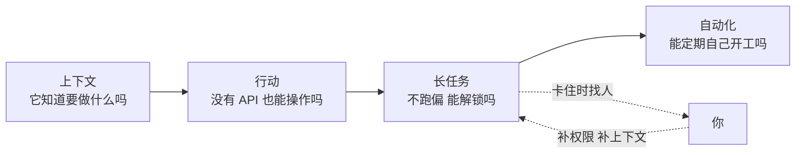

# Codex 应用一小时速览：怎样让代理在你不在时也能干活

Codex

**一句话看懂**：OpenAI 的两位讲者前一晚启动了几个长任务，第二天上台时，其中一个已经跑了 15 个半小时。这场工作坊讲的就是怎么做到这一点：给够上下文，让代理能操作没有 API 的软件，给长任务定可验证的目标、可观察的进度和解锁的办法，再用自动化让它定期自己开工。

## 读完你能带走的 7 条收获

1. **上下文是第一位的。** 截图（appshot）、口述、记忆，都比精心措辞的提示词重要；做完一个难流程，就让 Codex 把它变成 skill 或 plugin（见 3.1）。
2. **操作软件的三种方式按场景选。** 没有 API 的桌面软件用 Computer Use；需要登录态用 Chrome 扩展；测试本地网页用应用内浏览器（见 3.2）。
3. **`/goal` 的完成标准要尽量可验证。** 否则它会“技术上做到了，但不是你要的”（见 3.3）。
4. **长任务要能看、能查、能解锁。** 把目标写进文件，生成进度页，在里程碑处派线程审计；卡住时标记 blocked，并说清楚人要做什么（见 3.3）。
5. **子代理和线程交接，按“谁需要看见”来选。** 只要结果就用子代理；想全程参与就开多个线程。侧线程是临时的，结论要回传主线程（见 3.3）。
6. **确定性的检查交给 hooks。** 密钥扫描、工具白名单、收尾校验，不要只写在提示词里（见 3.3）。
7. **自动化分两种。** 线程内心跳适合“等它好了再做下一步”；新线程适合每周一次的独立任务（见 3.4）。

::: tip 小白先懂这几个词
- [/goal](/glossary#goal)：给代理一个目标和完成条件，没达成就自动继续。
- [Subagent（子代理）](/glossary#subagent)：主代理派出去做具体小事的分身，有独立上下文。
- [Computer Use](/glossary#computer-use)：代理像人一样看屏幕、点鼠标、敲键盘。
- [Compaction（上下文压缩）](/glossary#compaction)：上下文快满时浓缩成摘要继续干活。
- [Hooks](/glossary#hooks)：在固定时刻一定会执行的脚本。
- [Routines / Automations](/glossary#routines)：按时间表自动运行的代理任务。
:::

## 1. 基本信息

<YouTube id="FwiS44-xyYw" title="Cooking with Codex — Charlie Guo & Gabriel Chua, OpenAI" />

| 项目 | 内容 |
|---|---|
| 讲者 / 频道 | Charlie Guo、Gabriel Chua（OpenAI Developer Experience）／ **AI Engineer** |
| 发布日期 | 2026-10-06（YouTube 上传日期；录制于 AI Engineer World's Fair，演示画面里的日期是 6 月 29 日） |
| 时长 | 1:07:24（讲解约 65 分钟，之后是现场黑客松） |
| 使用工具 | Codex 应用（appshot、记忆、Chronicle、plugins、sites、Computer Use、Chrome 扩展、应用内浏览器、`/goal`、子代理、线程间交接、hooks、自动化、Codex remote）、Codex app server |
| 分析依据 | YouTube 自动字幕全文（yt-dlp 获取，2026-10-13），截图为 yt-dlp 下载片段后 ffmpeg 抽取的真实帧。自动字幕把 Codex 识别成 “codeex / codecs” 等；英文引文按字幕原样照录（含口头语），所选片段语义清楚，个别词可能有识别误差。“我觉得”开头的段落是本站评论。 |

## 2. 这场工作坊在回答什么

先看讲者的一个周末。

Gabriel 周五晚上给 Codex 布置了几个大任务，然后出门和朋友吃饭。周日他时不时看一眼手机，看 Codex 有没有在 Slack 里说“我卡住了”。周一早上 9 点上台时，一个任务已经跑了 15 小时 30 分钟，另外两个分别跑了约 6 小时和 7 小时。

这听起来很美好，但真做起来，问题马上就来了：代理怎么知道你想要什么？它要操作的软件没有 API 怎么办？十几个小时里，它会不会跑偏？卡住了谁来解？

讲者把这场工作坊编成“做菜的六个步骤”：给上下文、动手做、采取行动（Computer Use）、协作长任务、持续运行（自动化）、嵌进任何地方。我把它归成四个问题：

最后，讲者还介绍了怎么把 Codex 嵌进自己的产品（app server），放在 3.5。

## 3. 怎么做

### 3.1 上下文：先让它知道你在想什么

讲者花了很多时间讲上下文，理由很朴素：

<Trans zh="我读不了你的心，Codex 也读不了你的心">“I can't read your mind. Codex can't read your mind.”</Trans>

Gabriel 说，现在不需要什么“魔法提示词”，推理模型已经很聪明，关键是把要求和背景讲清楚。他台上展示的长提示词，其实是他对着手机口述，再让 Codex 润色出来的。

上下文有四个来源，各有对应的工具：

| 来源 | 工具 | 怎么用 |
|---|---|---|
| 别的应用里的讨论 | appshot | 在 macOS 上同时按两个 Command 键，截下当前窗口；和普通截图不同，里面的文字也一起带上 |
| 你脑子里的想法 | 听写 | 对着麦克风说一大段，不用字斟句酌 |
| 以前的对话 | 记忆（memories）| 默认关闭，在设置的 personalization 里打开；例如它会记住你用 uv 管理 Python 包 |
| 外部系统 | plugins | 一个插件 = skills + apps + MCP，例如 Slack、Gmail、Linear |

几个细节值得记：

- **appshot 很好用。** Charlie 说他已经不从 Slack 复制粘贴了，直接 appshot 发给 Codex，<Trans zh="九成以上的情况它都能弄明白该做什么">“90 plus% of the time it can figure out the right thing to do”</Trans>。
- **记忆有安全开关。** 可以设置“含工具调用的对话不生成记忆”，因为工具返回的内容可能不适合长期保存。另有一个看屏幕的研究预览功能 Chronicle，只对 Pro 用户开放。Charlie 提醒，记忆和 Chronicle 会多用一些 token。
- **自定义指令**相当于在家目录放一份 AGENTS.md，对所有对话生效。Gabriel 的例子是“always reply like a pirate”。
- **插件能省掉手工步骤。** OpenAI developers 插件可以直接替你创建 API key，不用再去平台网页上点“创建”、复制、保存。

最有用的一个习惯来自 Charlie：做完一个难搞的流程后，告诉 Codex<Trans zh="把这个做成一个 skill，或者更好，做成一个 plugin">“make this a skill or even better make this a plugin”</Trans>。下次直接调用，不用再从头走一遍。

现场也有翻车。Gabriel 用 appshot 截了一段 Slack 讨论，让 Codex 做一个 macOS 实时翻译应用。他说 Codex 只用了 4 分 2 秒就做出来了，但上台试的时候，麦克风和音箱怎么都调不通，翻译效果没能展示。

### 3.2 行动：没有 API 的软件怎么操作

很多软件没有 API。Gabriel 举的例子是一个数据仪表盘：要按周导出今年每个月的数据，人得一遍遍点“周一到周日”。

他只说了一句：下载最近七天的 commit 数（CSV），以及从月初到今天的 PR 数据（JSON），用 Computer Use 去做。然后屏幕上出现了第二个光标，开始自己点。

<figure class="shot"><figcaption>📷 视频截图 · <a href="https://www.youtube.com/watch?v=FwiS44-xyYw&t=1401s" target="_blank" rel="noopener">23:21</a> · Codex 用 Computer Use 操作一个没有 API 的分析仪表盘下载数据</figcaption></figure>

关键在于，它不抢你的鼠标：

<Trans zh="你不用跟代理抢屏幕的控制权">“You don't have to wrestle with the agent for control of your screen.”</Trans>

Gabriel 一边让它下载数据，一边用 Chrome 扩展让另一个任务根据 Google Doc 里的问题建一份 Google 表单（每题都设成必填），同时还在问 Codex 别的问题。

Codex 有三种操作软件的方式。Charlie 讲了各自该在什么时候用：

| 方式 | 适合什么 | 为什么 |
|---|---|---|
| Computer Use | 没有编程接口的桌面软件、老旧软件 | 像人一样看屏幕、点鼠标；macOS 上不抢你的光标 |
| Chrome 扩展 | 需要登录态的网站 | 用你已登录的浏览器，借你的凭据，不用处理登录；无头浏览器常被网站当成机器人，陷进验证码循环 |
| 应用内浏览器 | 测试你自己在开发的本地网页 | Codex 对它的浏览器引擎钩得比 Chrome 扩展更深，能更细地看到页面布局 |

<figure class="shot"><figcaption>📷 视频截图 · <a href="https://www.youtube.com/watch?v=FwiS44-xyYw&t=1601s" target="_blank" rel="noopener">26:41</a> · Recap 幻灯片：Computer Use、Chrome 扩展、应用内浏览器分别用在什么场景</figcaption></figure>

我觉得这张对照表是全场最实用的一页。判断顺序很简单：先问有没有 API；没有的话，再问要不要登录；如果是你自己的网页，就用应用内浏览器。

### 3.3 长任务：跑十几个小时，怎么不跑偏、卡住了怎么办

这是全场最长、也最有料的一部分。Gabriel 前一晚启动了几个任务，正好代表三种典型情况：

| 任务 | 类型 | 跑了多久 |
|---|---|---|
| 给 400 人的会场做实时问答网站（管理员、观众、舞台三个视图） | 从零开始 | 用 `/goal` 跑了 15 小时 30 分 55 秒，还在继续 |
| 把一个开源表单构建器改造成团队内部工具，放到 sites 上 | 改造现有项目 | 约 6 小时（字幕里说“5 hours and 57 seconds”） |
| 把研究生时期论文里的 Julia/R 代码重写成 Rust 后端的 Python 包 | 迁移重写 | 7 小时 1 分 40 秒 |

从他的演示里，可以归纳出五个做法。

**第一，完成标准要可验证。** Charlie 对第一次用 `/goal` 的人只有一条建议：<Trans zh="把判断“完成”的标准讲得非常具体">“be really specific with the criteria that you're giving the model to to know when it's done”</Trans>，而且<Trans zh="你希望这些标准尽量可以验证">“you want that criteria to be as verifiable as possible”</Trans>。`/goal` 会在每一轮拿这些标准检查自己：做完了吗？没做完要不要继续？

他把 `/goal` 比作许愿的神灯：好用的时候很神奇，不好用的时候像“猴爪”故事，

<Trans zh="它技术上完成了我要求的事，但完全不是我预期的方式">“it has done the thing technically that I asked it to do but like very much not in the way that I was expecting”</Trans>

他提到的规模参照：有人用 `/goal` 连续跑了 40 小时，用原生 Swift 重写了 Doom。适合 `/goal` 的任务还包括代码迁移、大型重构、反复试验，以及有详细规格的整个应用。

**第二，让进度看得见。** 一个任务跑七个小时，你根本不知道它在干什么。Gabriel 的做法是：用 OpenAI skills 仓库里的 define goal skill，让 Codex 不只定一个目标，而是拆成一串目标，写进 `goals.md`；再生成一个 `progress dashboard.html`，上面列出里程碑（已完成、进行中、未开始）和每个线程在做什么（总调度、沟通、视觉体验、协议……）。

**第三，在里程碑处做审计。** 主线程会在不同里程碑另开线程，跑代码审查和“目标审计”（goal audit），检查有没有偏离最初写在 `goals.md` 里的目标。偏了就提醒主线程：要么回到原计划，要么重新想计划。

**第四，按“谁需要看见”选委派方式。** Codex 有两种委派：子代理，以及线程之间的交接。Charlie 的判断标准是看

<Trans zh="工作的委派需要让你（用户）看见，还是只需要让模型看见">“the delegation of work needs to be visible to you, the user versus when it just needs to be visible to the model”</Trans>

- **子代理**像分包商：你不关心过程，只要结果好。它的上下文是独立的，模型自己会判断什么时候派。也可以在 TOML 文件里定制，比如一个用轻量模型、跑得快的代码审查员。
- **线程交接**适合你想全程参与的情况。Charlie 周末做游戏时开了一个“创意总监”线程，另开美术、音乐、动画、玩法几个线程，并在 AGENTS.md 里写明：做完之前要先找创意总监线程签字。

现场还有几种线程协作：

- **远程和本地分工**：问答网站跑在远程机器上，没有浏览器。它就在 Gabriel 的笔记本上开一个本地线程，用 Chrome 扩展做测试，再把结果发回远程线程。凌晨 3 点，本地的 Chrome 自己走完了建表单的整个流程。
- **主代理给子代理追加指令**：Gabriel 看了界面只回了一句“not very good”，主代理就给已经在跑的验证子代理发消息，让它按新截图更新验证任务，子代理随后自己测了一遍。
- **侧线程**：用 `/side` 在不打断主线程的情况下问“你做了什么、下一步做什么、有什么要我帮忙的”。Charlie 提醒，<Trans zh="侧线程是临时的">“Those are ephemeral.”</Trans> 长期要用的结论要传回主线程，否则过一阵就丢了。

**第五，卡住时要能交给人。** 夜里，任务卡在 Vercel 和 Convex 的认证上。Codex 把这一项标成 blocked，先做完了其他能做的部分。Gabriel 早上醒来，在侧线程里问它：

<Trans zh="一步一步解释，我能做什么来帮你解除阻塞">“explain step by step what I can do to unblock you here”</Trans>

Codex 给了几种方案。Vercel 那边，它启动命令行登录流程，Gabriel 点一下授权就行。Convex 的部署密钥，Gabriel 不想贴进聊天，就让 Codex 给一个安全的办法，于是 Codex 写了一段 bash，让他自己粘贴运行，把密钥设进远程环境。周末他还让 Codex 定期在 Slack 里汇报：做完了什么、没做完什么、有没有阻塞。

**护栏：hooks。** 代理自己跑得越久，越需要确定性的检查。hooks 在 Codex 家目录的 `config.toml` 里配置，Charlie 说它们<Trans zh="非常适合在开发周期的特定检查点引入确定性行为">“really great for when you want to start introducing uh deterministic behavior at specific checkpoints”</Trans>。他举的用途：

- 把对话发到日志系统；
- 检查输入里有没有误贴的 API key；
- 调用工具前检查它在不在白名单里；
- 一轮结束时跑自定义校验。简单的检查（比如跑 linter）写在 AGENTS.md 里就行，更复杂的才用 hook。

Gabriel 补充了一个例子：agents SDK 仓库配了一个 hook，每轮结束跑一段 Python 脚本整理仓库。

长任务能跑这么久，还依赖上下文压缩（compaction）。Gabriel 说，从 GPT-5.1 Codex Max 开始，模型就在训练时学会了跨多个上下文窗口压缩。

我觉得这一节的五个做法可以浓缩成一句：**长任务要设计成别人能接手的样子。** 目标写在文件里，进度能看，偏了有人查，卡住时能清楚说出需要谁做什么。

### 3.4 自动化：让它定期自己开工

Codex 的自动化有两种：

<figure class="shot"><figcaption>📷 视频截图 · <a href="https://www.youtube.com/watch?v=FwiS44-xyYw&t=3441s" target="_blank" rel="noopener">57:21</a> · 自动化分两种：线程内心跳（In-thread Heartbeat）和新线程（New Thread）</figcaption></figure>

**线程内心跳（heartbeat）**：在同一个线程里按定时器反复运行，直到事情办完。Charlie 认为这是目前更强的一种。

Gabriel 的例子：让 Codex 用 DigitalOcean 插件开一台云服务器。开机要等，Codex 不会傻等，而是自己建了一个心跳，每 5 分钟问一次“好了吗”。好了之后，它给出一个深链接，点一下就在 Codex 设置里配好 SSH。同样的办法可以用在部署流水线这类要等的事情上。

**新线程**：在 Scheduled 页面设置，每次运行开一个新线程。适合“每周总结一次直属下属在做什么”这类做完就归档的任务。

现场还演示了怎么把各种能力串起来：

1. 观众在 Slack 频道里给翻译应用提了 45 分钟的反馈。
2. Gabriel 建了一个自动化：每半小时读一次频道，把反馈分成表扬、bug、功能需求，并逐条回复。
3. 发出去之后他又改了主意，中途追加了要求：如果是 bug 或功能需求，就在 worktree 里开新线程去改，开 PR，请同事 Dom 审，24 小时内没批就一直提醒他。

Gabriel 说，这就像一个“软件工厂”：早上醒来，PR 已经准备好了。他还有个半开玩笑的例子：开场前，他让一个自动化每 5 分钟截一次幻灯片，估计这场会超时多少。到了现场，它判断时间有点紧。

两个让自动化越用越好的建议：

- **每周五回顾一次**：让 Codex 看一遍本周的所有对话，看哪些 skill 可以改进、哪些该删，AGENTS.md 里该补什么。
- **用实际结果校准**：一个自动化起草邮件回复，另一个拿你最后真正发出的回复做对照，把差别总结成最佳实践写进文件。这样起草就会越来越准。

Charlie 自己的用法：一个自动化定时查看 Slack、邮件和 Linear 的更新，写进本地 Obsidian 笔记库。之后问“某个演讲的准备进度到哪了”，Codex 直接从笔记里回答。

### 3.5 嵌进自己的产品：app server

Codex 应用、命令行和 VS Code 扩展，底层都通过同一个 app server 协议和 Codex harness 通信。这个协议是开源的，你也可以用它把 Codex 嵌进自己的产品，并且让你的用户用自己的 ChatGPT 订阅额度。

压缩上下文、中途追加指令这类 harness 核心功能都可以用；Computer Use 这类必须跑在本机上的能力不行。

Gabriel 的第四个长任务，就是用 app server 做了一个自己的 Codex 界面 Retroex：可以选模型和推理强度，推理强度越高，界面特效越夸张。在 Retroex 里发消息，同一个项目的线程也会出现在官方 Codex 应用里。他的建议是：`git clone openai/codex` 之后，直接问 Codex 它自己的 app server 怎么用。

本站另有一篇专讲这个协议：[[43]]。

### 3.6 收尾：五个问题

这场工作坊后半段是黑客松，没有问答。Charlie 用他自己反复问自己的几个问题收尾，我觉得它们是全场最好的总结：

1. 我试过直接让 Codex 做吗？他说办公室里现在最常听到的一句就是<Trans zh="我试过让 Codex 来做吗？">“have I tried asking Codex to do it?”</Trans>
2. 能不能从一问一答变成一个循环？每一轮要检查什么？
3. 是什么阻碍了 Codex？缺上下文，还是缺权限？能不能做成 skill 或 plugin，下次就不缺了？
4. 怎么从一个代理扩展到多个？
5. 这个流程为什么需要人？人留在必须的位置，其余的问自己：<Trans zh="怎么造出那台造机器的机器">“how do we figure out how to build the machine that builds the machine”</Trans>

## 4. 结果与局限

| 演示 | 结果 |
|---|---|
| Computer Use 下载仪表盘数据 | 成功，光标自己操作，不抢用户鼠标 |
| Chrome 扩展建 Google 表单 | 成功，题目全部设为必填 |
| 三个长任务 | 分别跑了 15 小时以上、约 6 小时、7 小时；表单构建器成品当场演示，放在 sites 上，只有 ChatGPT 工作区成员能访问 |
| 心跳自动化开服务器 | 成功（提前跑好的例子） |
| 实时翻译 macOS 应用 | 应用做出来了（讲者说用时 4 分 2 秒），但现场音频不通，没展示翻译效果 |
| Slack 反馈自动开 PR | 只发起，没看到结果 |

::: warning 局限与注意
- 这是 OpenAI 员工的产品导览，社区作品和网友评价有宣传成分。
- 长任务的结果只看到界面和成品片段，没有给出成功率或成本数据。
- 字幕是自动生成的，个别词可能识别错误。
- 部分功能有门槛：Chronicle 当时只对 Pro 用户开放，sites 当时是企业版和商务版的预览功能；后续可能有变化。
:::

## 5. 结论

这场工作坊功能很多，但主线只有一条：**人从“在旁边盯着”，退到“定规则、能验收、能解锁”。**

- 上下文给足，不靠魔法提示词；做完的流程固化成 skill 或 plugin。
- 操作软件，按有没有 API、要不要登录选方式。
- 长任务要有可验证的目标、可看的进度、里程碑审计，以及卡住时清楚的求助。
- 自动化分心跳和新线程两种，并用实际结果反过来改进它。

如果只做一件事，我建议从下一个长任务开始：先写下 3–5 条能用命令检查的完成标准，再启动 `/goal`。

### 你可以这样试

- [ ] 下一个长任务先写一份 `goals.md`，列出几条可以用命令或测试检查的完成标准，再启动 `/goal`。
- [ ] 让长任务每完成一个里程碑，就回答一次“和最初目标相比，有没有偏离？”
- [ ] 找一件你每周都要在某个没有 API 的网页后台点很多次的事，试试用浏览器扩展或 Computer Use 完成。
- [ ] 做完一个难流程后，对 Codex 说：“make this a skill”。
- [ ] 建一个每周五运行的自动化：回顾本周对话，建议改进或删除哪些 skill。

::: details 读完自测（点开看答案）
1. **要测试自己正在开发的本地网页，用哪种方式？** 应用内浏览器，它对页面布局看得更深。
2. **`/goal` 最常见的坑是什么？** 完成标准不够具体，结果它技术上做到了，但不是你要的。
3. **子代理和线程交接怎么选？** 只需要让模型看见过程、你只要结果，就用子代理；想全程参与，就开多个线程互相交接。
4. **侧线程的结论为什么要回传？** 侧线程是临时的，过一阵就没了。
5. **等服务器开机这类事，用哪种自动化？** 线程内心跳，定时检查，好了再做下一步。
:::
