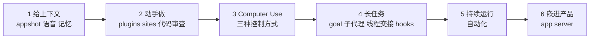

# Codex 应用一小时速览：上下文、Computer Use、长任务与自动化

Codex

**一句话看懂**：OpenAI 的 Charlie Guo 和 Gabriel Chua 在 AI Engineer 大会上用“做菜”的比喻，把 Codex 应用的能力按六步过了一遍：给上下文（appshot、语音、记忆）→ 动手做 → Computer Use（三种控制应用的方式各管什么）→ 长任务（`/goal`、子代理、线程间交接、hooks）→ 持续运行（自动化）→ 嵌进别的产品（app server）。最值得带走的是几条用法判断：**`/goal` 的完成标准要尽量可验证**；子代理和线程交接的区别在于“工作要让模型看见还是让你看见”；侧线程是临时的，长期要用的信息要回传主线程。

::: info 为什么值得看
本站已有 Codex 的 harness 拆解（[#09](/09-how-codex-works)）、团队流程（[#10](/10-how-openai-uses-codex)）和子代理（[#08](/08-codex-masterclass)）。这场是 2026 年中 Codex 应用的**功能全景**，演示了跑了 5–15 小时的长任务怎么拆线程、怎么在被卡住时让人解锁。适合已经在用 Codex、想知道新功能该在什么时候用的读者。它是一场工作坊的前半段，偏产品导览。
:::

::: tip 小白先懂这几个词
- [/goal](/glossary#goal)：给代理一个目标和完成条件，没达成就自动继续。
- [Subagent（子代理）](/glossary#subagent)：主代理派出去做具体小事的分身，有独立上下文。
- [Computer Use](/glossary#computer-use)：代理像人一样看屏幕、点鼠标、敲键盘。
- [Compaction（上下文压缩）](/glossary#compaction)：上下文快满时浓缩成摘要继续干活。
- [Hooks](/glossary#hooks)：在固定时刻一定会执行的脚本。
- [Routines / Automations](/glossary#routines)：按时间表自动运行的代理任务。
:::

## 1. 基本信息

<YouTube id="FwiS44-xyYw" title="Cooking with Codex — Charlie Guo & Gabriel Chua, OpenAI" />

| 项目 | 内容 |
|---|---|
| 讲者 / 频道 | Charlie Guo、Gabriel Chua（OpenAI）／ **AI Engineer** |
| 发布日期 | 2026-10-06（YouTube 上传日期；录制于 AI Engineer World's Fair，演示画面里的日期是 6 月 29 日） |
| 时长 | 1:07:24 |
| 使用工具 | Codex 应用（appshot、Chronicle、记忆、plugins、sites、`/code review`、Computer Use、Chrome 扩展、应用内浏览器、`/goal`、子代理、线程间交接、hooks、自动化、Codex remote）、Codex app server |
| 分析依据 | YouTube 自动字幕（yt-dlp 获取，2026-10-13），截图为 yt-dlp 下载片段后 ffmpeg 抽取的真实帧。自动字幕把 Codex 识别成 “codeex / codecs” 等，引文去掉了 “um / uh” 等口头语，其余照录；引用的片段语义清楚，个别地方可能有识别误差。视频后半段是现场黑客松，没有讲解内容。 |

## 2. 做了什么

讲者把一场工作坊组织成“六道菜”：上下文、动手做、Computer Use、长任务、持续运行（自动化）、把 Codex 放到任何地方（app server）。现场同时跑着前一晚启动的 4 个长任务，其中一个 `/goal` 已运行 15 小时以上。

## 3. 怎么做的

### 3.1 先给上下文

- **appshot**：一个快捷键把当前应用（如 Slack 里的讨论）截给 Codex 当上下文。讲者认为 appshot 和语音输入都被严重低估：口述可以很啰嗦，模型通常能理清。
- **Chronicle**（Pro 用户的研究预览）：Codex 能参考你屏幕上在看什么，例如你在看失败的 CI 流水线时直接问“为什么失败”。
- **提示词仍然要清楚**：

  ::: tr 只要指令清楚，它就仍然重要。我读不了你的心，Codex 也读不了。
  > "In so far as the instructions are clear, it still matters. Like I can't read your mind. Codex can't read your mind."
  :::

### 3.2 Computer Use：三种方式各管什么

讲者现场让 Codex 用 Computer Use 从一个“老式企业仪表盘”下载两段日期的数据，又用 Chrome 扩展创建 Google 表单。在 macOS 上，它不抢你的光标，你可以继续用电脑。

<figure class="shot"><figcaption>📷 视频截图 · <a href="https://www.youtube.com/watch?v=FwiS44-xyYw&t=1401s" target="_blank" rel="noopener">23:21</a> · Codex 用 Computer Use 操作一个没有 API 的分析仪表盘下载数据</figcaption></figure>

Charlie 的总结（幻灯片如下）：

| 任务需要 | 用什么 | 适合的场景（讲者原意） |
|---|---|---|
| 原生应用或跨应用流程 | Computer Use | 没有编程接口的桌面软件、遗留软件 |
| 你已登录的浏览器状态 | Chrome 扩展 | 需要借用你的登录态，避开无头浏览器被拦和验证码 |
| 本地 Web 应用 | 应用内浏览器 | 开发本地网页时做深度交互测试，Codex 能看到更深的页面布局 |

<figure class="shot"><figcaption>📷 视频截图 · <a href="https://www.youtube.com/watch?v=FwiS44-xyYw&t=1601s" target="_blank" rel="noopener">26:41</a> · Recap 幻灯片：Computer Use、Chrome 扩展、应用内浏览器分别用在什么场景</figcaption></figure>

### 3.3 长任务：/goal、子代理和线程间交接

Gabriel 展示了前一晚启动的三类长任务：给一个 Python 包重写 Rust 后端（他给了“不要用动态规划，用启发式”这样的约束）、从零做一个实时问答网站、把一个开源表单工具改成内部版本，分别跑了 5–7 小时以上。

- **`/goal` 的完成标准**：

  ::: tr 要非常具体地告诉模型什么时候算完成，而且这个标准要尽可能可验证。
  > "be really specific with the criteria that you're giving the model to know when it's done. And specifically, you want that criteria to be as verifiable as possible."
  :::

  Charlie 形容 `/goal` 好用时像精灵，不好用时像“猴爪”：技术上做到了你说的，但完全不是你想要的方式。Gabriel 用了 OpenAI skills 仓库里的 `define goal` skill 来写目标；任务在各个里程碑自动跑代码审查和“目标审计”，检查是否偏离最初目标。
- **压缩**：Gabriel 说从 GPT-5.1 Codex Max 起，模型被原生训练在多个上下文窗口间工作（compaction），这是长任务能跑下去的原因。
- **子代理 vs 线程间交接**：Charlie 的判断标准是<Trans zh="工作的委派需要让你（用户）看见，还是只需要让模型看见">“when the delegation of work needs to be visible to you, the user versus when it just needs to be visible to the model”</Trans>。子代理像分包商，你只关心结果；线程交接适合你还想在环里、想看每个线程在做什么。他做游戏时开了一个“创意总监”线程，美术、音乐、动画、玩法各一个线程，并在 AGENTS.md 里要求它们完成前先找创意总监签字。子代理也可以在 `.toml` 文件里自定义提示词和模型。
- **侧线程是临时的**：

  ::: tr 侧线程是临时的。所以如果有任何你想在项目里长期保留的上下文，一定要回传给主线程，因为它们过一段时间就会过期。
  > "Those are ephemeral. So if there is any context that you want to keep longterm in your project, make sure you're communicating that back to the main thread because they will get stale after a while."
  :::

- **被卡住时让人解锁**：深夜 Codex 需要凭据时，Gabriel 在侧线程里问它“一步步说明我能怎么帮你解锁”，选一个选项后，侧线程再通知主线程继续。他也让 Codex 通过 Slack plugin 给自己发进度消息。
- **hooks**：在 `config.toml` 里配置，<Trans zh="适合在开发周期的特定检查点引入确定性行为">“really great for when you want to start introducing deterministic behavior at specific checkpoints”</Trans>，例如把对话发到日志系统、扫描输入输出里是否误贴了 API key、检查工具是否在白名单上、回合结束时跑自定义校验。Gabriel 展示的例子是每个回合结束时跑一个 Python 脚本整理仓库。

### 3.4 持续运行：两种自动化

<figure class="shot"><figcaption>📷 视频截图 · <a href="https://www.youtube.com/watch?v=FwiS44-xyYw&t=3441s" target="_blank" rel="noopener">57:21</a> · 自动化分两种：线程内心跳（In-thread Heartbeat）和新线程（New Thread）</figcaption></figure>

- **线程内心跳**：活在同一个线程里，按定时器反复运行直到完成。Charlie 说这是目前更强大的一种，比如定时问“现在进度如何”，Codex 告诉你自上次以来发生了什么。
- **新线程**：在应用的 Scheduled 页面设置，每次开一个新线程，适合“每周汇总直属团队在做什么”这类任务。
- 现场例子：每半小时读一次 Slack 里的用户反馈；如果是 bug 或功能请求，就开 worktree 新线程修复、开 PR，并请同事审查。

### 3.5 嵌进产品：app server

Codex 的 harness 和 app server 都开源，可以把 Codex 嵌进自己的产品或内部平台（细节见 [[43]]）。Gabriel 前一晚启动的第四个长任务，就是用 app server 做一个复古风格的 Codex 客户端。

## 4. 结果如何

| 演示 | 讲者给出的情况 |
|---|---|
| 长任务 | 现场有一个 `/goal` 已运行 15 小时 30 分钟以上；另外的任务分别运行约 5 小时、7 小时、12 小时 |
| 现场构建 | 一个 macOS 实时翻译应用，讲者说 Codex 用了 4 分 2 秒做出来（他自称没做过 macOS 应用） |
| 社区案例 | 讲者提到有人单个会话用了近 300 个子代理、有人用 `/goal` 跑了 40 小时用 Swift 重写 Doom（引自社交媒体，未核实） |

::: warning 局限与注意
- 这是 OpenAI 员工的产品导览，偏“功能展示”；多数功能只在 Codex 应用里有，部分是 Pro 或企业版的预览功能（Chronicle、sites）。
- 长任务的最终质量、成本、失败率都没有给出；社区案例是讲者转述的社交媒体帖子。
- 基于自动字幕，引文可能有识别误差；录制于 6 月底，到 10 月上传时功能可能已有变化。
- 内容很广但每项都浅，具体配置（hooks、子代理 `.toml`）没有完整展示。
:::

## 5. 可借鉴之处

1. **`/goal` 先写可验证的完成条件**：越具体、越能检查，越不容易出现“技术上做到了，但不是你要的”。
2. **长任务定期做“目标审计”**：在里程碑处让一个线程检查是否偏离最初目标，偏了就提醒主线程。
3. **按“谁需要看见”选委派方式**：只要结果用子代理；想全程参与就开多个线程，并在 AGENTS.md 里规定完成前要找谁签字。
4. **侧线程的结论要回传**：临时线程会过期，长期要用的上下文写回主线程或文件。
5. **Computer Use 按场景选**：没 API 的桌面软件用 Computer Use，要登录态用浏览器扩展，本地网页测试用应用内浏览器。
6. **确定性的检查交给 hooks**：密钥扫描、工具白名单、收尾校验不要只写在提示词里。

### 你可以这样试

- [ ] 下一个长任务先写一段“完成条件”：列出 3–5 条可以用命令或测试检查的标准，再启动 `/goal`。
- [ ] 让长任务每完成一个里程碑就回答一次：“和最初目标相比，有没有偏离？”
- [ ] 找一件你每周都要在某个没有 API 的网页后台点很多次的事，试试让代理用浏览器或 Computer Use 完成。

::: details 读完自测（点开看答案）
1. **`/goal` 最重要的使用建议是什么？** 完成标准要具体、尽可能可验证。
2. **子代理和线程间交接怎么选？** 看工作需要让模型看见还是让你看见：只关心结果用子代理，想全程参与用线程交接。
3. **Computer Use、Chrome 扩展、应用内浏览器分别适合什么？** 没有编程接口的桌面 / 跨应用流程；需要你的登录态；本地 Web 应用的深度测试。
4. **两种自动化的区别？** 线程内心跳在同一线程按定时器反复跑；新线程在 Scheduled 页面设置，每次开新线程。
:::
