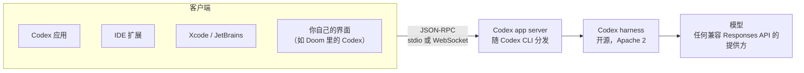

# 在 Codex harness 上做自己的客户端：app server 协议与三条建议

Codex

**一句话看懂**：Codex 应用、IDE 扩展、Xcode / JetBrains 集成，背后都是同一个 harness 和同一个协议：**app server**，一个 JSON-RPC 风格的协议，有 120 多种客户端消息，harness 和协议都以 Apache 2 许可开源。Dominik Kundel 用一个自制的抓包工具展示真实消息流，又现场把 Codex 塞进了 Doom 游戏里。他给出的三条建议：**自己打包一份 harness**；新工具标成**延迟加载**（deferred），不占上下文；改提示词优先用 **developer instructions 追加**，不要重写系统提示词。

::: info 为什么值得看
[#09](/09-how-codex-works) 拆解了 Codex harness 的内部机制，这场是它的“外部接口”：如果你想在 Codex 上做自己的界面、评测框架或内部平台，而不是从零写一个代理，就要知道 app server 能做什么、和 `codex exec`、ACP 有什么区别。时长 18 分钟。
:::

::: tip 小白先懂这几个词
- [Harness（代理外壳）](/glossary#harness)：包在模型外面、负责提示词、工具和循环的那层程序。
- [App Server（Codex 应用服务协议）](/glossary#app-server)：包住 Codex harness 的 JSON-RPC 协议，客户端通过它启动线程、收事件。
- [ACP（Agent Client Protocol）](/glossary#acp)：编辑器和代理之间的通用协议。
- [Deferred Tools（延后加载工具）](/glossary#deferred-tools)：工具不放进系统提示词，代理需要时再搜索加载。
- [codex exec](/glossary#codex-exec)：Codex 的非交互模式，适合脚本和 CI。
- [System Prompt（系统提示词）](/glossary#system-prompt)：每次对话开头固定给模型的指令。
:::

## 1. 基本信息

<YouTube id="9WiBJRO84yY" title="Building on the Codex Harness — Dominik Kundel, OpenAI" />

| 项目 | 内容 |
|---|---|
| 讲者 / 频道 | Dominik Kundel（OpenAI，Codex 开发者体验）／ **AI Engineer** |
| 发布日期 | 2026-10-09（YouTube 上传日期；录制于 AI Engineer World's Fair 的 Expo Stage，画面显示 2026-07-01） |
| 时长 | 18:07 |
| 使用工具 | Codex app server（随 Codex CLI 一起分发）、Codex 应用、Python SDK、自制消息抓包工具、Electron + Doom（WASM） |
| 分析依据 | YouTube 自动字幕（yt-dlp 获取，2026-10-13）；截图为 yt-dlp 下载片段后 ffmpeg 抽取的真实帧，其中一张是讲者的建议幻灯片。引文去掉了 “um / uh” 等口头语。讲者也是 [#09](/09-how-codex-works)、[#10](/10-how-openai-uses-codex) 的讲者。 |

## 2. 做了什么

::: tr app server 其实就是包住 Codex harness 的协议。如果你了解过 agent client protocol，这是很类似的概念：我们有一个协议，让你可以直接在 harness 上构建、深度集成。
> "the app server is actually the protocol that wraps the Codex harness. if you've ever looked into something like agent client protocol, this is a very similar concept where basically we have a protocol that allows you to directly build on top of the harness and deeply integrate into it."
:::

讲者讲了四件事：app server 是什么、怎么定制代理、怎么启动和集成、和 `codex exec` 的区别，最后给出三条建议。

## 3. 怎么做的

### 3.1 app server 是什么

- 一个 JSON-RPC 风格的协议，驱动 OpenAI 自己的所有界面（Codex 应用、IDE 扩展），也驱动第三方（Xcode、JetBrains、一些开源客户端），以及给 Claude Code 用的 Codex 插件。
- harness 和 app server 都开源（Apache 2），可以接任何兼容 Responses API 的模型提供方，并有连接 LM Studio、Ollama 的便捷设置。
- 讲者用自制的抓包工具展示了 Codex 应用和 app server 之间的真实消息：线程启动、配置读取、流式增量等。

<figure class="shot"><figcaption>📷 视频截图 · <a href="https://www.youtube.com/watch?v=9WiBJRO84yY&t=226s" target="_blank" rel="noopener">3:46</a> · 讲者自制的 Inspector：拦截 Codex 应用和 app server 之间的消息（config/read、thread/list、hooks/list 等）</figcaption></figure>

- 应用里的关键功能都通过协议暴露：<Trans zh="我们现在有 120 多种客户端消息，还在不断增加">“we have right now over 120 so different client messages that we continuously add more to”</Trans>，从初始化、线程和回合，到设置 goal、列出插件、文件搜索和修改文件系统。
- 和 ACP 的区别：ACP 是更通用的协议；app server 能让你控制 harness 的更多部分。用户还可以用 ChatGPT 账号登录，用量算在他们自己的 Codex 额度里。

### 3.2 怎么定制代理

- **developer instructions**：追加在 Codex 系统提示词之后。讲者建议追加而不是替换，<Trans zh="这样你仍然能用上我们为各个模型调教提示词所做的工作">“That way you're still leveraging all of the work that we put into tweaking the prompts for the individual models”</Trans>。Codex 应用自己也是这样给应用特有的功能加说明的。
- **dynamic tools**：直接定义额外的函数给代理用（也可以用 MCP），并且可以标成**延迟加载**：不注入系统提示词，Codex 用工具搜索找到它们，避免污染上下文窗口。
- **按线程配置**：每个线程可以换模型提供方、换模型，或细粒度控制沙箱（能访问哪些网络、能改哪些文件）。

### 3.3 怎么启动和集成

- app server 和 Codex CLI 是同一个二进制。Codex 应用把它打包在应用里，随每个版本更新；Windows 版同时带 Linux 和 Windows 两个二进制，用于 WSL 和原生模式。
- 可以让它为当前版本生成 TypeScript 绑定或 JSON schema。协议在版本之间经常变化，这也是要自己打包的原因。
- 传输方式：stdio 或 WebSocket。
- 集成方式：新发布的 Python SDK（处理生命周期、ChatGPT 登录）；或者直接让 Codex 读文档去实现这个协议。讲者说他用 Visual Basic 做了一个 Windows 原生客户端，基本一次成功。

### 3.4 现场演示：把 Codex 放进 Doom

一个 Electron 应用加载 Doom 的 WASM 渲染，Codex 的终端界面直接渲染在游戏里，通过 Electron IPC 连到本机的 app server（模型显示为 GPT-5.5）。用 dynamic tools 暴露了“加满护甲和血量”“给所有武器”等游戏函数；问它当前目录，它照样调用 shell。

<figure class="shot"><figcaption>📷 视频截图 · <a href="https://www.youtube.com/watch?v=9WiBJRO84yY&t=816s" target="_blank" rel="noopener">13:36</a> · 在 Doom 游戏里运行的 Codex 客户端（CODEXTERM，GPT-5.5），背后是同一个 app server</figcaption></figure>

### 3.5 app server 还是 codex exec

`codex exec` 适合写脚本、在 CI/CD 里做“自动修复 PR”这类事（见 [[22§3.1]]）。如果你要做完整的客户端、展示代理过程，或者**同时开很多个 Codex 线程**（比如自己的评测框架，或者用 `/goal`），app server 更合适：直接发多个新线程事件，不用自己去并行化一堆 `codex exec` 调用。

### 3.6 三条建议

<figure class="shot"><figcaption>📷 视频截图 · <a href="https://www.youtube.com/watch?v=9WiBJRO84yY&t=991s" target="_blank" rel="noopener">16:31</a> · Tips using app server：自己打包 harness；动态工具标为 deferred；优先用 developerInstructions</figcaption></figure>

1. **自己打包一份 harness**：依赖用户装的 CLI，会遇到破坏性变更、实验功能变化，还要担心用户有没有更新。
2. **新函数要暴露，但标成 deferred**：Codex 应用自己也这样做（例如让线程能创建自动化），避免不必要地占用上下文、让代理困惑。
3. **改指令先用 developer instructions**：

   ::: tr 你可能想马上冲去写自己的系统提示词，但我们做 harness 时要不断考虑很多事，确保提示词在模型的分布内、代理表现良好。直接写自己的系统提示词，就会失去这些。
   > "It might feel like you want to immediately rush to I'm going to write my own system prompt, but there is a lot of different things that we constantly have to think about when we're building a harness to make sure that the actual prompt is in distribution and make sure that the agent performs well. And you're losing out on all of that if you're actually jumping in and like writing your own system prompt."
   :::

## 4. 结果如何

| 项目 | 讲者给出的情况 |
|---|---|
| 客户端消息种类 | 120 多种，持续增加 |
| 用 app server 的客户端 | Codex 应用、IDE / VS Code 扩展、Xcode、JetBrains、部分开源客户端、Claude Code 里的 Codex 插件 |
| 许可 | harness 和 app server 都是 Apache 2 |
| 演示 | Doom 里的 Codex 客户端；Visual Basic 客户端“基本一次成功”（讲者自述，未展示） |

::: warning 局限与注意
- 18 分钟的大会短讲，偏介绍和演示，没有给出协议的具体消息格式示例或代码。
- 讲者是 OpenAI 员工，内容推广 Codex 生态；“让 Codex 帮你实现协议”的说法没有失败案例。
- 协议在版本之间经常变化，讲者自己也建议打包固定版本；具体消息请以开源仓库为准。
- 基于自动字幕，引文可能有识别误差。
:::

## 5. 可借鉴之处

1. **想要代理能力时，先考虑在现有 harness 上构建**：app server 给了线程、工具、沙箱、goal 等全部能力，比从零写代理省事。
2. **把依赖的 harness 版本固定下来**：随你的应用一起打包，不依赖用户环境。
3. **自定义工具默认延迟加载**：工具越多，越要避免一次性塞进上下文（同 [[09§3.2]]、[[36§3.3]]）。
4. **追加指令，别替换系统提示词**：厂商对系统提示词的调教是为模型分布做的，自己重写容易变差。
5. **脚本用 exec，产品和并发用 app server**：一次性任务、CI 用非交互模式；要并发、要展示过程用协议。

### 你可以这样试

- [ ] 如果你在写调用 Codex 的脚本或评测，看看能否从多次调用 `codex exec` 改成通过 app server 并发开线程。
- [ ] 检查你给代理加的自定义工具：不常用的能否改成按需加载？
- [ ] 如果你改过某个代理的系统提示词，试着恢复默认，把你的要求改写成追加的 developer instructions，对比效果。

::: details 读完自测（点开看答案）
1. **app server 是什么？** 包住 Codex harness 的 JSON-RPC 风格协议，Codex 应用、IDE 扩展和第三方集成都通过它和 harness 通信。
2. **它和 ACP 有什么不同？** ACP 更通用；app server 能控制 harness 的更多部分（如 developer instructions、dynamic tools、按线程的沙箱配置）。
3. **什么时候用 app server 而不是 codex exec？** 做完整客户端、展示代理过程，或者要同时开很多线程（评测框架、`/goal`）时。
4. **三条建议是什么？** 自己打包 harness；动态工具标成 deferred；优先用 developer instructions 而不是改完整指令。
:::
