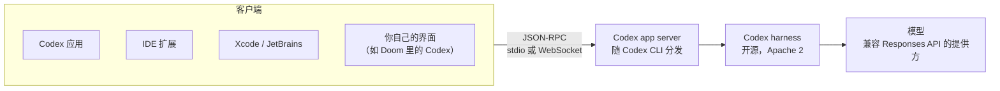

# 想做自己的代理界面，要从零写 harness 吗：Codex app server 协议与三条建议

Codex

**一句话看懂**：Codex 应用、IDE 扩展、Xcode / JetBrains 集成，背后都是同一个 harness 和同一个协议：**app server**，一个 JSON-RPC 风格的协议，有 120 多种客户端消息，harness 和协议都以 Apache 2 许可开源。Dominik Kundel 用一个自制的抓包工具展示真实消息流，又现场把 Codex 塞进了 Doom 游戏里。他给出的三条建议：**自己打包一份 harness**；新工具标成**延迟加载**（deferred），不占上下文；改提示词优先用 **developer instructions 追加**，不要重写系统提示词。

## 读完你能带走的 6 条收获

1. **想做自己的代理界面，不必从零写 harness**：Codex 的 harness 和 app server 都开源（Apache 2），Codex 自家应用也跑在同一个协议上（见 3.1）。
2. **app server 比 ACP 管得更细**：120 多种客户端消息，能设 goal、列插件、改文件系统，还能按线程换模型和沙箱（见 3.1、3.2）。
3. **改行为优先“追加”，不要“替换”**：用 developer instructions 接在系统提示词后面，保住厂商对各模型的调教（见 3.2、3.6）。
4. **自定义工具标成 deferred**：不进系统提示词，代理靠工具搜索按需找到，不污染上下文（见 3.2）。
5. **把 harness 版本随应用一起打包**：协议在版本之间常变，依赖用户装的 CLI 会踩破坏性变更（见 3.3、3.6）。
6. **脚本和 CI 用 `codex exec`，要并发或要完整界面用 app server**（见 3.5）。

::: tip 小白先懂这几个词
- [Harness（代理外壳）](/glossary#harness)：包在模型外面、负责提示词、工具和循环的那层程序。
- [App Server（Codex 应用服务协议）](/glossary#app-server)：包住 Codex harness 的 JSON-RPC 协议，客户端通过它启动线程、收事件。
- [ACP（Agent Client Protocol）](/glossary#acp)：编辑器和代理之间的通用协议。
- [Deferred Tools（延后加载工具）](/glossary#deferred-tools)：工具不放进系统提示词，代理需要时再搜索加载。
- [codex exec](/glossary#codex-exec)：Codex 的非交互模式，适合脚本和 CI。
- [System Prompt（系统提示词）](/glossary#system-prompt)：每次对话开头固定给模型的指令。
:::

## 1. 基本信息

<YouTube id="9WiBJRO84yY" title="Building on the Codex Harness — Dominik Kundel, OpenAI" />

| 项目 | 内容 |
|---|---|
| 讲者 / 频道 | Dominik Kundel（OpenAI，Codex 开发者体验）／ **AI Engineer** |
| 发布日期 | 2026-10-09（YouTube 上传日期；录制于 AI Engineer World's Fair 的 Expo Stage，画面显示 2026-07-01） |
| 时长 | 18:07 |
| 使用工具 | Codex app server（随 Codex CLI 一起分发）、Codex 应用、Python SDK、自制消息抓包工具、Electron + Doom（WASM） |
| 分析依据 | YouTube 自动英文字幕（yt-dlp，2026-10-14 重新抓取原始识别轨；另一条“en”轨是机器改写过的，不采用），引语逐字核对，保留了口语里的停顿和重复；字幕把 Claude Code 误识别成 “Cloud Code”，本文已更正。截图是视频真实帧，其中一张是讲者的建议幻灯片。讲者也是 [#09](/09-how-codex-works)、[#10](/10-how-openai-uses-codex) 的讲者，内容推广 Codex 生态。“我觉得”开头的段落是本站评论，不是讲者观点。 |

## 2. 这篇在回答什么

讲者开场先让台下举手：谁自己写过 agent harness？谁觉得写 harness 太吓人？

这就是这场 18 分钟短讲要解决的问题。你想在自己的产品里放一个编码代理：可能是一个内部平台，一个评测框架，或者一个奇怪的界面。要从零写提示词、工具循环、沙箱吗？

讲者的答案是：不用，在 Codex 的 harness 上接一个协议就行。

::: tr app server 其实就是包住 Codex harness 的协议。如果你了解过 agent client protocol，这是很类似的概念：我们有一个协议，让你可以直接在 harness 上构建、深度集成。
> "the app server is actually the protocol that wraps the Codex harness. Um, if you've ever looked into something like agent client protocol, this is a very similar concept where basically we have a protocol that allows you to directly build on top of the uh, harness and deeply integrate into it."
:::

围绕它，讲者回答了五个问题：

1. app server 是什么，和 ACP 有什么不同？（3.1）
2. 怎么定制里面的代理？（3.2）
3. 怎么拿到它、接进自己的程序？（3.3、3.4）
4. 什么时候该用 `codex exec`？（3.5）
5. 用的时候要注意什么？（3.6）

## 3. 怎么做

### 3.1 app server 是什么：Codex 自己也用的那个协议

先说是什么。app server 是一个 JSON-RPC 风格的协议：你的程序（客户端）发消息给 app server（服务端），让它执行动作，再收回事件。

为什么值得信？因为 OpenAI 自己的所有界面都跑在它上面：Codex 应用、IDE 扩展、VS Code 扩展。第三方也是：Xcode、JetBrains IDE，以及 T3 Code 等开源项目。讲者还提到，今年早些时候他们用它把 Codex 放进了 Claude Code，做成一个插件，可以让 Codex 审代码或接手任务。

它是开源的：

- harness 和 app server 都是 Apache 2 许可，可以 fork、改成自己的；
- 可以接任何兼容 Responses API 的模型提供方，还有连接 LM Studio、Ollama 的便捷设置。

讲者没有用假想的消息举例，而是<Trans zh="有点做过头了，真的做了一个小小的抓包器">“went a bit overboard and actually built a little inspector”</Trans>，拦截 Codex 应用和 app server 之间的真实事件。现场能看到线程启动（带着当前项目等配置）、配置读取、流式的 delta 消息。演示中缓冲区里有旧消息，他重开了一次。

<figure class="shot"><figcaption>📷 视频截图 · <a href="https://www.youtube.com/watch?v=9WiBJRO84yY&t=226s" target="_blank" rel="noopener">3:46</a> · 讲者自制的 Inspector：拦截 Codex 应用和 app server 之间的消息（config/read、thread/list、hooks/list 等）</figcaption></figure>

这个协议的灵活之处在于：应用里的关键功能全都暴露出来了。

::: tr 事实上，我们现在有 120 多种客户端消息，还在不断增加。
> "In fact, we have right now over 120 so different client client messages that we continuously add more to."
:::

范围从初始化（配置客户端特有的参数）、线程修改和回合，到设置 goal（可以实现你自己的 goal 模式）、列出插件，一直到文件搜索和修改文件系统。

那和 ACP 有什么不同？讲者说 ACP 是更通用的协议；app server 能让你控制 harness 里更多的部分。另一个很多人在意的点是：可以接入“用 ChatGPT 登录”，你的用户用自己的 ChatGPT 订阅，用量算在他们自己的 Codex 额度里。

### 3.2 怎么定制代理：追加指令、延迟加载的工具、按线程配置

定制最重要的是两件事：**developer instructions** 和**工具**。

**developer instructions** 是追加在 Codex 系统提示词后面的指令。系统提示词本身在仓库里可以看到，但讲者建议不要改它，而是往后追加：

::: tr 这样你仍然能用上我们为各个模型调教提示词所做的工作，同时又能为你的具体场景定制。
> "That way you're still leveraging all of the work that we put into tweaking the prompts for the individual models, while still customizing it for your specific use case of the harness."
:::

Codex 应用自己就是这么做的：应用比 IDE 扩展、CLI 多一些功能，这些说明就用 developer instructions 加上去。

**dynamic tools** 是你直接定义、给代理用的函数。也可以用 MCP，但直接定义更简单，而且可以标成**延迟加载**（deferred）：

- 不标：工具定义注入系统提示词，一开始就占上下文；
- 标了：Codex 通过一个工具搜索工具，在需要时找到它们，<Trans zh="而不是污染整个上下文窗口">“rather than polluting the overall context window”</Trans>。

（工具搜索的细节，讲者说在第二天另一场讲。）

**按线程配置**：每个线程都可以单独改设置，比如换模型提供方、换模型，或者精细控制沙箱，能连哪些网络、能改哪些文件。

我觉得这一节最值得记的是方向：定制代理时，先想“我能往上加什么”，而不是“我要重写什么”。追加指令和延迟加载工具，都是在不破坏原有调教的前提下扩展能力。

### 3.3 怎么拿到它、怎么接入

**拿到它很简单**：app server 和 Codex CLI 是同一个二进制。装了 Codex CLI，现在就能启动 app server。

Codex 应用也是这么带的：二进制就放在应用包里，每次应用更新它也跟着变。Windows 版带了两份，一份为 Linux 编译、一份为 Windows 编译，WSL 模式用前者，原生模式用后者。

**几个方便的功能**：

- 可以让它为当前版本生成 TypeScript 绑定或 JSON schema。这很有用，因为<Trans zh="这个协议在版本之间经常变化">“this uh, protocol regularly changes between versions”</Trans>，这也是要把它和应用打包在一起的原因。
- 传输方式有两种：标准输入输出（stdio）或 WebSocket。选哪个看场景，讲者说最简单的办法是问 Codex。

**两种最简单的接入方式**：

1. **Python SDK**：最近发布，替你管生命周期，也让接入“用 ChatGPT 登录”更容易。
2. **直接让 Codex 实现**：讲者说 Codex 实现这个协议非常在行，多数时候指给它文档就行，有时连文档都不用。他自己用 Visual Basic 做了一个真正的 Windows 原生客户端，<Trans zh="基本一次就成了">“it did it largely in one shot”</Trans>。

注意这个 Visual Basic 客户端只是口述，现场没有展示。

### 3.4 现场演示：把 Codex 放进 Doom

讲者说，app server 最有意思的地方是，你不必局限于经典的聊天界面：可以从现有应用的 UI 里触发它，可以在后台跑，可以装到奇怪的硬件上。他自己想的是：能不能在 Doom 里跑 Codex，而不是在 Codex 里跑 Doom？

演示是这样搭的：

- 一个 Electron 应用，用 Cloudflare 的 Doom Wasm 渲染器，加载 FreeDoom；
- 他让 Codex 改了游戏文件，Codex 的界面直接用游戏引擎原生渲染在游戏里；
- 游戏通过 Electron 的 IPC 把消息传给本机的 app server。

（开场有个小插曲：双显示器让游戏抢不到控制权，他调了一下。）

<figure class="shot"><figcaption>📷 视频截图 · <a href="https://www.youtube.com/watch?v=9WiBJRO84yY&t=816s" target="_blank" rel="noopener">13:36</a> · 在 Doom 游戏里运行的 Codex 客户端（CODEXTERM，GPT-5.5），背后是同一个 app server</figcaption></figure>

打个招呼，Codex 就回答了，用的是 5.5。有意思的部分是 dynamic tools：他把游戏函数暴露成工具，让它加满护甲和血量、给全部武器和弹药，它都调用了对应工具。

但它仍然是本机上那个完整的 app server。问它“当前目录是什么”，它真的调用 zsh 拿到了工作目录。讲者说，你确实可以在 Doom 里写代码，<Trans zh="不确定我会不会推荐">“not sure if I would recommend it”</Trans>。

我觉得这个演示的价值不在 Doom，而在说明 dynamic tools 的用法：把你自己应用里的功能暴露成几个函数，代理就能操作你的应用，同时保留读文件、跑命令这些原有能力。

### 3.5 app server 还是 codex exec

展会上很多人问讲者同一个问题：这和 `codex exec` 有什么区别？

`codex exec` 启动一个非交互界面，把任务丢给 Codex 执行。它适合写脚本：做 CI/CD、自动修复 PR 这类事（见 [[22§3.1]]）。

app server 适合两种情况：

- 你要做更完整的客户端，要把代理的过程展示给人看；
- 更重要的是，你要**同时开很多个 Codex 线程**，比如跑你自己的评测框架，或者用 `/goal`。

原因是 app server 让你完全控制 harness：发一堆“新线程”事件就能分出任务，<Trans zh="不用自己想办法把所有 Codex exec 调用并行起来">“you don't have to figure out your own way of parallelizing all of the Codex exact calls”</Trans>。

### 3.6 三条建议

<figure class="shot"><figcaption>📷 视频截图 · <a href="https://www.youtube.com/watch?v=9WiBJRO84yY&t=991s" target="_blank" rel="noopener">16:31</a> · Tips using app server：自己打包 harness；动态工具标为 deferred；优先用 developerInstructions</figcaption></figure>

讲者最后给了三条建议。

**第一，自己打包一份 harness。** 依赖用户装好的 CLI，会不断遇到破坏性变更。OpenAI 尽量减少这种变更，但如果你用了实验功能，还是可能碰上。你也不用担心用户有没有更新到你需要的版本，或者去催他们更新。

**第二，新函数要暴露，但标成 deferred。** Codex 应用自己也暴露了函数，让它能在线程里控制自己，比如创建自动化。标成 deferred，就不会用一堆额外函数无谓地占上下文，又能让代理在需要时用到，而不会被它们搞糊涂。

**第三，改指令先从 developer instructions 开始，不要改基础指令。**

::: tr 你可能想马上冲去写自己的系统提示词，但我们做 harness 时要不断考虑很多事，确保提示词在模型的分布内、代理表现良好。直接写自己的系统提示词，就会失去这些。
> "It might feel like you want to immediately rush to I'm going to write my own system prompt, but there is a lot of different things that we constantly have to think about when we're building a harness to make sure that the actual prompt is in distribution and make sure that the agent performs well. And you're losing out on all of that if you're actually jumping in and like writing your own system prompt."
:::

我觉得三条建议说的是同一件事：**别丢掉厂商已经替你做好的调教**。固定版本，是为了不被变化打乱；延迟加载，是为了不挤占上下文；追加指令，是为了让提示词留在模型熟悉的分布里。这对 Claude Code、Gemini CLI 等其他 harness 也同样适用（参见 [[09§3.2]]、[[36§3.3]]）。

## 4. 结果与局限

| 项目 | 讲者给出的情况 |
|---|---|
| 客户端消息种类 | 120 多种，持续增加 |
| 用 app server 的客户端 | Codex 应用、IDE / VS Code 扩展、Xcode、JetBrains、T3 Code 等开源客户端、Claude Code 里的 Codex 插件 |
| 许可 | harness 和 app server 都是 Apache 2 |
| 现场演示 | 抓包器显示真实消息（重开一次后正常）；Doom 里的 Codex 客户端调用游戏工具和 zsh 成功 |
| 口述未展示 | Visual Basic 客户端“基本一次成功” |

::: warning 局限与注意
- **短讲，没有代码**：18 分钟偏介绍和演示，没给出具体消息格式或示例代码。具体协议以开源仓库和生成的 schema 为准。
- **讲者立场**：讲者是 OpenAI 员工，内容推广 Codex 生态；“让 Codex 帮你实现协议”的说法没有讲失败情况。
- **协议常变**：讲者自己也建议打包固定版本，升级时要重新生成绑定。
- **自动字幕**：引语保留了识别出来的口语重复（如 “client client”），产品名有识别错误，已在正文更正。
:::

## 5. 结论

想在自己的产品里放一个编码代理，不必从零写 harness。Codex 的 harness 和 app server 都开源，Codex 自己的应用也跑在同一个协议上。你要做的是：接上协议，往上追加指令和工具，把版本固定下来。

我觉得这场短讲最实用的是 3.6 的三条建议，它们不只适用于 Codex：任何时候在别人的 harness 上做二次开发，都应该先追加、少替换。

### 你可以这样试

- [ ] 装了 Codex CLI 的话，启动 app server，让它为当前版本生成 JSON schema 或 TypeScript 绑定，看看有哪些消息。
- [ ] 如果你在用脚本循环调用 `codex exec` 做评测，试着改成通过 app server 并发开线程。
- [ ] 检查你给代理加的自定义工具：不常用的能否改成按需加载？
- [ ] 如果你改过某个代理的系统提示词，试着恢复默认，把你的要求改写成追加的指令，对比效果。

::: details 读完自测（点开看答案）
1. **app server 是什么？** 包住 Codex harness 的 JSON-RPC 风格协议，Codex 应用、IDE 扩展和第三方集成都通过它和 harness 通信。
2. **它和 ACP 有什么不同？** ACP 更通用；app server 能控制 harness 的更多部分（developer instructions、dynamic tools、按线程的模型和沙箱配置）。
3. **什么时候用 app server 而不是 codex exec？** 做完整客户端、展示代理过程，或者要同时开很多线程（评测框架、`/goal`）时。
4. **三条建议是什么？** 自己打包 harness；新函数标成 deferred；优先用 developer instructions，不要重写系统提示词。
:::
