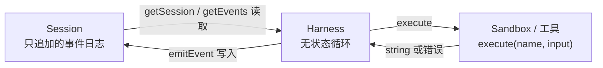

# 把代理的“大脑”和“双手”拆开：Anthropic 怎样设计一个不怕 harness 过时的托管代理

<div class="meta-tags"><span class="tool-tag tool-claude">Claude Code</span></div>

<div class="hook">

**一句话看懂**：harness 里的每个设计，都是在赌“模型自己做不到某件事”，而模型一升级，这些赌注就可能输掉。Anthropic 做托管代理服务时，干脆不押注任何一种 harness，而是像操作系统虚拟化硬件那样，把代理拆成三个稳定的接口：session（只追加的事件日志）、harness（调用 Claude 的循环）、sandbox（执行代码的环境）。拆开后，容器挂了只是一次工具报错，harness 崩了能从日志恢复，凭据碰不到生成的代码，首 token 延迟 p50 降了约 60%。

</div>

## 读完你能带走的 6 条收获

1. **harness 里写死的假设会过时。** Sonnet 4.5 需要的上下文重置，到 Opus 4.5 成了“死重”（见第 2 节）。
2. **别把会话、harness、沙箱塞进一个容器。** 那样容器就成了不能丢的“宠物”，坏了只能进去修，而里面还有用户数据（见 3.1）。
3. **沙箱只是一个工具：`execute(name, input) → string`。** 它挂了，Claude 收到一个工具错误，再开一个新的就行（见 3.2）。
4. **事件日志放在 harness 外面，harness 崩了用 `wake(sessionId)` 接着跑**（见 3.2）。
5. **凭据从结构上不进沙箱。** Git token 在初始化时写进 remote，MCP 的 OAuth token 放保险库、由代理服务替你调用（见 3.3）。
6. **会话日志不是上下文窗口。** 日志完整、可回读；挑哪些放进上下文由 harness 决定，这样压缩做错了也能找回来（见 3.4）。

::: tip 小白先懂这几个词
- [Harness（代理外壳）](/glossary#harness)：调用模型、把工具调用路由到基础设施的那个循环。
- [Session Log（会话事件日志）](/glossary#session-log)：只追加、持久保存的事件记录，代理崩溃后可从中恢复。
- [Sandbox（沙箱）](/glossary#sandbox)：Claude 执行代码、改文件的隔离环境。
- [Pets vs Cattle（宠物与牲畜）](/glossary#pets-vs-cattle)：服务器要么是要精心照料的“宠物”，要么是可随时替换的“牲畜”。
- [Context Anxiety（上下文焦虑）](/glossary#context-anxiety)：模型感觉上下文快满时提前收工。
- [Prompt Injection（提示词注入）](/glossary#prompt-injection)：外部内容诱导代理做用户没要求的事。
:::

## 1. 基本信息

<SourceCard type="文章" title="Scaling Managed Agents: Decoupling the brain from the hands" author="Lance Martin、Gabe Cemaj、Michael Cohen（Anthropic）" date="2026-04-08" url="https://www.anthropic.com/engineering/managed-agents" />

| 项目 | 内容 |
|---|---|
| 链接 | https://www.anthropic.com/engineering/managed-agents |
| 类型 | Anthropic Engineering 博客（文章） |
| 作者 | Lance Martin、Gabe Cemaj、Michael Cohen（文末署名） |
| 发布日期 | 2026-04-08 |
| 使用工具 | Claude Managed Agents（Claude Platform 上的托管服务）、MCP、凭据保险库 |
| 分析依据 | Anthropic Engineering 博客原文全文，2026-10-14 重新抓取并逐字核对。英文引用为原文摘录，“我觉得”开头的段落是本站评论；接口名（`execute`、`provision`、`wake`、`getSession`、`emitEvent`、`getEvents`）照录原文。文中没有给出完整代码或成本数据。 |


## 2. 这篇在回答什么

先看一个具体例子。Anthropic 之前发现，Claude Sonnet 4.5 感觉上下文快满时，会提前草草收工（“上下文焦虑”）。于是他们在 harness 里加了上下文重置。可同一个 harness 用到 Claude Opus 4.5 上时，这个毛病没了：

::: tr 那些重置变成了死重。
> The resets had become dead weight.
:::

文章由此得出一个判断：

::: tr harness 里编码了一些关于“Claude 自己做不到什么”的假设。但这些假设需要经常被质疑，因为模型一变强，它们就会过时。
> harnesses encode assumptions about what Claude can’t do on its own. However, those assumptions need to be frequently questioned because they can go stale as models improve.
:::

那么问题来了：如果你要做一个托管服务，替客户长时间运行代理，而你自己的 harness 也会过时，该怎么设计？

文章借了操作系统的老办法。几十年前，操作系统把硬件虚拟化成“进程”“文件”这样的抽象，足够通用，能支撑当时还不存在的程序。`read()` 不关心底下是 1970 年代的磁盘组还是今天的 SSD。抽象稳定，底下的实现随便换。

Managed Agents 照做，把代理拆成三个部件：

| 部件 | 是什么 |
|---|---|
| Session | 只追加的日志，记录发生过的一切 |
| Harness | 调用 Claude、把 Claude 的工具调用路由到对应基础设施的循环 |
| Sandbox | Claude 运行代码、编辑文件的执行环境 |

::: tr 我们对这些接口的形状有主见，对接口背后跑什么没有主见。
> We're opinionated about the shape of these interfaces, not about what runs behind them.
:::

文章按演进顺序回答了六个问题：


## 3. 怎么做

### 3.1 最初的设计：一切放进一个容器（“养了宠物”）

第一版很直接：session、harness、sandbox 都在同一个容器里。好处是文件编辑就是直接的系统调用，也不用设计服务边界。

问题是他们<Trans zh="养了一只宠物">“we’d adopted a pet”</Trans>。运维里有个“宠物与牲畜”的比喻：宠物有名字、要精心照料、丢不起；牲畜可以随时替换。一体化的容器就成了宠物：容器挂了，会话就丢了；容器没响应，就得把它救回来。

救容器很难：

- **看不清哪里坏了。** 唯一的窗口是 WebSocket 事件流，但它分辨不出故障出在哪：harness 的 bug、事件流丢包、容器离线，看起来一模一样。
- **进去修也不行。** 工程师得在容器里开个 shell 排查，可容器里往往有用户数据，这实际上等于没法调试。

还有一个问题：harness 假设 Claude 要操作的东西都和它在同一个容器里。客户想让 Claude 连自己的私有网络（VPC）时，只能把网络和 Anthropic 打通，或者自己跑整套 harness。

我觉得这一节的教训对自己搭代理平台的人很直接：凡是“会话状态只存在于某台机器上”的设计，最后都会变成宠物。

### 3.2 大脑和双手解耦

解决办法是把“大脑”（Claude 和它的 harness）和“双手”（执行动作的沙箱与工具）、“会话”（事件日志）分开。每部分都只对其他部分做很少的假设，每部分都能单独失败、单独替换。

**容器变成牲畜。** harness 搬出容器，像调用其他工具一样调用容器：

```text
execute(name, input) → string
```

容器挂了，harness 把它当成一次工具调用错误交还给 Claude。Claude 决定重试的话，用一个标准配方开个新容器：

```text
provision({resources})
```

再也不用把坏掉的容器救回来。

**harness 也变成牲畜。** 因为会话日志在 harness 外面，harness 里没有任何东西需要在崩溃后保留。一个挂了，就启动一个新的：

1. `wake(sessionId)` 唤醒；
2. `getSession(id)` 取回事件日志；
3. 从最后一个事件接着跑。

运行中，harness 用 `emitEvent(id, event)` 把每个事件写进会话，留下持久记录。



我觉得这一节的关键是“把状态放到会坏的东西外面”。容器会坏、harness 会坏，所以它们都不能是唯一保存状态的地方。

### 3.3 安全边界：凭据永远碰不到生成的代码

一体化设计还有个安全问题：Claude 生成的不可信代码，和凭据跑在同一个容器里。

::: tr 提示词注入只需要说服 Claude 去读它自己的环境。
> so a prompt injection only had to convince Claude to read its own environment.
:::

攻击者拿到 token，就能开出新的、不受限的会话，把活派给它们。

缩小 token 的权限范围是常见的缓解办法。但文章指出，这本身也是一个假设：假设 Claude 拿着受限的 token 做不了什么。而 Claude 越来越聪明。所以他们选了结构性的修复：

::: tr 确保 token 从运行 Claude 生成代码的沙箱里永远够不着。
> The structural fix was to make sure the tokens are never reachable from the sandbox where Claude’s generated code runs.
:::

具体两种做法：

| 场景 | 做法 |
|---|---|
| Git | 沙箱初始化时，用仓库的访问 token 克隆仓库，并把它接进本地 git remote。沙箱里 `git push` / `git pull` 照常能用，但代理自己从不经手 token |
| 自定义工具（MCP） | OAuth token 存在沙箱外的安全保险库。Claude 通过一个专用代理服务调用 MCP 工具，代理服务拿着和会话关联的 token，去保险库取对应凭据，再调外部服务 |

最后一句很干脆：<Trans zh="harness 从头到尾都不知道任何凭据">“The harness is never made aware of any credentials.”</Trans>

### 3.4 session 不是 Claude 的上下文窗口

长任务经常超出上下文窗口。常见办法（压缩、memory 工具写文件、裁剪旧的工具结果和思考块）都有一个共同点：要做不可逆的取舍，决定留什么、扔什么。

问题是：

::: tr 很难知道未来的轮次会需要哪些 token。
> It is difficult to know which tokens the future turns will need.
:::

被压缩掉的消息，只有事先存下来才找得回。已有研究的办法是把上下文作为窗口外的对象，比如放进 REPL，让模型写代码去筛选、切片。

Managed Agents 的 session 起同样作用，只是上下文持久地存在会话日志里，而不是沙箱或 REPL 里。接口是 `getEvents()`，按位置切出事件流的一段。用法很灵活：

- 从上次读到的地方接着读；
- 在某个时刻之前回退几个事件，看前因；
- 在执行某个动作前，重读相关上下文。

取出来的事件，harness 还可以先变换再放进上下文窗口，比如为了提高提示缓存命中率重新组织、做各种上下文工程。

为什么这样分工？

::: tr 我们把“可恢复的上下文存储”放在 session，把“任意的上下文管理”放在 harness，因为我们无法预测未来的模型需要什么样的上下文工程。
> We separated the concerns of recoverable context storage in the session and arbitrary context management in the harness because we can’t predict what specific context engineering will be required in future models.
:::

接口只保证一件事：会话是持久的、可以查询的。

我觉得这一节和 [[16§2]] 讲的“上下文重置 vs 压缩”可以对着看：那篇在争哪种上下文策略更好，这篇说策略会变，所以先把完整历史存好，策略交给可替换的 harness。

### 3.5 很多大脑、很多双手

**很多大脑。** 拆开后，客户 VPC 的问题自然消失了：harness 不在容器里，也就不再假设资源都在身边。

性能上也有收获。原来每个大脑都要一个容器，容器准备好之前不能推理，每个会话都要先付一遍启动成本：克隆仓库、启动进程、从服务器拉待处理的事件，哪怕这个会话根本用不到沙箱。这段空等体现在首 token 延迟（TTFT）上，也就是用户最能直接感到的延迟。

现在容器只在需要时由大脑通过工具调用开出来。不急着用容器的会话不必等，编排层从会话日志拉到待处理事件就能开始推理。

::: tr 用这个架构，我们的 p50 TTFT 下降了大约 60%，p95 下降了 90% 以上。
> Using this architecture, our p50 TTFT dropped roughly 60% and p95 dropped over 90%.
:::

扩展成很多大脑，就是启动很多无状态的 harness，需要时再接上双手。

**很多双手。** 一个大脑也可以接很多执行环境。这要求 Claude 判断把活发到哪个环境，比在单个 shell 里干活难。文章说，他们一开始用单容器，正是因为早期模型做不到这一点；模型变聪明后，单容器反而成了限制：它一挂，大脑伸进去的所有“手”的状态都丢了。

现在每只手都是一个工具，接口还是 `execute(name, input) → string`。它能接任何自定义工具、任何 MCP 服务器和 Anthropic 自己的工具。

::: tr harness 不知道沙箱是一个容器、一部手机，还是一个宝可梦模拟器。
> The harness doesn’t know whether the sandbox is a container, a phone, or a Pokémon emulator.
:::

而且手不绑定在任何大脑上，大脑之间可以互相传递手。

### 3.6 Meta-harness：只对接口有主见

最后，文章把 Managed Agents 称作一个 meta-harness：它对 Claude 未来需要哪种具体 harness 没有主见。Claude Code 是一个很好的通用 harness，任务专用的 harness 在窄领域也表现出色，Managed Agents 都能容纳。

它有主见的只是 Claude 周围的接口：

- Claude 需要操作状态（session）；
- Claude 需要执行计算（sandbox）；
- Claude 需要能扩展到很多大脑、很多双手。

但不假设大脑和手有多少个、在哪里。

## 4. 结果与局限

- **给出的数据**：p50 TTFT 下降约 60%，p95 下降超过 90%。这是文中唯一的量化结果。
- **给出的接口**：`execute(name, input) → string`、`provision({resources})`、`wake(sessionId)`、`getSession(id)`、`emitEvent(id, event)`、`getEvents()`，只有名字和用途，没有完整签名或代码。

::: warning 局限与注意
- 是 Anthropic 自家托管服务的架构介绍，没有成本、可靠性（比如恢复成功率）、规模等数据。
- TTFT 的下降只说明“不用等容器”带来的收益，没有拆分基线是多少毫秒。
- “多双手”要求模型自己决定把活发到哪个环境，文章没给出这方面的失败率或评测。
- 对个人在本地用代理的人，这套架构大多用不上；最可迁移的是“凭据不进执行环境”和“日志独立于循环”两条原则。
:::

## 5. 结论

这篇文章的主线是：**harness 里的每个假设都会过时，所以把会变的东西放到稳定的接口后面。**

- 容器会坏，所以它只是一个工具；
- harness 会坏、会过时，所以状态放在它外面的日志里；
- 限权 token 也是一种假设，所以凭据从结构上隔离；
- 上下文策略会变，所以存完整历史，策略交给可替换的 harness。

我觉得它和 Cursor 云端代理把“循环、机器、对话状态”拆开（[[40§3.3]]）是同一个结论的两种实现。如果你在搭自己的云端代理平台，可以拿这三个接口当检查清单：沙箱挂了，会话还在吗？harness 重启，能从哪里接着跑？生成的代码，能不能读到任何一个 token？

### 你可以这样试

- [ ] 检查你的代理运行环境：沙箱里有没有 `.env`、云凭据或 GitHub token？能不能改成初始化时注入 remote、或由外部代理服务转发？
- [ ] 把代理的事件（工具调用、结果）写到一个独立于运行进程的日志里，试一次“杀掉进程再从日志恢复”。
- [ ] 如果你在用自己的 harness，列出里面为旧模型加的补丁（比如上下文重置），换新模型时逐个关掉试试。
- [ ] 测一下你的代理会话从收到任务到出第一个 token 要多久，其中多少时间花在准备执行环境上。

::: details 读完自测（点开看答案）
1. **Managed Agents 把代理拆成哪三部分？** Session（只追加的事件日志）、harness（调用 Claude 的循环）、sandbox（执行环境）。
2. **一体化容器为什么是“宠物”？** 容器挂了会话就丢；排查只能进容器，而容器里有用户数据，实际上没法调试。
3. **harness 崩溃后怎么恢复？** 用 `wake(sessionId)` 启动新的 harness，`getSession(id)` 取回日志，从最后一个事件接着跑。
4. **为什么不靠缩小 token 权限来防注入？** 那本身是“Claude 拿着受限 token 做不了什么”的假设，会随着模型变强而失效；结构性办法是让 token 根本够不着沙箱。
5. **session 和上下文窗口是什么关系？** session 是窗口外的完整持久记录，`getEvents()` 按位置读取；放什么进窗口由 harness 决定。
:::
