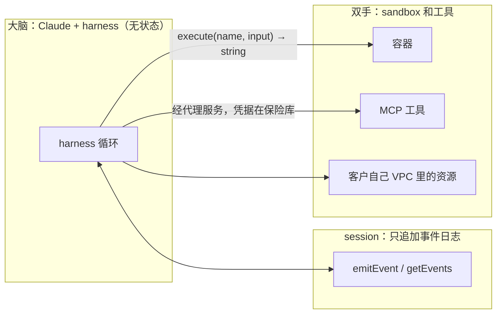

# 把代理的“大脑”和“双手”拆开：Anthropic Managed Agents 的架构

Claude Code

**一句话看懂**：harness 里写死的假设会随着模型变强而过时，所以 Anthropic 做托管代理服务时，不押注某一种 harness，而是像操作系统虚拟化硬件那样，把代理拆成三个接口：**session（只追加的事件日志）、harness（调用 Claude 的循环）、sandbox（执行代码的环境）**。每一部分都可以单独失败、单独替换。拆开之后：容器挂了只是一次工具调用报错；harness 崩了可以从日志恢复；凭据永远碰不到 Claude 生成的代码；不需要容器的会话不用等容器启动，p50 首 token 延迟下降约 60%，p95 下降超过 90%。

::: info 为什么值得看
“看原理”阶段讲过上下文和循环的设计（[#24](/24-huntley-horthy-ralph-loop)、[#16](/16-anthropic-harness-design-long-running-apps)），这篇往外再退一层：**harness 本身也会被替换时，系统该怎么设计**。它和 Cursor 云端代理的“循环、机器、对话状态解耦”（[[40§3.3]]）是同一个结论的两种实现，放在一起读很有收获。
:::

::: tip 小白先懂这几个词
- [Harness（代理外壳）](/glossary#harness)：调用模型、把工具调用路由到基础设施的那个循环。
- [Session Log（会话事件日志）](/glossary#session-log)：只追加、持久保存的事件记录，代理崩溃后可从中恢复。
- [Sandbox（沙箱）](/glossary#sandbox)：Claude 执行代码、改文件的隔离环境。
- [Pets vs Cattle（宠物与牲畜）](/glossary#pets-vs-cattle)：服务器要么是要精心照料的“宠物”，要么是可随时替换的“牲畜”。
- [Context Anxiety（上下文焦虑）](/glossary#context-anxiety)：模型感觉上下文快满时提前收工。
- [Prompt Injection（提示词注入）](/glossary#prompt-injection)：外部内容诱导代理做用户没要求的事。
:::

## 1. 基本信息

<SourceCard type="文章" title="Scaling Managed Agents: Decoupling the brain from the hands" author="Lance Martin、Gabe Cemaj、Michael Cohen（Anthropic）" date="2026-04-08" url="https://www.anthropic.com/engineering/managed-agents" />

| 项目 | 内容 |
|---|---|
| 链接 | https://www.anthropic.com/engineering/managed-agents |
| 类型 | Anthropic Engineering 博客（文章） |
| 作者 | Lance Martin、Gabe Cemaj、Michael Cohen（文末署名） |
| 发布日期 | 2026-04-08 |
| 使用工具 | Claude Managed Agents（Claude Platform 上的托管服务）、MCP、凭据保险库 |
| 分析依据 | Anthropic Engineering 博客原文全文，2026-10-13 用 curl 抓取。英文引用为原文摘录；接口名（`execute`、`provision`、`wake`、`getSession`、`emitEvent`、`getEvents`）照录原文。文中没有给出完整代码或成本数据。 |

## 2. 做了什么

::: tr harness 编码的是“Claude 自己做不到什么”的假设。但这些假设需要经常质疑，因为模型变强后它们可能就过时了。
> "harnesses encode assumptions about what Claude can’t do on its own. However, those assumptions need to be frequently questioned because they can go stale as models improve."
:::

例子：Claude Sonnet 4.5 感觉上下文快满时会提前收工（“context anxiety”），他们在 harness 里加了 context reset；换到 Opus 4.5 后这个行为消失了，<Trans zh="这些重置变成了累赘">“The resets had become dead weight.”</Trans>（对应 [[16§3.5]]。）

所以 Managed Agents 借鉴操作系统的思路：操作系统把硬件虚拟化成进程、文件这类抽象，`read()` 不在乎底下是 1970 年代的磁盘还是现代 SSD。同样，他们把代理虚拟化成三个组件：

::: tr session（发生过的一切的只追加日志）、harness（调用 Claude 并把它的工具调用路由到相应基础设施的循环）和 sandbox（Claude 运行代码、编辑文件的执行环境）。
> "a session (the append-only log of everything that happened), a harness (the loop that calls Claude and routes Claude’s tool calls to the relevant infrastructure), and a sandbox (an execution environment where Claude can run code and edit files)."
:::

## 3. 怎么做的

### 3.1 最初的设计：一切放进一个容器（“养了宠物”）

session、harness、sandbox 都在一个容器里：好处是文件编辑就是系统调用，不用设计服务边界。问题是：

- **容器成了宠物**：容器挂了，会话就丢了；容器卡住，就得“护理”它。
- **几乎无法调试**：唯一的窗口是 WebSocket 事件流，harness 的 bug、事件流丢包、容器下线看起来都一样。要排查只能进容器开 shell，但容器里常有用户数据，所以<Trans zh="这基本上意味着我们没有调试能力">“that approach essentially meant we lacked the ability to debug”</Trans>。
- **假设写死在 harness 里**：harness 假设 Claude 处理的东西都和它在同一个容器里。客户想连自己的 VPC 时，只能和 Anthropic 的网络对等互联，或者在自己的环境里跑 harness。

### 3.2 大脑和双手解耦

- **harness 离开容器**：它像调用任何工具一样调用容器：`execute(name, input) → string`。容器挂了，harness 把它当作工具调用错误交还给 Claude；Claude 决定重试的话，用标准配方 `provision({resources})` 重新初始化一个新容器。
- **harness 也变成“牲畜”**：因为 session 日志在 harness 之外，harness 崩溃时不需要保存任何东西。新的 harness 用 `wake(sessionId)` 启动，用 `getSession(id)` 取回事件日志，从最后一个事件继续；运行中用 `emitEvent(id, event)` 持久记录事件。

### 3.3 安全边界：凭据永远碰不到生成的代码

耦合设计里，Claude 生成的不可信代码和凭据在同一个容器里，提示词注入只要说服 Claude 读自己的环境就行。缩小 token 权限是常见缓解办法，但作者指出这本身也是一个假设：<Trans zh="它编码了“Claude 拿着受限 token 做不了什么”的假设，而 Claude 越来越聪明">“this encodes an assumption about what Claude can't do with a limited token—and Claude is getting increasingly smart”</Trans>。结构性的修复是让 token 从沙箱里根本拿不到：

- **Git**：沙箱初始化时用仓库的 access token 克隆，并接进本地 git remote，代理在沙箱里 push / pull，自己从不接触 token。
- **自定义工具**：用 MCP，OAuth token 存在安全保险库里。Claude 通过专门的代理服务调用 MCP 工具，代理服务凭会话 token 去保险库取凭据。<Trans zh="harness 从不知道任何凭据">“The harness is never made aware of any credentials.”</Trans>

### 3.4 session 不是 Claude 的上下文窗口

长任务常常超出上下文窗口，常见的处理方式（压缩、记忆工具、上下文裁剪）都涉及“留什么、丢什么”的不可逆决定，而<Trans zh="很难知道未来的回合需要哪些 token">“It is difficult to know which tokens the future turns will need.”</Trans>

Managed Agents 的做法：session 是一个活在上下文窗口之外的上下文对象，持久存在日志里。harness 用 `getEvents()` 按位置切片读取事件流：从上次读到的地方接着读、在某个时刻前回退几个事件看来龙去脉、在某个动作前重读上下文。取出的事件在交给 Claude 之前，可以由 harness 任意变换（例如为了提高提示缓存命中率）。

::: tr 我们把“可恢复的上下文存储”放在 session，把“任意的上下文管理”放在 harness，因为我们无法预测未来的模型需要什么样的上下文工程。
> "We separated the concerns of recoverable context storage in the session and arbitrary context management in the harness because we can’t predict what specific context engineering will be required in future models."
:::

### 3.5 很多大脑、很多双手

- **很多大脑**：容器装着 harness 时，每个会话都要先付完整的容器启动成本（克隆仓库、启动进程、拉取事件），哪怕它根本不碰沙箱。解耦后，容器只在大脑通过工具调用需要时才创建，推理可以在编排层从日志拉到待处理事件后立刻开始。扩展到很多大脑，就是启动很多无状态 harness。
- **很多双手**：每只“手”都是一个工具，`execute(name, input) → string`，<Trans zh="harness 不知道沙箱是容器、手机还是宝可梦模拟器">“The harness doesn’t know whether the sandbox is a container, a phone, or a Pokémon emulator.”</Trans> 因为手不绑定某个大脑，大脑之间还能互相传递手。作者说一开始把大脑放进单个容器，是因为早期模型还不能在多个执行环境之间决定把活派到哪里；模型变强后，单个容器反而成了限制。

### 3.6 Meta-harness：只对接口有主见

Managed Agents 被称为 meta-harness：对 Claude 未来需要什么样的 harness 不预设立场，Claude Code 这样的通用 harness 和窄领域的专用 harness 都能放进来。它只对接口有主见：Claude 需要操作状态（session）、执行计算（sandbox），需要扩展到很多大脑和很多双手；但对大脑和双手的数量、位置不做假设。

## 4. 结果如何

| 指标 | 原文数据 |
|---|---|
| 首 token 延迟（TTFT）p50 | 下降约 60% |
| TTFT p95 | 下降超过 90% |
| 容器故障 | 变成一次工具调用错误，由 Claude 决定是否重试 |
| harness 故障 | 新 harness 用 `wake(sessionId)` 从事件日志恢复 |
| 成本、可靠性数字 | 未给出 |

::: warning 局限与注意
- 这是 Anthropic 介绍自家托管服务架构的文章，开头就引导去看产品文档；接口名是概念层面的，不一定等于公开 API。
- 除了 TTFT，没有给出可靠性、成本或安全事件的数据；“凭据碰不到沙箱”的安全性没有第三方评估。
- 主要价值在架构思路，个人开发者很难直接复用，除非自己搭托管代理平台。
:::

## 5. 可借鉴之处

1. **把 harness 当成会被替换的东西**：它编码的是对模型能力的假设，模型一升级就可能过时（同 [[16§3.5]]）。
2. **事件日志放在 harness 之外**：harness 崩了从日志恢复，自己不保存状态。
3. **执行环境当成可丢弃的工具**：容器挂了就报错、重建，不去“护理”它。
4. **凭据不进沙箱**：git 在初始化时接好，外部工具经代理服务从保险库取凭据，生成的代码怎么都读不到。
5. **完整历史和喂给模型的上下文分开**：日志保留全部，harness 按需切片、变换，避免不可逆的压缩决定。
6. **按需创建执行环境**：不需要沙箱的会话不该为它等待。

### 你可以这样试

- [ ] 如果你在跑自己的代理服务，检查一下：代理执行代码的环境里能不能读到 API key？能的话，试着改成在环境外注入（git remote、代理服务）。
- [ ] 让你的代理把每一步事件追加写进一个日志文件，然后试着在中途杀掉进程，看能否从日志恢复。
- [ ] 对照 [[40§3.3]]，列出你系统里的“代理循环、执行环境、对话 / 事件记录”三部分，看它们是否耦合在同一个进程或容器里。

::: details 读完自测（点开看答案）
1. **Managed Agents 把代理拆成哪三个接口？** session（只追加事件日志）、harness（调用 Claude 并路由工具调用的循环）、sandbox（执行环境）。
2. **为什么说最初的容器是“宠物”？** 容器挂了会话就丢，卡住了要人去护理，而且因为容器里有用户数据，几乎无法进去调试。
3. **怎么保证凭据碰不到 Claude 生成的代码？** Git 在沙箱初始化时用 token 克隆并接好 remote；MCP 工具经专门的代理服务从保险库取凭据，harness 也不知道凭据。
4. **解耦带来了什么延迟改善？** 容器只在需要时创建，p50 首 token 延迟下降约 60%，p95 下降超过 90%。
:::
