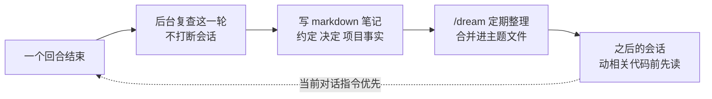

# Grok Build 有了跨会话记忆：自动记下约定和决定，下次开工先读

Grok Build

**一句话看懂**：Grok Build 现在会在每个回合结束后，**在后台**复查这一轮，把值得长期保留的东西（团队约定、决定及理由、项目事实）写成 markdown 笔记；之后的会话在动相关代码前先读这些笔记。`/dream` 把零散笔记整理成按主题分的文件，`/memory` 以只读方式浏览所有记忆文件。它刻意不记任务状态、未定的结论、密钥，以及仓库和文档里已经写了的东西；当前对话里的指令优先于笔记。

::: info 为什么值得看
“打地基”阶段讲的规则文件（[#20](/20-humanlayer-writing-good-claude-md)）和“每个错误都改环境”（[[27§3.5]]）都要人手动写。这是一个让代理**自己沉淀项目知识**的产品实现，而且说清了“记什么、不记什么”。原文很短，是一篇产品发布说明，没有效果数据；收录它主要是补上 xAI 官方一手内容，并和手写规则文件做对照。
:::

::: tip 小白先懂这几个词
- [Agent Memory（代理记忆）](/glossary#agent-memory)：代理在会话之间保留并读回的笔记。
- [AGENTS.md](/glossary#agents-md)：写给代理的项目规则文件，每次会话都会读。
- [Progressive Disclosure（渐进披露）](/glossary#progressive-disclosure)：平时只露出目录，需要时再读细节。
- [Grok Build](/glossary#grok-build)：xAI 的命令行编码代理。
- [Slash Command（斜杠命令）](/glossary#slash-command)：以 `/` 开头的内置命令，如 `/memory`。
:::

## 1. 基本信息

<SourceCard type="文章" title="Memory in Grok Build" author="xAI" date="2026-09-16" url="https://x.ai/news/grok-build-memory" />

| 项目 | 内容 |
|---|---|
| 链接 | https://x.ai/news/grok-build-memory |
| 类型 | 官方产品发布说明（文章） |
| 作者 | xAI（未署个人） |
| 发布日期 | 2026-09-16 |
| 使用工具 | Grok Build CLI 的 memory 功能，`/memory`、`/dream`、`/new` 命令 |
| 分析依据 | x.ai 官方新闻页原文全文（约 500 词，部分段落在页面上重复出现），2026-10-13 用 curl 抓取。英文引用为原文摘录。原文没有给出记忆文件的格式示例、存储路径、效果数据或关闭方法。 |

## 2. 做了什么

::: tr Grok Build 现在有记忆了。你工作时，它会记下出现的约定、决定和项目事实，之后的会话在动相关代码之前会读这些笔记。
> "Grok Build now has memory. As you work, it keeps notes on the conventions, decisions, and project facts that come up, and later sessions read those notes before touching related code."
:::

## 3. 怎么做的

### 3.1 回合结束后在后台记录

每个回合完成后，Grok 在后台复查这一轮，记录持久的内容：约定、决定和项目事实。<Trans zh="记录在每个完成的回合上运行，不会打断会话">“Capture runs on every completed turn and does not interrupt the session.”</Trans>

### 3.2 记什么、不记什么

::: tr 记忆保存最可能在之后的会话里用到的细节：团队怎么写代码、怎么审代码；决定及其背后的理由；项目的持久事实，从某个子系统在哪里，到哪条命令跑测试。任务状态、尚未确定的结论、密钥，以及仓库或文档已经覆盖的内容，都不会记。
> "Memory holds the details most likely to matter in a later session: how the team writes and reviews code, decisions and the reasoning behind them, and durable facts about the project, from where a subsystem lives to which command runs the suite. Task state, tentative conclusions, secrets, and anything the repository or its docs already cover are left out."
:::

### 3.3 按主题存成 markdown，分项目和全局两层

- 笔记是 markdown 文件，一个主题一个文件；每个项目有自己的工作区范围，另有一个全局范围存放到处适用的偏好。
- `/dream` 把新观察合并进所属主题，例如 `topics/testing.md`；它也会定期在后台自动运行。
- `/memory` 打开一个只读浏览器，按范围分组列出所有记忆文件并预览，<Trans zh="是查看一次会话产出了什么、以及笔记有错时找到要改的文件的最快办法">“It is the fastest way to see what a session produced, and to find the file to edit when a note is wrong.”</Trans>

### 3.4 读回：动相关代码前先读，当前指令优先

开始相关工作前，Grok 读取覆盖这一区域的主题并应用，<Trans zh="包括在从没提到这个话题的会话里">“including in sessions where the subject never comes up”</Trans>。<Trans zh="当前对话里的指令优先于笔记里的任何内容。">“Instructions in the current conversation take precedence over anything in a note.”</Trans>

记忆只对新会话生效：运行 `/new` 或重新启动 `grok`，第一个回合完成后开始记笔记。

## 4. 结果如何

原文没有给出任何效果数据（准确率、对任务成功率的影响、记忆文件规模等），只说 <Trans zh="Grok Build 用得越多就越好用">“Grok Build gets better the more you use it.”</Trans>

::: warning 局限与注意
- 这是一篇约 500 词的产品发布说明，没有设计取舍、失败案例或数据；“越用越好”是厂商说法。
- 笔记是代理自己判断后写的，可能记错；原文给的纠错办法是用 `/memory` 找到文件后手动修改，没有说明怎么关闭或审查写入。
- 自动记忆和手写的 AGENTS.md 怎么分工、冲突时谁优先（原文只说当前对话指令优先于笔记），原文没有说明。
- 团队共享：笔记存在本地还是随仓库提交，原文没有说明。
:::

## 5. 可借鉴之处

1. **“记什么”比“能记”更重要**：只记约定、决定（含理由）和项目事实；不记任务状态、没定的结论、密钥和仓库里已有的内容。即使你手写规则文件，这也是一份好的筛选标准。
2. **按主题整理，而不是一直追加**：零散笔记定期合并进 `topics/testing.md` 这样的主题文件，和“规则文件少即是多 + 指针”（[[20§3.5]]）是同一个思路。
3. **记忆要能被人看见和改**：有一个只读浏览入口，错了能找到文件修改。
4. **当前指令优先于记忆**：避免旧笔记压过你现在的要求。

### 你可以这样试

- [ ] 如果你用 Grok Build，开一个新会话做完几个回合后运行 `/memory`，看它记了什么、有没有记错。
- [ ] 不管用哪个代理，用原文的“记 / 不记”标准检查你的 AGENTS.md 或 CLAUDE.md：删掉任务状态、临时结论和仓库文档里已有的内容。
- [ ] 把规则文件里的长段落按主题拆到 `docs/agent/testing.md` 这类文件，根文件只留指针。

::: details 读完自测（点开看答案）
1. **记忆什么时候写入？** 每个回合完成后在后台复查并记录，不打断会话。
2. **哪些内容不会记？** 任务状态、尚未确定的结论、密钥，以及仓库或文档已经覆盖的内容。
3. **`/dream` 和 `/memory` 分别做什么？** `/dream` 把新笔记整理进主题文件（也会定期自动运行）；`/memory` 只读浏览所有记忆文件。
4. **笔记和当前对话的指令冲突时听谁的？** 当前对话的指令优先。
:::
