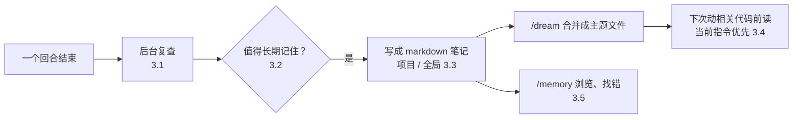

# 纠正过一次的事，代理下次还记得吗：Grok Build 的记忆功能

<div class="meta-tags"><span class="tool-tag tool-grokbuild">Grok Build</span></div>

<div class="hook">

**一句话看懂**：你告诉代理“别用 `cargo test`，用 `just test`，它会先起测试数据库”，下一次新会话它还是用 `cargo test`。Grok Build 的记忆功能解决的就是这个问题：**每个回合结束后，它在后台复查这一回合，把约定、决定（含理由）和项目事实写成 markdown 笔记**；任务状态、暂定结论、密钥和仓库文档里已有的内容不记。笔记分项目和全局两层，`/dream` 把零散笔记合并成按主题的文件；以后动相关代码前先读这些主题，但当前对话里的指令优先。`/memory` 可以浏览所有记忆文件，找出记错的那条。

</div>

## 读完你能带走的 6 条收获

1. **记忆在回合结束后、在后台写**，不打断正在进行的会话（见 3.1）。
2. **记什么比记多少更重要**：记约定、决定和理由、长期不变的项目事实；不记任务进度、没定论的猜测、密钥，也不重复仓库文档里已有的内容（见 3.2）。
3. **笔记是普通的 markdown 文件**，分项目和全局两层；零散笔记定期合并成一个主题一个文件，比如 `topics/testing.md`（见 3.3）。
4. **读回是按“要动哪块代码”触发的**：即使这次对话没提到测试，只要要动相关代码，就先读测试主题（见 3.4）。
5. **当前对话的指令永远优先于笔记**，所以笔记过时时，当场说一句就能覆盖（见 3.4）。
6. **自动写的笔记可能记错，要能看、能找、能改**：`/memory` 按范围列出所有文件，是检查记忆的入口（见 3.5）。

::: tip 小白先懂这几个词
- [Agent Memory（代理记忆）](/glossary#agent-memory)：代理在会话之间保留并读回的笔记。
- [AGENTS.md](/glossary#agents-md)：写给代理的项目规则文件，每次会话都会读。
- [Progressive Disclosure（渐进披露）](/glossary#progressive-disclosure)：平时只露出目录，需要时再读细节。
- [Grok Build](/glossary#grok-build)：xAI 的命令行编码代理。
- [Slash Command（斜杠命令）](/glossary#slash-command)：以 `/` 开头的内置命令，如 `/memory`。
:::

## 1. 基本信息

<SourceCard type="文章" title="Memory in Grok Build" author="xAI" date="2026-09-16" url="https://x.ai/news/grok-build-memory" />

| 项目 | 内容 |
|---|---|
| 链接 | https://x.ai/news/grok-build-memory |
| 类型 | 官方产品发布说明（文章） |
| 作者 | xAI（未署个人） |
| 发布日期 | 2026-09-16 |
| 使用工具 | Grok Build CLI 的 memory 功能，`/memory`、`/dream`、`/new` 命令 |
| 分析依据 | x.ai 官方新闻页原文全文（约 500 词，部分段落在页面上重复出现，另有演示用的终端文本），2026-10-14 用 curl 重新抓取并逐字核对引语。终端示例（`just test`、topic 文件、`/memory` 界面）均为页面上的演示文本。原文没有给出存储路径、效果数据，也没有说明团队之间怎么共享记忆。“我觉得”开头的段落是本站评论。 |

## 2. 这篇在回答什么

页面上的演示是一个很常见的场景。代理在一个叫 orbit 的 Rust 项目里跑测试：

```text
error: connection refused (postgres at localhost:5432)
test result: FAILED. 143 passed; 5 failed; 0 ignored
```

用户纠正它：

::: tr 用 just test，别用 cargo test。它会先启动测试数据库。
> "use just test, not cargo test. it starts the test database first."
:::

代理照做，148 个测试全过。问题是：明天开一个新会话，它还记得吗？

没有记忆的代理不记得。你要么每次重新说一遍，要么自己去改 `AGENTS.md`。Grok Build 的回答是：

<Trans zh="Grok Build 现在有记忆了。">“Grok Build now has memory.”</Trans>

这篇发布说明回答五个问题：

1. 什么时候写？（3.1）
2. 写什么、不写什么？（3.2）
3. 存在哪里、怎么组织？（3.3）
4. 什么时候读、和当前指令冲突听谁的？（3.4）
5. 记错了怎么发现？（3.5）



## 3. 怎么做

### 3.1 回合结束后在后台记录

记忆是在**每一个完成的回合之后**写的：

<Trans zh="一个回合完成后，Grok 在后台复查它，记下任何持久的内容：约定、决定和项目事实。">“After a turn completes, Grok reviews it in the background and records anything durable: conventions, decisions, and project facts.”</Trans>

为什么放在回合之后、放在后台？因为这样不会拖慢你正在做的事。原文强调记录<Trans zh="从不阻塞会话">“never blocks the session”</Trans>：复查完成的回合，把值得保留的写成 markdown 笔记，然后继续。

### 3.2 记什么、不记什么

记忆要留的是<Trans zh="最可能在以后的会话里起作用的细节">“the details most likely to matter in a later session”</Trans>：

| 记 | 不记 |
|---|---|
| 团队怎么写代码、怎么审代码 | 任务状态（做到哪一步了） |
| 决定，以及背后的理由 | 暂定的结论 |
| 持久的项目事实：某个子系统在哪、哪条命令跑测试 | 密钥 |
| | 仓库或文档里已经写了的东西 |

这张表的右栏很关键。任务状态和暂定结论会很快过时，记下来反而误导下一个会话；密钥不该落盘；仓库里已有的东西再记一遍，只会和原文打架。

回到开头的例子，那次纠正变成了这样一个主题文件（页面演示文本，原文摘录）：

::: tr 测试：orbit 里测试怎么跑、怎么组织。命令：用 just test 跑测试套件，它先启动测试数据库再跑 cargo test；直接 cargo test 会让集成测试失败。Fixtures：集成测试从 tests/fixtures/seed.sql 导入数据。
```text
Testing
How tests are run and organized in orbit.

Commands
• Run the suite with just test. It starts the test database and then runs cargo test; plain cargo test fails the integration tests.

Fixtures
• Integration tests seed from tests/fixtures/seed.sql.
```
:::

注意它记的不只是“用 `just test`”，还记了**为什么**：它会先起数据库，直接 `cargo test` 会让集成测试失败。有了理由，下一个会话遇到类似情况才能举一反三。

### 3.3 按主题存成 markdown，分项目和全局两层

笔记就是普通的 markdown 文件，一个主题一个文件。范围分两层：

- **项目（workspace）范围**：每个项目一份；
- **全局范围**：适用于所有项目的偏好，比如你希望回答和 PR 描述怎么写。演示里的全局索引就列了一个 “Reply preferences” 主题（`topics/preferences.md`）。

零散笔记会越积越多，所以有一个整理步骤：

<Trans zh="/dream 把最近的笔记整理成主题文件，例如 topics/testing.md。Dream 也会定期在后台自动运行。">“/dream organizes recent notes into topic files, for example topics/testing.md. Dream also runs on its own periodically in the background.”</Trans>

这样每个项目最后只剩一小组整理好的参考文件，而不是几百条流水账。

### 3.4 读回：动相关代码前先读，当前指令优先

什么时候读？不是每次会话开头把所有笔记都塞进去，而是：

<Trans zh="开始相关工作之前，Grok 读取覆盖这块区域的主题并应用它们，即使在从没提到这个话题的会话里也是如此。">“Before starting related work, Grok reads the topics that cover the area and applies them, including in sessions where the subject never comes up.”</Trans>

演示的后半段就是这样：在后来的会话里，代理给 `src/webhooks.rs` 加了重试（<Trans zh="在 src/webhooks.rs 里加了重试。用 just test 跑，151 个测试通过。">“Added the retry in src/webhooks.rs. 151 tests pass with just test.”</Trans>），这次直接用了 `just test`。

和当前指令冲突时听谁的？原文写得很清楚：

<Trans zh="当前对话里的指令优先于笔记里的任何内容。">“Instructions in the current conversation take precedence over anything in a note.”</Trans>

这条规则很重要。笔记总会有过时的时候，当场一句话就能覆盖，不用先去改文件。

### 3.5 记错了怎么办：用 /memory 检查

自动写的东西一定会有记错的时候。原文给的入口是 `/memory`：

<Trans zh="/memory 打开一个只读的浏览器，列出所有记忆文件，按范围分组，并预览选中的文件。">“/memory opens a read-only browser of every memory file, grouped by scope, with a preview of the selected file.”</Trans>

原文说这是查看一次会话产生了什么、以及笔记出错时<Trans zh="找到要编辑的文件">“to find the file to edit when a note is wrong”</Trans>的最快方法。

演示界面上还能看到几个细节：底部有 `y copy path`、`x delete`、`t toggle (on)` 等快捷键；全局索引文件标注着 “Generated by Grok. Do not edit this file directly.”（由 Grok 生成，不要直接编辑）。这些快捷键的具体含义原文没有解释，以实际界面为准。

## 4. 结果与局限

| 项目 | 原文情况 |
|---|---|
| 写入时机 | 每个完成的回合后，后台运行 |
| 存储形式 | markdown，按主题，分项目 / 全局两层 |
| 整理 | `/dream`，也会定期自动运行 |
| 查看 | `/memory` 只读浏览器 |
| 启用方式 | 只对新会话生效：运行 `/new` 或重新启动 `grok`，第一个回合完成后开始记 |
| 存储路径、效果数据、团队共享 | 未给出 |

::: warning 局限与注意
- 这是产品发布说明，没有效果数据：记了多少、记对多少、帮了多少都没说。
- 自动写入的笔记可能记错，要定期用 `/memory` 检查。
- 没说明团队之间怎么共享记忆，也没说记忆文件能否放进仓库让队友用。
- `/memory` 界面上的快捷键（删除、开关）只出现在演示截图文本里，原文没有解释。
:::

## 5. 结论

Grok Build 的记忆功能，本质上是让代理自己维护一份“项目笔记”：回合后记、按主题整理、用到时再读、当前指令优先。它最适合的就是开头那种场景：你纠正过一次的事，下次不用再说。

我觉得这和 HumanLayer 主张的“规则文件由人精心维护，少即是多”（[[20§3.4]]）是两条不同的路线。一个靠人把关、写得少而准；一个靠代理自动记、需要人定期检查。两者可以并用：普遍适用的写进规则文件，零散的纠正交给记忆。

### 你可以这样试

- [ ] 在 Grok Build 里纠正代理一次（比如测试命令），开一个新会话做相关的事，看它有没有用上。
- [ ] 每周跑一次 `/memory`，看看记下了什么，删掉或修改过时、记错的笔记。
- [ ] 对比你的 `AGENTS.md` 和记忆里的主题，把记忆里普遍适用的条目挪进规则文件。

### 读完自测

1. 记忆在什么时候写？为什么放在后台？
2. 哪四类内容不会被记下？为什么？
3. 演示里的 testing 主题除了“用 just test”，还记了什么？这有什么用？
4. 笔记什么时候被读回？和当前指令冲突时听谁的？
