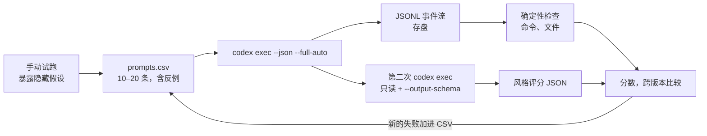

# 给 Skill 写评测：用 codex exec --json 把“感觉变好了”变成证据

<div class="meta-tags"><span class="tool-tag tool-codex">Codex</span></div>

<div class="hook">

**一句话看懂**：改了一个 Skill，到底是变好了还是只是变了？OpenAI 的两位作者给的办法是把 Skill 当成提示词来评测：**一条 prompt → 一次被记录的运行（trace + 产物）→ 几条检查 → 一个能随时间比较的分数**。先用 `codex exec --json` 拿到结构化事件流，写确定性检查（跑了 `npm install` 吗？`package.json` 生成了吗？）；再用 `--output-schema` 让 Codex 按固定 JSON 格式给风格打分。10–20 条 prompt 就够，其中至少要有一条“不该触发”的反例。

</div>

## 读完你能带走的 6 条收获

1. **先写“成功”是什么，再写 Skill。** 检查分成结果、过程、风格、效率四类，只留必须通过的几条（见 3.1）。
2. **Skill 会不会被调用，主要看 `name` 和 `description`。** 写得含糊或塞太多东西，触发就不稳定，所以“触发”本身就要测（见 3.2）。
3. **先手动跑几次，找出 Skill 的隐藏假设**：触发假设、环境假设、执行假设。每一次手动修正，都是一条未来的测试（见 3.3）。
4. **测试集不用大，但要有反例。** 显式调用、隐式调用、带上下文调用各一条，再加一条“相邻但不该触发”的请求（见 3.4）。
5. **能用规则判断的，就别让模型判断。** `codex exec --json` 输出 JSONL 事件流，直接查有没有执行某条命令，失败时能定位到具体哪一步（见 3.5）。
6. **主观的风格检查，用 JSON Schema 固定输出格式**，结果才能合并、diff、跨版本比较（见 3.6）。

::: tip 小白先懂这几个词
- [Skills（技能包）](/glossary#skills)：一个带 `SKILL.md` 的目录，代理按需加载。
- [Evals（评测）](/glossary#evals)：检查模型的输出和过程是否符合预期。
- [codex exec](/glossary#codex-exec)：Codex 的非交互命令，适合脚本和 CI。
- [Grader（评分器）](/glossary#grader)：给一次运行打分的规则或模型。
- [Negative Control（反例对照）](/glossary#negative-control)：不该触发 Skill 的测试用例，用来抓误触发。
- [Output Schema（输出格式约束）](/glossary#output-schema)：用 JSON Schema 限定模型最终回答的结构。
:::

## 1. 基本信息

<SourceCard type="文章" title="Testing Agent Skills Systematically with Evals" author="Dominik Kundel、Gabriel Chua（OpenAI Developers）" date="2026-01-22" url="https://developers.openai.com/blog/eval-skills" />

| 项目 | 内容 |
|---|---|
| 链接 | https://developers.openai.com/blog/eval-skills |
| 类型 | OpenAI Developers 博客（文章） |
| 作者 | Dominik Kundel、Gabriel Chua（页面署名） |
| 发布日期 | 2026-01-22（页面显示 Jan 22, 2026） |
| 使用工具 | Codex（`codex exec`、`--json`、`--output-schema`、`$skill-creator`）、Codex GitHub Action |
| 分析依据 | 原文全文，2026-10-14 用 curl 重新抓取并逐字核对引语。Skill、CSV、脚本和 Schema 均为原文代码，下文只摘录关键片段。原文没有给出任何实际运行结果或分数。“我觉得”开头的段落是本站评论。 |

## 2. 这篇在回答什么

你写了一个 Skill，用了几天，觉得不够好，改了改 description，又加了两步说明。改完之后，新版本好像快了一点，又好像更稳了一点。然后某天发现：它该触发的时候不触发了，或者跳过了一步，或者在目录里多留了几个文件。

作者说，这正是改 Skill 时最常见的处境：

::: tr 当你在为 Codex 这样的代理迭代一个 Skill 时，很难分清你是真的在改进它，还是只是在改变它的行为。
> "When you’re iterating on a skill for an agent like Codex, it’s hard to tell whether you’re actually improving it or just changing its behavior."
:::

他们的答案很朴素：Skill 本质上是一组提示词和指令，那就像评测其他提示词一样评测它。

::: tr 一个 eval 就是：一条 prompt → 一次被记录的运行（trace + 产物）→ 一小组检查 → 一个可以随时间比较的分数。
> "Concretely, an eval is: a prompt → a captured run (trace + artifacts) → a small set of checks → a score you can compare over time."
:::

全文用一个故意做得很小的 Skill `setup-demo-app` 当例子，回答四个问题：

1. “变好了”到底指什么？（3.1、3.2）
2. 拿什么输入去测？（3.3、3.4）
3. 怎么打分，哪些靠规则、哪些靠模型？（3.5、3.6）
4. Skill 成熟以后还要加什么检查？（3.7）



## 3. 怎么做

### 3.1 先定义“成功”，再写 Skill

评测的第一步不是写脚本，而是写下“成功”长什么样，并且要写成能检查的样子。作者把检查分成四类：

- **结果**：任务完成了吗？应用能跑吗？
- **过程**：Codex 调用 Skill 了吗？按预期的工具和步骤走了吗？
- **风格**：输出符合你要的约定吗？
- **效率**：有没有<Trans zh="来回折腾">“thrashing”</Trans>，比如多余的命令、过多的 token？

为什么只留几条？因为一开始就想覆盖所有偏好，评测本身就会变成负担。

<Trans zh="目标不是一开始就把所有偏好写进去，而是抓住你最在意的行为。">“The goal isn’t to encode every preference up front, but to capture the behaviors you care about most.”</Trans>

示例里的组合是：几条具体检查（跑了 `npm install` 吗？生成了 `package.json` 吗？）加一个结构化的风格评分。作者说这种混合是故意的：你要的是**早早暴露具体回归的快信号**，而不是最后一个笼统的“通过 / 不通过”。

### 3.2 Skill 的 name 和 description 决定会不会被触发

Codex 的 Skill 是一个目录，里面的 `SKILL.md` 开头是 YAML front matter（`name`、`description`），后面是 Markdown 指令。作者特别提醒，这两个字段比看上去重要：它们是 Codex 判断要不要调用 Skill、什么时候把整份 `SKILL.md` 注入上下文的主要信号。

<Trans zh="如果写得含糊或塞得太多，Skill 就不会稳定触发。">“If these are vague or overloaded, the skill won’t trigger reliably.”</Trans>

起步可以用内置的 `$skill-creator`（它本身也是一个 Skill）。它会问你这个 Skill 做什么、什么时候该触发、是只写指令还是带脚本，默认推荐只写指令。

示例 Skill `setup-demo-app` 做四件事：用 Vite 的 React + TypeScript 模板建项目，用官方 Vite 插件配 Tailwind，固定一套最小的文件结构，写明“完成的定义”。最后这段是后面所有检查的基础（原文摘录，2026-10-14 抓取）：

::: tr 完成的定义：npm run dev 能启动；package.json 存在；src/components/Header.tsx 和 Card.tsx 存在。
```markdown
## Definition of done

- npm run dev starts successfully
- package.json exists
- src/components/Header.tsx and src/components/Card.tsx exist
```
:::

这个 Skill 的要求很“霸道”：只用函数组件、只用 Tailwind 类、不加别的 UI 库。作者说这是故意的：

<Trans zh="没有清晰的约束，就没有可以评测的具体东西。">“Without clear constraints, there’s nothing concrete to evaluate.”</Trans>

我觉得这一节的价值在于把“触发”单独拎出来。很多人测 Skill 只看它跑起来做得对不对，却没想过它根本没被调用，或者在不该出现的地方冒出来。

### 3.3 先手动跑，找出隐藏假设

写完 Skill 别急着批量评测。先用 `/skills` 斜杠命令或 `$setup-demo-app` 显式调用，在真实仓库或临时目录里跑几次，看它哪里坏。这一步不求快，只找 Skill 默默做了哪些假设：

- **触发假设**：“set up a quick React demo” 应该触发却没触发；更泛的 “add Tailwind styling” 不该触发却触发了。
- **环境假设**：默认目录是空的；默认有 npm，而且优先用 npm。
- **执行假设**：以为依赖已经装好，跳过了 `npm install`；Vite 项目还没建就先配 Tailwind。

要重复跑时，换成 `codex exec`。它为自动化和 CI 设计：进度写到 stderr，只有最终结果写到 stdout，方便脚本捕获。它默认在受限沙箱里跑，任务要写文件就加 `--full-auto`。作者的原则是自动化时只给完成任务所需的最小权限。

```bash
codex exec --full-auto \
  'Use the $setup-demo-app skill to create the project in this directory.'
```

这一步最重要的产出不是“跑通”，而是一份修正记录：

<Trans zh="你在这里做的每一次手动修正……都是未来一条 eval 的候选。">“Every manual fix you make here … is a candidate for a future eval”</Trans>

### 3.4 小而有针对性的 prompt 集

不需要大型 benchmark。作者说，单个 Skill 用 10–20 条 prompt 就够发现回归、确认改进。从一个小 CSV 开始，原文的起始版本是这样的：

::: tr 测试集：前三条应该触发 Skill（显式点名、隐式描述、带领域上下文），第四条“给已有 React 应用加 Tailwind”不应触发。
```csv
id,should_trigger,prompt
test-01,true,"Create a demo app named `devday-demo` using the $setup-demo-app skill"
test-02,true,"Set up a minimal React demo app with Tailwind for quick UI experiments"
test-03,true,"Create a small demo app to showcase the Responses API"
test-04,false,"Add Tailwind styling to my existing React app"
```
:::

四条各测一件事：

| 用例 | 测什么 | 为什么要有 |
|---|---|---|
| test-01 显式调用 | 点名用 Skill | 改了名字、描述、指令后，直接调用还能用 |
| test-02 隐式调用 | 不点名，只描述场景 | `description` 够不够强，能不能让 Codex 自己选中 |
| test-03 带上下文调用 | 加了领域噪声（Responses API） | 真实 prompt 里还能触发，产物结构不变 |
| test-04 反例 | 相邻但不该触发 | 抓误触发：用户想改已有项目，Skill 却新建了一个 |

反例最容易被漏掉。“给已有应用加 Tailwind” 和 Skill 描述里的 “React + Tailwind demo” 字面上很像，Codex 选得太积极，就会在用户的项目里再搭一个新项目。

之后每发现一次漏触发或输出偏差，就加一行。这个 CSV 会慢慢变成一份<Trans zh="活的记录">“living record”</Trans>，记下这个 Skill 必须一直做对的场景。

### 3.5 确定性检查：读 JSONL 事件流

这是整套评测的核心。加上 `--json` 之后，`codex exec` 的 stdout 变成 JSONL 结构化事件流，你可以检查**实际发生了什么**，而不只是最后的输出看起来对不对。

原文给了一个“够用”的 Node.js 脚本，三步：对每条 prompt 运行 `codex exec --json --full-auto "<prompt>"`；把 JSONL trace 存盘；解析事件，跑确定性检查。最关键的检查函数（原文摘录）：

::: tr 确定性检查：事件流里有没有一条命令执行项，命令里包含 npm install。
```js
// deterministic check: did the agent run `npm install`?
function checkRanNpmInstall(events) {
  return events.some(
    (e) =>
      (e.type === "item.started" || e.type === "item.completed") &&
      e.item?.type === "command_execution" &&
      typeof e.item?.command === "string" &&
      e.item.command.includes("npm install"));
}
```
:::

另一个检查更简单：`existsSync(path.join(projectDir, "package.json"))`。

为什么先做这种检查？因为它便宜、稳定，而且能解释。检查失败了，打开 JSONL 文件就能看到每一条命令按顺序是一个 `item.*` 事件，回归的原因一眼可见。

<Trans zh="这里的价值在于一切都是确定的、可调试的。">“The value here is that everything is deterministic and debuggable.”</Trans>

### 3.6 风格检查：第二次 codex exec + --output-schema

文件存不存在、命令跑没跑，答的是“基本功做了没有”。但“是不是按你要的方式做的”，比如组件结构、Tailwind 配置方式，规则很难写。

作者的办法是在流水线里加第二步：对生成的仓库再跑一次**只读**的 `codex exec`，让它按要求检查，并用 `--output-schema` 把最终回答约束成固定的 JSON 结构。原文的 Schema 只有三个字段：`overall_pass`（布尔）、`score`（0–100 的整数）、`checks[]`（每项有 `id`、`pass`、`notes`）。命令是这样的（原文摘录，略去中间四条要求）：

```bash
codex exec \
  "Evaluate the demo-app repository against these requirements:
  ...
  Return a rubric result as JSON with check ids: vite, tailwind, structure, style." \
  --output-schema ./evals/style-rubric.schema.json \
  -o ./evals/artifacts/test-01.style.json
```

固定结构的好处是：多次运行的结果可以合并、diff、跟踪。以后搬进 CI，Codex GitHub Action 也支持通过 `codex-args` 传 `--output-schema`。

我觉得这里有个原文没讨论的问题：让 Codex 给 Codex 生成的代码打分，评分本身可能有偏差，同一份代码两次打分也未必一致。用之前最好先拿几份你自己判过的样例校准一下（对比 [[19]] 对 grader 的讨论）。

### 3.7 Skill 成熟后再加的检查

核心循环跑起来后，可以往需要的方向加深：

| 检查 | 怎么做 | 抓什么 |
|---|---|---|
| 命令数 | 数 JSONL 里的 `command_execution` 项 | 代理开始循环、重复跑命令 |
| token 预算 | 看 `turn.completed` 事件的 `usage.input_tokens`、`usage.output_tokens` | 提示词意外膨胀，跨版本比效率 |
| 构建 | 跑完后 `npm run build` | 坏掉的 import、配错的工具 |
| 运行冒烟 | 起 `npm run dev` 用 curl 访问，或跑轻量 Playwright | 跑不起来；耗时，选择性使用 |
| 仓库整洁 | `git status --porcelain` 为空或匹配允许清单 | 多余文件 |
| 权限回归 | 不提高权限也能跑通 | 越权；自动化后最重要 |

原则只有一句：

<Trans zh="先上能解释行为的快检查，只有在能降低风险时才加更慢、更重的检查。">“begin with fast checks that explain behavior, then add slower, heavier checks only when they reduce risk.”</Trans>

## 4. 结果与局限

| 项目 | 原文情况 |
|---|---|
| 示例 Skill、CSV、脚本、Schema | 全部给出，可复制 |
| 实际运行结果、通过率、分数变化 | 未给出 |
| 推荐测试集规模 | 单个 Skill 10–20 条 |
| 模型评分的稳定性 | 未讨论 |

::: warning 局限与注意
- 这是方法教程，没有展示任何一次真实的评测结果，也没有说这套检查抓到过什么回归。
- 风格检查让 Codex 给自己生成的代码打分，评分模型的偏差和一致性没有讨论（对比 [[19]]）。
- 示例是“建 demo 应用”这种结果容易检查的 Skill；判断类、写作类 Skill 怎么写确定性检查，原文没覆盖。
- 命令和参数绑定 Codex CLI，换工具要自己找对应的结构化输出方式。
:::

## 5. 结论

给 Skill 写评测并不需要大工程。一份 10–20 行的 CSV、一个解析 JSONL 的小脚本、一个三字段的 Schema，就能把“我感觉变好了”换成“这几条检查从失败变成了通过”。最该先做的两件事是：写一段能用命令检查的“完成的定义”，以及在测试集里放一条反例。

我觉得这篇最实用的一点，是把“触发”当成和“做对”同等重要的测试对象。Skill 越多，误触发和漏触发的代价越大。

### 你可以这样试

- [ ] 挑一个你最常用的 Skill，写 5 条 prompt：3 条应触发、2 条相邻但不应触发，手动跑一遍看触发情况。
- [ ] 用 `codex exec --json` 跑其中一条，把 JSONL 存下来，数一数 `command_execution` 有几条。
- [ ] 给这个 Skill 的说明补一段“完成的定义”，写成能用命令检查的三条。

### 读完自测

1. 作者把检查分成哪四类？为什么建议只留几条？
2. 测试集里的反例在防什么问题？举一个原文的例子。
3. 为什么先做确定性检查，再做模型评分？
4. `--output-schema` 解决了风格评分的什么问题？
