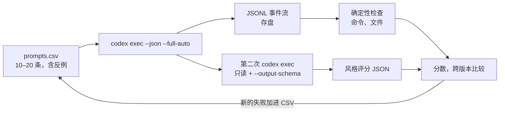

# 给 Skill 写评测：用 codex exec --json 把“感觉变好了”变成证据

<div class="meta-tags"><span class="tool-tag tool-codex">Codex</span></div>

<div class="hook">

**一句话看懂**：改了一个 Skill，到底是变好了还是只是变了？OpenAI 给的办法是把 Skill 当成提示词来评测：**一条 prompt → 一次被记录的运行（trace + 产物）→ 几条检查 → 一个能随时间比较的分数**。先用 `codex exec --json` 拿到结构化事件流，写确定性检查（跑了 `npm install` 吗？`package.json` 生成了吗？）；再用 `--output-schema` 让 Codex 按固定 JSON 格式给风格打分。10–20 条 prompt 就够，其中至少要有一条“不该触发”的反例。

</div>

::: info 为什么值得看
本站讲 evals 的资料（[#19](/19-anthropic-demystifying-agent-evals)）偏概念，这篇是少见的**完整可照做**的例子：有 Skill 原文、CSV 测试集、Node.js 评测脚本和 JSON Schema。适合已经在写 Skill（[[21]]）、想知道改动有没有效果的人。
:::

::: tip 小白先懂这几个词
- [Skills（技能包）](/glossary#skills)：一个带 `SKILL.md` 的目录，代理按需加载。
- [Evals（评测）](/glossary#evals)：检查模型的输出和过程是否符合预期。
- [codex exec](/glossary#codex-exec)：Codex 的非交互命令，适合脚本和 CI。
- [Grader（评分器）](/glossary#grader)：给一次运行打分的规则或模型。
- [Negative Control（反例对照）](/glossary#negative-control)：不该触发 Skill 的测试用例，用来抓误触发。
- [Output Schema（输出格式约束）](/glossary#output-schema)：用 JSON Schema 限定模型最终回答的结构。
:::

## 1. 基本信息

<SourceCard type="文章" title="Testing Agent Skills Systematically with Evals" author="OpenAI Developers" date="2026-01-22" url="https://developers.openai.com/blog/eval-skills" />

| 项目 | 内容 |
|---|---|
| 链接 | https://developers.openai.com/blog/eval-skills |
| 类型 | OpenAI Developers 博客（文章） |
| 作者 | 页面未署个人作者，按 OpenAI Developers 记 |
| 发布日期 | 2026-01-22（页面显示 Jan 22, 2026） |
| 使用工具 | Codex（`codex exec`、`--json`、`--output-schema`、`$skill-creator`）、Codex GitHub Action |
| 分析依据 | 原文全文，2026-10-14 用 curl 抓取。Skill、CSV、脚本和 Schema 均为原文代码，下文只摘录关键片段。文中没有给出实际运行结果或分数。 |

## 2. 做了什么

::: tr 改进 Skill 最可靠的方法，是像评测任何 LLM 应用的提示词那样评测它。
> "The most reliable way to improve a skill over time is to evaluate it the same way you would any other prompt for LLM applications."
:::

作者用一个故意做得很小的 Skill 当例子：`setup-demo-app`，用 Vite 的 React + TypeScript 模板建一个 demo 应用、配 Tailwind、固定文件结构，并写明“完成的定义”。然后一步步给它加评测。

::: tr 一个 eval 就是：一条 prompt → 一次被记录的运行（trace + 产物）→ 一小组检查 → 一个可以随时间比较的分数。
> "Concretely, an eval is: a prompt → a captured run (trace + artifacts) → a small set of checks → a score you can compare over time."
:::



## 3. 怎么做的

### 3.1 先定义成功，再写 Skill

把检查分成四类，只留必须通过的几条：

- **结果**：任务完成了吗？应用能跑吗？
- **过程**：Codex 调用 Skill 了吗？按预期的工具和步骤走了吗？
- **风格**：输出符合你要的约定吗？
- **效率**：有没有<Trans zh="来回折腾">“thrashing”</Trans>（多余命令、token 过多）？

<Trans zh="目标不是一开始就把所有偏好写进去，而是抓住你最在意的行为。">“The goal isn’t to encode every preference up front, but to capture the behaviors you care about most.”</Trans>

### 3.2 Skill 的 name 和 description 决定会不会被触发

Codex Skill 是一个目录，里面的 `SKILL.md` 带 YAML front matter（`name`、`description`）和 Markdown 指令。作者特别提醒：name 和 description 是 Codex 判断要不要调用 Skill 的主要信号，写得含糊或塞太多东西，Skill 就不能稳定触发。起步可以用内置的 `$skill-creator`（它本身也是一个 Skill），默认推荐只写指令、不带脚本。

示例 Skill 的“完成的定义”（原文摘录，2026-10-14 抓取）：

::: tr 完成的定义：npm run dev 能启动；package.json 存在；src/components/Header.tsx 和 Card.tsx 存在。
```markdown
## Definition of done

- npm run dev starts successfully
- package.json exists
- src/components/Header.tsx and src/components/Card.tsx exist
```
:::

<Trans zh="没有清晰的约束，就没有可以评测的具体东西。">“Without clear constraints, there’s nothing concrete to evaluate.”</Trans>

### 3.3 先手动触发，暴露隐藏假设

早期用 `/skills` 或 `$` 前缀显式调用，在真实仓库或临时目录里看它哪里出错。要找三类假设：

- **触发假设**：“set up a quick React demo” 应该触发却没触发；“add Tailwind styling” 不该触发却触发了。
- **环境假设**：默认目录是空的、默认有 npm 且优先用 npm。
- **执行假设**：以为依赖已装好而跳过 `npm install`；Vite 项目还没建就先配 Tailwind。

要重复跑时换成 `codex exec`：进度写到 stderr，只有最终结果写到 stdout，方便脚本捕获。它默认在受限沙箱里跑，要写文件就加 `--full-auto`；作者的原则是自动化时只给完成任务所需的最小权限。

<Trans zh="你在这里做的每一次手动修正，都是未来一条 eval 的候选。">“Every manual fix you make here … is a candidate for a future eval”</Trans>

### 3.4 小而有针对性的 prompt 集

单个 Skill 用 10–20 条 prompt 就够发现回归。原文的起始 CSV：

::: tr 测试集：前三条应该触发 Skill（显式点名、隐式描述、带领域上下文），第四条“给已有 React 应用加 Tailwind”不应触发。
```csv
id,should_trigger,prompt
test-01,true,"Create a demo app named `devday-demo` using the $setup-demo-app skill"
test-02,true,"Set up a minimal React demo app with Tailwind for quick UI experiments"
test-03,true,"Create a small demo app to showcase the Responses API"
test-04,false,"Add Tailwind styling to my existing React app"
```
:::

四条各测一件事：**显式调用**（改名、改描述后还能直接用吗）、**隐式调用**（不点名时 description 够不够强）、**带上下文调用**（有噪声的真实 prompt 里还能触发吗）、**反例**（相邻请求会不会误触发，把“改已有项目”错当成“新建项目”）。发现新的漏触发或输出偏差，就加一行。

### 3.5 确定性检查：读 JSONL 事件流

`codex exec --json` 让 stdout 变成 JSONL 结构化事件流。原文的最小 Node.js 脚本对每条 prompt 运行 Codex、把 trace 存盘，再检查事件。核心检查（原文摘录）：

::: tr 确定性检查：事件流里有没有一条命令执行项，命令里包含 npm install。
```js
// deterministic check: did the agent run `npm install`?
function checkRanNpmInstall(events) {
  return events.some(
    (e) =>
      (e.type === "item.started" || e.type === "item.completed") &&
      e.item?.type === "command_execution" &&
      typeof e.item?.command === "string" &&
      e.item.command.includes("npm install"));
}
```
:::

好处是可调试：检查失败就打开 JSONL，每条命令按顺序是一个 `item.*` 事件。

### 3.6 风格检查：第二次 codex exec + --output-schema

文件存在、命令次数抓不住“是不是按你想要的方式做的”。作者加了第二步：对生成的仓库跑一次**只读**的 `codex exec`，用 `--output-schema ./evals/style-rubric.schema.json` 约束最终回答必须是 `overall_pass`、`score`（0–100）、`checks[]`（id / pass / notes）这种固定结构，并用 `-o` 写到文件。检查项 id 是 vite、tailwind、structure、style。

结构固定后，多次运行的结果可以合并、diff、跟踪。之后搬进 CI 时，Codex GitHub Action 也支持通过 `codex-args` 传 `--output-schema`。

### 3.7 Skill 成熟后再加的检查

- **命令数**：数 `command_execution` 项，抓循环或重复跑命令。
- **token 预算**：看 `turn.completed` 事件里的 `usage.input_tokens`、`usage.output_tokens`。
- **构建检查**：跑完后 `npm run build`。
- **运行冒烟**：起 `npm run dev` 用 curl 访问，或跑轻量 Playwright（耗时，选择性使用）。
- **仓库整洁**：`git status --porcelain` 为空或匹配允许清单。
- **权限回归**：不提高权限也能跑通。

<Trans zh="先上能解释行为的快检查，只有在能降低风险时才加更慢、更重的检查。">“begin with fast checks that explain behavior, then add slower, heavier checks only when they reduce risk.”</Trans>

## 4. 结果如何

| 项目 | 原文情况 |
|---|---|
| 示例 Skill、CSV、脚本、Schema | 全部给出，可复制 |
| 实际运行结果、通过率、分数变化 | 未给出 |
| 推荐测试集规模 | 单个 Skill 10–20 条 |
| 模型打分的稳定性 | 未讨论 |

::: warning 局限与注意
- 是方法教程，没有展示任何一次真实的评测结果，也没有说明这套检查抓到过什么回归。
- 风格检查让 Codex 给自己生成的代码打分，评分模型的偏差和一致性没有讨论（对比 [[19]] 对 grader 的讨论）。
- 示例是“建 demo 应用”这种结果容易检查的 Skill；判断类、写作类 Skill 怎么写确定性检查，原文没覆盖。
- 命令和参数绑定 Codex CLI，换工具要自己找对应的结构化输出方式。
:::

## 5. 可借鉴之处

1. **把 Skill 当提示词评测**：改动是否有效用分数说话，不靠感觉。
2. **先写“完成的定义”**：没有可检查的约束，就没法评测。
3. **测触发，也测不触发**：测试集至少放一条反例，抓误触发。
4. **先跑确定性检查**：从结构化事件流里查命令和文件，失败能直接定位。
5. **主观项用固定格式打分**：让模型按 JSON Schema 输出评分，才能跨版本比较。
6. **真实失败驱动覆盖**：每次手动修正都变成一行新测试。

### 你可以这样试

- [ ] 挑一个你最常用的 Skill，写 5 条 prompt：3 条应触发、2 条相邻但不应触发，手动跑一遍看触发情况。
- [ ] 用 `codex exec --json` 跑其中一条，把 JSONL 存下来，数一数 `command_execution` 有几条。
- [ ] 给这个 Skill 的说明补一段“完成的定义”，写成能用命令检查的三条。
