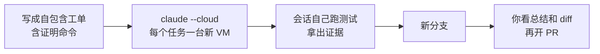

# 把任务交给另一台机器上的 Claude：Claude Code 云端会话实战

<div class="meta-tags"><span class="tool-tag tool-claude">Claude Code</span></div>

<div class="hook">

**一句话看懂**：本地 Claude Code 离不开你的笔记本：共用工作目录、用你的凭据、电脑一睡就停。**云端会话给每个任务一台新虚拟机**，仓库克隆到新分支，做完留下一个可以开 PR 的分支。作者在 16 秒内起了三个会话修三个问题，87 秒全部完成。但隔离也有代价：会话彼此看不见，你的个人配置也带不过去。所以想用好它，有两个前提：每个任务写清“用哪条命令证明做完了”，配置写进仓库。

</div>

## 读完你能带走的 7 条收获

1. **云端会话的价值来自“一个任务一台机器”**：互不抢文件、不抢端口，可以真正并行（见 3.1）。
2. **隔离的另一面是互相看不见。** 按文件边界拆任务、按顺序合并，并且要预料到一个会话会报告另一个会话正在修的问题（见 3.1、3.7）。
3. **每个任务写成自包含工单**：哪里错、什么算完成、用哪条命令证明。云端 CPU 不是你的，可以放心要求“连跑 30 次”（见 3.4）。
4. **GitHub token 不进 VM**，会话只拿到一个只能推自己分支的短期凭据；跑不可信代码时，这比本地安全得多（见 3.2、3.4）。
5. **需要本机才有的东西就留在本地**：真实数据、VPN、GPU、硬件、几秒一次的视觉调试（见 3.3）。
6. **连不上 GitHub，多半是没装 GitHub App**：登录只说明“你是谁”，App 才决定“能看哪些私有仓库”（见 3.5）。
7. **`~/.claude` 不会跟去云端**：测试命令写进 CLAUDE.md，依赖安装写成 SessionStart hook，这样本地和云端行为一致（见 3.6）。

::: tip 小白先懂这几个词
- [Cloud Session（云端会话）](/glossary#cloud-session)：Claude Code 在一台独立虚拟机上运行的会话。
- [Background Agent（后台代理）](/glossary#background-agent)：你不用盯着、在后台把活干完的代理。
- [Teleport（会话拉回本地）](/glossary#teleport)：把云端会话的分支和对话拉到本地终端继续。
- [Routines（例程）](/glossary#routines)：按定时、HTTP 调用或 GitHub 事件触发的云端会话。
- [Flaky Test（不稳定测试）](/glossary#flaky-test)：时过时不过的测试。
- [Hooks（钩子）](/glossary#hooks)：在固定时机自动执行的脚本，这里用 SessionStart 装依赖。
:::

## 1. 基本信息

<SourceCard type="文章" title="Claude Code in the cloud: a field guide to cloud sessions" author="Addy Osmani" date="2026-10-06" url="https://claude.dev/blog/claude-code-in-the-cloud/" />

| 项目 | 内容 |
|---|---|
| 链接 | https://claude.dev/blog/claude-code-in-the-cloud/ |
| 类型 | claude.dev 博客（文章） |
| 作者 | Addy Osmani（页面元数据） |
| 发布日期 | 2026-10-06 |
| 使用工具 | Claude Code 云端会话（`claude --cloud`、`--teleport`、routines、Auto-fix、projects）、Claude GitHub App |
| 分析依据 | 原文全文，2026-10-14 用 curl 重新抓取并逐字核对引语。文中的图和录屏未读取，只用了图注文字。作者说明示例仓库 tidepool 和截图里的用户是虚构的，会话、输出和数字来自真实运行。作者发在 Anthropic 的 claude.dev 博客上，套餐、价格等属于产品介绍。“我觉得”开头的段落是本站评论，不是作者观点。 |

## 2. 这篇在回答什么

假设你手上有三个互不相关的小问题：一个时过时不过的测试、一份过时的 API 文档、一个要改成结构化输出的日志模块。

在笔记本上，你大概会一个一个来。想同时开三个 Claude，就得建三个 worktree，再给每个分配端口，免得它们互相踩。作者的说法是，本地会话在三件事上依赖你的电脑：

::: tr 它共用你的工作树，所以同一个仓库上的两个会话可能改同一批文件、抢同一个端口。它用你的凭据运行。电脑睡眠或 Wi-Fi 断掉，它就停了。
> "It shares your working tree, so two sessions on one repository can edit the same files and fight over the same port. It runs with your credentials. It stops when your computer sleeps or the Wi-Fi drops."
:::

云端会话把这三件事都换掉了。这篇文章就是一份使用手册，回答五个问题：

1. 同时开几个云端会话，实际会发生什么？（3.1）
2. 云端会话里面是什么样的，哪些东西变了？（3.2）
3. 什么时候该留在本地？（3.3）
4. 哪些工作最适合交给云端？（3.4）
5. 怎样让它顺利连上 GitHub，并且能自己验证结果？（3.5、3.6）

最后是一组好习惯和常见问答（3.7）。



## 3. 怎么做

### 3.1 三个会话同时跑：隔离的好处和代价

示例仓库 tidepool 是一个小的 Node API，给三个虚构港口预测潮汐。它有三个常见问题，作者在 16 秒内起了三个会话，一个问题一个：

```bash
claude --cloud "npm test fails maybe one run in four. Find the flaky test, fix the root cause in the code (not the test), and prove it by running the suite at least 30 times in a row."
claude --cloud "docs/API.md is out of date with src/server.js. Rewrite it so every endpoint, parameter, default and response shape matches the code. Start the server and run each curl example to check it."
claude --cloud "Make src/logger.js emit one JSON object per line, keep LOG_LEVEL, and log method, path, status and duration_ms as fields. Add a test for the logger."
```

三个会话分别跑了 61、65、72 秒，第一个启动后 87 秒全部完成。要注意，因为 tidepool 不在 GitHub 上，每个会话先要从提示词里重建仓库，这一步占了每次运行的三分之一到一半多。

结果：

- **不稳定的测试**：Claude 在 `TtlCache.get` 里找到一个竞态。缓存要等加载完成才存值，所以加载期间同一个 key 的第二次 `get` 会再调一次加载函数。它改成存“进行中的 promise”，加载失败时删掉条目，然后连跑 40 次 `npm test`，零失败。
- **文档**：Claude 起了服务器，对每个接口跑 curl，找出旧文档 5 处错误：列了接口从不返回的字段、写了代码不读的 `days` 参数、把米写成英尺、漏了 `/next-high`、没写错误响应。它还发现 `from=` 格式错误时会返回 200 和空列表，但只把这一点**记成注意事项**，没有去改它没被要求碰的服务器代码。
- **日志**：Claude 写了 JSON 日志，加了 5 个测试。提交时有一个测试失败。它把缓存测试重跑 8 次，失败 5 次，追到和第一个会话正在修的同一个竞态。它提出了同样的修法，但**没碰缓存**，因为那不在它的任务范围里，并在总结里说明测试套件不干净。

第三个会话正好说明了隔离的两面。好的一面：文档会话和日志会话都起了 API 服务器，互不影响；本地一个检出里的两个代理就会抢文件、抢端口。代价是：日志会话看不到第一个会话的修复。作者的建议是：

::: tr 按文件边界拆分并行任务，按合理的顺序合并分支，并且要预料到某个会话会报告另一个会话正在修的问题。
> "Split parallel tasks along file boundaries, merge the branches in a sensible order, and expect a session to report problems that another session is already fixing."
:::

我觉得这一段比 87 秒这个数字更有价值。三个会话都守住了边界：文档会话没去改服务器，日志会话没去修缓存，而且都把发现写进了总结。这正是你希望后台代理做到的：**不越界，但不隐瞒**。

### 3.2 云端会话里面是什么样

一个云端会话就是跑在 Anthropic 托管机器上的 Claude Code 会话，也可以跑在组织自己的机器上（self-hosted 环境）。作者说，真正改变用法的是四件事：

1. **每个任务一台机器。** 新 VM，仓库克隆到新分支，会话之间碰不到彼此的文件和端口。
2. **你的 GitHub token 不进 VM。** 原文：<Trans zh="由一个代理持有它，会话拿到的是一个短期凭据，只能推送到它自己的工作分支。">“A proxy holds it, and the session gets a short-lived credential that can push only to its own working branch.”</Trans>
3. **仓库里的 Claude 配置会带过去，个人配置不会。** CLAUDE.md、rules、skills、agents、commands 随仓库走，`~/.claude` 留在你的笔记本上。
4. **空闲的 VM 会被回收。** 重新打开会话，你会拿到一台新 VM 和恢复的对话，所以在意的工作要提交。

第 2 条和第 3 条决定了后面大部分做法：安全上，云端比本地更好控制；配置上，你得把团队需要的东西放进仓库。

### 3.3 什么时候留在本地

作者明确说，云端会话不是替代品，多数人两种都用。差别可以压成一张表：

| | 本地会话 | 云端会话 |
|---|---|---|
| 运行在 | 你的电脑 | 每个任务一台新 VM |
| 电脑睡眠或离线 | 会话停止 | 继续跑 |
| 一个仓库上多个任务 | 要分 worktree、分端口、小心照看 | 每个任务一台 VM、一个分支 |
| 代理能碰到什么 | 你的账号能碰的一切，包括 SSH key、云 CLI、`~/.claude` | 仓库、你设的网络级别、你开的连接器、会话级 GitHub 凭据 |
| 审批模式 | 任意，包括逐条命令批准 | Auto、Accept edits 或 Plan |
| 结束时 | 改动在你的工作树里 | 一个分支，需要时再开 PR |

**留在本地的情况**：任务需要只有你的机器才有的东西，比如有真实本地数据的数据库、要走 VPN 的服务、GPU、手机模拟器、桌上的硬件；需要几秒看一次效果的视觉调试；组织开了 Zero Data Retention（这会直接关掉云端会话）。

还有两个折中选项。**Remote control**：会话留在你的机器上，你用手机或浏览器遥控它。**Self-hosted 环境**（Team 和 Enterprise 的 beta）：云端会话跑在组织自己的基础设施上，可以访问内网。

### 3.4 七种适合云端的用法

这七种用法，都是把上表里的三个差别用起来：每个任务一台机器、你不在时继续跑、最后交回一个分支。

**1. 并行清掉一堆小任务。** 五个互不相关的小修复，起五个会话，审五个分支。注意 `claude --cloud` 克隆的是你 GitHub 远端的当前分支，所以**先 push**。关键在于提示词怎么写：

::: tr 每个任务写成一张自包含的工单：说清哪里错了、什么样算完成、怎么证明。
> "Write each task as a self-contained ticket that states what's wrong, what done looks like, and how to prove it."
:::

如果这些任务属于同一个大目标，可以用 project（Pro 和 Max 公测），由一个协调对话替你启动、跟踪这些会话，并按“进行中、等你、可审查”分组。

**2. 让它把修复证明出来。** 云端 VM 没有算力费用，CPU 也不是你的，所以可以要求很重的证明：测试跑 200 次、在 50 个提交里二分查找回归、跑慢的集成测试，或者像文档会话那样起服务再 curl。一个注意点：前台命令默认 2 分钟超时（最多 10 分钟），之后转后台最多再跑 30 分钟；可以用环境变量 `BASH_DEFAULT_TIMEOUT_MS` 和 `BASH_MAX_TIMEOUT_MS` 调高。

**3. 在本地定计划，在云端施工，回终端收尾。** 大改动先在来回成本低的地方把方案谈好：

```bash
claude --permission-mode plan
# ...agree on the plan, save it to docs/migration-plan.md, commit and push...
claude --cloud "Execute the migration plan in docs/migration-plan.md"
```

云端在施工时，你的终端可以干别的。完成后用 `claude --teleport`（或会话内 `/teleport`、`/tp`）把会话拉回来：它检查仓库是否一致，拉取并切到会话分支，把整段对话载入终端。前提是本地工作树干净（它会提议 stash），分支已经推送。

**4. 用手机提问。** 手机适合那种“等你坐到键盘前就忘了”的问题。作者用第四个会话问：tidepool 怎么预测潮汐，时间窗口边缘会怎么出错？Claude 跑代码验证自己的回答，找到一个真 bug：循环从不检查第一个和最后一个采样点，所以正好落在窗口起点的高潮会漏掉。

**5. 把 CI 失败和 review 意见交给 Claude。** 装了 Claude GitHub App 后，会话可以盯着一个 PR：在 claude.ai/code 的 CI 栏打开 Auto-fix，或在终端对 PR 分支运行 `/autofix-pr`。Claude 会推送明确的修复，模糊或涉及架构的地方会来问你。几个边界：它在 review 线程里的回复**以你的 GitHub 用户名发出**（标注为 Claude Code）；它不会收到和基础分支冲突的通知，要你让它 rebase；它的评论还可能触发 Atlantis 这类靠评论驱动的自动化。

**6. 不用你亲自启动。** routine（研究预览）是一组保存好的资源：提示词、仓库、连接器、环境。每次运行就是一个云端会话，由定时（最频繁每小时一次）、HTTP 调用或 GitHub 事件触发。routine 运行时没有审批提示，默认推到 `claude/` 前缀的分支。还可以从任何已登录的机器（包括 CI job）往运行中的会话里排一条后续消息：

```bash
claude -p "The integration tier is green now; rebase on main and push" --cloud <session-id>
```

**7. 跑你不完全信任的代码。** 贡献者的 PR、新依赖的安装脚本、五分钟前刚克隆的仓库，都可能执行你没读过的代码。在笔记本上，它就挨着你的 SSH key、云 CLI 会话和浏览器配置；在云端会话里，它在一台用完即弃的 VM 里，没有这些东西。网络可以设成 None（最严格），或保留 Trusted（允许包仓库、GitHub 和主要云 SDK 的域名）。但有一个边界要知道：

::: tr 即使设为 None，Claude Code 仍然会向 Anthropic API 发请求，所以数据可以经由这条路离开 VM，会话也仍然可以推送到自己的分支。
> "Even at None, Claude Code still sends requests to the Anthropic API, so data can leave the VM that way, and the session can still push to its own branch."
:::

所有出站流量都经过一个记录主机名的代理。

### 3.5 连接 GitHub：两种权限别搞混

作者说，第一次云端会话出问题，最可能的原因是 GitHub。大部分问题来自它需要**两种不同的权限**：

- **用 GitHub 登录**：告诉 Claude 你是谁。
- **安装 Claude GitHub App**：决定 Claude 在某个账号或组织下能看到哪些私有仓库。

公开仓库只要第一个；私有仓库还需要在**拥有它的那个账号或组织**上装 App。连了 GitHub 却找不到某个私有仓库，通常就是 App 没装在对的地方。另外，Auto-fix、GitHub 事件触发的 routine 和 project 都依赖 App。

连接方式有三种：

- **A. 浏览器（推荐）**：在 claude.ai/connect-github 连接账号，再把 App 装到仓库所在的账号或组织上；组织通常要 owner 批准。
- **B. 终端 `/web-setup`**：已经在用 gh CLI 的话，把 gh token 发给 Claude 账号，会话就能访问这个 token 能访问的仓库。Team 和 Enterprise 要 owner 先开 Quick setup。
- **C. 跳过 GitHub**：在没有 GitHub 远端的仓库里运行 `claude --cloud`，会上传一个仓库 bundle 而不是克隆。只有 GitHub 连接对该仓库有推送权限时，会话才能推回去。

常见故障：组织的仓库在连接后立刻消失，多半是组织用了 SAML 单点登录，而你跳过了 GitHub 的 “Single sign-on to your organizations” 那一步，要回去点 Authorize；每个会话都报认证错误，通常是 Claude 组织开了 IP 白名单，要请支持团队豁免 Anthropic 托管服务。

### 3.6 给会话自己验证的能力

这是我觉得全文最重要的一节。作者说得很直接：

::: tr 能跑你的测试的会话，会在交回工作之前先检查自己的工作。没有这个能力，你审的就是没人跑过的改动。
> "A session that can run your tests checks its own work before it hands the work back. Without that, you review changes nobody has run."
:::

本文所有演示的价值，几乎都来自 Claude 真的去跑了：测试连跑 40 次、起服务器 curl、在窗口边缘算潮汐。作者认为花十分钟设置环境就够了：

- **先用 Default 环境**：Trusted 网络、无变量、无初始化脚本，对多数 JavaScript、Python、Go、Rust 仓库就够了。
- **机器层面用初始化脚本**：以 root 在 Claude Code 启动前运行，可以 `apt install`；必须退出码 0，否则会话起不来；最好约五分钟内跑完，环境才能被缓存成快照。改脚本、改允许的主机，或大约每七天，缓存会重建。
- **项目层面用 SessionStart hook**：`npm install` 这类步骤放进仓库 `.claude/settings.json` 的 hook，本地和云端行为一致；只想在云端跑的步骤，检查 `CLAUDE_CODE_REMOTE`。
- **服务每个会话自己启动**：缓存只存文件，进程不会保留，所以让 Claude 跑 `service postgresql start`，或写进 SessionStart hook。
- **选最窄的网络级别**：Trusted 覆盖常见包仓库；私有仓库用 Custom；只有真的需要开放互联网才用 Full。
- **密钥别放共享变量**：环境变量对使用这个环境的所有人可见。Pro 和 Max 的环境可以配 API credentials，在 VM 外部给指定主机的请求附上密钥。
- **命令写进 CLAUDE.md**：个人 `~/.claude` 到不了云端 VM。Claude 要知道怎么跑集成测试，仓库里就得写清楚。

### 3.7 好习惯和常见问答

作者列的习惯，大多是前面几节的推论：

- **一个任务一个会话**：小而分开的会话好审，也好扔。
- **要证据**：写明证明完成的命令，**先读 Claude 的总结，再看 diff**。
- **`claude --cloud` 之前先 push**：VM 从 GitHub 克隆，没推的提交到不了。
- **长任务边做边提交**：空闲 VM 会被回收。
- **工作中可以插话**：Claude 干活时你发的消息会排队，排着的消息还能撤回。
- **共享会话**：Team 和 Enterprise 可以把会话设为团队可见，云端会话的提交带一个 `Claude-Session` trailer，链接回对话记录，审查者能看到改动是怎么来的。
- **注意额度**：并行会话是并行消耗额度的，五个会话大约以一个会话五倍的速度用掉额度；project 每天最多新开 200 个线程。

文末的问答里，有几条边界条件值得记下：

- **谁能用**：Pro、Max、Team，以及有相应席位的 Enterprise 用户，用 claude.ai 账号登录。**Console API key 和第三方模型提供方不能用。**
- **大仓库撑得住吗**：VM 约 4 vCPU、16 GB 内存、30 GB 磁盘；重的安装放进初始化脚本，只跑一次并进快照。
- **GitLab、Bitbucket**：`claude --cloud` 可以从任意 git 仓库上传 bundle，但**推不回去**。GitHub Enterprise Server 在 Team 和 Enterprise 上支持。
- **并行分支冲突怎么办**：会话彼此不知道。先合一个分支，再给下一个会话发后续消息，例如 `claude -p "rebase on main and fix any conflicts" --cloud <session-id>`。
- **本地工具会丢吗**：用户级配置不随行。团队需要的东西要放进仓库：skills 和 commands 提交到 `.claude/`，项目级 MCP server 写进 `.mcp.json`，测试命令写进 CLAUDE.md。
- **数据和训练**：会话记录由 Anthropic 保存，保存多久取决于套餐和模型改进设置；Team、Enterprise 和 API 默认不用你的代码训练，Free、Pro、Max 取决于你的设置。

## 4. 结果与局限

文中能核对的结果，全部来自一个虚构的小仓库上的四个真实会话：

| 会话 | 结果 |
|---|---|
| 修不稳定测试 | 找到 `TtlCache.get` 竞态，修复后连跑 40 次零失败 |
| 更新 API 文档 | 起服务逐个 curl，找出 5 处错误，另记一条行为注意事项 |
| 结构化日志 | 加 5 个测试；发现同一竞态但未越界修改，在总结里说明 |
| 手机提问 | 跑代码验证，找到窗口边界漏判高潮的 bug，没改文件 |

三个并行会话 87 秒全部完成。

::: warning 局限与注意
- **样本很小**：tidepool 是几个文件的示例仓库，而且每次运行有三分之一到一半多的时间花在重建仓库上。87 秒不能直接推到真实大仓库。
- **作者立场**：文章发在 Anthropic 的 claude.dev 博客上，“不额外收费”“共用套餐额度”等是产品介绍，以官方定价页为准；不少功能还是 beta 或研究预览（project、routine、self-hosted）。
- **隔离不等于没有风险**：网络设为 None 时，数据仍可能经 Anthropic API 离开 VM；Auto-fix 的回复以你的 GitHub 身份发出；routine 运行没有审批提示。
- **会话彼此看不见**：同一文件或互相依赖的任务不适合并行，冲突要你安排顺序、让会话 rebase。
- **额度并行消耗**：五个会话大约是一个会话五倍的速度。
:::

## 5. 结论

云端会话真正卖的不是“云”，而是**一个任务一台独立的机器**。它带来了三样本地给不了的东西：真正并行、你不在也继续跑、不可信代码不挨着你的密钥。

但独立的机器也意味着两个新前提。第一，**会话要能自己证明做完了**：提示词里写明证明命令，环境里能跑测试，否则你审的就是没人跑过的代码。第二，**配置要写进仓库**：`~/.claude` 带不过去，测试命令、依赖安装、skills 和 MCP 都得进仓库。

我觉得可以这样入手：挑一个“有明确证明方式”的小任务（比如修一个不稳定测试），写成自包含工单交给云端，回来先读总结、再看 diff。跑顺了，再加并行和 routine。

### 你可以这样试

- [ ] 从 backlog 里挑一个能用命令证明完成的小任务，写成“哪里错 / 什么算完成 / 怎么证明”的提示词，`git push` 后运行 `claude --cloud "..."`。
- [ ] 检查你的 CLAUDE.md 有没有写清“怎么跑测试”；没有就补上。
- [ ] 把 `npm install` 之类的准备步骤写成仓库里的 SessionStart hook，本地和云端都用它。
- [ ] 下一次要跑陌生 PR 或陌生仓库的代码时，放进网络设为 None 的云端会话里跑。

::: details 读完自测（点开看答案）
1. **为什么日志会话没有修好缓存竞态？** 它看不到第一个会话的修复，而缓存不在它的任务范围内；它只在总结里报告了问题。
2. **连了 GitHub 却找不到私有仓库，最常见原因是什么？** Claude GitHub App 没装在拥有该仓库的账号或组织上。
3. **网络设为 None，数据就一定出不去了吗？** 不是，Claude Code 仍会请求 Anthropic API，会话也仍能推到自己的分支。
4. **你的个人 `~/.claude` 配置在云端可用吗？** 不可用，要放进仓库的 `.claude/`、`.mcp.json` 和 CLAUDE.md。
:::
