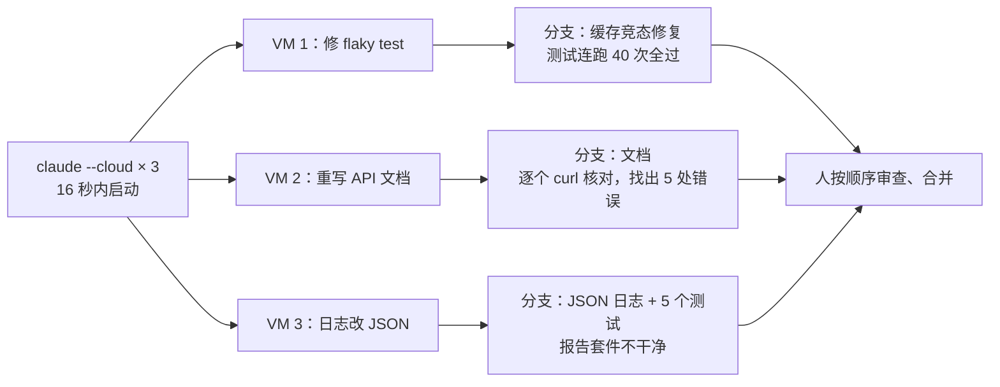

# Claude Code 云端会话实战：一个任务一台机器，七种适合的用法

Claude Code

**一句话看懂**：本地 Claude Code 依赖你的笔记本：共用工作目录、用你的凭据、电脑睡眠就停。**云端会话给每个任务一台新虚拟机**：仓库克隆到新分支、环境已装好，做完留下一个可以开 PR 的分支。作者用 `claude --cloud` 在 16 秒内起了三个会话修三个问题，87 秒全部完成。文章讲了什么时候留在本地、七种适合云端的用法、GitHub 连接怎么一次成功，以及让会话能自己验证的环境设置。

::: info 为什么值得看
“自动化”阶段已经有云端代理的基础设施经验（[[40]]）和定时代理的规则（[[41]]），这篇是使用者视角的**操作手册**：命令、限制、权限、排错表都写得很具体。所有演示来自作者真实跑过的四个云端会话，数字可以对照。
:::

::: tip 小白先懂这几个词
- [Cloud Session（云端会话）](/glossary#cloud-session)：Claude Code 在一台独立虚拟机上运行的会话。
- [Background Agent（后台代理）](/glossary#background-agent)：你不用盯着、在后台把活干完的代理。
- [Teleport（会话拉回本地）](/glossary#teleport)：把云端会话的分支和对话拉到本地终端继续。
- [Routines（例程）](/glossary#routines)：按定时、HTTP 调用或 GitHub 事件触发的云端会话。
- [Flaky Test（不稳定测试）](/glossary#flaky-test)：时过时不过的测试。
- [Hooks（钩子）](/glossary#hooks)：在固定时机自动执行的脚本，这里用 SessionStart 装依赖。
:::

## 1. 基本信息

<SourceCard type="文章" title="Claude Code in the cloud: a field guide to cloud sessions" author="Addy Osmani" date="2026-10-06" url="https://claude.dev/blog/claude-code-in-the-cloud/" />

| 项目 | 内容 |
|---|---|
| 链接 | https://claude.dev/blog/claude-code-in-the-cloud/ |
| 类型 | claude.dev 博客（文章） |
| 作者 | Addy Osmani（页面元数据） |
| 发布日期 | 2026-10-06 |
| 使用工具 | Claude Code 云端会话（`claude --cloud`、`--teleport`、routines、Auto-fix、projects）、Claude GitHub App |
| 分析依据 | 原文全文，2026-10-14 用 curl 抓取。文中的图和录屏未读取，只用了图注文字。作者说明示例仓库 tidepool 和截图里的用户是虚构的，会话、输出和数字来自真实运行。 |

## 2. 做了什么

::: tr 云端会话让 Claude Code 在一台属于它自己的机器上运行。每个任务得到一台新虚拟机，你的仓库被克隆到一个新分支，环境的初始化已经做好。
> "A cloud session runs Claude Code on a machine of its own. Each task gets a fresh virtual machine with your repository cloned onto a new branch and your environment's setup already done."
:::

示例仓库 tidepool 是一个小 Node API，有三个普通问题：一个测试大约四次挂一次、API 文档和代码对不上、日志用字符串拼接。作者在 16 秒内起了三个云端会话：

会话分别跑了 61、65、72 秒，87 秒全部完成（其中三分之一到一半多的时间花在重建示例仓库上，真实仓库直接克隆即可）。

## 3. 怎么做的

### 3.1 三个会话的结果，和隔离带来的副作用

- **flaky test**：Claude 找到 `TtlCache.get` 的竞态：加载完成前第二次 get 同一个 key 会再调一次 loader。改成缓存进行中的 promise、加载失败时删除条目，然后连跑 `npm test` 40 次零失败。
- **文档**：启动服务器，对每个端点跑 curl，找出旧文档五处错误；还发现格式错误的 `from=` 返回空列表加 200，把它写成注意事项，而**没有改它没被要求碰的服务器代码**。
- **日志**：写好 JSON 日志和五个测试，但提交时有一个测试失败。它重跑缓存测试 8 次、失败 5 次，追到和第一个会话正在修的同一个竞态，提出同样的修法，但因为不在任务范围内没有动，并在总结里说明套件不干净。

隔离的另一面是会话互相看不见：

::: tr 按文件边界拆分并行任务，按合理的顺序合并分支，并且预期一个会话会报告另一个会话正在修的问题。
> "Split parallel tasks along file boundaries, merge the branches in a sensible order, and expect a session to report problems that another session is already fixing."
:::

### 3.2 云端会话的四个关键事实

- **每个任务一台机器**：新 VM、新分支，会话之间文件和端口互不影响。
- **GitHub token 不进 VM**：代理服务器持有 token，会话只拿到只能推送到自己工作分支的短期凭据。
- **仓库的 Claude 配置会带上，个人的不会**：CLAUDE.md、rules、skills、agents、commands 随仓库走；`~/.claude` 留在你的笔记本上。
- **空闲 VM 会被回收**：重新打开会话会得到新 VM 和恢复的对话，所以重要的工作要提交。

### 3.3 什么时候留在本地

任务需要只有你的机器才有的东西时留在本地：带真实数据的本地数据库、要走 VPN 的服务、GPU、手机模拟器、桌上的硬件；想在自己浏览器里几秒内看每次改动的视觉迭代；以及组织开启了 Zero Data Retention（会关掉云端会话）。介于两者之间的有 Remote control（会话留在本机、手机遥控）和 self-hosted environments（Team / Enterprise beta，在组织自己的基础设施上跑云端会话）。

| | 本地会话 | 云端会话 |
|---|---|---|
| 运行在 | 你的机器 | 每个任务一台新 VM |
| 笔记本睡眠或断网 | 会话停止 | 继续运行 |
| 代理能碰到什么 | 你账户能碰到的一切（SSH key、云 CLI、`~/.claude`） | 仓库、你设定的网络级别、启用的连接器、会话级 GitHub 凭据 |
| 审批模式 | 任意，包括逐条命令 | Auto、Accept edits 或 Plan |
| 结束时 | 工作目录里的改动 | 一个分支，需要时开 PR |

（表格据原文对照表节选翻译。）

### 3.4 七种适合云端的用法

1. **并行清待办**：五个互不相关的小修复起五个会话。`claude --cloud` 克隆的是 GitHub 远端的当前分支，所以要先 push。每个任务写成自包含的工单：哪里错、什么算完成、怎么证明。
2. **让它证明修好了**：VM 没有单独计算费用、CPU 也不是你的，所以可以要求跑 200 次测试、在 50 个提交里二分、跑慢的集成测试。前台命令默认 2 分钟超时（最多 10 分钟），之后转后台最多再跑 30 分钟，可用 `BASH_DEFAULT_TIMEOUT_MS`、`BASH_MAX_TIMEOUT_MS` 调整。
3. **桌前规划、云端实现、终端收尾**：本地 `claude --permission-mode plan` 定计划、提交并推送，再 `claude --cloud "Execute the migration plan in docs/migration-plan.md"`；做完用 `claude --teleport` 把分支和整段对话拉回终端（需要干净的工作目录）。
4. **手机上查看**：Claude 应用的 Code 标签连着同一批会话。作者从手机问了一个问题，会话跑代码核对后发现了一个真实 bug：循环从不检查第一个和最后一个样本。
5. **把 CI 失败和审查意见交给 Claude**：装了 Claude GitHub App 后打开 Auto-fix，或在 PR 分支上跑 `/autofix-pr`。明确的问题它直接推修复，模糊或架构性的问题会问你；它不会收到和主干的合并冲突通知，要你让它 rebase。
6. **不用自己动手就开工**：routine（研究预览）由定时（最频繁每小时一次）、HTTP 调用或 GitHub 事件触发，运行时没有审批提示，默认推送到 `claude/` 前缀的分支。还能从 CI 里往运行中的会话追加消息：`claude -p "…" --cloud <session-id>`。
7. **运行你不完全信任的代码**：外部贡献者的 PR、新依赖的安装脚本在一次性 VM 里跑，碰不到你的 SSH key 和浏览器配置。网络可设为 None；但即使是 None，Claude Code 仍会请求 Anthropic API，会话也仍能推送到自己的分支。

### 3.5 GitHub 连接：两种权限别搞混

::: tr 用 GitHub 登录告诉 Claude 你是谁。在账户或组织上安装 Claude GitHub App，决定 Claude 能看到那里的哪些私有仓库。
> "Signing in with GitHub tells Claude who you are. Installing the Claude GitHub App on an account or organization sets which private repositories Claude can see there."
:::

公开仓库只要第一个；私有仓库要在**拥有它的那个账户或组织**上装 App。Auto-fix、GitHub 触发的 routine 和 projects 也依赖 App。另外两条路：在 Claude Code 里跑 `/web-setup` 把 gh token 发到 Claude 账户；或者在没有 GitHub 远端的仓库里直接 `claude --cloud`，上传仓库打包（能否推回取决于权限）。原文还有一张“现象 → 原因 → 修法”的排错表（私有仓库不在列表里、SAML 单点登录被跳过、IP 白名单等）。

### 3.6 给会话自己验证的能力

::: tr 能跑你测试的会话，会在交回工作之前检查自己的工作。没有这一点，你审查的就是没人跑过的改动。
> "A session that can run your tests checks its own work before it hands the work back. Without that, you review changes nobody has run."
:::

- 先用 Default 环境（Trusted 网络、无变量、无初始化脚本）。
- **初始化脚本**以 root 在 Claude Code 启动前运行，必须 exit 0，最好约 5 分钟内跑完以便缓存成快照；脚本或允许的主机改动时、以及大约每 7 天重建一次。
- **项目依赖放 SessionStart hook**（仓库的 `.claude/settings.json`），本地和云端同样执行；只在云端跑的步骤检查 `CLAUDE_CODE_REMOTE`。
- 缓存只存文件，服务要每个会话重新启动。
- 网络级别选能用的最窄一档。
- 环境变量对所有使用该环境的人可见，别放密钥；Pro 和 Max 可以用在 VM 外为指定主机附加 key 的 API 凭据。
- 测试命令写进 CLAUDE.md，因为个人 `~/.claude` 到不了 VM。

## 4. 结果如何

| 项目 | 原文数据 |
|---|---|
| 三个并行会话 | 61、65、72 秒；87 秒全部完成 |
| flaky test 证明 | 测试套件连跑 40 次零失败（要求至少 30 次） |
| 文档会话 | 找出旧文档 5 处错误 |
| VM 规格 | 约 4 vCPU、16 GB 内存、30 GB 磁盘 |
| 计费 | Pro / Max / Team / Enterprise 计划内无额外计算费用，共用 Claude Code 用量额度；五个并行会话消耗额度约五倍速 |

::: warning 局限与注意
- 作者是 Anthropic 一方，文章同时是产品指南，带推广；没有失败率、成本或和本地会话的质量对比。
- 演示仓库很小、虚构，三个任务都是几十秒级的小修复，大仓库和长任务的表现原文没给。
- routines、projects 仍是研究预览或 beta，功能和限制可能变化。
- 只支持推回 GitHub（GitHub Enterprise Server 限 Team / Enterprise）；GitLab、Bitbucket 只能上传打包、不能推回。
:::

## 5. 可借鉴之处

1. **一个任务一个会话**：小而独立的会话好审查，也便宜丢弃。
2. **在 prompt 里写明证明方法**：比如“连跑至少 30 次”，会话就会照做。
3. **并行任务按文件边界拆**：会话彼此看不见，合并顺序要自己安排。
4. **云端会话推之前先 push**：VM 从 GitHub 克隆，本地未推送的提交到不了。
5. **团队需要的配置放进仓库**：个人 `~/.claude` 不会跟去云端。
6. **凭据留在环境外**：token 由代理持有、会话只拿到分支级短期凭据（和 [[45§3.3]] 同一思路）。

### 你可以这样试

- [ ] 从待办里挑一个小 bug，写成“哪里错 / 什么算完成 / 用哪条命令证明”的三段式 prompt，交给一个云端会话。
- [ ] 把项目的依赖安装放进 SessionStart hook，让本地和云端都能直接跑测试。
- [ ] 检查 CLAUDE.md 里有没有写测试命令；没有就补上。
